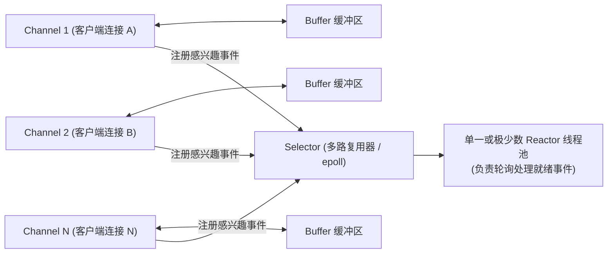

# Java I/O 演进：从传统 BIO 到 NIO 三大核心组件

在网络编程和高并发服务器架构中，I/O 模型的演进是软件工程突破高并发性能瓶颈的史诗篇章。从早期 Tomcat 的传统 BIO（Blocking I/O）模型，到现代 Netty、Kafka 标配的高性能 NIO（Non-blocking I/O），Java I/O 体系经历了脱胎换骨式的演进。

---

## 1. 传统 BIO 阻塞模型的 C10K 瓶颈

在 JDK 1.4 之前，网络通信完全基于 BIO 模型（`Socket` 与 `ServerSocket`）：

```text
传统 BIO 服务端架构 (One Thread Per Connection):
客户端 1 ──▶ [线程 1 专有服务] ──▶ 阻塞在 socket.read() 
客户端 2 ──▶ [线程 2 专有服务] ──▶ 阻塞在 socket.read()
客户端 N ──▶ [线程 N 专有服务] ──▶ ... (线程池迅速耗尽打满)
```

### 为什么 BIO 无法抗住万级高并发（C10K 难题）？
1. **线程与连接强行 1:1 绑定**：每一个连上来的客户端，服务端都必须分配一个独立的操作系统线程为其服务。
2. **读写完全阻塞**：当客户端连接建立后若不发送数据，服务端的线程就必须在 `read()` 调用上无限制阻塞等待。
3. **巨大的系统开销**：
   - 在 64 位 Linux 系统中，一个 Java 线程默认栈内存占用约为 **1MB**。1 万个连接光线程栈就要吃掉整整 **10GB** 内存！
   - 数万线程在 CPU 上频繁进行抢占与上下文切换（Context Switch），CPU 几乎全部浪费在寄存器和调用栈的保存恢复上，有效计算吞吐断崖式下跌。

---

## 2. Java NIO 三大核心组件深度解剖

从 JDK 1.4 起，Java 引入了基于 I/O 多路复用的 **NIO（New I/O / Non-blocking I/O）** 体系。其底层核心由三大组件协同运转：



---

### 2.1 核心组件一：Buffer（缓冲区与状态位指针转换）
在 NIO 中，所有数据的读写都必须经过 **Buffer**，它本质上是一个内存数组包装对象。

#### Buffer 内部四大核心指针变量：
- **`capacity`（容量）**：缓冲区所能容纳的数据最大容量，一旦分配不可修改。
- **`position`（当前读写位置）**：下一个要读取或写入的数据索引。
- **`limit`（读写界限）**：缓冲区中当前可以读/写的上限位置。
- **`mark`（标记）**：记录上一次的位置，可随时通过 `reset()` 回退。

```text
指针在写模式与读模式的切换演进：

1. 初始状态 (空 Buffer，写模式):
   position=0, limit=capacity=10
   [  ][  ][  ][  ][  ][  ][  ][  ][  ][  ]
    ▲                                    ▲
    │                                    │
   pos                                 limit/cap

2. 写入 4 个字节后:
   position=4, limit=capacity=10
   [ A][ B][ C][ D][  ][  ][  ][  ][  ][  ]
                    ▲                    ▲
                    │                    │
                   pos                 limit/cap

3. 执行 flip() 翻转方法 (切入读模式，极度核心!):
   limit = position(4); position = 0;
   [ A][ B][ C][ D][  ][  ][  ][  ][  ][  ]
    ▲               ▲                    ▲
    │               │                    │
   pos            limit                 cap
```

> **核心方法速记**：
> - **`flip()`**：从写模式切换为读模式（`limit = position; position = 0;`）。
> - **`clear()`**：清空缓冲区，恢复为初始写模式状态（`position = 0; limit = capacity;`）。
> - **`compact()`**：把未读完的数据压缩移动到数组开头，释放后续空间供继续写入。

---

### 2.2 核心组件二：Channel（全双工通道）
传统的 Stream（如 `FileInputStream`）是**单向**的，要么只读（Input），要么只写（Output）。
- **Channel 是全双工的**：一个通道既可以读也可以写，支持异步非阻塞数据传输。
- **常见类型**：`FileChannel`（文件）、`SocketChannel`（TCP 客户端）、`ServerSocketChannel`（TCP 服务端监听）、`DatagramChannel`（UDP）。

#### `FileChannel.transferTo()` 操作系统级零拷贝：
在文件传输或网络发送场景中（如 Kafka 发送消息给消费者）：
```java
fileChannel.transferTo(position, count, targetSocketChannel);
```
底层直接调用 Linux 操作系统的 **`sendfile` 系统调用**：数据直接在操作系统内核态缓冲区和网卡缓冲区之间通过 DMA 传输，**完全不经过 JVM 用户态内存，不发生任何 CPU 内存拷贝**，这就是传说中的“零拷贝（Zero-Copy）”技术！

---

### 2.3 核心组件三：Selector（多路复用器）
Selector 是 NIO 能够以“单线程处理上万个并发网络连接”的核心大脑。

1. **注册**：将成千上万个 `SocketChannel` 注册到同一个 `Selector` 实例上，并声明其感兴趣的网络事件：
   - **`SelectionKey.OP_ACCEPT`**：有新的客户端连接接入。
   - **`SelectionKey.OP_CONNECT`**：与远端服务连接成功。
   - **`SelectionKey.OP_READ`**：通道中有新的网络数据可读。
   - **`SelectionKey.OP_WRITE`**：通道当前缓冲区可写。
2. **多路复用轮询（`selector.select()`）**：
   在 Linux 平台上，Selector 底层直接封装调用了著名的 **`epoll` 系统调用（`epoll_create`, `epoll_ctl`, `epoll_wait`）**。
   - 当没有网络事件就绪时，轮询线程进入休眠，不消耗 CPU；
   - 一旦有网卡数据到达触发中断，操作系统只将真正有数据就绪的少数活跃 Channel 通知给 Selector，单线程即可迅速轮询处理，彻底根除了 BIO 的线程膨胀灾难！

---

## 3. 社招高频面试追问

### Q1：直接内存（DirectByteBuffer）相比堆内存（HeapByteBuffer）有什么优劣？它是如何被回收的？
- **优势**：直接内存是在操作系统堆外物理内存中分配的。在进行 Socket 发送时，操作系统可以直接访问直接内存执行 I/O；如果使用堆内内存，JVM 必须先把堆内数据临时拷贝一份到堆外临时区域，再交给操作系统，直接内存**少了一次 CPU 内存拷贝**。
- **劣势**：直接内存的分配与释放开销显著高于 JVM 堆内存。适合生命周期长的大缓冲区（如 Netty 连接池）。
- **回收机制**：`DirectByteBuffer` 内部并不受 JVM 堆垃圾收集器的直接管辖，而是通过一个关联的 **`sun.misc.Cleaner` 对象（虚引用 PhantomReference）**。当 `DirectByteBuffer` 实例在堆中被 GC 回收后，`Cleaner` 会将它加入 ReferenceQueue，并在独立的引用处理线程中调用底层 `Unsafe.freeMemory()` 释放堆外物理内存。
