# 📚 Java 后端与分布式高频硬核考点全解

## 使用入口：先解决问题，再做验证

把已有后端实践整理成递进的面试回答。

**先做基本操作**：先做语言、CRUD、事务与缓存练习，再按集合→并发→运行时→分布式复习，并说明版本前提。初次学习可先完成[本模块基础实践](/doc/Java/Java语言基础与日常开发)。

**再逐步深入**：基本 API 与输入输出 → 常见失败和使用边界 → 场景排查与优化 → 本文机制分析与源码。面试先讲用途和自己的操作过程，再回答场景与原理追问。

> 本篇为 Java 后端、JVM、MySQL、Redis 及分布式系统高频核心考点的系统级归纳全景文档，深入源码底层机制、内存模型、算法原理与生产选型。

---

## 目录导航

- [一、线程安全集合及其底层原理](#一、线程安全集合及其底层原理)
- [二、HashMap 底层架构与版本演进深度剖析](#二、hashmap-底层架构与版本演进深度剖析)
- [三、ConcurrentHashMap 加锁逻辑与演进哲学](#三、concurrenthashmap-加锁逻辑与演进哲学)
- [四、JVM 类加载生命周期与内存空间分布](#四、jvm-类加载生命周期与内存空间分布)
- [五、JVM 垃圾回收机制与核心回收器（CMS & G1）](#五、jvm-垃圾回收机制与核心回收器-cms-g1)
- [六、Java 双亲委派模型机制、意义与打破场景](#六、java-双亲委派模型机制、意义与打破场景)
- [七、分布式事务保证方案与 Seata 深度剖析（AT vs XA）](#七、分布式事务保证方案与-seata-深度剖析-at-vs-xa)
- [八、MySQL 日志体系全景与应用场景](#八、mysql-日志体系全景与应用场景)
- [九、MySQL MVCC 实现原理与应用场景](#九、mysql-mvcc-实现原理与应用场景)
- [十、Redis 核心数据结构与 ZSet 底层跳表运作机制](#十、redis-核心数据结构与-zset-底层跳表运作机制)
- [十一、CAP 定理中 AP 与 CP 的本质区别与架构选型](#十一、cap-定理中-ap-与-cp-的本质区别与架构选型)

---

## 一、线程安全集合及其底层原理

Java 集合框架中的线程安全集合可以划分为四大梯队：

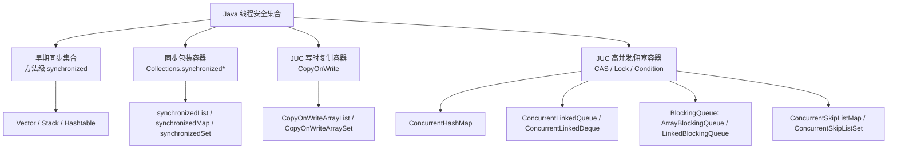

### 1. 核心集合及其安全原理归纳

| 集合类别 | 代表类 | 线程安全实现原理 | 适用场景与优劣势 |
| :--- | :--- | :--- | :--- |
| **早期传统容器** | `Vector`, `Hashtable`, `Stack` | 在方法声明上直接加上 **`synchronized` 关键字**，对整个实例对象（`this`）粗暴加锁。 | **劣势显著**：单锁竞争极其严重，高并发下所有线程串行化，性能极低。现已全面废弃。 |
| **同步包装容器** | `Collections.synchronizedList()`<br/>`Collections.synchronizedMap()` | 采用**装饰器/适配器模式**，内部封装一个 `final Object mutex` 对象监视器，所有方法内包含 `synchronized(mutex)` 代码块。 | 灵活性优于早期容器，但在复合操作（如“若不存在则新增”）及遍历时仍需外部客户端手动加锁同步。 |
| **写时复制容器** | `CopyOnWriteArrayList`<br/>`CopyOnWriteArraySet` | **写时复制（Copy-On-Write）机制**：<br/>1. 内部维护 `private transient volatile Object[] array`。<br/>2. **读操作完全无锁**。<br/>3. **写操作（add/set/remove）加 `ReentrantLock` 互斥锁**，复制一份新副本在副本上修改，修改完毕后通过 volatile 引用赋值原子切换。 | **极致读多写少**：如黑白名单、权限缓存、系统配置广播。缺点是写操作内存开销大、数据存在弱一致性（非实时一致）。 |
| **高并发散列** | `ConcurrentHashMap` | **JDK 7**：Segment 分段锁（`ReentrantLock` 数组）。<br/>**JDK 8+**：**CAS + synchronized 锁桶首节点** + 分散热点计数（CounterCell）。 | 高并发键值对读写首选，兼具高吞吐量与线程安全。 |
| **高并发无锁队列** | `ConcurrentLinkedQueue`<br/>`ConcurrentLinkedDeque` | 基于单向/双向链表，采用 **Michael-Scott 非阻塞算法**。全量使用 **CAS 自旋无锁原子操作**维护头尾节点（Head / Tail）。 | 极高并发场景下的无界异步事件通道，吞吐量极佳，不阻塞线程。 |
| **阻塞队列** | `ArrayBlockingQueue`<br/>`LinkedBlockingQueue`<br/>`PriorityBlockingQueue` | 内部基于独占锁 `ReentrantLock` 搭配两个条件变量 **`Condition notEmpty` 和 `Condition notFull`** 实现等待/通知。 | **生产者-消费者模型**与**线程池任务队列（ThreadPoolExecutor）**的核心支撑底座。 |
| **有序并发跳表** | `ConcurrentSkipListMap`<br/>`ConcurrentSkipListSet` | 基于多层有序跳表（SkipList），通过无锁 CAS 完成节点的链表插入与删除，替代红黑树高并发加锁瓶颈。 | 高并发读写且要求键按自然顺序或 Comparator 排序的场景。 |

---

## 二、HashMap 底层架构与版本演进深度剖析

### 1. 底层数据结构演变：JDK 7 vs JDK 8

* **JDK 1.7**：**数组 + 单向链表**（`Entry<K,V>[] table`）。
* **JDK 1.8+**：**数组 + 单向链表 + 红黑树**（`Node<K,V>[] table` 与 `TreeNode<K,V>`）。

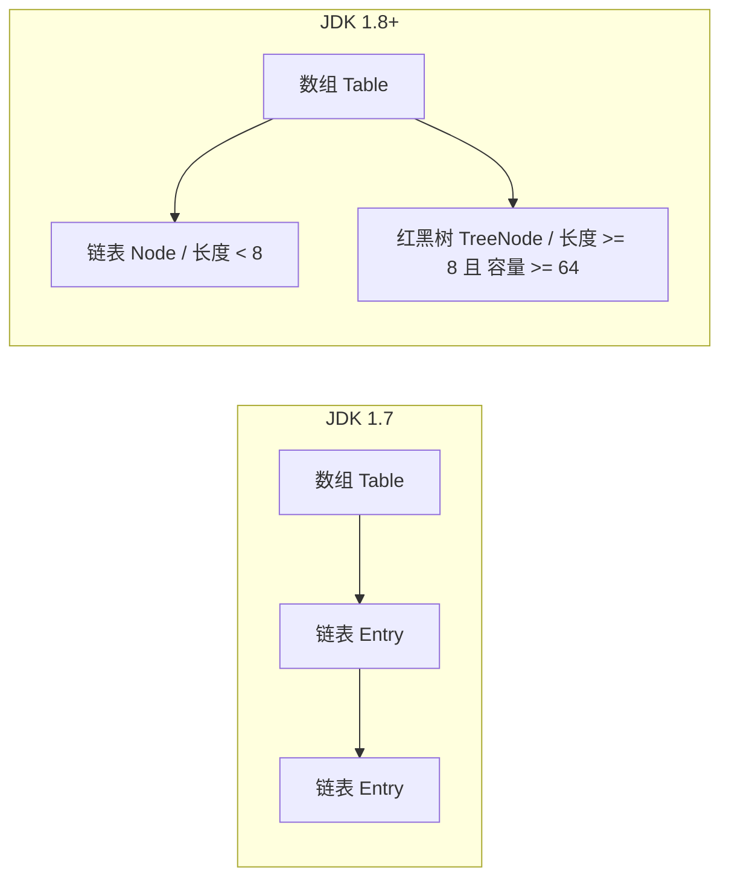

### 2. JDK 7 与 JDK 8 核心差异对比

| 差异维度 | JDK 1.7 | JDK 1.8+ | 演进原因与优势 |
| :--- | :--- | :--- | :--- |
| **底层结构** | 数组 + 链表 | 数组 + 链表 + 红黑树 | 解决链表过长时检索退化为 $O(N)$ 问题，树化后最差为 $O(\log N)$。 |
| **链表插入方式** | **头插法**（Head-Insertion） | **尾插法**（Tail-Insertion） | **头插法在并发扩容时可能产生环形链表**，后续 get 导致 CPU 100% 死循环；尾插法维持原有相对顺序彻底根除了死循环（但并发下仍有数据覆盖风险，不能当作并发容器）。 |
| **Hash 扰动函数** | 4 次位移 + 4 次异或（较复杂） | 1 次无符号右移 16 位 + 1 次异或：`(h = key.hashCode()) ^ (h >>> 16)` | 简化计算，兼顾低位与高位特征打散度，性能更佳。 |
| **扩容计算策略** | 每个元素重新调用 `hash()` 并重新取模计算下标 | 利用 `(e.hash & oldCap) == 0` 分流判定 | 为 0 保持原下标；非 0 则落入 `原下标 + oldCap`，**免除重新 hash 计算**。 |
| **扩容触发时机** | 达到阈值且当前插入的桶不为空才扩容 | 只要元素总数 `size > threshold` 或单个桶长度 $\ge 8$ 且容量 $< 64$ 立即扩容 | 降低碰撞几率，保证容量充足。 |

### 3. 取下标算法：`index = (n - 1) & hash`

#### 为什么要这么做？
1. **执行速度极致**：按位与 `&` 是底层 CPU 硬件级单周期指令，比除法取模 `%` 效率高数十倍。
2. **数学等价性**：**当且仅当容量 $n$ 严格为 2 的幂次方（$n = 2^k$）时**，$hash \pmod n \equiv hash\ \&\ (n - 1)$ 恒成立。
3. **扰动函数（Perturbation Function）的必要性**：
   ```java
   static final int hash(Object key) {
       int h;
       return (key == null) ? 0 : (h = key.hashCode()) ^ (h >>> 16);
   }
   ```
   Java 的 `hashCode()` 返回 32 位整型。通常数组初识大小较小（如 16，二进制为 `0000...00010000`，$n-1 = 15$，二进制 `00001111`）。如果不做扰动，直接进行 `& 15`，**仅有最低 4 位参与运算**，高 28 位的差异完全被忽略，极易发生散列拥堵。通过将高 16 位无符号右移并与自身异或，让高位特征充分混合至低 16 位，大幅减少碰撞。

### 4. 链表与红黑树相互转换的阈值

* **链表 $\rightarrow$ 红黑树（树化）阈值**：
  * **单个桶链表长度 $\ge 8$**；
  * **且数组总容量 $\ge 64$（`MIN_TREEIFY_CAPACITY = 64`）**。
  * *注：若链表长度达到 8 但数组总容量小于 64，优先调用 `resize()` 扩容数组，分散链表，而不是转为红黑树。*
  * **为什么阈值是 8？** 源码注释明确指出依据**泊松分布（Poisson Distribution）**：在理想随机哈希码与负载因子 0.75 条件下，同一个桶内节点数达到 8 的概率仅为 `0.00000006`（不足千万分之一）。8 是时间检索复杂度与红黑树额外内存开销（TreeNode 占用空间是 Node 的约 2 倍）的临界平衡点。
* **红黑树 $\rightarrow$ 链表（退化）阈值**：
  * **`UNTREEIFY_THRESHOLD = 6`**：在 `resize()` 重新分流或删除节点导致树节点数 $\le 6$ 时退化为单向链表。
  * **为什么不是 7？** 如果设为 7，当桶元素在 7 和 8 之间频繁插入/删除时，会导致链表与红黑树频繁相互转换，引起极大的性能抖动（振荡效应）。设置 6 提供了缓冲区间。

---

## 三、ConcurrentHashMap 加锁逻辑与演进哲学

### 1. JDK 7 分段锁实现机制

* **底层结构**：`Segment<K,V>[] segments` + `HashEntry<K,V>[] table`。
* **加锁逻辑**：每个 `Segment` 继承自 `ReentrantLock`。默认并发度 `concurrencyLevel = 16`，内部包含 16 个 Segment。
* **操作流程**：
  * 写入时通过二次 Hash 定位到指定的 `Segment`；
  * 调用 Segment 的 `tryLock()` / 自旋后 `lock()` 获取独占锁；
  * 仅锁定当前 Segment 内部的桶列表，其他 Segment 依然可以并发写入。

### 2. JDK 8+ 架构革命：CAS + synchronized 锁桶首节点

* **底层结构**：`Node<K,V>[] table` + 链表 + 红黑树（与 JDK 8 HashMap 一致）。
* **写入（`putVal`）加锁流程**：
  1. **无锁延迟初始化**：数组初始化采用自旋 CAS 修改 `sizeCtl` 为 -1，保证只有一个线程进行数组初始化。
  2. **桶首为空**：直接使用 **CAS 无锁写入**（`casTabAt`），若 CAS 失败则说明有竞争，自旋重试。
  3. **正在扩容**：若检测到桶首节点的 `hash == MOVED`（-1），当前线程立即主动调用 `helpTransfer()` 协助并发扩容。
  4. **发生冲突**：使用 **`synchronized` 锁定该哈希桶的第一个节点（Head Node）**：
     - 若为单向链表：遍历链表覆盖旧值或尾插新节点。
     - 若为红黑树（`TreeBin`）：调用红黑树的插入逻辑。
  5. **并发计数**：采用类似 `LongAdder` 的 `baseCount` + `CounterCell[]` 数组分段累加，避免全局竞争。

```mermaid
flowchart TD
    Start[putVal操作] --> CheckInit{数组是否已初始化?}
    CheckInit -- 否 --> InitTable[CAS 修改 sizeCtl 初始化数组]
    CheckInit -- 是 --> CalcHash[计算 Hash 定位桶 i]

    CalcHash --> CheckEmpty{table[i] 是否为空?}
    CheckEmpty -- 是 --> CasPut[CAS 设置头节点]
    CasPut -- 成功 --> End[计数并返回]
    CasPut -- 失败 --> Loop[自旋重试]

    CheckEmpty -- 否 --> CheckMoving{hash == MOVED?}
    CheckMoving -- 是 --> HelpTransfer[协助多线程并发扩容]
    CheckMoving -- 否 --> LockHead[synchronized 锁住桶头节点 f]

    LockHead --> IsTree{节点是 TreeBin?}
    IsTree -- 是 --> TreeInsert[红黑树插入更新]
    IsTree -- 否 --> ListInsert[链表遍历覆盖或尾插]
    TreeInsert --> CheckTreeify{链表长度 >= 8?}
    ListInsert --> CheckTreeify
    CheckTreeify -- 是 --> Treeify[树化处理]
    CheckTreeify -- 否 --> AddCount[addCount 分散并发计数]
    Treeify --> AddCount
    AddCount --> End
```

### 3. 为什么 JDK 8 弃用 Segment 改为 CAS + synchronized？

1. **锁粒度极致细化**：
   - JDK 7 的锁粒度是 Segment 级别（默认 16），并发度上限受限于 Segment 数量。
   - JDK 8 的锁粒度精确到**单个哈希桶头节点（Bucket Level）**。理论并发度直接等同于数组长度 $N$（16, 32, 64, ...），极大降低哈希碰撞锁冲突。
2. **大幅降低内存开销**：
   - JDK 7 中每个 Segment 都是一个重量级的 `ReentrantLock` 对象，包含 AQS 同步队列等内部结构。
   - JDK 8 彻底废弃 Segment，普通节点即是 `Node`，只有在发生哈希冲突时才用 synchronized 锁住头节点。
3. **JVM 级别对 synchronized 的深度性能调优**：
   - JDK 1.6 后 JVM 对 `synchronized` 引入了**偏向锁、轻量级锁、自适应自旋锁、锁粗化、锁消除**。在低冲突或无冲突场景下，synchronized 直接通过对象头 Mark Word 的 CAS 切换，性能丝毫不逊于甚至优于 ReentrantLock，同时省去了复杂的显式加锁释放逻辑。

---

## 四、JVM 类加载生命周期与内存空间分布

### 1. 类加载全流程（5 大核心阶段）

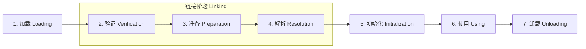

1. **加载（Loading）**：
   - 通过类的全限定名获取二进制字节流（Class 文件、JAR 包、网络传输、动态代理生成等）；
   - 将静态字节流存储结构转换为**方法区（Metaspace 元空间）**的运行时数据结构；
   - 在 **Java 堆（Heap）** 中生成对应的 `java.lang.Class` 镜像对象，作为访问该类元数据的统一入口。
2. **验证（Verification）**：
   - 确保 Class 字节流完全符合《Java虚拟机规范》，防范恶意代码注入。包含：文件格式验证、元数据验证、字节码验证、符号引用验证。
3. **准备（Preparation）**：
   - 正式为**类变量（`static` 修饰的变量）**在方法区分配内存并赋予**初始零值**（如 `int` 为 0，引用为 `null`）。
   - *特例*：对于 `static final` 常量（基本类型或字面量 String），编译期已生成 ConstantValue 属性，在准备阶段会**直接赋予设定的业务实际值**。
4. **解析（Resolution）**：
   - 将常量池内的**符号引用（Symbolic References）**替换为**直接引用（Direct References）**（能够直接指向目标的物理指针、相对偏移量或间接句柄）。
5. **初始化（Initialization）**：
   - 执行编译器自动生成的类构造器 **`<clinit>()` 方法**。
   - `<clinit>()` 由编译器按顺序收集所有静态变量显式赋值动作与 `static {}` 静态代码块合并而成。JVM 保证在多线程环境下 `<clinit>()` 被正确同步加锁，只执行一次。

### 2. 类加载完毕后各部分在 JVM 内存区域的存放分布（以 JDK 8+ HotSpot 为准）

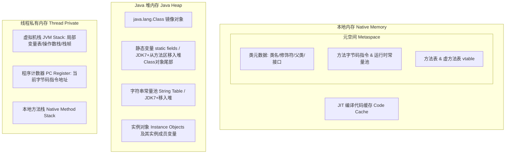

* **元空间（Metaspace，占用本地内存 Native Memory）**：
  - 存放类的**类型信息、字段描述符、方法描述符、方法字节码指令、虚方法表（vtable）与接口方法表（itable）、运行时常量池（符号引用、字面量引用）**。
* **Java 堆（Heap，JVM 管理）**：
  - 存放由 JVM 加载该类时反射创建的 **`java.lang.Class` 实例对象**；
  - **静态变量（`static` 字段）**：自 JDK 7 起，静态变量从永久代移出，物理上直接依附于堆中的 `java.lang.Class` 对象末尾存储；
  - **字符串常量池（String Table）**：自 JDK 7 起从永久代移至堆空间；
  - 运行时所有的类实例化对象及其非静态字段（实例变量）。
* **线程虚拟机栈（JVM Stack，线程私有）**：
  - 存放当前线程方法调用生成的**栈帧（Stack Frame）**，其局部变量表持有指向堆中对象地址的**引用句柄（Reference）**。

---

## 五、JVM 垃圾回收机制与核心回收器（CMS & G1）

### 1. JVM 垃圾回收核心原理基石

* **存活判定算法**：
  * **可达性分析算法（Reachability Analysis）**：从一组根对象 **GC Roots** 出发向下搜索引用链，未落在引用链上的对象判定为不可达。
  * **GC Roots 包含**：虚拟机栈帧中局部变量表引用的对象、方法区静态属性引用的对象、常量池引用的对象、JNI 本地方法引用的对象、被 `synchronized` 同步锁持有的对象。
* **四大引用类型**：强引用（GC绝不回收）、软引用（`SoftReference`，内存溢出前回收）、弱引用（`WeakReference`，只要GC即回收）、虚引用（`PhantomReference`，仅用于堆外内存追踪释放通知）。
* **三大经典回收算法**：标记-清除（产生空间碎片）、标记-复制（新生代 8:1:1，高效无碎片但可用内存打折）、标记-整理（老年代规整内存，消除碎片）。

### 2. CMS（Concurrent Mark Sweep）回收器原理

* **定位**：以**获取最短回收停顿时间**为目标的老年代收集器，基于**标记-清除**算法。
* **四大工作阶段**：
  1. **初始标记（Initial Mark）**：**STW**。仅标记 GC Roots 能够直接关联到的对象，速度极快。
  2. **并发标记（Concurrent Mark）**：**并发**。与用户线程并发运行，从直接关联对象展开遍历整棵对象引用图。耗时较长但无业务停顿。
  3. **重新标记（Remark）**：**STW**。修正在并发标记期间因用户程序运行而导致标记产生变动的对象（采用**增量更新 Incremental Update** 算法）。停顿远短于并发标记。
  4. **并发清除（Concurrent Sweep）**：**并发**。清理已被判定为死亡的对象，释放内存空间。与用户线程并发执行。
* **CMS 致命缺陷**：
  - **内存碎片严重**：基于标记-清除算法，老年代容易出现大量不连续碎片，大对象无法分配时会提前触发 **Full GC**。
  - **浮动垃圾与 Concurrent Mode Failure**：并发清除阶段用户线程继续产生的垃圾（浮动垃圾）无法在当次收回；必须预留部分老年代空间给用户线程运行，若运行中预留空间耗尽，将触发并发失败，强制退化为单线程 `Serial Old`，造成长时间 STW。

### 3. G1（Garbage-First）回收器原理

* **定位**：面向服务端的大内存收集器（JDK 9+ 默认），打破传统连续物理分代，开创了 **Region** 化与**可预测停顿模型**。
* **架构设计**：
  - 将整个 Java 堆划分为约 2048 个大小相等的独立 **Region**（大小为 1MB~32MB，且为 2 的幂）。
  - 每个 Region 逻辑上动态扮演 **Eden、Survivor、Old、Humongous（大对象区，超过 0.5 个 Region 大小）**。
  - 维护每个 Region 内部的回收价值（回收可释放空间与耗时成本的比率），**优先回收垃圾最多、收益最大的 Region（Garbage-First）**。

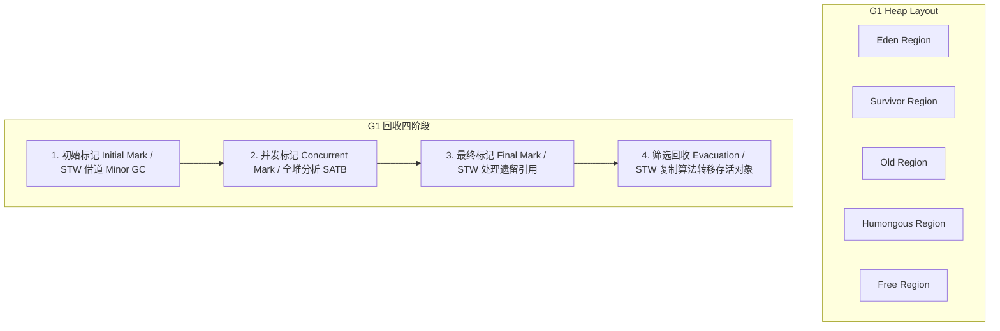

* **G1 Mixed GC（混合回收）工作流程**：
  1. **初始标记（Initial Mark）**：**STW**。借由 Young GC 同步执行，仅标记 GC Roots 直接关联对象。
  2. **并发标记（Concurrent Mark）**：**并发**。与用户线程并发遍历对象图；利用 **SATB（原始快照 Snapshot-At-The-Beginning）** 记录并发过程中的引用变更。
  3. **最终标记（Final Mark）**：**STW**。快速清空并发标记期间遗留的 SATB 变动日志。
  4. **筛选回收（Evacuation / Live Data Counting）**：**STW**。根据用户通过 `-XX:MaxGCPauseMillis`（默认 200ms）指定的期望停顿时间，通过成本模型计算最具性价比的 Region 集合；**使用“标记-复制”算法将存活对象复制搬迁到空闲 Region 中，老 Region 整体清空**。
* **G1 核心优势**：
  - **空间整合，无碎片**：Region 之间采用复制算法，整体相当于标记-整理，彻底杜绝内存碎片。
  - **可控可预测停顿**：允许开发者设定明确的停顿上限时间目标，G1 自行动态调整回收 Region 数量。

---

## 六、Java 双亲委派模型机制、意义与打破场景

### 1. 类加载器双亲委派机制定义

Java 默认的类加载器层次结构呈现递进委派关系：

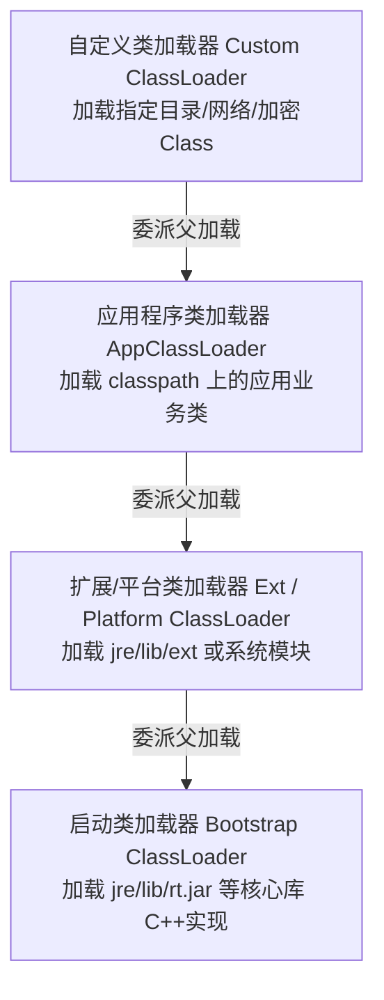

* **委派规则**：
  当一个类加载器收到类加载请求时，它**绝不首先自己尝试加载**，而是将加载任务层层委派给父类加载器；每一层皆是如此，直至顶层的启动类加载器（Bootstrap ClassLoader）。只有当父类加载器在自身搜索路径内无法找到该类（抛出 `ClassNotFoundException`）时，子加载器才会尝试自己去加载。

### 2. 双亲委派的核心价值与作用

1. **沙箱安全防篡改**：防止 Java 核心基础类库被恶意篡改。若黑客自定义一个名为 `java.lang.String` 的类试图注入后门，类加载请求自底向上委派至 Bootstrap ClassLoader，最终加载的一定是 JDK 原生安全的 String 类，用户仿冒类根本无法被加载。
2. **避免重复加载**：在 JVM 中，判断两个 Class 是否相同，必须满足两个条件：**类全限定名相同** 且 **加载它们的 ClassLoader 实例相同**。双亲委派确保了任何公共核心类在 JVM 内部全局唯一。

### 3. 打破双亲委派的典型场景与实现机制

| 打破场景 | 为什么打破？（核心痛点） | 如何打破？（底层技术机制） |
| :--- | :--- | :--- |
| **1. SPI 机制<br/>（如 JDBC 驱动）** | 核心接口（如 `java.sql.Driver`）定义在 JDK 核心库 `rt.jar`，由 Bootstrap ClassLoader 加载；但具体的驱动实现类（如 MySQL 的 `com.mysql.cj.jdbc.Driver`）位于应用的 Classpath。**启动类加载器无法逆向下沉加载子类实现**。 | **线程上下文类加载器（Thread Context ClassLoader）**：<br/>通过 `Thread.currentThread().getContextClassLoader()`，让父加载器逆向获取子加载器（AppClassLoader）去加载第三方驱动类。 |
| **2. Tomcat / Servlet 容器** | 1. **应用隔离**：同一个 Tomcat 下部署的应用 A 和应用 B 可能依赖相同第三方库的不同版本（如 Spring 4 与 Spring 5），不能相互污染。<br/>2. **共享与独立**：容器自身库与应用库需要解耦，且支持应用热部署。 | **自定义 `WebAppClassLoader`**：<br/>重写 `loadClass()` 方法，颠覆“父加载器优先”逻辑，变为**本 WebApp 优先**：先在自身 `/WEB-INF/classes` 和 `/WEB-INF/lib` 中查找加载，找不到再向上传递给 Common/Shared 父加载器。 |
| **3. OSGi 动态模块化与热替换** | 需要在运行时对单个模块（Bundle）进行动态安装、卸载、热替换，代码依赖不再是单向树形结构。 | **网状类加载拓扑架构**：<br/>每个 Bundle 拥有独立的类加载器，需要加载类时通过 Export-Package 和 Import-Package 在平级加载器之间网状寻找，完全打破树形委派。 |

---

## 七、分布式事务保证方案与 Seata 深度剖析（AT vs XA）

### 1. 分布式事务主流保证方案

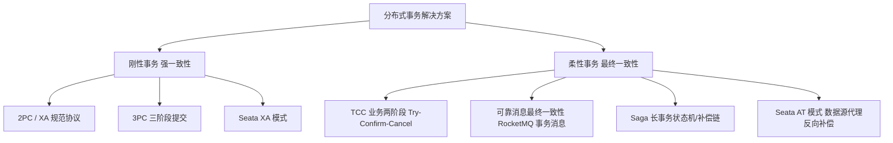

### 2. Seata 整体架构与工作原理

Seata 抽象出三大核心角色协同完成分布式事务调度：
* **TC（Transaction Coordinator，事务协调器）**：独立部署的高可用服务端，维护全局事务与分支事务的运行状态，驱动全局提交或回滚。
* **TM（Transaction Manager，事务管理器）**：集成在业务发起方，界定全局事务范围，负责发起全局事务（Begin）、请求全局提交（Commit）或全局回滚（Rollback）。
* **RM（Resource Manager，资源管理器）**：控制分支事务资源，与本地数据库交互，向 TC 注册分支事务并汇报分支状态，接收 TC 指令执行最终提交或回滚。

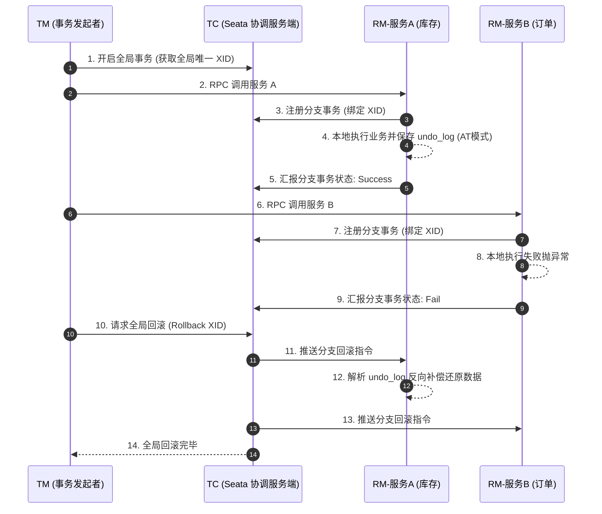

### 3. Seata AT 模式 vs XA 模式核心对比

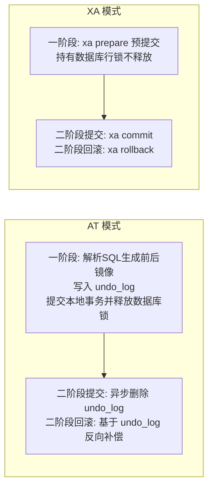

| 对比维度 | Seata AT 模式（Auto Transaction） | Seata XA 模式（标准 XA 协议） |
| :--- | :--- | :--- |
| **一致性保障** | **最终一致性（柔性事务）** | **强一致性（刚性事务）** |
| **数据库物理锁持有时长** | **极短**。一阶段执行完业务 SQL 和写入 `undo_log` 后，**立即提交本地事务并释放数据库物理锁**。并发吞吐量极高。 | **极长**。一阶段执行 `xa prepare` 保持连接与物理行锁不释放，直到二阶段 TC 通知 `xa commit` 才释放，高并发下锁等待严重。 |
| **脏写防护机制** | 依赖 Seata **全局锁（Global Lock）**。一阶段提交前必须向 TC 申请行记录的全局锁；若未获取则自旋等待，防止并发修改。 | 依赖底层数据库原生 XA 锁机制（读写排他锁）。 |
| **回滚原理** | **逻辑反向补偿**：读取 `undo_log` 中的前镜像（Before-Image），比对当前数据后镜像防止脏写，校验通过后逆向生成 `UPDATE/DELETE/INSERT` 语句恢复。 | **数据库底层物理日志回滚**：原生利用数据库内部的 Undo Log 引擎机制执行 `xa rollback`。 |
| **环境与代码要求** | 对业务零侵入；但数据库必须是关系型，且业务 SQL 必须能被 Seata 语法解析器识别解析。 | 零侵入，要求底层数据库及驱动必须原生支持 XA 规范（如 MySQL InnoDB）。 |
| **典型适用场景** | 电商交易、大并发核心链路、微服务全链路高吞吐业务。 | 银行转账、金融证券清算、对强一致性有绝对严苛要求的传统企业系统。 |

---

## 八、MySQL 日志体系全景与应用场景

MySQL（以 InnoDB 引擎为例）内部拥有完整的日志体系，涵盖事务保证、主从高可用与运行运维：

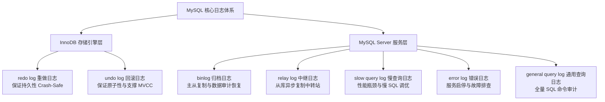

### 核心日志详解与场景矩阵

| 日志名称 | 所属层级 | 记录内容与工作形式 | 核心作用 | 典型应用场景 |
| :--- | :--- | :--- | :--- | :--- |
| **redo log<br/>（重做日志）** | **InnoDB 引擎** | 物理日志，记录数据页的物理修改偏移量。采用 **WAL（Write-Ahead Logging）** 机制，**循环写入（4 个文件环形轮转）**。 | 实现 **Crash-Safe 崩溃恢复能力**，保证事务的**持久性（Durability）**。 | 服务器断电、系统崩溃后重启，InnoDB 根据 redo log 将未刷盘的脏页数据恢复到磁盘。 |
| **undo log<br/>（回滚日志）** | **InnoDB 引擎** | 逻辑日志，记录与操作相反的逆向记录（如 `INSERT` 对应记 `DELETE`，`UPDATE` 记旧值）。 | 保证事务的**原子性（Atomicity）**；支撑 **MVCC 多版本并发控制**。 | 1. 事务执行异常时执行 `ROLLBACK`。<br/>2. 支撑非阻塞的快照一致性读。 |
| **binlog<br/>（归档日志）** | **Server 层** | 逻辑日志，记录所有修改表结构与数据的 SQL 或行变更事件。**追加写入（Append-only）**，不覆盖历史。 | 保证**全量数据恢复**与**高可用集群数据流转**。 | 1. **主从复制（Master-Slave）**。<br/>2. **Point-in-Time 误删数据定点恢复**。<br/>3. **Canal / Flink CDC 监听 binlog** 实时同步至 Redis / ES。 |
| **relay log<br/>（中继日志）** | **Server 层（从库）** | 结构与 binlog 相同，由从库 I/O 线程从主库拉取后暂存在从库本地。 | 解耦主从复制网络 I/O 与本地重放。 | 主从架构中，从库 SQL 线程读取 relay log 顺序重放事务事件。 |
| **slow query log<br/>（慢查询日志）** | **Server 层** | 文本日志，记录执行耗时超过 `long_query_time`（默认 10s）的 SQL。 | 定位数据库性能瓶颈。 | 线上 SQL 调优、索引缺失排查、DBA 慢查询巡检。 |
| **error log<br/>（错误日志）** | **Server 层** | 记录 mysqld 启动、运行、关闭过程中的警告与致命错误。 | 故障诊断与健康监控。 | MySQL 实例无法启动排障、死锁告警监控、内核级 Crash 分析。 |

---

## 九、MySQL MVCC 实现原理与应用场景

### 1. 什么是 MVCC？

**MVCC（Multi-Version Concurrency Control，多版本并发控制）** 是 InnoDB 引擎在 **RC（读已提交）** 和 **RR（可重复读）** 隔离级别下，实现**读写不冲突、无锁并发一致性读（快照读）**的核心机制。

### 2. MVCC 的三大底层实现基石

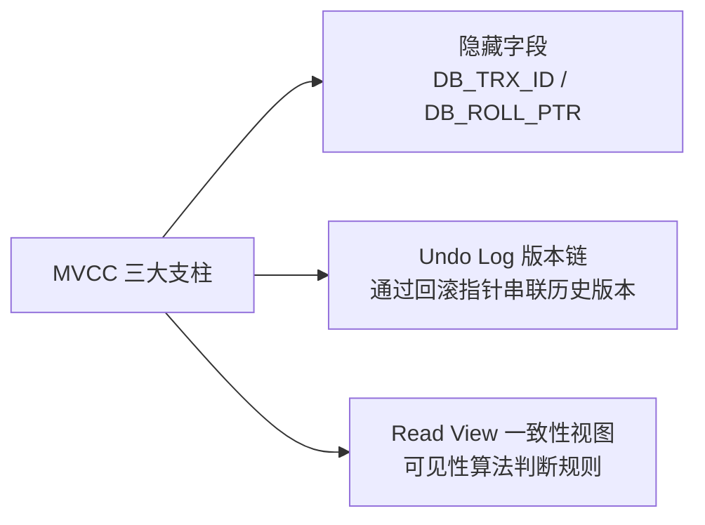

#### ① 聚簇索引记录的隐藏字段
InnoDB 会为每行聚簇索引记录自动追加隐式字段：
* **`DB_TRX_ID`（6 字节）**：最近一次插入或修改该行记录的事务 ID。
* **`DB_ROLL_PTR`（7 字节）**：回滚指针，指向该行上一个旧版本的 `undo log` 地址。
* **`DB_ROW_ID`（6 字节）**：隐式自增行 ID（若无主键且无非空唯一键时生成）。

#### ② Undo Log 版本链（Version Chain）
当事务修改某行记录时，旧版本会被拷贝到 undo log 中，并通过当前最新记录的 `DB_ROLL_PTR` 指针指向上一个版本，串联成一条**从最新向最旧的单向链表**：

```
[当前最新记录 trx_id=100] ---> [undo log trx_id=80] ---> [undo log trx_id=50] ---> [历史起点]
```

#### ③ Read View（一致性读视图）
当执行普通 `SELECT` 快照读时，系统会生成一个 Read View，包含 4 个核心属性：
* `m_ids`：生成 Read View 时当前系统处于**活跃且未提交**的事务 ID 列表。
* `min_trx_id`：`m_ids` 中的最小事务 ID。
* `max_trx_id`：生成 Read View 时系统应分配给下一个事务的 ID（即当前最大事务 ID + 1）。
* `creator_trx_id`：创建该 Read View 的当前事务 ID。

#### ④ 版本可见性判断算法逻辑
遍历 Undo Log 版本链中的每个版本（其事务 ID 设为 `trx_id`）：
1. 若 `trx_id == creator_trx_id`：该版本由当前事务自己修改，**可见**。
2. 若 `trx_id < min_trx_id`：该事务在 Read View 创建前已提交，**可见**。
3. 若 `trx_id >= max_trx_id`：该事务在 Read View 创建后才开启，**不可见**。
4. 若 `min_trx_id <= trx_id < max_trx_id`：
   - 若 `trx_id` 存在于 `m_ids` 列表中：说明创建视图时该事务尚未提交，**不可见**。
   - 若 `trx_id` 不在 `m_ids` 列表中：说明创建视图时该事务已提交，**可见**。
5. 若不可见，顺着 `DB_ROLL_PTR` 指针继续向后检索上一版本，直至找到可见版本或返回空。

### 3. RC 与 RR 隔离级别的本质区别与适用场景

* **RC（Read Committed）**：**每次执行普通 SELECT 语句时都重新生成一个新的 Read View**。因此只要其他事务提交了，下一次 SELECT 就能看到最新数据（导致不可重复读）。
* **RR（Repeatable Read，InnoDB 默认）**：**仅在事务第一次执行普通 SELECT 语句时生成 Read View**，后续整个事务生命周期内始终沿用该视图。因此即使其他事务修改提交，当前事务多次读取结果始终一致（解决不可重复读，并通过快照读大幅消除幻读）。
* **核心场景**：
  - 高并发电商订单查询、报表统计、用户主页加载等绝大多数非加锁读场景（快照读）。
  - 彻底规避了 `SELECT ... FOR UPDATE` 带来的行锁甚至表锁开销，保证并发吞吐量。

---

## 十、Redis 核心数据结构与 ZSet 底层跳表运作机制

### 1. Redis 核心数据结构与高频业务场景全览

| 数据结构 | 底层编码实现 | 典型业务应用场景 |
| :--- | :--- | :--- |
| **String** | SDS（Simple Dynamic String） | 分布式 Session、Token 鉴权、分布式锁（`SETNX`）、全局自增序列号/点赞防刷（`INCR`）。 |
| **Hash** | listpack / ziplist / hashtable | 结构化对象存储（如电商商品详情、用户信息）、购物车商品与数量增减（`HINCRBY`）。 |
| **List** | quicklist（双向链表 + listpack） | 时间线 Timeline、最新消息动态（`LPUSH` + `LTRIM`）、简单异步任务队列（`BLPOP`）。 |
| **Set** | intset / hashtable | 唯一去重集合、抽奖活动（`SRANDMEMBER` / `SPOP`）、社交共同好友/共同关注（`SINTER` 交集）。 |
| **ZSet** | listpack / ziplist / **skiplist + dict** | **实时热搜榜、游戏战力天梯榜、按时间范围延迟调度任务、滑动窗口限流器**。 |
| **Bitmap** | String 内部位操作 | 海量用户打卡签到、连续登录天数统计、在线状态跟踪（极省内存）。 |
| **HyperLogLog** | 基数统计概率算法 | 海量页面 UV 独立访客统计（12KB 内存统计 $2^{64}$ 个元素，误差仅 0.81%）。 |
| **Stream** | radix tree + listpack | 完善的持久化消息队列（支持多播消费组 Consumer Group、ACK 确认与 Pending 消息补偿）。 |

### 2. ZSet（有序集合）的底层数据结构

ZSet 具备两大底层实现形态：
1. **压缩列表（ziplist / Redis 7+ listpack）**：当元素数量 $< 128$ 且每个元素大小 $< 64$ 字节时采用，紧凑内存存储。
2. **跳跃表（skiplist） + 哈希表（dict）**：超越上述阈值后转换为双结构协同运作。

### 3. ZSet 底层跳表与哈希表是如何协同运转的？

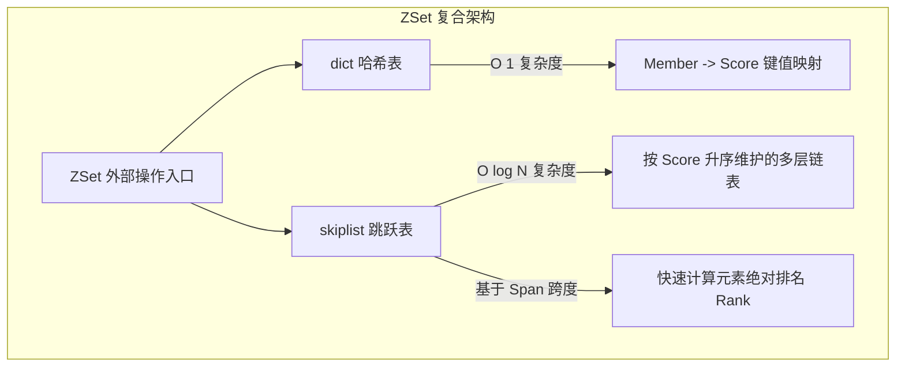

#### ① `dict` 与 `skiplist` 的双剑合璧
* **`dict` 的使命**：维护 `member -> score` 映射关系。执行 `ZSCORE key member` 时，直接通过哈希表在 **$O(1)$** 时间复杂度内极速返回分数值。
* **`skiplist` 的使命**：所有节点按照 `score` 从小到大排序（分值相同时按 `member` 字典序排序）。支持高效的**范围检索**（`ZRANGEBYSCORE`）与**排名计算**（`ZRANK`）。

#### ② 跳表（SkipList）的运转与检索机制

```
Level 3: [Head] ------------------------------> [Node 7] -------------------------> NULL
Level 2: [Head] -------------> [Node 3] --------> [Node 7] -------------> [Node 10] -> NULL
Level 1: [Head] -> [Node 1] -> [Node 3] -> [Node 5] -> [Node 7] -> [Node 9] -> [Node 10] -> NULL
```

1. **多层跳跃查找**：
   - 检索从最高层 Level 开始向右比对，若前驱节点的 score 小于目标值，则向右推进；
   - 若前驱节点的值大于目标值或为空，则**下降一层（Level - 1）继续向右查找**；
   - 类似二分查找，检索时间复杂度稳定在 **$O(\log N)$**。
2. **随机层高机制（Random Level）**：
   - 为什么不用平衡红黑树？红黑树在插入和删除时需要左旋、右旋来维持平衡，高并发下锁开销极大且实现复杂；
   - 跳表采用**幂次概率随机算法（掷硬币机制）**：每个新节点在创建时，生成一个 1 到 32 之间的随机层高（下一层晋升上一层的概率为 25%）。无需旋转调整，只需修改前后指针即可完成插入删除。
3. **跨度（Span）与排名计算**：
   - 跳表中每个层级的指针不仅保存后继指针，还保存了当前指针跨越的底层节点数量——**`span`（跨度）**；
   - 当需要获取某个成员的排名（`ZRANK`）时，只需在从顶层查找到该节点的路径上，**将所经过所有指针的 `span` 进行累加**，即为该节点的全局绝对排名，复杂度同样仅为 **$O(\log N)$**。

---

## 十一、CAP 定理中 AP 与 CP 的本质区别与架构选型

### 1. CAP 定理的核心定义

* **C（Consistency，强一致性）**：所有节点在同一时刻访问到的数据完全一致，写入成功后任何客户端读到的都是最新数据。
* **A（Availability，高可用性）**：所有非故障节点对客户端的读写请求必须在有限时间内给出成功响应（不保证拿到的是最新数据，但绝不拒绝或超时）。
* **P（Partition Tolerance，分区容错性）**：当网络由于丢包、延迟、光纤切断等原因发生**网络分区（Network Partition）**导致节点间无法通信时，系统依然能够对外提供服务。

> **分布式系统的铁律**：由于网络通信天然不可靠，网络分区 $P$ 在分布式系统中是**绝对不可避免的客观事实**。因此，架构师无法同时拥有 C 和 A，只能在 **CP** 和 **AP** 之间做出抉择。

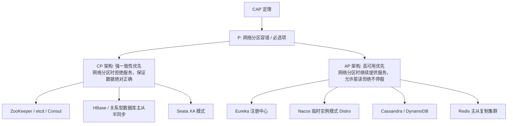

### 2. CP 架构 vs AP 架构深度特性对比

| 比较维度 | CP 架构（一致性优先） | AP 架构（可用性优先） |
| :--- | :--- | :--- |
| **核心哲学** | **“宁可报异常/拒绝服务，也绝不返回脏数据”** | **“宁可拿到稍旧数据，也绝不拒绝请求或宕机”** |
| **网络分区下的行为** | 出现网络隔离时，少数派分区节点无法达成共识，立即停止写入甚至读取，直接向客户端返回超时或错误，直到网络恢复并重新同步一致。 | 出现网络隔离时，所有节点依然独立承接读写；待网络分区恢复后，通过 Gossip 协议或向量时钟进行异步数据对齐与冲突合并。 |
| **一致性保障级别** | 强一致性（线性一致性 Linearizable Consistency / 顺序一致性）。 | 弱一致性 / 最终一致性（Eventual Consistency）。 |
| **典型组件代表** | **ZooKeeper / etcd / Consul**（Raft/Paxos 算法，Leader 宕机选主期间全集群拒绝写请求）；**HBase**。 | **Eureka**（自我保护机制，哪怕全部失联也不剔除实例）；**Nacos（Distro 协议模式）**；**DynamoDB**。 |
| **业务选型场景** | **金融财务对账、库存扣减、分布式锁、元数据协调**等对数据准确度零容忍的场景。 | **电商商品详情页、用户社交动态、视频播放计数、微服务实例发现**等对高并发与可用性要求极高的场景。 |

---

## 总结导图与复习速查

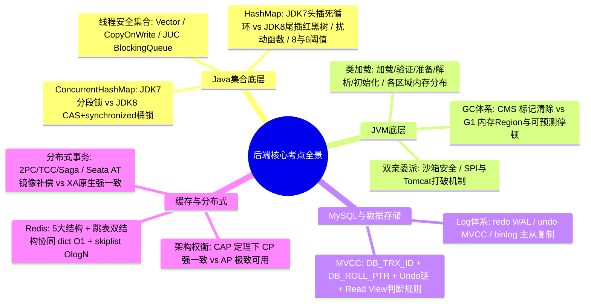
