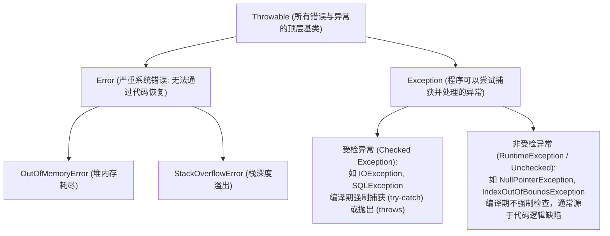

# Java 异常体系、语法糖底层与 try-with-resources

异常处理是编写健壮、高可用生产代码的基础。但在很多项目中，到处充斥着“抓了异常打一行日志就吞掉（Swallow）”或者“在 `finally` 块中写 `return` 导致业务返回值神秘被改”的恶性 Bug。

本篇深度拆解 Java 异常设计哲学、`finally` 字节码指令复制底层，以及 `try-with-resources` 是如何利用**异常抑制（Suppressed Exceptions）**解决传统资源释放陷阱的。

---

## 1. Java 异常体系全景架构与受检异常反思

所有异常的共同祖先都是 `java.lang.Throwable`，其下分为两大阵营：



### 1.2 为什么现代现代开源框架极力排斥“受检异常（Checked Exception）”？
在早期（Java 1.0 时期），设计者推崇受检异常，认为编译期强行要求开发者捕获异常能提高健壮性。但二十多年实践证明，受检异常在大型系统中弊远大于利：
1. **破坏分层抽象与方法签名污染**：
   如果底层 DAO 抛出一个 `SQLException`，上层 Service 和 Controller 的方法签名就必须层层声明 `throws SQLException`。上层业务代码被迫与底层的持久化技术死死耦合！
2. **引发“吞异常”恶习**：
   由于编译报错强迫开发者处理，大量开发人员被迫写出如下害死人的空代码：
   ```java
   try {
       fileStream.read();
   } catch (IOException e) {
       // 空实现，或者只打印 e.printStackTrace()，真实异常被无声无息吞掉！
   }
   ```
- **现代潮流**：Spring 框架在设计之初就做出了表率，将所有 JDBC 的受检异常彻底包装转译为未受检的 **`DataAccessException`（继承自 `RuntimeException`）**，将控制权交给全局统一异常拦截器（`@ControllerAdvice`），代码结构大幅清爽。

---

## 2. `try-catch-finally` 的底层字节码实现真相

### 2.1 `finally` 块为什么无论如何都一定会执行？
在 Java 虚拟机规范中，早期的 `jsr` / `ret` 指令已被彻底废弃。现代 Javac 编译器采用了非常直白暴力的手段：
- **代码物理复制内联**：
  编译器在生成字节码时，**会把 `finally` 块中的所有字节码指令，自动强行复制多份**：
  1. 复制一份无缝追加到 `try` 块代码的正常退出路径末尾；
  2. 复制一份追加到每一个 `catch` 块代码的正常退出路径末尾；
  3. 如果 `try` 或 `catch` 内部中途抛出了任何未捕获异常，JVM 的异常表（Exception Table）会将所有未处理异常全部引导跳转到一个兜底处理块，在再次向上抛出异常前，**强制执行最后一份 `finally` 代码**！

---

### 2.2 生产大坑：`finally` 里的 `return` 覆盖陷阱
```java
public static int testReturn() {
    int x = 1;
    try {
        x = 2;
        return x; // 此时返回值已暂存到操作数栈中
    } finally {
        x = 3;
        return x; // 致命操作！
    }
}
```
- **输出结果**：最终返回的是 **`3`**，而不是 2！
- **字节码执行过程**：
  1. `try` 块中的 `return x` 会将变量 `x`（值为 2）加载到操作数栈顶并保存在一个临时的局部变量插槽中；
  2. 紧接着由于字节码内联，代码继续执行 `finally` 块；
  3. `finally` 中的 `return x` 会把全新的 `3` 再次加载到操作数栈顶，并直接执行 **`ireturn` 指令终止方法**！
  - **严重后果**：**`finally` 里的 `return` 会彻底覆盖丢弃 `try` 块计算好的所有返回值！更可怕的是，如果 `try` 块里抛出了异常，`finally` 里的 `return` 会直接把该异常“强行吞噬抹杀”，导致外部永远无法感知异常抛出！**
  - **生产红线**：**严禁在 `finally` 块中编写 `return` 语句！**

---

## 3. 优雅利器：`try-with-resources` 与“异常抑制”机制

在 JDK 7 之前，传统的资源关闭（关闭 Socket、流、数据库连接）极其繁琐且极度丑陋：
```java
// 早期代码地狱：
InputStream is = null;
try {
    is = new FileInputStream("test.txt");
    is.read();
} finally {
    if (is != null) {
        try { is.close(); } catch (IOException e) { /* 嵌套异常再次发生 */ }
    }
}
```

### 3.1 传统写法引发的“主异常丢失”灾难
如果 `is.read()` 发生了磁盘读取故障抛出 `IOException: Read Error`；紧接着在 `finally` 中调用 `is.close()` 时也抛出了网络超时 `IOException: Close Error`。
- 在传统的 `try-finally` 中，**后抛出的 `Close Error` 会把最初也是最重要的业务根因 `Read Error` 彻底覆盖吞噬**！运维在日志中只能看到关闭错误，真实的业务报错线索完全失联。

### 3.2 `try-with-resources` 的优雅革命
任何实现了 **`java.lang.AutoCloseable`** 接口的类，都可以直接套用语法糖：
```java
try (InputStream is = new FileInputStream("test.txt");
     OutputStream os = new FileOutputStream("out.txt")) {
    is.transferTo(os);
} // 编译器自动安全关闭，先开的后关，后开的先关！
```

### 3.3 核心底层机制：异常抑制（Suppressed Exceptions）
如果业务操作抛出了异常 $E_1$，而随后的自动关闭操作也抛出了异常 $E_2$：
- `try-with-resources` 底层会自动调用 **`$E_1$.addSuppressed($E_2$)`**！
- **最终抛出的主异常依然是真正的核心业务异常 $E_1$**，而次要的关闭异常 $E_2$ 会作为“被抑制的异常（Suppressed）”挂载在 $E_1$ 的属性列表中。
- 开发者可以通过 `e.getSuppressed()` 获取完整的链路异常，既保证了主根因不丢，又留存了关闭失败的证据。
