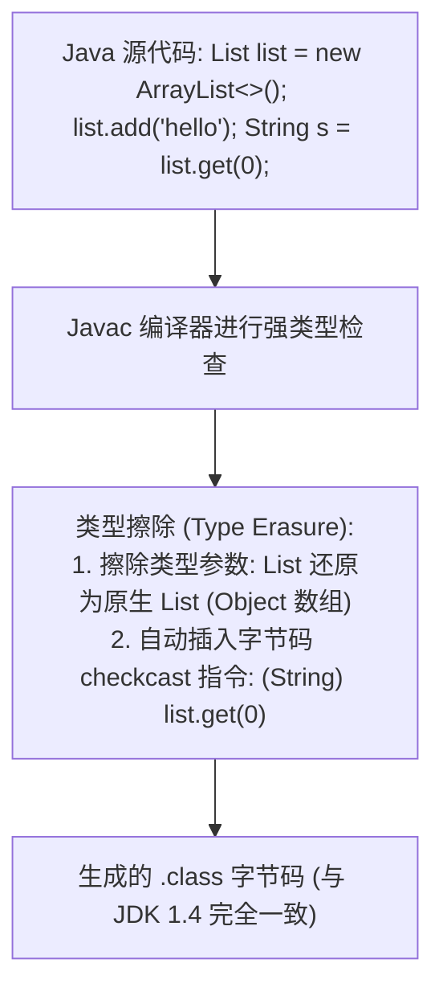

# Java 泛型机制与类型擦除深挖

泛型（Generics）在 JDK 5 中正式引入，极大地提升了 Java 的类型安全与代码复用性。但 Java 的泛型与 C++ 的模板（Template）在底层实现上有着天壤之别。Java 采用的是 **伪泛型（Pseudo-Generics）** 与 **类型擦除（Type Erasure）**。

深入理解类型擦除机制，是搞懂“为什么不能 `new T()`”、“为什么 `List<String>` 和 `List<Integer>` 的 Class 相同”、以及设计高扩展性框架 API 的核心内功。

---

## 1. 为什么 Java 采用“伪泛型”与类型擦除？

### 1.1 历史兼容性约束（二进制向后兼容）
在 JDK 1.4 及更早版本中，Java 集合中存放的全都是裸类型 `Object`，取出来时必须强转。
- 当 Sun 公司设计泛型时，首要目标是：**必须保证编译出来的类文件在没有泛型的旧 JVM 上完全向下兼容运行，且旧的未经泛型改造的代码必须能与全新的泛型代码无缝互操作**！
- 相比 C++ 模板在编译时针对每种类型生成一份独立的机器码（代码膨胀），Java 选择了在**编译期进行强类型检查，编译后将类型信息完全“擦除”还原为原始字节码**的方案。

---

## 2. 类型擦除（Type Erasure）的底层字节码行为

类型擦除遵循严格的转换规则：



### 2.1 擦除规则全景：
1. **无边界泛型 `<T>`**：编译后一律擦除为 **`Object`**。
2. **有上限泛型 `<T extends Number>`**：编译后一律擦除为其**上限类型 `Number`**。
3. **方法调用处**：编译器会自动在获取数据时插入 **`checkcast`（强制类型转换）** 字节码指令。

### 2.2 核心深水区：桥接方法（Bridge Method）如何保全多态性？
假设有如下继承结构：
```java
public class Node<T> {
    public void setData(T data) { ... }
}

public class MyNode extends Node<Integer> {
    @Override
    public void setData(Integer data) { ... }
}
```

#### 思考一个诡异的矛盾：
- 父类 `Node<T>` 经过类型擦除后，其方法签名为：`setData(Object data)`。
- 子类 `MyNode` 的方法签名为：`setData(Integer data)`。
- 从 JVM 字节码角度看，参数一个是 `Object` 一个是 `Integer`，这根本不是方法重写（Override），而是**方法重载（Overload）**！多态性彻底失效了！

#### 编译器的隐式魔法：桥接方法（Bridge Method）
为了保全面向对象的多态性，Javac 编译器会在子类 `MyNode` 中自动生成一个合成的（Synthetic）**桥接方法**：
```java
// 编译器自动生成的桥接方法：
public void setData(Object data) {
    // 强制转换为真实参数类型后，调用开发者手写的方法！
    setData((Integer) data);
}
```
通过 `javap -v MyNode.class` 即可看到带有 `ACC_BRIDGE` 和 `ACC_SYNTHETIC` 标记的桥接字节码。

---

## 3. 泛型通配符与 PECS 原则（Producer Extends, Consumer Super）

在设计公共 API 或框架组件时，通配符是灵活处理集合继承关系的关键。

### 3.1 核心法则：PECS（Producer Extends, Consumer Super）
- **Producer Extends（`<? extends T>` 协变）**：
  - 如果参数是一个**生产者（只负责从中读取数据供业务使用）**，使用 `<? extends T>`。
  - **限制**：**只读，无法安全写入**（除了 `null` 之外，严禁向其中 `add` 任何元素，因为编译器无法确定实际具体的子类型）。
- **Consumer Super（`<? super T>` 逆变）**：
  - 如果参数是一个**消费者（只负责接收数据并写入其中）**，使用 `<? super T>`。
  - **限制**：**可写，但读取出来只能作为 `Object` 处理**。

### 3.2 经典代码示范（`Collections.copy`）
```java
// src 是数据生产者 (只读) -> extends
// dest 是数据消费者 (写入) -> super
public static <T> void copy(List<? super T> dest, List<? extends T> src) {
    for (int i = 0; i < src.size(); i++) {
        dest.set(i, src.get(i));
    }
}
```

---

## 4. 泛型在运行时的保留与提取技巧

既然类型在编译后被擦除了，为什么 Jackson、Gson 或 Spring 能够反序列化 `List<User>`？

### 4.1 签名属性（Signature Attribute）
- 虽然方法体内部的局部变量泛型被彻底擦除了；
- 但是，**类签名、成员变量签名以及方法返回值/参数签名**，会被编译器保存在 `.class` 文件的常量池 **`Signature` 属性** 中！

### 4.2 匿名内部类与 TypeToken 技巧
通过继承一个带有泛型的类或接口，可以借助反射获取其超类的真实泛型实参：
```java
// 借助匿名内部类捕获泛型信息
Type superclass = new ArrayList<String>() {}.getClass().getGenericSuperclass();
ParameterizedType parameterized = (ParameterizedType) superclass;
Type actualType = parameterized.getActualTypeArguments()[0];
System.out.println(actualType); // 输出: class java.lang.String
```
这也是 Spring 的 `ResolvableType` 和 Google Guava 的 `TypeToken` 实现深度泛型解析的核心底层原理。

---

## 5. 社招高频面试追问

### Q1：为什么不能创建泛型数组（如 `List<String>[] arr = new ArrayList<String>[10];` 会编译报错）？
- **数组在 Java 中是协变且具体化（Reifiable）的**：数组在运行期能够完全感知元素的真实类型。例如 `Object[] arr = new String[10]; arr[0] = 123;` 会在运行期立即抛出 `ArrayStoreException`。
- 但**泛型在运行期是被擦除的**。如果允许创建泛型数组，`List<String>[]` 在运行期会被退化为 `List[]`，你可以往里面放入 `List<Integer>`，而运行期的数组检查机制无法识别，最终导致在后续读取时发生不可预知的 `ClassCastException`，违背了泛型的类型安全承诺。
