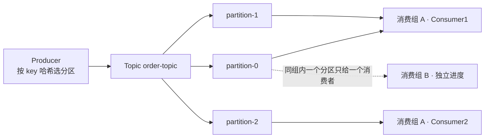
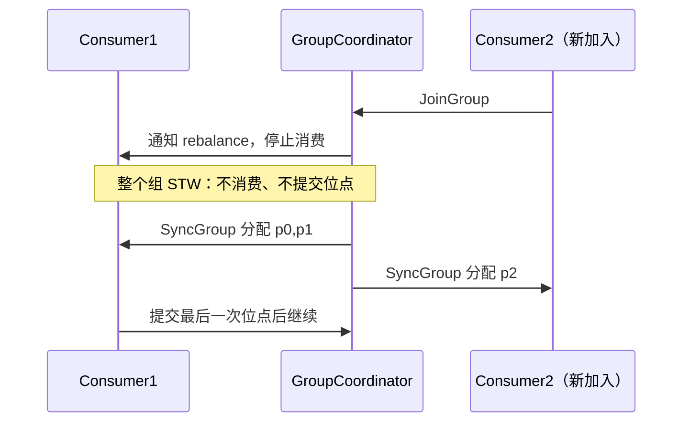
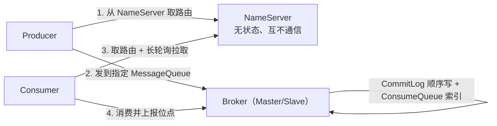
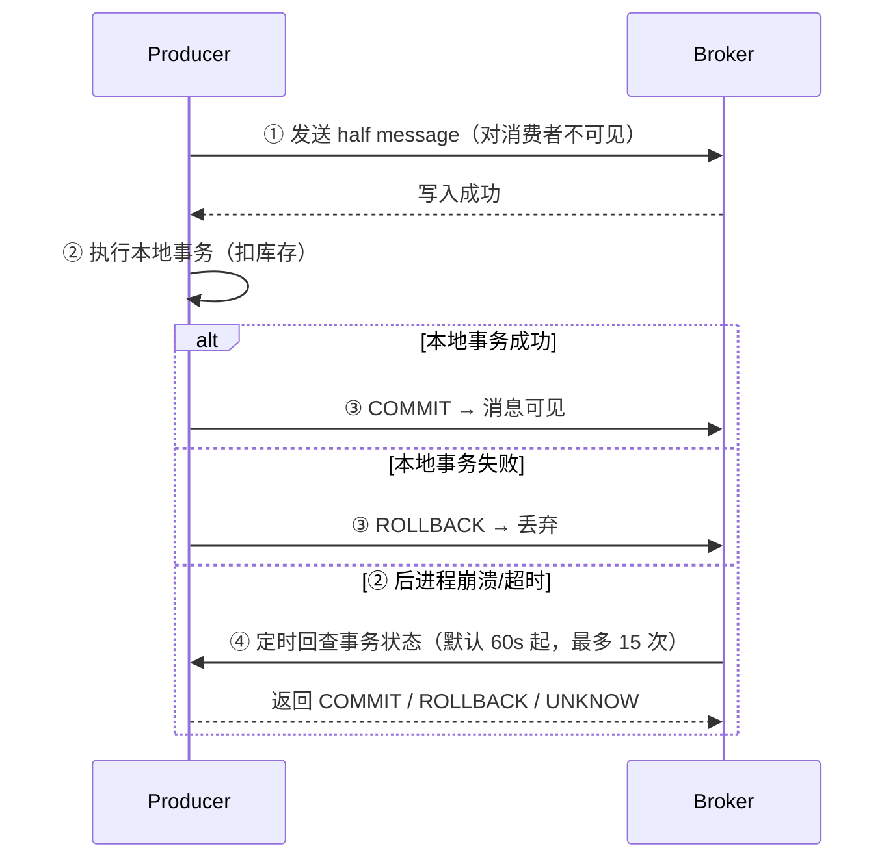
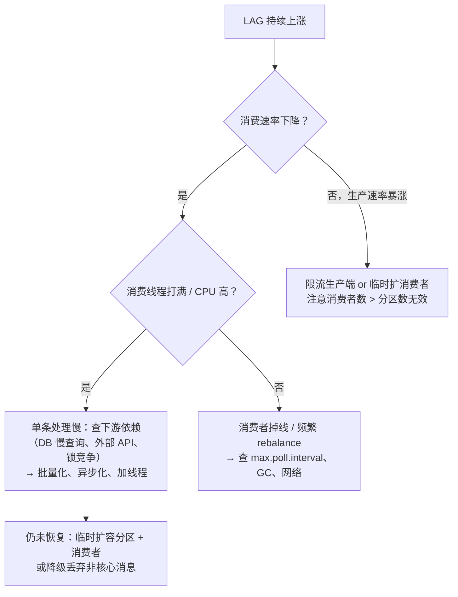

# Kafka 与 RocketMQ 生产级接入实战

## 先理解：消息队列解决什么问题

消息队列位于生产者和消费者之间：

```text
业务服务 → 发送消息 → 消息队列 → 消费服务
```

它主要解决三类问题：

1. **异步处理**：下单接口先返回，发送通知、写日志等任务稍后执行。
2. **削峰排队**：请求突然增加时，消息先进入队列，消费者按照自己的速度处理。
3. **服务解耦**：订单服务不需要直接依赖通知服务、积分服务和数据同步服务。

消息队列不能自动保证业务不重复、不丢失和最终成功。生产者、Broker、消费者都需要配置确认、重试、幂等和监控。

## 先选择：Kafka 还是 RocketMQ

| 业务需求 | 优先考虑 | 原因 |
|---|---|---|
| 日志、埋点、数据管道、大吞吐 | Kafka | 分区模型清晰，吞吐和水平扩展能力强 |
| 订单事件、事务消息、延迟消息 | RocketMQ | 事务消息、重试队列和延迟消息使用直接 |
| 需要严格的业务顺序 | 两者都可以 | Kafka 使用同一 key，RocketMQ 使用同一 MessageQueue |
| 需要多次回放历史消息 | Kafka | 消费者可以按 offset 重新读取 |
| 业务团队已经有统一平台 | 以现有平台为准 | 运维、监控和故障处理成本通常比 API 差异更重要 |

初学者建议先掌握一种消息队列的完整链路：发送成功 → 消费成功 → 消费失败重试 → 死信处理 → 堆积排查。理解这条链路后，再对比另一种实现。

本文的阅读顺序：

1. Kafka 或 RocketMQ 的基础模型。
2. 生产者和消费者的最小代码。
3. Spring Boot 配置。
4. 顺序、事务、重试和死信。
5. 堆积、扩容和生产故障排查。

选型对比与可靠性模型见 [消息中间件选型与高可靠投递全解](/doc/Java/消息中间件选型与高可靠投递全解)；延迟队列见 [MQ 消息队列与延迟任务实战](/doc/Java/MQ消息队列与延迟任务实战)。

## 只想先跑通一个 MVP

### Kafka MVP

1. 创建一个 Topic，并设置固定数量的 Partition。
2. 生产者使用业务主键作为 key，发送 JSON 消息。
3. 消费者关闭自动提交，业务处理成功后提交 offset。
4. 为失败消息配置重试和死信处理。

### RocketMQ MVP

1. 创建 Topic 和生产者组、消费者组。
2. 生产者使用同步发送，检查 `SEND_OK`。
3. 消费者处理成功返回成功，异常返回重试。
4. 监控重试队列和死信队列。

完成这八步后，再学习顺序消息、事务消息、延迟消息和集群扩容。这样可以避免在还没有跑通基本链路之前，先陷入大量参数配置。

## Kafka 与 RocketMQ 的核心差异

| 维度 | Kafka | RocketMQ |
|---|---|---|
| 客户端 | `kafka-clients` / `spring-kafka` | `rocketmq-client` / `rocketmq-spring-boot-starter` |
| 消费线程模型 | 一个 `KafkaConsumer` 只能由一个线程使用；并发通常通过多个消费者实现 | 一个消费者实例内部可以使用消费线程池 |
| 消费进度 | 消费者把 offset 提交到 Kafka 的内部 topic | Broker 保存消费进度，消费者上报当前进度 |
| 失败重试 | 通过业务代码或 Spring 的错误处理器重新投递 | Broker 提供重试队列和死信队列 |
| 顺序消息 | 同一 partition 内有序（按 key 哈希分区） | 同一 MessageQueue 内有序（`MessageQueueSelector` 指定） |
| 事务消息 | 幂等生产者 + 事务 API（跨分区能力有限） | 原生 **half message + 回查** |
| 延迟消息 | 无原生 | 4.x 18 个等级；5.x 支持任意时间 |
| 消费模型 | 消费者主动拉取，消费组负责分配分区 | 客户端通过长轮询获取消息，可使用集群或广播消费 |

**只需要记住两句话：**

- Kafka 的并行单位是 **Partition**，消费组负责分配 Partition。
- RocketMQ 的并行单位是 **MessageQueue**，消费组负责分配 MessageQueue。

## 一、Kafka：先掌握 Topic、Partition 和 Consumer Group

### 1. Kafka 适合什么场景

Kafka 更适合日志采集、埋点、数据同步、搜索索引更新和高吞吐事件流。它的核心优势是：消息按照 Partition 顺序写入，消费者可以保存 offset，并在需要时重新读取历史消息。

### 2. Kafka 中的三个对象

| 对象 | 可以理解为 | 作用 |
|---|---|---|
| Topic | 消息分类 | 例如 `order-topic` 表示订单事件 |
| Partition | Topic 中的一条并行队列 | 决定并发能力和同分区顺序 |
| Consumer Group | 一组共同处理消息的消费者 | 同一组内，一个 Partition 同时只分配给一个消费者 |



> 关键约束：同一 Partition 在同一 Consumer Group 内只会分配给一个消费者。不同 Consumer Group 可以独立消费同一条消息。

| 概念 | 一句话 |
|---|---|
| Partition | 并行和顺序的最小单位 |
| Offset | 消息在 Partition 中的位置，消费进度依赖它 |
| ISR | 与 leader 保持同步的副本集合，`min.insync.replicas` 参与 `acks=all` 判定 |
| Controller | 某个 Broker 兼任，负责分区 leader 选举（依赖 ZK 或 KRaft） |
| `__consumer_offsets` | Kafka 保存消费进度的内部 topic，不应随意修改其配置 |
| Rebalance | 消费者数量或订阅发生变化时，重新分配 Partition |
| `max.poll.interval.ms` | 两次拉取消息之间允许的最大间隔，处理时间过长会触发 Rebalance |

**本节只记：** Partition 决定并行度，offset 决定消费进度，Consumer Group 决定谁来处理消息。消费者数量超过 Partition 数量时，多出的消费者不会获得消息。

### 3. 生产者：如何可靠发送消息

生产者完成三件事：连接 Kafka、把消息写入指定 Topic、确认 Broker 是否接收成功。订单、支付、库存等关键消息必须处理发送结果，不能只调用 `send()` 就认为发送成功。

```java
Properties props = new Properties();
props.put(ProducerConfig.BOOTSTRAP_SERVERS_CONFIG, "kafka1:9092,kafka2:9092,kafka3:9092");
props.put(ProducerConfig.KEY_SERIALIZER_CLASS_CONFIG, StringSerializer.class.getName());
props.put(ProducerConfig.VALUE_SERIALIZER_CLASS_CONFIG, StringSerializer.class.getName());

// 可靠性三件套
props.put(ProducerConfig.ACKS_CONFIG, "all");                    // 所有 ISR 落盘才返回
props.put(ProducerConfig.ENABLE_IDEMPOTENCE_CONFIG, true);       // 幂等生产者，防重试导致重复
props.put(ProducerConfig.RETRIES_CONFIG, Integer.MAX_VALUE);     // 配合幂等可无限重试
props.put(ProducerConfig.MAX_IN_FLIGHT_REQUESTS_PER_CONNECTION, 5); // ≤5 才能保证幂等生效

// 吞吐三件套
props.put(ProducerConfig.LINGER_MS_CONFIG, 20);                  // 攒 20ms 批量发
props.put(ProducerConfig.BATCH_SIZE_CONFIG, 32 * 1024);
props.put(ProducerConfig.COMPRESSION_TYPE_CONFIG, "lz4");        // 压缩比/CPU 平衡最好的选择

try (KafkaProducer<String, String> producer = new KafkaProducer<>(props)) {
    ProducerRecord<String, String> record =
            new ProducerRecord<>("order-topic", orderId, json);   // key 决定分区，同订单号必进同一分区
    // 同步等结果：要求不丢且能感知失败的业务消息
    RecordMetadata md = producer.send(record).get(3, TimeUnit.SECONDS);
    log.info("sent p={} offset={}", md.partition(), md.offset());
}
```

| 参数 | 默认 | 生产建议 | 为什么 |
|---|---|---|---|
| `acks` | `all`（3.0+ 默认） | `all` | `1` 在 leader 宕机时会丢 |
| `enable.idempotence` | `false`（3.0+ 默认 true） | `true` | 防「重试导致同一分区消息重复」 |
| `max.in.flight` | 5 | 5（幂等要求 ≤5） | 调大虽快但会破坏顺序与幂等 |
| `retries` | `2147483647` | 配 `delivery.timeout.ms` 兜底 | 无限重试会阻塞，靠超时打断 |
| `linger.ms` | 0 | 5~50 | 0 等于每条都发，吞吐腰斩 |
| `compression.type` | none | lz4 / zstd | 网络与磁盘省 50%+ |
| `buffer.memory` | 32MB | 64~128MB | 太小会 `buffer full` 阻塞 |

### 4. 消费者：业务成功后再提交 offset

消费者的核心规则只有一条：**业务处理成功后，才提交 offset**。如果业务处理失败，应重试或进入死信流程；不能在处理前提交，否则进程崩溃后消息可能无法再次消费。

```yaml
spring:
  kafka:
    bootstrap-servers: kafka1:9092,kafka2:9092
    consumer:
      group-id: order-consumer
      auto-offset-reset: earliest         # 新组从最早开始；latest 会漏历史消息
      enable-auto-commit: false           # ★ 必须关，自动提交 = 处理前就提交位点
      max-poll-records: 200               # 每次拉多少，决定单批处理耗时
      properties:
        max.poll.interval.ms: 300000      # 处理慢就要调大，否则频繁 rebalance
        session.timeout.ms: 45000
        partition.assignment.strategy: org.apache.kafka.clients.consumer.CooperativeStickyAssignor
    listener:
      ack-mode: MANUAL_IMMEDIATE          # 手动 ack
      concurrency: 4                      # 并发线程数不应超过 Partition 数量
```

```java
@KafkaListener(topics = "order-topic", groupId = "order-consumer")
public void onMessage(ConsumerRecord<String, String> record, Acknowledgment ack) {
    try {
        orderHandler.handle(record.key(), record.value());   // 业务必须幂等
        ack.acknowledge();                                   // 成功才提交位点
    } catch (RetryableException e) {
        throw e;      // 交给 DefaultErrorHandler 重试，超次数进 DLT
    } catch (Exception e) {
        log.error("消费失败，进死信 offset={}", record.offset(), e);
        deadLetterPublisher.publish(record);                 // 自己落库/MQ 死信
        ack.acknowledge();                                   // 避免失败消息长期阻塞分区
    }
}
```

**三种 ack-mode 的差别**（常见配置问题）：

| 模式 | 行为 | 后果 |
|---|---|---|
| `RECORD` | 每条处理完提交 | 最安全，性能稍差 |
| `BATCH`（默认） | 一批 poll 的记录处理完一起提交 | 这批中间失败，重启后**整批重放** |
| `MANUAL` / `MANUAL_IMMEDIATE` | 必须手动 `acknowledge()` | 不调就永不提交，重启重复消费 |
| `TIME` | 按时间提交 | 与处理进度无关，最危险 |

### 5. Rebalance：消费者重新分配 Partition

**触发条件**：消费者加入/离开、订阅 topic 变化、**心跳超时（`session.timeout.ms`）**、**处理超时（`max.poll.interval.ms`）**、分区数变化。



**四个缓解手段**：
1. 用 `CooperativeStickyAssignor`（增量式 rebalance，只迁移必要分区，不全量 STW）。
2. `max.poll.records` 调小 + `max.poll.interval.ms` 调大，让单批处理时间可控。
3. 消费逻辑异步化：poll 到的消息丢给业务线程池，但**位点提交必须等业务完成**（用 `pause/resume` 或手动管理）。
4. 静态成员 `group.instance.id`，滚动发布时不触发 rebalance。

### 6. 顺序消息

```java
// 生产者：用业务主键做 key，保证同主键进同一分区
new ProducerRecord<>("order-topic", orderId, payload);

// 消费者：分区内天然有序，但 concurrency 会破坏——同一 key 不会被不同线程消费，
// 因为同一分区只分给一个消费线程，所以只要 key 选对，并发消费也能保序
```

**注意**：增加分区数会**打破既有 key 的映射**，历史消息与新消息不再保证同一分区 → 顺序错乱。分区数上线前定好。

## 二、RocketMQ：NameServer、Broker 和 MessageQueue

### 1. RocketMQ 适合什么场景

RocketMQ 更适合订单事件、支付结果、通知、延迟任务和事务消息。它提供重试队列、死信队列、延迟消息和事务消息，业务接入时需要重点设计幂等和补偿。



| 概念 | 说明 |
|---|---|
| NameServer | 路由注册中心，Broker 定期上报 Topic 路由；节点之间不共享状态，可按可用性需求部署多个 |
| CommitLog | 所有 Topic 消息**混写**在一个文件里，顺序写盘；单文件默认 1GB |
| ConsumeQueue | 每个 Topic+Queue 一个索引文件，存「CommitLog 物理偏移 + 大小 + tag hash」，消费走索引再随机读 CommitLog |
| MessageQueue | 类似 Kafka 的 partition，是并行与顺序单位 |
| 位点 | 存在 Broker 的 `ConsumerOffset.json`（4.x）或 `consumequeue` 的 `.offset`，客户端只上报 |

**本节只记：** NameServer 提供路由，Broker 保存消息，MessageQueue 决定并行和顺序。生产者发送消息，消费者处理消息并上报消费进度。

### 2. 普通、顺序、单向和延迟消息

```java
DefaultMQProducer producer = new DefaultMQProducer("order-producer");
producer.setNamesrvAddr("nameserver1:9876;nameserver2:9876");
producer.setRetryTimesWhenSendFailed(2);
producer.start();

// ① 同步发送：要结果（默认，最常用）
SendResult r = producer.send(msg);
if (r.getSendStatus() != SendStatus.SEND_OK) { /* 必须判断发送状态 */ }

// ② 异步发送：不阻塞，回调处理失败
producer.send(msg, new SendCallback() {
    public void onSuccess(SendResult r) { }
    public void onException(Throwable e) { log.error("send fail", e); }
}, 3000);

// ③ 单向发送：不关心结果（日志、埋点），可能丢
producer.sendOneway(msg);

// ④ 顺序发送：同一 orderId 固定进同一 MessageQueue
producer.send(msg, (mqs, m, arg) -> {
    int idx = Math.abs(arg.hashCode()) % mqs.size();
    return mqs.get(idx);
}, orderId);

// ⑤ 延迟消息（4.x 固定等级；5.x 支持任意时间）
msg.setDelayTimeLevel(16);   // 4.x：1s 5s 10s 30s 1m 2m 3m 4m 5m 6m 7m 8m 9m 10m 20m 30m 1h 2h
```

延迟消息的选择：固定延迟可以使用 4.x 的 `delayTimeLevel`；需要精确到秒的延迟，应使用支持精确时间的版本能力，或者使用数据库时间字段加定时扫描。业务不能把延迟消息当作绝对准时的定时器，必须允许延迟和重复投递。

### 3. 事务消息：先保存消息，再确认本地事务



```java
TransactionMQProducer producer = new TransactionMQProducer("tx-producer");
producer.setNamesrvAddr("nameserver:9876");
producer.setTransactionListener(new TransactionListener() {
    @Override
    public LocalTransactionState executeLocalTransaction(Message msg, Object arg) {
        try {
            stockService.deduct((Long) arg);          // 本地事务
            return LocalTransactionState.COMMIT_MESSAGE;
        } catch (Exception e) {
            return LocalTransactionState.ROLLBACK_MESSAGE;
        }
    }
    @Override
    public LocalTransactionState checkLocalTransaction(MessageExt msg) {
        // ★ 回查必须基于「本地事务是否真的成功」判断，不能返回 UNKNOW 了事
        return stockService.isDeducted(msg.getKeys())
                ? LocalTransactionState.COMMIT_MESSAGE
                : LocalTransactionState.ROLLBACK_MESSAGE;
    }
});
```

Kafka 的事务主要解决多条 Kafka 消息的原子写入和读已提交隔离；RocketMQ 的 half message + 回查用于协调本地事务与消息发送。两者解决的问题不同，不能直接互相替换。

### 4. 消费者：并发、顺序、重试和死信

```java
DefaultMQPushConsumer consumer = new DefaultMQPushConsumer("order-consumer");
consumer.setNamesrvAddr("nameserver:9876");
consumer.setConsumeFromWhere(ConsumeFromWhere.CONSUME_FROM_FIRST_OFFSET);
consumer.subscribe("order-topic", "CREATE || PAY");       // tag 过滤，服务端过滤
consumer.setMessageModel(MessageModel.CLUSTERING);        // 集群消费；BROADCAST 是广播
consumer.setConsumeThreadMin(20);
consumer.setConsumeThreadMax(64);
consumer.setConsumeMessageBatchMaxSize(1);                // 顺序消费必须为 1

consumer.registerMessageListener((MessageListenerConcurrently) (msgs, ctx) -> {
    for (MessageExt m : msgs) {
        try {
            handler.handle(m);                            // 幂等
        } catch (Exception e) {
            return ConsumeConcurrentlyStatus.RECONSUME_LATER;  // 进重试队列，自动退避
        }
    }
    return ConsumeConcurrentlyStatus.CONSUME_SUCCESS;
});
consumer.start();
```

| 行为 | 机制 | 关键点 |
|---|---|---|
| 失败重试 | 进 `%RETRY%order-consumer`，退避间隔 `10s 30s 1m 2m 3m 4m 5m 6m 7m 8m 9m 10m 20m 30m 1h 2h`，共 16 次 | 重试消息 **topic 变了但 MessageQueue 不变**，仍是同一队列 |
| 死信队列 | 超过最大重试次数进 `%DLQ%order-consumer`，**不再自动消费** | 必须做监控 + 人工/定时补偿，否则消息静默消失 |
| 顺序消费 | `MessageListenerOrderly` + `ConsumeMessageBatchMaxSize=1` | 队列级锁，一个队列同时只有一个线程消费；消费阻塞会卡住整个队列 |
| 集群消费 | 同组内分摊队列 | 扩缩容触发 rebalance（Broker 侧分配） |
| 广播消费 | 每个实例都消费全量 | 位点存本地，重启重复消费 |

> **顺序消息的代价**：`MessageListenerOrderly` 会对队列加锁，异常时会「暂停队列 30s 再重试」（`suspendCurrentQueueTimeMillis`），为了避免局部阻塞全局，重试次数要配合业务可跳过性设计。

## 三、Spring Boot 集成

如果项目已经使用 Spring Boot，优先使用官方或社区维护的 Starter，避免在业务代码中手动管理连接线程。配置时先完成最小链路，再逐项打开批量、压缩、重试和并发参数。

### 1. spring-kafka

```yaml
spring:
  kafka:
    bootstrap-servers: kafka1:9092,kafka2:9092
    producer:
      key-serializer: org.apache.kafka.common.serialization.StringSerializer
      value-serializer: org.apache.kafka.common.serialization.StringSerializer
      acks: all
      retries: 3
      properties:
        enable.idempotence: true
        linger.ms: 20
        compression.type: lz4
    consumer:
      group-id: ${spring.application.name}
      enable-auto-commit: false
      auto-offset-reset: earliest
      max-poll-records: 200
      properties:
        max.poll.interval.ms: 300000
    listener:
      ack-mode: manual_immediate
      concurrency: 4
```

### 2. rocketmq-spring-boot-starter

```yaml
rocketmq:
  name-server: nameserver1:9876;nameserver2:9876
  producer:
    group: order-producer-group
    send-message-timeout: 3000
    retry-times-when-send-failed: 2
```

```java
// 发
@Autowired private RocketMQTemplate rocketMQTemplate;

public void createOrder(Order order) {
    rocketMQTemplate.syncSend("order-topic:CREATE",
            MessageBuilder.withPayload(order).setKeys(order.getId().toString()).build(),
            3000, 0);   // timeout, delayLevel
}

// 收（注意：消费组是消费方的，不是生产方的）
@Service
@RocketMQMessageListener(topic = "order-topic", selectorExpression = "CREATE",
        consumerGroup = "order-consumer-group")
public class OrderConsumer implements RocketMQListener<Order> {
    @Override
    public void onMessage(Order order) {
        orderService.handle(order);   // 抛异常 = 触发重试
    }
}
```

**RocketMQ Starter 注意事项：**

1. `consumerGroup` 表示消费者身份。同一个业务组不要让多个无关类共用，否则会产生消费关系冲突。
2. 使用 JSON 消息时，生产者和消费者的字段名称、类型和序列化方式必须一致。
3. 消费方法抛出异常会触发重试，因此业务处理必须幂等。

## 四、运维与故障排查

消息堆积时，应先确认事实，再修改参数。排查顺序如下：

1. 生产速度是否突然增加。
2. 消费者是否在线，是否频繁 Rebalance。
3. 单条消息处理是否变慢，尤其是数据库、HTTP 接口和锁等待。
4. 消费者数量是否超过 Partition 或 MessageQueue 数量。
5. 是否存在失败重试、死信增长或异常日志。

### 4.1 Kafka 常用命令

```bash
# 看消费组堆积（最关键的两个指标：LAG 与 消费速率）
kafka-consumer-groups.sh --bootstrap-server kafka1:9092 \
  --describe --group order-consumer
#   TOPIC  PARTITION  CURRENT-OFFSET  LOG-END-OFFSET  LAG

# 看 topic 详情与分区
kafka-topics.sh --bootstrap-server kafka1:9092 --describe --topic order-topic

# 扩分区（会打破 key→分区映射，慎用！）
kafka-topics.sh --bootstrap-server kafka1:9092 --alter --topic order-topic --partitions 12

# 重置位点（危险：--execute 前先 --dry-run 看计划）
kafka-consumer-groups.sh --bootstrap-server kafka1:9092 --group order-consumer \
  --topic order-topic --reset-offsets --to-earliest --dry-run
kafka-consumer-groups.sh --bootstrap-server kafka1:9092 --group order-consumer \
  --topic order-topic --reset-offsets --to-earliest --execute
```

### 4.2 RocketMQ 常用命令

```bash
# 集群状态
sh mqadmin clusterList -n nameserver1:9876
# 消费进度（哪个组、哪个队列、堆积多少）
sh mqadmin consumerProgress -n nameserver1:9876 -g order-consumer
# 查一条消息（按 key / msgId）
sh mqadmin queryMsgByKey -n nameserver1:9876 -t order-topic -k ORDER_123
# 重投死信（先看再重投）
sh mqadmin consumeMessage -n nameserver1:9876 -t %DLQ%order-consumer -g order-consumer
```

### 4.3 堆积排查决策树



**排查时必须记住三点：**

1. 消费者数量超过 Partition 或 MessageQueue 数量时，多出的实例不会提高吞吐。
2. Kafka 扩大 Partition 数量可能改变 key 到 Partition 的映射，顺序业务必须提前评估。
3. 消息堆积通常与消费端处理速度有关，应优先检查下游数据库、外部接口、线程池和锁等待。

## 五、生产配置检查清单

| 坑 | 现象 | 正解 |
|---|---|---|
| 自动提交位点 | 消费端重启后消息"消失" | `enable-auto-commit=false`，业务成功后再提交 |
| 消费慢触发 rebalance | 日志频繁 `Rebalance`，重复消费 | 调大 `max.poll.interval.ms`、减小 `max.poll.records`、用 CooperativeSticky |
| 只发不管结果 | 明明发失败，业务却认为成功 | Kafka `send().get()` 或回调；RocketMQ 判断 `SendStatus.SEND_OK` |
| 重试放大了副作用 | 一条消息处理 3 次，发了 3 张券 | 消费端幂等（唯一键/状态机），重试次数设上限 |
| 死信无监控 | 消息进 DLQ 后再没人知道 | 监控 DLQ 数量，配补偿任务/人工重投 |
| 消息体过大 | Kafka `RecordTooLargeException`（默认 1MB）；RocketMQ 默认 4MB | 大对象放 OSS，消息只传引用 |
| 顺序消息用多线程消费 | 订单状态错乱（先"已发货"后"已支付"） | `MessageListenerOrderly` + batch=1；Kafka 用 key 分区 + 单线程 |
| 分区/队列数量缺少容量估算 | 后期扩容导致顺序破坏或容量不足 | 按“目标吞吐 / 单分区能力”估算，并预留扩容空间 |
| 广播消费用于业务 | 每个实例都处理一遍，重复发货 | 业务消息一律集群消费，只有缓存刷新/本地配置才用广播 |
| 消费者组名冲突 | 新服务抢了老服务的消费组，老服务收不到消息 | group 命名带应用名 + 环境，禁止多服务共组 |

## 六、面试与设计检查点

| 追问 | 高分回答要点 |
|---|---|
| Kafka 为什么快？ | 分区顺序写 + 页缓存 + 零拷贝（sendfile）+ 批量 + 压缩；读靠 sendfile 直接从页缓存到 socket |
| Kafka 怎么保证不丢？ | 生产 `acks=all` + 幂等 + 重试；Broker `replication.factor≥3`、`min.insync.replicas≥2`、`unclean.leader.election=false`；消费手动提交 |
| 消费组 rebalance 怎么减少？ | CooperativeStickyAssignor 增量分配、`group.instance.id` 静态成员、控制单批处理时长与 `max.poll.interval.ms` |
| RocketMQ 为什么 CommitLog 混写还能快？ | 所有 topic 消息顺序追加写一个文件（顺序 IO），ConsumeQueue 只是索引；读消息先读索引再按偏移随机读，配合 page cache 预热 |
| RocketMQ 和 Kafka 的位点存哪？ | Kafka 客户端提交到内部 topic `__consumer_offsets`；RocketMQ 由 Broker 存 `ConsumerOffset`，客户端只上报 |
| 顺序消息怎么实现？ | Kafka 按 key 哈希到固定分区 + 单线程消费；RocketMQ 用 `MessageQueueSelector` 定队列 + `MessageListenerOrderly` 队列级锁 |
| 事务消息解决什么问题？ | 本地事务与消息发送的原子性（half message + 回查），不是「多条消息原子性」 |
| 堆积了怎么办？ | 先定位消费耗时（下游慢、线程不足或 Rebalance），再评估扩分区、扩消费者或业务降级 |

**延伸阅读**：[消息中间件选型与高可靠投递全解](/doc/Java/消息中间件选型与高可靠投递全解)、[MQ 消息队列与延迟任务实战](/doc/Java/MQ消息队列与延迟任务实战)、[分布式定时任务与调度框架实战](/doc/Java/分布式定时任务与调度框架实战)、[幂等性设计与重复请求治理](/doc/SystemDesign/幂等性设计与重复请求治理)。
