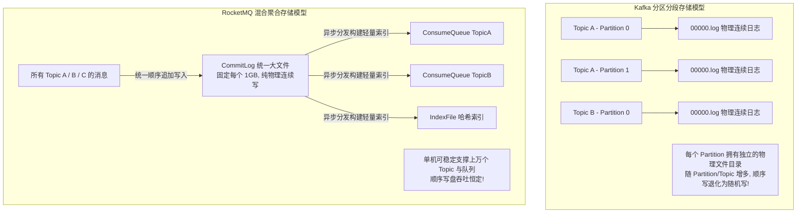
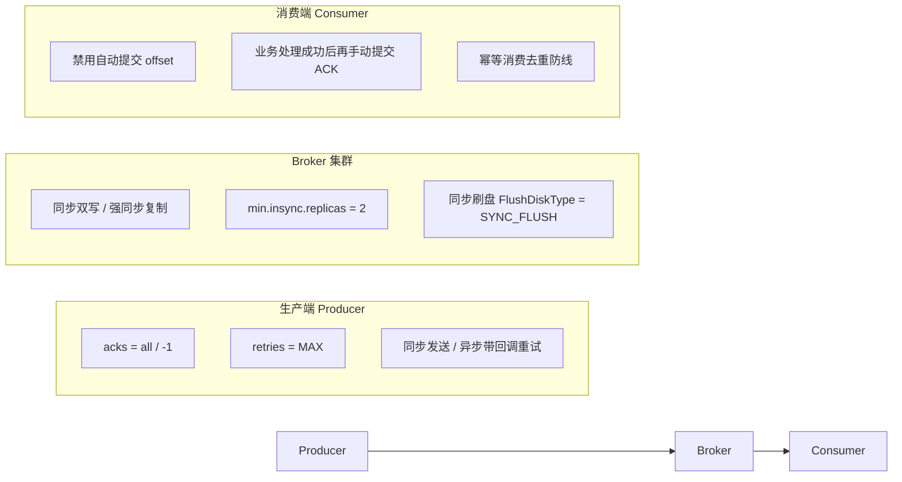
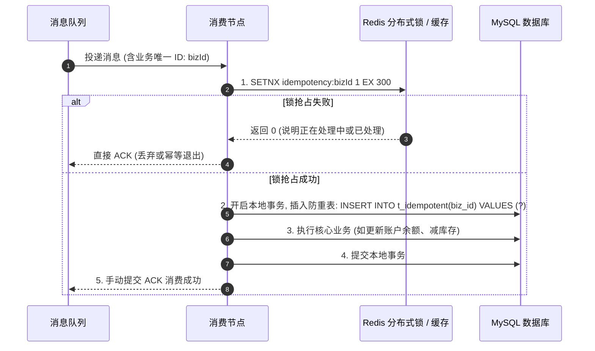
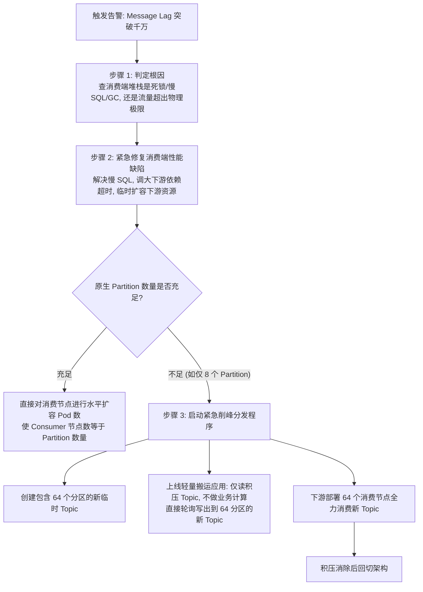

# Kafka与RocketMQ生产级高可靠投递与积压治理

在现代分布式微服务架构中，消息队列（Message Queue）承担着**异步解耦、削峰填谷、海量数据收集**的核心职能。然而，在金融交易、电商下单等严苛业务中，“消息丢失”会导致严重资损，“消息重复”会导致多次计费，“消息积压”会导致全链路系统雪崩。本文围绕 **Kafka 与 RocketMQ** 两大工业级消息引擎，深度解构其底层物理存储差异，给出“零丢失”全链路配置模型与千万级消息积压排障应急 SOP。

---

## 核心底层机制与全景架构

### 1. 底层存储模型终极对决：Kafka vs RocketMQ

存储引擎的物理设计直接决定了 MQ 的吞吐上限、分区扩展性与稳定性：



| 核心维度 | **Apache Kafka** | **Apache RocketMQ** |
| :--- | :--- | :--- |
| **存储设计理念** | **每个 Partition 对应一套物理目录与分段文件（`.log`, `.index`）** | **所有 Topic 混合共享单一物理 `CommitLog` 文件**，轻量逻辑队列 `ConsumeQueue` 仅存位移与 Tag 哈希 |
| **Topic 承载上限** | 数百个 Topic。若分区过多，底层由顺序写退化为磁头寻道**随机写**，吞吐断崖式下跌 | **轻松支撑上万个 Topic**。写入始终紧凑追加在单文件末尾，吞吐不受 Topic 数量影响 |
| **高性能物理武器** | **OS PageCache + 顺序写 + `sendfile` 零拷贝** | **PageCache + 内存映射 `mmap` + 文件预热** |
| **死信队列与重试** | 不支持原生重试/死信，需业务层自建 Topic | **原生完善的 16 级延时重试队列与死信队列（DLQ）** |
| **适用核心场景** | 大数据海量日志采集、流式计算（Flink/Spark） | **电商金融交易、订单结算、强一致性微服务编排** |

---

## 消息“零丢失”（Zero-Loss）全链路闭环保障

要保证分布式环境下数据绝对不丢，必须在**生产端、Broker 端、消费端**三方达成严格契约：



### 1. Kafka 零丢失黄金三角配置
- **Producer 端**：
  ```properties
  acks=all                         # 要求 ISR 列表中所有副本全部写入成功才返回 ACK
  retries=2147483647               # 重试次数设为最大值
  max.in.flight.requests.per.connection=1 # 保证单连接下消息重试时的绝对有序性
  ```
- **Broker 端**：
  ```properties
  min.insync.replicas=2            # ISR 最小可用写入副本数，小于此数拒绝写入
  unclean.leader.election.enable=false # 禁止非 ISR 副本竞选 Leader，杜绝脏 Leader 丢失历史数据
  ```
- **Consumer 端**：
  ```properties
  enable.auto.commit=false         # 彻底关闭自动提交位移，防止业务尚未处理完就提前提交
  ```

### 2. RocketMQ 零丢失黄金配置
- **Producer 端**：使用 `SendResult = producer.send(msg)` 同步发送，并校验 `sendResult.getSendStatus() == SendStatus.SEND_OK`；
- **Broker 端**：
  - 刷盘策略：`flushDiskType = SYNC_FLUSH`（同步刷盘，消息写入磁盘物理扇区才应答）；
  - 主从同步：`brokerRole = SYNC_MASTER`（同步双写，Master 必须等 Slave 写入成功才应答客户端）；
- **Consumer 端**：只有在业务处理完毕且本地事务提交后，才向 Broker 返回 `ConsumeConcurrentlyStatus.CONSUME_SUCCESS`。

---

## 消息幂等与消费去重防线

消息队列保证的是 **至少投递一次（At Least Once）**，在网络超时、重试、机器重启场景下，消息重复是常态。

### 生产级防重方案：业务唯一键 + 去重防重表



利用关系型数据库的**唯一索引约束（Unique Index）**作为终极屏障：若插入防重表抛出 `DuplicateKeyException`，说明已被成功处理，消费端直接安全返回 ACK。

---

## 线上千万级消息积压（Message Lag）突发紧急排障 SOP

**事故场景**：某电商大促突发告警，订单 Topic 消费积压从平时百条暴增至 8000 万条，且积压曲线持续飙升，下游库存扣减与通知瘫痪。



### 紧急排障执行命令清单与排查准则：
1. **查看积压与消费速率（Kafka）**：
   ```bash
   kafka-consumer-groups.sh --bootstrap-server localhost:9092 \
     --describe --group order-consumer-group
   ```
   重点观测 `LOG-END-OFFSET`（日志末端）、`CURRENT-OFFSET`（当前已消费位移）与 `LAG`（积压数）。
2. **为什么增加消费者数量有时完全没有效果？**
   - **核心物理铁律**：在 Kafka / RocketMQ 的集群消费模式下，**一个分区（Partition / Queue）在同一时间只能被同一个消费组下的一个消费者实例独占消费**。
   - 如果当前 Topic 只有 8 个分区，即便你扩容了 32 个消费者 Pod，依然**只有 8 个 Pod 能够分到数据，另外 24 个 Pod 处于完全饥饿空转状态**！
   - 解决方案：必须**先扩容 Topic 的 Partition 数量**，再等比扩容 Consumer 节点。

---

## 社招高频硬核连环追问

### Q1: Kafka 的单分区有序是如何做到的？如果需要保证全局有序该怎么做？
- **考点**：消息分区路由机制与顺序消费代价。
- **解析**：
  1. **单分区有序**：Kafka 保证在同一个 Partition 内部，消息是物理连续追加存储的，位移（Offset）严格单调递增。生产者在发送消息时，指定相同的 `Key`（如 `order_id`），Kafka 会使用默认的分区器对 Key 进行 MurmurHash2 计算取模，将相同 Key 的消息**路由到同一个 Partition** 中，消费端单线程消费该分区即可保证绝对有序。
  2. **全局有序**：
     - 若要实现全局有序，唯一的方案是**将该 Topic 的 Partition 数量强制设置为 1**，且消费端只能启动单一实例消费。
     - **生产代价极高**：设置单分区意味着彻底放弃了 Kafka 分布式并行读写的架构优势，系统的写入与消费吞吐上限被钉死在单机磁盘和单线程瓶颈上，生产上一般推荐基于业务 Key 的“局部有序”。

### Q2: Kafka 使用 PageCache 写入消息，如果操作系统突然宕机断电，消息会不会丢？
- **考点**：PageCache 刷盘机制与多副本复制容灾。
- **解析**：
  - Kafka 默认依赖 Linux 操作系统的后台 `pdflush / flush` 线程异步将 PageCache 刷入磁盘，**单机层面上是可能发生数据丢失的**。
  - Kafka 官方不推荐将 `flush.messages = 1`（每条消息强制 `fsync` 刷盘），因为这将导致磁盘 IOPS 打满，吞吐量跌落两个数量级。
  - **Kafka 保证持久性不丢的核心手段是：多副本冗余机制（Replication）**。
    通过 `acks=all` 和 `min.insync.replicas=2`，确保消息在应答成功前，已经由 Leader 同步到了至少 2 台物理独立服务器的 PageCache 中。两台物理机同时断电的概率极低，只要有一台存活，数据即可完整保留。
