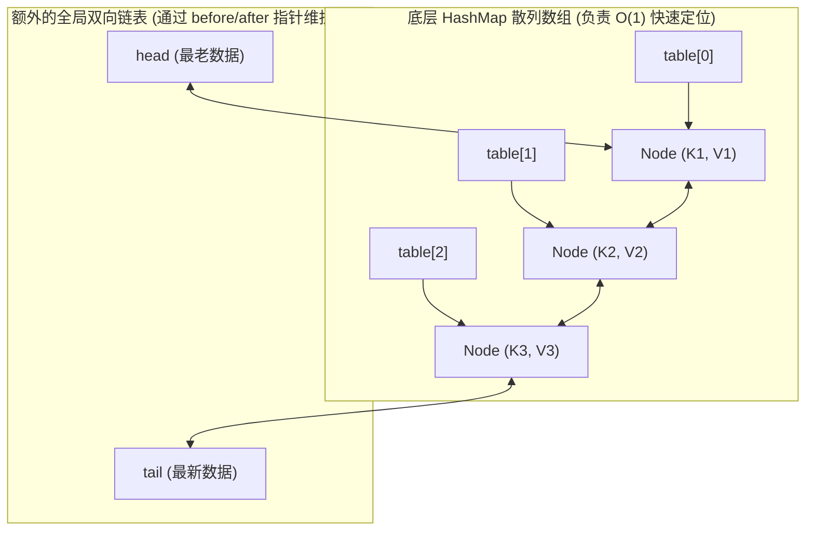

# LinkedHashMap 与 TreeMap 底层原理

普通的 `HashMap` 拥有极高的散列读写性能，但它最大的缺陷在于：**无序**。在迭代遍历 `HashMap` 时，输出顺序既不代表插入顺序，也不代表访问顺序。

当业务需要**维持数据的先后插入顺序、基于访问热度实现本地 LRU 缓存淘汰、或者按键值大小有序进行范围区间检索**时，`LinkedHashMap` 和 `TreeMap` 是必不可少的标准容器。

---

## 1. LinkedHashMap：双向链表与 LRU 缓存底座

`LinkedHashMap` 直接继承自 `HashMap`，其核心设计理念在于：**在普通 HashMap 离散哈希数组的基础上，额外通过一条全局的双向链表将所有的键值对串联起来**！



### 1.1 内部节点结构：`LinkedHashMap.Entry`
```java
// 继承自 HashMap.Node，额外增加了双向链表指针
static class Entry<K,V> extends HashMap.Node<K,V> {
    Entry<K,V> before, after; // 负责维护全局有序双向链表
    Entry(int hash, K key, V value, Node<K,V> next) {
        super(hash, key, value, next);
    }
}
```

---

### 1.2 两种核心排序模式：`accessOrder`
在构造函数中，有一个关键的布尔参数 `accessOrder`：
```java
public LinkedHashMap(int initialCapacity, float loadFactor, boolean accessOrder)
```
- **`accessOrder = false`（默认模式）**：
  **按插入顺序（Insertion Order）排序**。新插入的数据永远挂在全局双向链表的末尾，无论后续如何 `get()` 读取，链表顺序永远不变。
- **`accessOrder = true`（访问顺序模式 / LRU 模式）**：
  **按访问频次排序**！每次执行 `get(key)` 或更新 `put(key, newVal)` 时，底层会触发回调钩子 `afterNodeAccess(Node e)`，**将当前被访问的节点从链表中间摘除，并移动到双向链表的尾部（Tail）**！
  - 链表头部（Head）：代表最久未被访问的“冷数据”；
  - 链表尾部（Tail）：代表最近刚被访问的“热数据”。

---

### 1.3 核心生产实操：手写标准 LRU 本地缓存

利用 `LinkedHashMap`，仅需十几行代码即可实现一个功能完备的本地 LRU（Least Recently Used）缓存池：

```java
public class LruCache<K, V> extends LinkedHashMap<K, V> {
    private final int maxCapacity;

    public LruCache(int maxCapacity) {
        // initialCapacity, loadFactor=0.75f, accessOrder=true (启用访问顺序)
        super(maxCapacity, 0.75f, true);
        this.maxCapacity = maxCapacity;
    }

    /**
     * HashMap 在每次 put 成功后都会调用此方法判断是否需要淘汰老节点
     * 当当前元素个数超过预设上限时，返回 true 自动删除链表头部的最久未用节点！
     */
    @Override
    protected boolean removeEldestEntry(Map.Entry<K, V> eldest) {
        return size() > maxCapacity;
    }
}
```

---

## 2. TreeMap：红黑树自平衡与范围区间检索

`TreeMap` 与 `HashMap` 毫无血缘关系，它直接实现了 **`NavigableMap`**（继承自 `SortedMap`），其底层是一棵严格的 **红黑树（Red-Black Tree）**。

### 2.1 核心特性与复杂度
- **有序性**：内部所有的 Key 永远处于自然升序或指定的 `Comparator` 排序状态。
- **时间复杂度**：增删改查的所有操作，时间复杂度严格保证为稳定的 **$O(\log_2 N)$**。
- **键的约束**：Key **绝不能为 `null`**（除非自定义比较器允许），且 Key 的类型必须实现 `Comparable` 接口，或者在构造时显式传入 `Comparator`。

### 2.2 强大的范围区间检索能力
普通哈希表无法回答“请找出 Key 大于 100 且小于 200 的所有订单”，而 `TreeMap` 提供了一整套强大的区间 API：
```java
TreeMap<Integer, String> treeMap = new TreeMap<>();
treeMap.put(10, "A");
treeMap.put(20, "B");
treeMap.put(30, "C");
treeMap.put(40, "D");

// 1. 获取第一个和最后一个键
Integer first = treeMap.firstKey(); // 10
Integer last = treeMap.lastKey();   // 40

// 2. 边界寻找 (Ceiling / Floor)
Integer ceil = treeMap.ceilingKey(25); // 返回 >= 25 的最小键 -> 30
Integer floor = treeMap.floorKey(25);  // 返回 <= 25 的最大键 -> 20

// 3. 区间截取 (SubMap)
SortedMap<Integer, String> sub = treeMap.subMap(15, 35); // 截取 [15, 35) 的子视图 -> 包含 20, 30
```

---

## 3. 选型权衡全景对比

| 容器类型 | 底层数据结构 | 是否有序 | 时间复杂度 | 核心优势场景 |
|:---|:---|:---|:---:|:---|
| **`HashMap`** | 散列数组 + 链表 + 红黑树 | 无序 | $O(1)$ | 追求极致读写吞吐，无顺序诉求的常规缓存 |
| **`LinkedHashMap`** | 散列数组 + 全局双向链表 | **插入有序 / 访问热度有序** | $O(1)$ | 需要保留先后顺序、或构建本地 LRU 缓存池 |
| **`TreeMap`** | 纯红黑树 | **按 Key 大小自然或自定义有序** | $O(\log_2 N)$ | 需要按键排序、区间范围截取、求上下界（Ceiling/Floor） |
