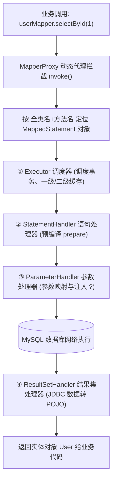

# MyBatis核心原理与插件实战

## 使用入口：先解决问题，再做验证

将 Java 方法映射成参数化 SQL 并按需扩展。

**先做基本操作**：先写 Mapper 完成查询和更新，验证绑定、行数与日志，再研究代理和拦截器。初次学习可先完成[本模块基础实践](/doc/Java/Java语言基础与日常开发)。

**再逐步深入**：基本 API 与输入输出 → 常见失败和使用边界 → 场景排查与优化 → 本文机制分析与源码。面试先讲用途和自己的操作过程，再回答场景与原理追问。

> **一句话大白话**：
> - **Mapper 接口为什么没写实现类就能跑？** 因为 MyBatis 在启动时用 **JDK 动态代理** 动态捏造了一个 `MapperProxy` 替身注入 Spring。你调 `userMapper.selectById(1)`，替身就顺着“接口全名 + 方法名”去 XML 或注解里把那句 SQL 翻出来，交给底层 JDBC 塞参执行。
> - **插件机制是什么？** 就是在 MyBatis 执行 SQL 必经的四大关卡（调度器、SQL预编译、参数设置、结果映射）设下“安检门”，让你能在 SQL 执行前后做耗时统计、分库分表改写、敏感数据自动加解密。

---

## 30 秒生活比喻：外卖平台的「智能骑手系统」

- **Mapper 接口与 XML（外卖菜单与点单系统）**：
  你（调用者）在手机上点了一份“宫保鸡丁”（调了 `OrderMapper.selectById()` 接口方法）。接口本身只是一张**菜单纸（无实现类）**。
  - **`MapperProxy`（外卖智能调度系统）**：调度系统接单后，拿着菜单上的名字，在后厨菜单库（`MappedStatement`）里找到这道菜的标准做法（对应的 SQL 语句模板）。
  - **四大金刚执行链路**：
    - **`Executor`（后厨总调度）**：协调是否从保温箱（缓存）里直接拿，还是要起锅烧油。
    - **`StatementHandler`（掌勺大厨）**：把生铁锅架在炉子上（创建 JDBC `PreparedStatement` 预编译 SQL）。
    - **`ParameterHandler`（配菜工）**：把大葱、辣椒、鸡丁按克重精准称好倒进锅里（为 SQL 中的占位符 `?` 注入参数）。
    - **`ResultSetHandler`（装盘打包员）**：把炒好的菜盛进外卖盒，打包成整齐的套餐交付给你（将数据库行记录转成 Java 实体对象）。

---

## 一张图看懂 Mapper 代理与四大对象执行链路



---

## 一、Mapper 代理底层源码闭环拆解

为什么我们在 Spring 中直接 `@Autowired private UserMapper userMapper;` 能够无缝注入？

1. **扫描与 BeanDefinition 注册**：
   Spring 启动时，`@MapperScan` 引入 `MapperScannerRegistrar`，扫描指定包下的接口，并将它们的 Bean 定义全部偷换为 **`MapperFactoryBean`**（Spring 的工厂 Bean）。
2. **生成代理对象**：
   在 `MapperFactoryBean.getObject()` 阶段，委托 MyBatis 核心配置对象 `Configuration`，调用 `MapperProxyFactory.newInstance(sqlSession)`。底层使用 **`Proxy.newProxyInstance()`** 创建出 `MapperProxy` 代理实例放入 Spring 单例池。
3. **方法调用路由（`MapperMethod`）**：
   当调用接口方法时，触发 `MapperProxy.invoke()`：
   - 过滤 `Object` 的基础方法（如 `toString`、`hashCode`、`equals`）；
   - 从缓存的 `Map<Method, MapperMethodInvoker>` 中取出 `MapperMethod`；
   - 根据 SQL 类型（SELECT / INSERT / UPDATE / DELETE），委派给底层 `SqlSession`（如 `sqlSession.selectOne(...)`）。

---

## 二、MyBatis 拦截器插件架构

MyBatis 允许使用插件（Interceptor）以责任链模式拦截以下**四大核心对象**的指定方法：

| 拦截对象 | 核心职责 | 最常见的拦截切入点 | 典型应用场景 |
|---|---|---|---|
| **`Executor`** | 顶层调度器，负责读写缓存与事务提交 | `update`, `query`, `commit`, `rollback` | 跨库事务管控、分库分表路由、分布式多租户隔离 |
| **`StatementHandler`** | 负责 JDBC Statement 的预编译与底层执行 | `prepare`, `parameterize`, `batch`, `update`, `query` | **慢 SQL 告警统计、分页参数自动改写（PageHelper）** |
| **`ParameterHandler`** | 负责将 Java 参数对象映射到预编译的占位符 `?` | `getParameterObject`, `setParameters` | **手机号/身份证入库前自动加密脱敏** |
| **`ResultSetHandler`** | 负责将 JDBC 查询结果行转换为 Java 领域对象 | `handleResultSets`, `handleOutputParameters` | **敏感数据出库解密、大字段数据流式转换** |

---

## 三、实战手写：企业级慢 SQL 监控告警拦截器

在真实生产中，当接口响应慢时，排查是哪个 SQL 拖垮了数据库至关重要。下面实现一个拦截 `StatementHandler` 的轻量级慢 SQL 自动告警插件：

```java
package com.example.mybatis.interceptor;

import org.apache.ibatis.executor.statement.StatementHandler;
import org.apache.ibatis.mapping.BoundSql;
import org.apache.ibatis.plugin.*;
import org.slf4j.Logger;
import org.slf4j.LoggerFactory;

import java.sql.Connection;
import java.util.Properties;

/**
 * 拦截 StatementHandler 的 prepare 方法（SQL 预编译前开始计时）
 */
@Intercepts({
    @Signature(
        type = StatementHandler.class,
        method = "prepare",
        args = {Connection.class, Integer.class}
    )
})
public class SlowSqlMonitorInterceptor implements Interceptor {

    private static final Logger log = LoggerFactory.getLogger(SlowSqlMonitorInterceptor.class);

    // 默认慢 SQL 告警阈值（毫秒），支持在配置中覆写
    private long slowThresholdMs = 1000;

    @Override
    public Object intercept(Invocation invocation) throws Throwable {
        long startTime = System.currentTimeMillis();
        try {
            // 放行，让责任链下一个拦截器或真实目标方法执行
            return invocation.proceed();
        } finally {
            long cost = System.currentTimeMillis() - startTime;
            if (cost > slowThresholdMs) {
                // 取出当前拦截的目标 StatementHandler
                StatementHandler statementHandler = (StatementHandler) invocation.getTarget();
                BoundSql boundSql = statementHandler.getBoundSql();
                String rawSql = boundSql.getSql();
                // 格式化压缩 SQL 换行与多余空格
                String cleanSql = rawSql.replaceAll("\\s+", " ").trim();
                
                log.warn("⚠️ [生产慢SQL告警] 耗时: {} ms (阈值: {} ms) | 执行SQL: {}",
                        cost, slowThresholdMs, cleanSql);
            }
        }
    }

    @Override
    public Object plugin(Object target) {
        // 使用 JDK 动态代理将当前拦截器包裹到目标对象外层
        return Plugin.wrap(target, this);
    }

    @Override
    public void setProperties(Properties properties) {
        String threshold = properties.getProperty("slowThresholdMs");
        if (threshold != null && !threshold.isEmpty()) {
            this.slowThresholdMs = Long.parseLong(threshold);
        }
    }
}
```

### 在 SpringBoot 中注册插件
```java
@Configuration
public class MyBatisConfig {
    @Bean
    public SlowSqlMonitorInterceptor slowSqlMonitorInterceptor() {
        return new SlowSqlMonitorInterceptor();
    }
}
```

---

## 四、生产避坑速查表

| 现象 | 根因剖析 | 快速排查与避坑指南 |
|---|---|---|
| **`BindingException: Invalid bound statement (not found)`** | 1. 接口名/方法名与 XML 的 `namespace` 或 `id` 不匹配；<br/>2. Maven 打包漏了 XML（资源未打包进 target 目录）；<br/>3. `application.yml` 里的 `mapper-locations` 路径写错 | 检查 Target 目录下是否存在对应的 `.xml` 文件，确认编译路径是否包含了通配符 `classpath*:mapper/**/*.xml` |
| **插件在分页时把总数查成了第一页的数量** | 插件执行顺序不对。如果写了自定义拦截器改变了 SQL，晚于 PageHelper 执行，会导致分页包装失效 | 拦截器遵循责任链模式，明确多个插件的 `@Order` 优先级，将分页拦截器置于最外层 |
| **插件中修改了参数但 DB 没生效** | 拦截了错误的切入点。如果拦截 `Executor` 修改参数，但下游 `ParameterHandler` 已拿到旧入参 | 修改 SQL 占位参数应优先拦截 `ParameterHandler.setParameters` 或在 `Executor.query` 阶段重置 `BoundSql` |
| **Mapper 出现方法重载导致报错** | MyBatis 底层用 `全类名.方法名` 作为 StatementId 存入 Map 字典，**天然不支持严格的方法重载** | 业务 Mapper 接口严禁定义同名同重载方法，每个 SQL 方法名必须全局唯一 |

---

## 五、高频面试追问（含高分/低分特征）

| 追问 | 高分回答要点 | 低分回答特征 |
|---|---|---|
| **Q1: Mapper 接口允许定义同名重载方法吗？** | 原则上不支持。MyBatis 内部通过 `接口全路径.方法名` 作为 Key 寻找 `MappedStatement`。若有重载，两个同名方法指向同一个 XML ID，无法精准区分参数形态。虽然可以通过不同参数反射分支做妥协，但属于反模式，极易出错。 | “可以重载，跟 Java 普通方法一样”。 |
| **Q2: MyBatis 插件的实现机制是什么？** | 基于 **动态代理（JDK Proxy）** 与 **责任链模式**。通过实现 `Interceptor` 接口并标注 `@Intercepts` 指定四大对象的方法签名。容器初始化时循环调用 `Plugin.wrap()`，层层包裹生成代理对象。调用时逐层触发 `intercept()`。 | 只说“配置一个拦截器就可以了”。 |
| **Q3: 执行一条 SQL 时，四大对象被创建了几次？** | 每执行一次 SQL 操作，`Executor` 是复用当前 `SqlSession` 的单例对象；而 `StatementHandler`、`ParameterHandler`、`ResultSetHandler` 是**每次执行具体 SQL 时全新创建的局部对象**，执行完即随方法栈销毁。 | “全部都是单例，只创建一次”。 |
