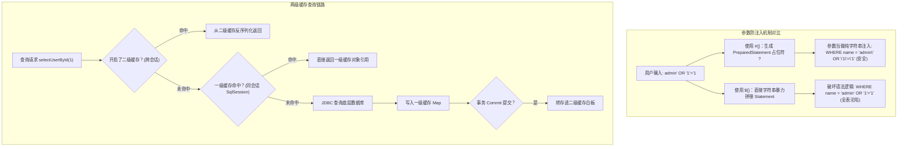

# MyBatis缓存机制与SQL注入防范

## 使用入口：先解决问题，再做验证

避免 SQL 拼接风险并理解查询缓存边界。

**先做基本操作**：先用绑定参数查询特殊字符、动态排序采用白名单，再在不同会话和事务下观察缓存。初次学习可先完成[本模块基础实践](/doc/Java/Java语言基础与日常开发)。

**再逐步深入**：基本 API 与输入输出 → 常见失败和使用边界 → 场景排查与优化 → 本文机制分析与源码。面试先讲用途和自己的操作过程，再回答场景与原理追问。

> **一句话大白话**：
> - **SQL 注入防范**：`#{}` 是**安全填空题**，数据库把 `?` 预编译当成纯文本内容处理，即使你输入恶意代码也只能算个普通字符串；而 `${}` 是**生硬拼字游戏**，你输入什么它就拼什么，直接破坏 SQL 语法结构导致家底被偷空。
> - **两级缓存机制**：一级缓存是**单个对话的草稿纸（SqlSession）**，会话结束即撕毁；二级缓存是**同一个科目跨桌共享的白板（Mapper Namespace）**。在分布式微服务时代，二级缓存因为跨实例无法同步脏数据，**在生产中属于“坚决关闭的大坑”**！

---

## 30 秒生活比喻：安全安检与公司公共白板

- **`#{}` vs `${}`（安检通道 vs 敞开后门）**：
  - **`#{}`（安检机包裹）**：旅客（用户输入参数）进入机场，无论你长得像炸弹还是拿着打火机，安检员全部装进封闭安检箱贴上标签（占位符 `?`），当成普通行李运送，绝不可能引爆飞机。
  - **`${}`（敞开后门直接放行）**：你告诉门卫“带一个包裹进去”，结果旅客大喊“我是局长，全体放行 OR 1=1”，门卫不做任何过滤直接把这话拼进广播，所有大门瞬间为攻击者全开（SQL 注入成功）。
- **一级缓存与二级缓存（个人记事本 vs 办公室跨部门白板）**：
  - **一级缓存（业务员手头的记事本）**：同一笔业务（SqlSession）内，刚刚查过张三的电话，5 秒内再问，直接看记事本不翻总档案库。一旦在记事本上修改或退单（`insert/update/delete`），记事本立刻涂黑作废。
  - **二级缓存（挂在走廊的跨班次白板）**：一班员工在白板上记了商品库存为 10；但二班员工（另一个服务器实例）把库存扣减到了 0，却没有跨楼层擦除一班的白板，导致一班一直看着过期的数字卖出超卖商品（脏读）。

---

## 一张图看懂 SQL 参数编译与两级缓存流转



---

## 一、`#{}` 与 `${}` 的底层本质差异与防注入实战

### 1. 为什么 `${}` 极度危险？（源码与攻击复现）
```xml
<!-- ❌ 危险的 Mapper.xml 写法：直接文本拼装 -->
<select id="findByUsernameDangerous" resultType="User">
    SELECT id, username, phone, role
    FROM sys_user
    WHERE username = '${username}' AND status = 1
</select>
```

#### 攻击者注入实战复现
如果攻击者在网页表单中输入：
```text
admin' OR '1'='1' --
```
最终在数据库执行的原始 SQL 直接变成：
```sql
SELECT id, username, phone, role
FROM sys_user
WHERE username = 'admin' OR '1'='1' --' AND status = 1
```
`--` 将后面的逻辑全部注释掉，`OR '1'='1'` 恒成立，数据库直接将管理员信息及全表隐私泄露！

---

### 2. `#{}` 如何对参数值进行安全绑定？
```xml
<!-- ✅ 安全规范的推荐写法 -->
<select id="findByUsernameSafe" resultType="User">
    SELECT id, username, phone, role
    FROM sys_user
    WHERE username = #{username} AND status = 1
</select>
```
MyBatis 在解析 `#{}` 时，会将其替换为 JDBC 原生占位符：
```sql
SELECT id, username, phone, role FROM sys_user WHERE username = ? AND status = 1
```
底层调用 JDBC 的 `PreparedStatement.setString(1, input)`。数据库在执行前已经完成了 SQL 语法的词法分析与执行计划生成，用户输入的值仅仅被当做纯文本字面量绑定，根本无法改变 SQL 的语法抽象树（AST）。

---

### 3. 必须使用 `${}` 的特定场景与安全兜底方案
在某些场景下，由于 SQL 语法限制，不能在占位符位置放 `?`：
- **动态列名排序**：`ORDER BY ${column} ${sortType}`（数据库不支持 `ORDER BY ?`）；
- **动态分表名切换**：`FROM order_${tableIndex}`；
- **动态指定查询字段**：`SELECT ${selectColumns} FROM ...`。

#### 生产安全白名单防御代码
如果必须用 `${}`，**严禁将未经校验的前端入参直接透传进 Mapper**，必须在 Java 代码层进行严格的白名单校验：

```java
@Service
public class UserService {

    // 1. 定义合法的排序列名白名单
    private static final Set<String> ALLOWED_SORT_COLUMNS = Set.of("id", "create_time", "age", "score");
    private static final Set<String> ALLOWED_SORT_ORDERS = Set.of("ASC", "DESC");

    @Autowired
    private UserMapper userMapper;

    public List<User> getUserList(String sortColumn, String sortOrder) {
        // 2. 强校验防注入防御网
        if (!ALLOWED_SORT_COLUMNS.contains(sortColumn.toLowerCase())) {
            throw new IllegalArgumentException("非法的排序列名，涉嫌注入攻击: " + sortColumn);
        }
        if (!ALLOWED_SORT_ORDERS.contains(sortOrder.toUpperCase())) {
            throw new IllegalArgumentException("非法的排序方向: " + sortOrder);
        }

        // 3. 经过白名单安全过滤后，方可传入 ${}
        return userMapper.listUsersOrderBy(sortColumn, sortOrder);
    }
}
```

---

## 二、一级缓存与二级缓存深度剖析

### 1. 一级缓存（SqlSession 作用域）
- **实现原理**：内部维护了一个简单的 `HashMap<CacheKey, Object>`。Key 由 Statement ID、SQL 语句、分页参数、入参以及环境 ID 共同 Hash 构成。
- **生命周期**：与 `SqlSession` 完全同生共死。
- **清除触发点**：
  1. 会话内执行了任何一次 `insert`、`update`、`delete` 操作（无论更新哪张表，当前 SqlSession 的一级缓存全部刷空！）；
  2. 手动调用 `sqlSession.commit()`、`sqlSession.rollback()` 或 `sqlSession.clearCache()`；
  3. Spring 整合环境下：若未开启 `@Transactional` 事务，每次调用 Mapper 都会新建并关闭一个独立的 `SqlSession`，此时**一级缓存实际上完全不生效**！

---

### 2. 二级缓存（Mapper Namespace 作用域）与生产大坑
- **实现原理**：跨 `SqlSession` 共享，缓存数据必须实现 `Serializable` 序列化接口。在事务 `commit()` 之后才会真正刷入二级缓存。
- **生产架构大忌**：
  - **在分布式、集群微服务环境下，严禁开启 MyBatis 二级缓存！**
  - **为什么？** 二级缓存是**单机 JVM 进程内内存**。如果应用部署了 3 台机器（节点 A、B、C）。当用户在节点 A 修改了商品价格，节点 A 刷掉了自身的二级缓存；但节点 B 和 C 的二级缓存全然不知，依然拿着旧的过期价格卖给用户，**直接产生严重的分布式脏数据**！
  - **解决方案**：业务数据缓存一律交由分布式中间件（Redis / Memcached）并配合缓存双删或 Canal 监听 binlog 统一治理。

---

## 三、生产避坑速查表

| 场景 | 危险等级 | 根因机制 | 工业级避坑对策 |
|---|---|---|---|
| **`LIKE` 模糊查询拼接错误** | 极高 | 开发者偷懒写 `LIKE '%${keyword}%'` 导致 SQL 注入 | 改用内置函数：`LIKE CONCAT('%', #{keyword}, '%')`，全参数化绑定 |
| **`IN` 范围查询拼接字符串** | 高 | 字符串拼接 `WHERE id IN (${ids})` 容易被注入恶意条件 | 使用 MyBatis 原生标签：`<foreach item="id" collection="ids" open="(" separator="," close=")">#{id}</foreach>` |
| **无事务导致一级缓存失效** | 低 | 没加 `@Transactional` 时，Spring 每次执行完 SQL 立即自动 close 会话 | 理解机制：需要会话级别缓存或批量复用时开启事务，或直接使用 Redis 缓存 |
| **多表关联更新导致二级缓存脏读** | 极高 | 二级缓存基于单 Mapper Namespace，修改了从表，主表的二级缓存不会被联动清空 | 生产直接全局关闭二级缓存：`mybatis.configuration.cache-enabled=false` |

---

## 四、高频面试追问（含高分/低分特征）

| 追问 | 高分回答要点 | 低分回答特征 |
|---|---|---|
| **Q1: `#{}` 和 `${}` 在底层处理上有何不同？** | `#{}` 采用 JDBC `PreparedStatement` 占位符 `?`，由数据库驱动进行安全转义与参数绑定，避免恶意指令改变 AST 语法结构，防注入且能复用执行计划；`${}` 是单纯的字符串拼接（Statement），存在严重的 SQL 注入风险，仅限白名单过滤后的字段排序或分表。 | “一个带引号，一个不带引号”。 |
| **Q2: Spring 环境下，一级缓存什么时候会失效？** | 1. 执行了写操作（insert/update/delete）；<br/>2. 手动 commit/rollback；<br/>3. **最容易被忽略的点**：没有加 `@Transactional` 事务时，Spring 的 `SqlSessionTemplate` 每次查询都是全新创建并关闭 SqlSession，导致两次查询根本不在同一会话内，一级缓存不生效。 | 只背出了“增删改之后失效”。 |
| **Q3: 为什么大厂微服务规范中普遍要求关闭 MyBatis 二级缓存？** | 二级缓存是进程内单机缓存，跨多实例无法感知数据变更，多节点并发写时必定造成严重的分布式数据不一致；同时多表关联查询时，修改了关联表无法主动失效主表缓存。统一采用 Redis 集中式缓存是业界标准方案。 | “因为二级缓存耗内存”。 |


参数绑定保护的是值位置，不是任意 SQL 结构。表名、列名、排序方向需白名单；允许用户输入拼进动态 SQL 的其他位置仍有风险。实际安全验证要覆盖全部拼接路径，不能仅看 Mapper 中出现了 #{}。
