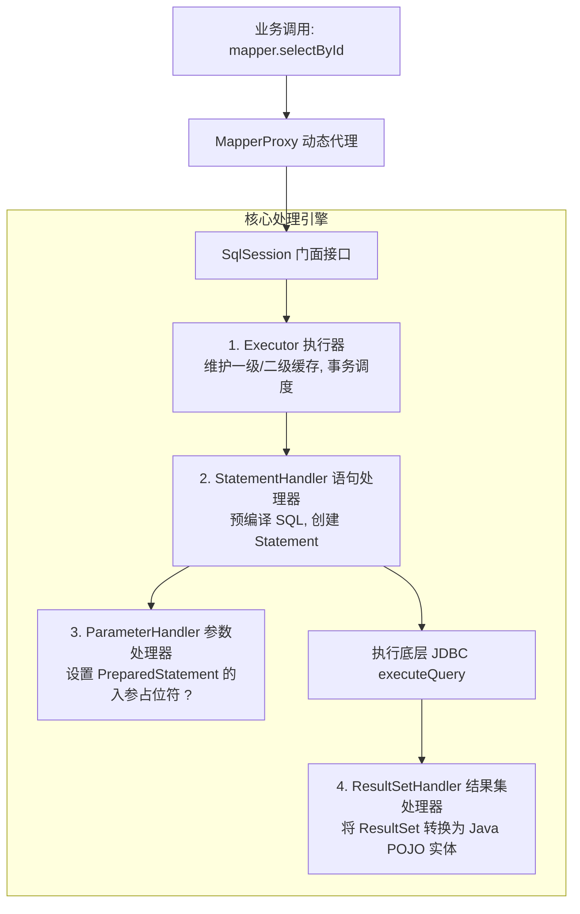
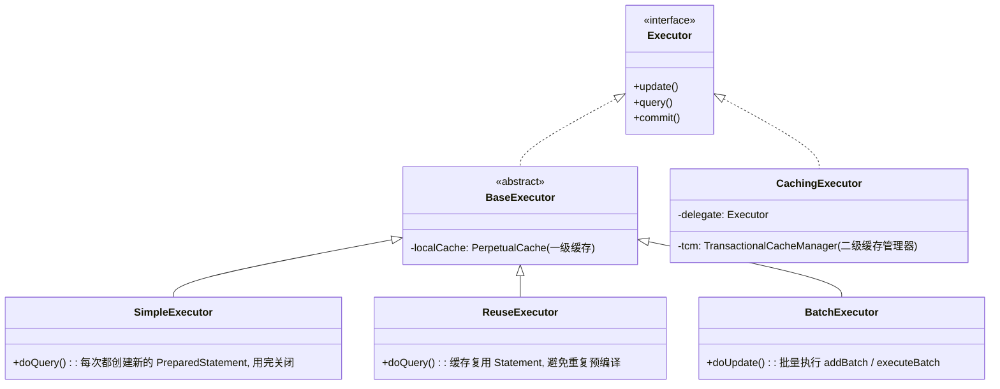

# MyBatis核心架构SQL映射与插件拦截器实战

MyBatis 作为 Java 生态中最经典的半自动 ORM（对象关系映射）框架，凭借灵活的 SQL 自定义控制力、轻量高效的映射机制，成为国内中大型互联网公司的标配数据访问层。本篇将深入剖析 MyBatis 核心执行链路中的“四大金刚”对象，揭秘插件拦截器的动态代理实现，并深度拆解一级/二级缓存的设计缺陷与生产禁用规范。

---

## 核心底层机制与全景架构

### 1. MyBatis 核心架构与“四大金刚”执行生命周期

当执行 `User user = userMapper.selectById(1L)` 时，MyBatis 底层调用链条严格流转于四个核心对象（俗称“四大金刚”）：



#### 四大核心对象职责细分：
1. **`Executor`**：执行器，SQL 调度的真正总指挥。负责查询缓存维护（`CachingExecutor`）、事务管理及批处理调度；
2. **`StatementHandler`**：负责与 JDBC `Statement` 交互，包括 SQL 语句预编译、参数设置调度；
3. **`ParameterHandler`**：负责将 Java 对象参数根据 `TypeHandler` 转换为 JDBC 类型并绑定到 `PreparedStatement` 占位符 `?` 上；
4. **`ResultSetHandler`**：负责将数据库返回的 JDBC `ResultSet` 游标行映射转换为对应的 Java 实体对象。

---

## 源码级架构物理拆解

### 1. 三种基础 Executor 与 CachingExecutor 装饰器

`Configuration.newExecutor()` 会根据配置构建对应的执行器：



- **`SimpleExecutor`（默认）**：每次执行 SQL 都向连接申请全新的 `Statement`，执行完毕立即 `close()`。
- **`ReuseExecutor`**：内部维护 `Map<String, Statement>`，以 SQL 文本为 Key 复用已编译的 `Statement`。
- **`BatchExecutor`**：针对批量 `INSERT/UPDATE`，调用 JDBC `statement.addBatch()`，最后统一调用 `executeBatch()` 一次性刷入数据库。
- **`CachingExecutor`（二级缓存装饰器）**：若全局开启了二级缓存（`cacheEnabled=true`），Spring Boot 会用 `CachingExecutor` 包裹上述三种原生执行器。查询时先查二级缓存，未命中再下钻到 `BaseExecutor` 查一级缓存与数据库。

---

### 2. 插件拦截器（Plugin / Interceptor）实现原理

MyBatis 的扩展机制极具设计美感，允许开发者在“四大金刚”的所有核心方法上进行拦截增强：
- `Executor` (`update`, `query`, `flushStatements`, `commit`, `rollback` 等)
- `StatementHandler` (`prepare`, `parameterize`, `batch`, `update`, `query` 等)
- `ParameterHandler` (`getParameterObject`, `setParameters`)
- `ResultSetHandler` (`handleResultSets`, `handleOutputParameters`)

#### 插件链拦截底层机制：
当四大金刚被 `Configuration.newXXX()` 创建时，都会调用 `interceptorChain.pluginAll(target)`：
```java
// org.apache.ibatis.plugin.InterceptorChain#pluginAll
public Object pluginAll(Object target) {
    for (Interceptor interceptor : interceptors) {
        // 责任链循环：每经过一个拦截器，就生成一层动态代理包装
        target = interceptor.plugin(target);
    }
    return target;
}
```
`Plugin.wrap(target, interceptor)` 利用 **JDK 动态代理** 生成代理对象。当被拦截方法执行时，进入 `Plugin.invoke()`，若方法签名匹配 `@Signature` 则调用 `interceptor.intercept(invocation)`，否则直接 `method.invoke(target, args)` 透传。

---

## 一级缓存与二级缓存的生产大坑

### 1. 一级缓存（Local Cache / SqlSession 级别）
- **数据结构**：`BaseExecutor` 内部持有一个 `PerpetualCache`，本质是一个普通的 `HashMap`。
- **作用域**：仅在同一个 `SqlSession` 内生效。
- **清空条件**：
  1. 当前 SqlSession 执行了任意 `INSERT`、`UPDATE`、`DELETE` 操作；
  2. 显式调用 `sqlSession.clearCache()` 或 `commit()` / `rollback()`；
  3. 执行的映射语句配置了 `flushCache="true"`。
- **大厂避坑**：在 Spring 环境下，若没有开启事务，每次查询 Spring 都会获取新的 `SqlSession` 并立即关闭，**导致一级缓存完全失效**！

### 2. 二级缓存（Namespace 级别）与分布式脏读
- **作用域**：Mapper 级别的全局缓存，跨不同的 `SqlSession` 共享。
- **核心要求**：存储的实体 POJO 必须实现 `Serializable` 接口。
- **为什么大型互联网大厂必须强制禁用二级缓存？**
  1. **跨服务多节点脏读**：MyBatis 二级缓存是**JVM 本地内存缓存**。在多机器集群部署下，A 节点修改了数据库，B 节点的二级缓存无法感知失效，导致 B 节点持续读出过期脏数据；
  2. **多表关联联查脏读**：二级缓存基于 Mapper Namespace 隔离。若 `UserMapper.xml` 中联合查询了 `orders` 表，此时通过 `OrderMapper.xml` 修改了订单状态，MyBatis **只会清空 OrderMapper 对应的二级缓存，UserMapper 下缓存的关联查询结果完全不会刷新**，引发严重的业务数据脏读！
- **生产规范**：`mybatis.configuration.cache-enabled = false`。全量读缓存统一由 Redis 分布式缓存承担。

---

## 生产级插件实战：SQL 慢查询耗时与敏感字段脱敏拦截器

需求：针对所有 SQL 查询，记录真实执行耗时；并在结果集映射后，自动对手机号进行掩码脱敏。

```java
@Intercepts({
    @Signature(
        type = StatementHandler.class, 
        method = "query", 
        args = {Statement.class, ResultHandler.class}
    )
})
public class SqlPerformanceAndDesensitizeInterceptor implements Interceptor {

    private static final Logger log = LoggerFactory.getLogger(SqlPerformanceAndDesensitizeInterceptor.class);

    @Override
    public Object intercept(Invocation invocation) throws Throwable {
        long startTime = System.currentTimeMillis();
        try {
            // 执行原始查询
            return invocation.proceed();
        } finally {
            long cost = System.currentTimeMillis() - startTime;
            StatementHandler handler = (StatementHandler) invocation.getTarget();
            BoundSql boundSql = handler.getBoundSql();
            String sql = boundSql.getSql().replaceAll("\\s+", " ");
            
            // 超过 1000ms 告警
            if (cost > 1000) {
                log.warn("[SQL-SLOW] 耗时: {} ms, SQL: {}", cost, sql);
            }
        }
    }

    @Override
    public Object plugin(Object target) {
        return Plugin.wrap(target, this);
    }

    @Override
    public void setProperties(Properties properties) {
        // 读取插件自定义配置
    }
}
```

---

## 社招高频硬核连环追问

### Q1: `#{}` 和 `${}` 在 MyBatis 底层处理上有何本质区别？
- **考点**：SQL 预编译与 SQL 注入防御。
- **解析**：
  1. **`#{}`（预编译占位符）**：
     - MyBatis 会将其解析为 JDBC 的占位符 `?`；
     - 底层调用 `PreparedStatement.setXXX()` 进行类型安全的入参设值；
     - 能够**彻底免疫 SQL 注入攻击**。
  2. **`${}`（字符串文本替换）**：
     - MyBatis 在 SQL 解析阶段，通过 OGNL 表达式直接将参数值进行**纯字符串拼接**；
     - 存在严重 SQL 注入风险，仅能用于无法预编译的场景（如动态表名、动态列名、`ORDER BY ${column}`）。对于此类场景，参数必须在 Java 层经过严格的白名单枚举校验。

### Q2: Mapper 接口没有写任何实现类，为什么调用它的方法就能执行 SQL？
- **考点**：`MapperProxy` 与 JDK 动态代理。
- **解析**：
  1. 在 Spring 整合 MyBatis 时，`MapperScannerConfigurer` 扫描接口并将其实例化为 `MapperFactoryBean`；
  2. `MapperFactoryBean` 内部调用 `SqlSession.getMapper(Class<T> type)`；
  3. MyBatis 使用 JDK 原生 `Proxy.newProxyInstance()` 动态创建了实现了该接口的代理对象，其 InvocationHandler 为 `MapperProxy`；
  4. 当业务代码调用方法时，被 `MapperProxy.invoke()` 拦截，根据“接口全类名 + 方法名”精准定位到对应的 `MappedStatement`，进而调用 `SqlSession.selectOne/selectList` 完成真实 SQL 发送。

---

## 生产级避坑指南与故障排查 SOP

### 1. 批量插入（Batch Insert）性能翻倍调优

**常见误区**：在 `<insert>` 标签中使用 `<foreach>` 拼接几万条 `INSERT INTO table VALUES (...), (...)...`。
- **风险**：SQL 文本过长会触发 MySQL `max_allowed_packet` 异常崩溃，且解析超大 SQL 树导致应用 CPU 飙升。

**高性能 SOP**：
使用 `BatchExecutor`（或通过 `SqlSessionTemplate` 指定 `ExecutorType.BATCH`）：
```java
@Autowired
private SqlSessionFactory sqlSessionFactory;

public void batchInsertUsers(List<User> list) {
    try (SqlSession sqlSession = sqlSessionFactory.openSession(ExecutorType.BATCH, false)) {
        UserMapper mapper = sqlSession.getMapper(UserMapper.class);
        int batchSize = 1000;
        for (int i = 0; i < list.size(); i++) {
            mapper.insert(list.get(i));
            if ((i + 1) % batchSize == 0 || i == list.size() - 1) {
                // 阶段性提交至底层 JDBC
                sqlSession.commit();
                sqlSession.clearCache(); // 清理一级缓存，防止 OOM
            }
        }
    }
}
```
通过物理级批处理命令交互，将千万级插入吞吐提升 5~10 倍。
