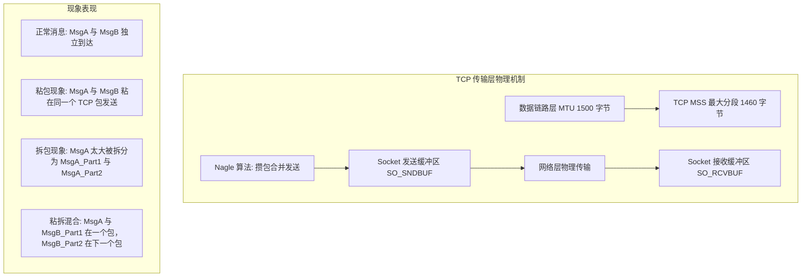

# Netty网络编解码粘包拆包与心跳检测实战

在基于 TCP 的分布式网络通信中，**粘包（Packet Stickiness）与拆包（Packet Fragmentation）**是每个网络框架必须解决的协议层问题。此外，公网环境下的长连接面临 NAT 超时、网络抖动和假死连接等严峻挑战，**基于心跳检测的健康保活与智能断线重连**是构建生产级长连接服务的基础设施。

---

## 核心底层机制与全景架构

### 1. TCP 粘包与拆包的物理本质

TCP 是面向**字节流（Stream-Oriented）**的传输层协议，协议本身并没有“应用层消息边界”的概念。TCP 保证数据的有序与可靠到达，但并不关心应用层数据的分段逻辑：



#### 粘包成因：
1. **Nagle 算法**：为减少网络中小报文数量，TCP 默认启用 Nagle 算法，将短时间内产生的微小数据包合并为一个较大的段一次性发送；
2. **Socket 发送缓冲区（`SO_SNDBUF`）积压**：发送速率高于网络发送窗口时，数据在缓冲区积攒，被一次性刷到网卡。

#### 拆包成因：
1. **超过 MSS（Maximum Segment Size）**：单条数据包大小超过 MSS 限制（通常为 1460 字节），TCP 强制将其分段；
2. **IP 层分片**：报文长度大于网络链路层 MTU（通常 1500 字节）。

---

## 源码级架构物理拆解

### 1. Netty 四大开箱即用解码器

为解决粘包拆包问题，通信双方通常采用四种协议约定方式：

| 解码器类型 | 协议约定方式 | 优缺点与适用场景 |
| :--- | :--- | :--- |
| `FixedLengthFrameDecoder` | 固定长度报文 | 浪费带宽（不足补空字节），适用于格式极度固定的工控协议 |
| `LineBasedFrameDecoder` | 换行符（`\n` 或 `\r\n`）作为结束符 | 依赖文本扫描，性能高，适用于 Telnet、命令行交互协议 |
| `DelimiterBasedFrameDecoder` | 自定义特殊分隔符（如 `$_$`） | 需转义消息体内的分隔符，适用于纯文本或轻量级自研协议 |
| `LengthFieldBasedFrameDecoder` | **动态长度字段头（Length Field）** | **通用性最强、传输效率最高**，主流 RPC（Dubbo、gRPC）的标准设计 |

---

### 2. 深度推导：LengthFieldBasedFrameDecoder 核心参数

`LengthFieldBasedFrameDecoder` 是 Netty 中最复杂、最强大的解码器。其构造器接收 5 个关键参数：

```java
public LengthFieldBasedFrameDecoder(
    int maxFrameLength,        // 允许的最大数据帧长度（防止 OOM）
    int lengthFieldOffset,     // 长度字段在报文中的起始偏移量
    int lengthFieldLength,     // 长度字段本身的字节数（如 2、4 字节）
    int lengthAdjustment,      // 长度字段补偿值
    int initialBytesToStrip    // 解码后跳过的初始字节数（如跳过协议头）
)
```

#### 参数物理推导案例分析：

假设自研二进制协议结构如下：
```
+--------------+---------------+------------------+----------------+
|  Magic(2B)   |  MsgType(1B)  |  BodyLength(4B)  |   Body(N B)    |
+--------------+---------------+------------------+----------------+
| 0xCAFE (2B)  |     0x01      |      0x0014      | "Hello Netty!" |
+--------------+---------------+------------------+----------------+
```

1. **`lengthFieldOffset = 2`**：Magic 占用 2 字节，紧接着是 MsgType(1B)，所以长度字段起始偏移为 $2 + 1 = 3$。
2. **`lengthFieldLength = 4`**：BodyLength 为整型，占 4 字节。
3. **`lengthAdjustment` 核心推导**：
   - Netty 默认判定：整个数据帧长度 = `lengthFieldOffset + lengthFieldLength + 长度字段的值`。
   - **情况 A**：若 `BodyLength` 存的纯粹是 `Body` 的长度（$N$）。
     则当前计算公式：$3 + 4 + N = 7 + N$ 正好等于整帧物理长度。此时补偿值 `lengthAdjustment = 0`。
   - **情况 B**：若某些协议规范中，`BodyLength` 记录的是**整帧总长度**（Header + Body = $7 + N$）。
     此时默认公式变为 $3 + 4 + (7 + N) = 14 + N$，多加了 7 字节！为了让 Netty 计算出准确的物理终点，必须减去多出的字节，因此此时 `lengthAdjustment = -7`。
4. **`initialBytesToStrip` 裁剪控制**：
   - 若业务 Handler 只需要拿到 Body 数据，不需要协议头：则跳过前 7 字节，`initialBytesToStrip = 7`。
   - 若业务 Handler 需要保留 Magic 与 MsgType 做路由分发：则不裁剪，`initialBytesToStrip = 0`。

---

### 3. IdleStateHandler 空闲检测与心跳双向交互

长连接保活不能只依赖 TCP 层的 `SO_KEEPALIVE`（默认间隔 2 小时才探测，对故障感知过于迟钝）。应用层心跳机制是必选项。

```mermaid
sequenceDiagram
    autonumber
    participant Client as 客户端
    participant Server as 服务端 (IdleStateHandler)
    
    Note over Server: 配置 readerIdleTime = 60s
    Client ->> Server: 正常业务数据包
    Note over Server: 重置读空闲计时器
    ... 60秒无任何网络数据到达 ...
    Server ->> Server: 触发 ReaderIdleStateEvent
    Server ->> Client: 发送 Ping 心跳探测包
    Client -->> Server: 返回 Pong 响应包 (重置读空闲)
    
    ... 再次超过 60 秒且重试 3 次均未收到 Pong ...
    Server ->> Server: 判定客户端为死连接 (Half-Open)
    Server ->> Client: 关闭通道 ctx.close()
```

#### IdleStateHandler 的核心状态：
- `readerIdleTime`：读空闲超时。指定时间内未收到对端任何数据，触发 `READER_IDLE` 事件；
- `writerIdleTime`：写空闲超时。指定时间内未向对端发送任何数据，触发 `WRITER_IDLE` 事件；
- `allIdleTime`：读写全空闲超时。

---

## 社招高频硬核连环追问

### Q1: 为什么 TCP 自带 KeepAlive，应用层还需要设计心跳检测机制？
- **考点**：传输层探活与应用层状态探活的本质差异。
- **解析**：
  1. **响应周期不可控**：Linux 内核默认的 `tcp_keepalive_time` 为 7200 秒（2 小时），虽然可通过参数调小，但跨系统、跨网关平台兼容性极差。
  2. **无法感知应用层死锁/假死**：TCP KeepAlive 由操作系统内核协议栈负责处理。即便 Java 进程发生死锁（Deadlock）或长时间 Full GC 挂起（Stop-The-World），操作系统内核依然能够正常应答 TCP KeepAlive ACK，导致服务端误认为客户端连接健康，无法及时摘除假死连接。
  3. **中间运营商 NAT 超时屏蔽**：运营商路由器或防火墙通常会在连接静默 3~5 分钟后强行清除 NAT 映射表项。此时连接在两端看似处于 ESTABLISHED，但实际已被路由黑洞吞噬。应用层必须以小于 NAT 超时的频次（如 30 秒）发送心跳维持路由管道。

### Q2: 生产环境下客户端断线重连如何避免“雪崩效应（Thundering Herd）”？
- **考点**：高可用长连接恢复策略、退避抖动算法。
- **解析**：
  - 如果数万台客户端在服务端重启或网络闪断后，以固定频率（如每 2 秒一次）同时重连，会形成瞬时海啸流量，直接击垮服务端的 `ServerBootstrap`。
  - **标准重连算法：带随机抖动的指数退避（Exponential Backoff with Jitter）**：
    $$\text{SleepTime} = \min\left(\text{MaxInterval},\; \text{BaseInterval} \times 2^{\text{retryCount}}\right) \pm \text{RandomJitter}$$
  - 每次重连失败，重连间隔翻倍（如 1s, 2s, 4s, 8s... 直至上限 60s），并叠加一定的随机波动（如 $\pm 20\%$），将重连请求在时间轴上均匀打散。

---

## 生产级避坑指南与故障排查 SOP

### 1. LengthFieldBasedFrameDecoder 导致的堆外 OOM

**事故场景**：客户端发送恶意伪造的超长 Length 字段，或者未对齐协议导致将垃圾数据误读为 Length（如读出了一个高达 2GB 的长度值），解码器尝试在堆外预分配 2GB ByteBuf，瞬间打爆堆外内存。

**防御配置规范**：
必须严格设置 `maxFrameLength` 上限（如 $10\text{ MB}$）。一旦读取到的包长超过该阈值，Netty 将抛出 `TooLongFrameException`，直接拦截并掐断恶意连接：
```java
pipeline.addLast(new LengthFieldBasedFrameDecoder(
    10 * 1024 * 1024, // 10MB 严格物理上限
    0, 4, 0, 4
));
```

### 2. 生产级心跳与断线重连完整代码模板

```java
// 客户端心跳触发与断线重连 Handler
public class HeartbeatClientHandler extends ChannelInboundHandlerAdapter {
    private final ClientBootstrapManager bootstrapManager;
    private int reconnectAttempts = 0;

    public HeartbeatClientHandler(ClientBootstrapManager manager) {
        this.bootstrapManager = manager;
    }

    @Override
    public void userEventTriggered(ChannelHandlerContext ctx, Object evt) throws Exception {
        if (evt instanceof IdleStateEvent) {
            IdleStateEvent event = (IdleStateEvent) evt;
            if (event.state() == IdleState.WRITER_IDLE) {
                // 写空闲触发，发送轻量 Ping 帧
                ctx.writeAndFlush(new PingMessage());
            }
        } else {
            super.userEventTriggered(ctx, evt);
        }
    }

    @Override
    public void channelInactive(ChannelHandlerContext ctx) throws Exception {
        // 连接断开，触发指数退避重连
        long delay = Math.min(60, 1L << Math.min(reconnectAttempts++, 6));
        long jitter = ThreadLocalRandom.current().nextLong(500, 1500);
        ctx.channel().eventLoop().schedule(() -> {
            bootstrapManager.connect();
        }, delay * 1000 + jitter, TimeUnit.MILLISECONDS);
    }
}
```
