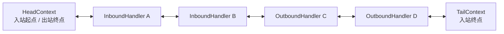

# Reactor反应堆线程模型与Netty核心架构

在高性能网络编程领域，传统的同步阻塞 IO（BIO）采用“一连接一线程”模型，在高并发连接（如数十万连接）场景下，线程上下文切换与栈内存占用会迅速拖垮操作系统。Netty 作为当今 Java 生态中最主流的异步事件驱动网络框架，其高性能基石正是 Reactor 反应堆线程模型与非阻塞 IO 的结合。

---

## 核心底层机制与全景架构

### 1. 三种经典 Reactor 线程模型演进

Reactor 模式基于事件驱动（Event-Driven），核心职责是分发 I/O 事件到对应的处理器（Handler）：

1. **单 Reactor 单线程模型**：
   - 包含 Reactor 负责监听和分发事件，Acceptor 负责接收连接，Handler 负责读写与业务计算。
   - 所有操作在单线程内运行。一旦 Handler 处理耗时业务（如计算、查库），将阻塞所有后续连接的接入和读写。
2. **单 Reactor 多线程模型**：
   - Reactor 仅负责监听连接与读写 I/O 事件。
   - 读写完成后的数据由独立的业务线程池（Worker Thread Pool）异步处理，计算完毕后再由 Reactor 线程写回。
   - 瓶颈在于单 Reactor 仍然承担所有百万级连接的握手与 I/O 读写，容易跑满单核 CPU。
3. **主从 Reactor 多线程模型（Netty 采纳的基石）**：
   - **MainReactor（BossGroup）**：专职监听服务器端口，处理客户端新连接建立（`OP_ACCEPT`），三次握手成功后生成 `SocketChannel` 并转交给 SubReactor。
   - **SubReactor（WorkerGroup）**：轮询负责将接收到的通道注册到自己的 Selector 上，处理通道的读写事件（`OP_READ`、`OP_WRITE`），并将解码后的事件分发到业务流水线。

```mermaid
flowchart TD
    Client1[客户端连接1] -->|TCP三次握手| BossGroup[BossGroup / MainReactor NioEventLoopGroup]
    Client2[客户端连接2] -->|TCP三次握手| BossGroup
    Client3[客户端连接3] -->|TCP三次握手| BossGroup
    
    subgraph Netty Server Runtime
        BossGroup -->|ServerBootstrap绑定端口<br/>接收OP_ACCEPT并创建NioSocketChannel| Acceptor[ServerBootstrapAcceptor]
        Acceptor -->|Round-Robin负载均衡分发| WorkerGroup[WorkerGroup / SubReactor NioEventLoopGroup]
        
        subgraph Worker NioEventLoop Group
            Loop1[NioEventLoop 1<br/>Selector 1]
            Loop2[NioEventLoop 2<br/>Selector 2]
            LoopN[NioEventLoop N<br/>Selector N]
        end
        WorkerGroup --> Loop1
        WorkerGroup --> Loop2
        WorkerGroup --> LoopN
        
        Loop1 -->|绑定单个通道| ChannelPipeline[ChannelPipeline 责任链]
        subgraph Pipeline Execution
            In1[ChannelInboundHandler 1] --> In2[ChannelInboundHandler 2]
            Out2[ChannelOutboundHandler 2] --> Out1[ChannelOutboundHandler 1]
        end
        ChannelPipeline --> Pipeline Execution
    end
```

---

## 源码级架构物理拆解

### 1. NioEventLoop 核心执行循环与 I/O 比例控制

每个 `NioEventLoop` 本质上是一个单线程执行器（`SingleThreadEventLoop`），它无限循环执行三件事：
1. **`select()` 轮询 I/O 就绪事件**；
2. **`processSelectedKeys()` 处理网络 I/O 事件**；
3. **`runAllTasks()` 处理异步队列中的非 I/O 任务**（如系统定时任务、跨线程提交的任务）。

```java
// 简化自 io.netty.channel.nio.NioEventLoop#run
protected void run() {
    int selectCnt = 0;
    for (;;) {
        try {
            int strategy = selectStrategy.calculateStrategy(selectNowSupplier, hasTasks());
            switch (strategy) {
                case SelectStrategy.CONTINUE:
                    continue;
                case SelectStrategy.SELECT:
                    // 轮询就绪事件，带超时与空轮询检测
                    select(wakenUp.getAndSet(false));
                    if (wakenUp.get()) {
                        selector.wakeup();
                    }
                default:
            }

            cancelledKeys = 0;
            needsToSelectAgain = false;
            final int ioRatio = this.ioRatio; // 默认 50%
            if (ioRatio == 100) {
                try {
                    processSelectedKeys();
                } finally {
                    runAllTasks();
                }
            } else if (strategy > 0) {
                final long ioStartTime = System.nanoTime();
                try {
                    processSelectedKeys();
                } finally {
                    // 根据 I/O 执行耗时按比例分配任务执行时间
                    final long ioTime = System.nanoTime() - ioStartTime;
                    runAllTasks(ioTime * (100 - ioRatio) / ioRatio);
                }
            } else {
                runAllTasks(0); // 最小化处理队列任务
            }
        } catch (Throwable t) {
            handleLoopException(t);
        }
    }
}
```

#### Epoll 空轮询 Bug 解决原理
JDK NIO 在 Linux 平台上存在经典的 Epoll 空轮询 Bug：当 Selector 上的连接意外中断时，Linux `epoll_wait()` 会由于未知原因直接唤醒并返回 0，导致线程陷入 100% CPU 的死循环。

Netty 内部维护了一个计数器 `selectCnt`：
- 若在超时时间内 Selector 提前唤醒且就绪键数量为 0，则 `selectCnt++`；
- 当 `selectCnt >= SELECTOR_AUTO_REBUILD_THRESHOLD`（默认 512）时，判定触发 Epoll 空轮询 Bug；
- Netty 触发 `rebuildSelector()`：重新创建一个新的 Selector，将旧 Selector 上的所有 `SelectionKey` 取消并重新注册到新 Selector 上，随后关闭旧 Selector，彻底化解死循环。

---

### 2. ChannelPipeline 责任链的双向链表机制

`ChannelPipeline` 内部维护了一个双向链表，由多个 `ChannelHandlerContext` 节点构成：
- `HeadContext`：实现了 `ChannelInboundHandler` 与 `ChannelOutboundHandler`，作为入站的起点和出站的终点（最终调用底层的 `Unsafe` 写出网络数据）。
- `TailContext`：实现了 `ChannelInboundHandler`，作为入站链条的末端，负责未处理事件的垃圾回收与释放（如释放漏泄的 ByteBuf）。



#### `fireChannelRead` 与 `write` 的执行路径差异
- **入站事件（Inbound）**：自头向尾（`HeadContext -> TailContext`）传播。调用 `ctx.fireChannelRead(msg)` 会从当前 Handler 的下一个 Inbound 节点继续向后传递；调用 `pipeline.fireChannelRead(msg)` 则强制从 `HeadContext` 重新开始。
- **出站事件（Outbound）**：自尾向头（`TailContext -> HeadContext`）反向传播。调用 `ctx.write(msg)` 会从当前节点的上一个 Outbound 节点往前传播；调用 `channel.write(msg)` 则从 `TailContext` 向前穿透整条链直到 `HeadContext`。

---

## 社招高频硬核连环追问

### Q1: Netty 为什么推荐默认的线程数为 `CPU 核心数 * 2`？
- **考点**：`NettyRuntime.availableProcessors() * 2` 的底层考量。
- **解析**：
  1. Netty 的 `NioEventLoop` 承担的是纯非阻塞 I/O 处理（`Socket` 的读写与就绪事件轮询），几乎没有线程阻塞。
  2. 在现代 CPU 架构中，一个物理核通常支持超线程技术（Hyper-Threading，1核2线程）。因此乘以 2 刚好能够饱和压榨物理处理器的硬件线程。
  3. 如果线程数远超核心数，多出的线程将在操作系统调度下引发高频上下文切换（Context Switch），反而降低网络吞吐；如果线程数少于核心数，无法发挥全部多核算力。

### Q2: 业务逻辑可以在 ChannelInboundHandler 中同步执行吗？什么时候该用 EventExecutorGroup？
- **考点**：Netty 线程模型的单线程无锁化原则与防阻塞。
- **解析**：
  - **严禁直接在 I/O 线程中执行耗时阻塞操作**（如数据库查询、RPC 同步调用、长耗时加密计算、`Thread.sleep()`）。
  - 因为每个 `NioSocketChannel` 在注册后被绑定到唯一的 `NioEventLoop` 线程上。一个 `NioEventLoop` 同时管理成千上万个 Channel。若某个 Handler 阻塞，该 EventLoop 上的其他所有连接的 I/O 事件将全部冻结！
  - **解决方案**：
    1. 在 pipeline 添加 Handler 时指定专属的业务线程池：`pipeline.addLast(businessGroup, new MySlowHandler())`。
    2. 在 Handler 内部，将业务数据封装为 Runnable，手动提交到自定义的业务线程池（如 `ThreadPoolExecutor`）中异步运行。

### Q3: Netty 是如何实现“无锁化设计”（Lock-Free）的？
- **考点**：串行化无锁设计（ThreadLocal / SPSC Queue / SingleThreadEventLoop）。
- **解析**：
  1. **Channel 亲和绑定**：每个客户端 Channel 在生命周期内完全绑定到唯一的 `NioEventLoop` 线程。对该 Channel 的所有读写和 Pipeline 流转始终在该线程内顺序执行，内部状态无需通过 `synchronized` 或 `ReentrantLock` 竞争。
  2. **跨线程任务投递**：若外部线程尝试向 Channel 发送数据（`channel.write()`），Netty 会通过 `inEventLoop()` 检查当前调用者是否是 Channel 所绑定的 EventLoop。若是则直接执行；若不是，将任务压入 `taskQueue`（基于 JCTools 的 MpscUnboundedArrayQueue，多生产者单消费者无锁并发队列），由绑定的 EventLoop 线程在下一个轮询周期统一串行处理。

---

## 生产级避坑指南与故障排查 SOP

### 1. 业务逻辑堵死 I/O 线程的排查 SOP

**现象**：服务吞吐急剧下降，客户端大量报超时，但服务端 CPU、内存利用率却很低。

#### 排查步骤
1. **使用 jstack 或 Arthas 抓取线程栈**：
   ```bash
   # Arthas 查看繁忙与阻塞线程
   thread -b
   thread | grep nioEventLoopGroup
   ```
2. **定位卡点代码**：
   若发现 `nioEventLoopGroup-x-x` 线程停留在 `java.sql.PreparedStatement.executeQuery` 或 `org.apache.http.impl.client` 的等待方法上，即可断定 I/O 线程被同步阻塞阻塞。
3. **治理方案**：
   将阻塞代码剥离出 I/O 线程，引入独立业务线程池隔离：
   ```java
   EventExecutorGroup businessGroup = new DefaultEventExecutorGroup(64);
   channel.pipeline().addLast(businessGroup, new OrderProcessHandler());
   ```

### 2. ChannelPipeline 漏泄引发堆外内存溢出

**常见故障**：在自定义 `ChannelInboundHandlerAdapter` 中重写 `channelRead`，但未释放 ByteBuf。
```java
// 错误示范：没有向后传播，也没有释放
public void channelRead(ChannelHandlerContext ctx, Object msg) {
    ByteBuf buf = (ByteBuf) msg;
    // ... 解析数据但未调用 ReferenceCountUtil.release(msg) 也未调用 ctx.fireChannelRead(msg)
}
```
**规范修复**：
1. 继承 `SimpleChannelInboundHandler<T>`，Netty 会在模板方法末尾的 `finally` 块中自动调用 `ReferenceCountUtil.release(msg)`。
2. 若继续使用 `ChannelInboundHandlerAdapter`，必须严格遵循“谁最后消费谁释放”原则：
   ```java
   @Override
   public void channelRead(ChannelHandlerContext ctx, Object msg) {
       try {
           process(msg);
       } finally {
           ReferenceCountUtil.release(msg);
       }
   }
   ```
