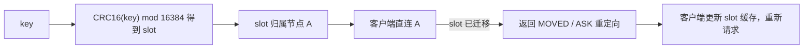

# Redis 大 Key、热 Key 与集群治理实战

## 使用入口：先解决问题，再做验证

治理内存/带宽过大的键和访问过热的分片。

**先做基本操作**：先观察 key 大小、访问热点、慢日志和分片负载，在隔离环境验证拆分与渐进删除，再分析槽位。初次学习可先完成[本模块基础实践](/doc/Java/Java语言基础与日常开发)。

**再逐步深入**：基本 API 与输入输出 → 常见失败和使用边界 → 场景排查与优化 → 本文机制分析与源码。面试先讲用途和自己的操作过程，再回答场景与原理追问。

> **一句话结论**：大 Key 是**单次操作 O(N) 卡住单线程事件循环**，热 Key 是**单分片被单点流量打爆**——前者解决「拆」，后者解决「散」，两者成因不同、解法不同，混着答基本就是没做过生产治理。

## 30 秒速览

| 问题 | 判定标准（经验值） | 直接后果 | 主解法 |
|---|---|---|---|
| 大 Key（String） | value > 10KB | 网络阻塞、删除卡顿 | 拆分成多个 key / 压缩 / 改存对象存储 |
| 大 Key（集合） | Hash/List/Set/ZSet 元素 > 5000 或总 > 10MB | `HGETALL`/`DEL` 阻塞数百 ms | 按业务维度分桶、分页取 |
| 热 Key | 单 key QPS > 数千，或占分片流量 30%+ | 单分片 CPU 100%，其他分片空闲 | 本地缓存 + 复制多份 key 打散 slot |
| Big Key 删除 | `DEL` 大集合 | 主线程阻塞、主从雪崩 | `UNLINK` 异步删除 + lazyfree |
| 集群倾斜 | 部分节点内存/流量远超其他 | 扩容也救不了 | hash tag 慎用、重新分片 |

## 一张图看懂两类故障


Redis 6 之后网络 IO 多线程，但**命令执行始终是单线程**，所以任何 O(N) 命令的影响都是全实例级别的。

## 二、大 Key 治理：发现 → 评估 → 拆分 → 删除

```bash
# ① 离线扫描（生产低峰执行，--bigkeys 内部走 SCAN，不阻塞太久）
redis-cli --bigkeys -i 0.1          # -i 每 100 个 key 休眠 0.1s，进一步降低影响
redis-cli --memkeys                 # Redis 6+ 按内存维度找大 key

# ② 精确测量单个 key
redis-cli MEMORY USAGE user:feed:1001
redis-cli HLEN user:feed:1001

# ③ 安全删除（异步，主线程只解引用，实际内存由后台线程回收）
UNLINK user:feed:1001
```

| 阶段 | 要点 |
|---|---|
| 发现 | `--bigkeys` 只能找每种类型最大的一个，需用 `SCAN + MEMORY USAGE` 抽样脚本全量摸底；也可分析 RDB（rdb-tools）离线统计 |
| 评估 | 看元素数、单元素大小、访问频率；只读大 key 与高频写大 key 处理策略不同 |
| 拆分 | Hash 按 `hash(field) % N` 分桶成 `user:feed:1001:0..N-1`；List 按时间分段；String 大 JSON 拆字段或压缩；超过 100KB 的二进制直接放对象存储，Redis 只存 URL |
| 删除 | 一律 `UNLINK` / `FLUSHALL ASYNC`，并开启 `lazyfree-lazy-eviction yes`、`lazyfree-lazy-expire yes`、`lazyfree-lazy-server-del yes`、`replica-lazy-flush yes` |
| 预防 | 写入前校验元素数量与 value 大小；集合类设置上限并按时间归档；上线前用压测数据过一遍 |

> 集群模式下大 Key 还有个隐藏伤害：**迁移 slot 时大 Key 无法拆分，导致扩容卡住甚至超时失败**，这是很多「扩容没效果」的根因。

## 三、热 Key 治理：本地缓存 + 打散

```bash
redis-cli --hotkeys        # 需 maxmemory-policy 为 LFU（allkeys-lfu / volatile-lfu）
redis-cli OBJECT FREQ k    # 查看 key 的 LFU 访问频次
redis-cli SLOWLOG GET 10
```

```java
// 方案一：进程内本地缓存，挡掉绝大部分读（Caffeine），随机过期防同一时刻集体回源
LoadingCache<String, Item> local = Caffeine.newBuilder()
    .maximumSize(10_000)
    .expireAfterWrite(60 + ThreadLocalRandom.current().nextInt(30), TimeUnit.SECONDS)
    .build(key -> redisTemplate.opsForValue().get(key));

// 方案二：把一份热数据复制成 N 份，读时随机选一份，把流量散到不同 slot
String suffix = String.valueOf(ThreadLocalRandom.current().nextInt(16));
String key = "sku:10086#" + suffix;      // 16 份落在不同 slot，写时批量更新 16 份
```

| 方案 | 适用 | 代价 |
|---|---|---|
| 本地缓存（Caffeine） | 读多写少、允许秒级不一致 | 各实例副本不一致、内存占用、需处理失效广播 |
| 复制多份 key + 随机读 | 极热点且必须走 Redis | 写放大 N 倍、更新一致性难保证 |
| 读写分离 + 多副本 | 读热点 | 副本数有限，写热点无解 |
| 请求合并 / 单飞 singleflight | 缓存击穿瞬间 | 只解决回源风暴，不解决分片热点 |
| 业务削峰（排队、答题、验证码） | 秒杀 | 产品层面改动，见 [秒杀全链路设计](/doc/SystemDesign/高并发秒杀系统全链路设计) |

> 别和「缓存击穿」混淆：击穿是**一个 key 过期瞬间回源打数据库**，热 Key 是**这个 key 一直在、但访问量打爆单个 Redis 节点**。前者加互斥锁/逻辑过期（见 [Redis 高并发缓存与一致性实战](/doc/Java/Redis高并发缓存与一致性实战)），后者要散流量。

## 四、Cluster 槽位与扩缩容



| 机制 | 说明 |
|---|---|
| 16384 槽 | 固定槽数，节点按槽段负责；扩缩容 = 迁移槽，不是重新哈希全部 key |
| `MOVED` vs `ASK` | MOVED 表示槽已永久归属新节点（客户端应更新缓存）；ASK 表示迁移中临时重定向（不改变缓存） |
| hash tag `{...}` | `user:{1001}:name` 与 `user:{1001}:age` 只按 `1001` 算槽，保证同槽以便 Lua / 事务 / mget |
| 跨槽限制 | `MGET`、Lua、事务涉及多 key 时必须在同一槽，否则报 `CROSSSLOT`；滥用 hash tag 会造成数据倾斜 |
| 扩容注意 | 先加主节点 → `reshard` 迁槽 → 再加从节点；大 Key 会拖慢迁移，需提前治理 |

## 五、内存、淘汰与慢查询

| 项 | 建议 |
|---|---|
| `maxmemory` | 物理内存的 60%~70%，给 fork（RDB/AOF 重写）留 COW 空间，否则容易 OOM |
| 淘汰策略 | 纯缓存用 `allkeys-lru`/`allkeys-lfu`；带持久数据用 `volatile-ttl` 或 `noeviction` + 告警，**别让带业务语义的 key 被静默淘汰** |
| 内存碎片 | `INFO memory` 看 `mem_fragmentation_ratio` > 1.5 需关注，Redis 4+ 开 `activedefrag yes` |
| 过期删除 | 定期抽样 + 惰性删除；大量 key 同时过期会造成「过期风暴」，过期时间加随机抖动 |
| 危险命令 | `KEYS *`、`HGETALL`、`SMEMBERS`、`LRANGE 0 -1` 一律禁用或改 `SCAN`/`HSCAN`/分页；生产用 `rename-command` 屏蔽 |
| 慢查询 | `slowlog-log-slower-than 10000`（10ms）+ `SLOWLOG GET`，配合监控看 P99 |

## 六、生产避坑清单

| 现象 | 根因 | 处理 |
|---|---|---|
| 周期性几百 ms 卡顿 | 大 Key 过期/删除、AOF 重写 fork、大量 key 同时过期 | UNLINK + lazyfree + 过期时间打散 + 低峰重写 |
| 单个节点 CPU 100% 其余空闲 | 热 Key 或 hash tag 导致数据倾斜 | 本地缓存 / 复制打散 / 检查 tag 设计 |
| 扩容后性能没改善 | 大 Key 卡住 slot 迁移，或热 Key 仍在原节点 | 先治大 Key，再迁移，最后核对槽分布 |
| `MGET` 报 CROSSSLOT | 多 key 落在不同槽 | 用 hash tag 或客户端按槽分组批量请求 |
| 内存涨到上限后写入报错 | `noeviction` 且无告警 | 设容量水位告警（70%/85%），提前扩容或清理 |
| 主从切换后数据「少了」 | 异步复制丢最后一段写 | 关键场景用 `WAIT` / 半同步思路，接受最终一致并做对账 |

## 七、高频追问（含高分/低分特征）

| 追问 | 高分回答要点 | 低分回答 |
|---|---|---|
| 大 Key 和热 Key 区别？ | 前者 O(N) 阻塞单线程，后者单分片流量倾斜；一个拆体积，一个散流量 | 「都是 key 太大」 |
| 怎么在线发现大 Key？ | `--bigkeys -i` 抽样 + `SCAN/MEMORY USAGE` 全量 + RDB 离线分析，避免 `KEYS` | 「用 KEYS * 遍历」 |
| 删大 Key 为什么不能用 DEL？ | DEL 同步释放内存阻塞主线程，UNLINK 只解引用、后台线程回收，配合 lazyfree 四参数 | 「都一样」 |
| 热 Key 怎么治？ | 本地缓存挡读 + 复制多份分散 slot + 读写分离，秒杀还要业务削峰 | 「加 Redis 节点」 |
| 扩容为什么没效果？ | 槽迁移被大 Key 阻塞、热点仍集中在原槽、连接未更新 slot 缓存 | 「机器不够」 |
| Cluster 为什么是 16384 槽？ | 折中：心跳包头用 bitmap 压缩到 2KB，节点数上限下仍能高效传槽位信息；太多槽增加元数据开销 | 「随便定的」 |

**延伸阅读**：[Redis 高并发缓存与一致性实战](/doc/Java/Redis高并发缓存与一致性实战)、[分布式锁与 Redisson 源码](/doc/SystemDesign/分布式锁与Redisson源码全解)、[高并发秒杀系统全链路设计](/doc/SystemDesign/高并发秒杀系统全链路设计)。
