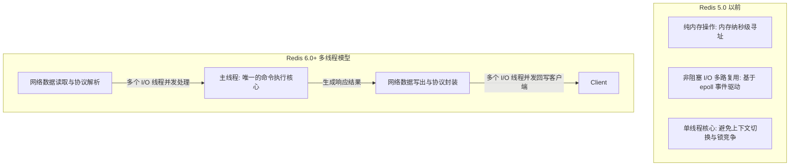
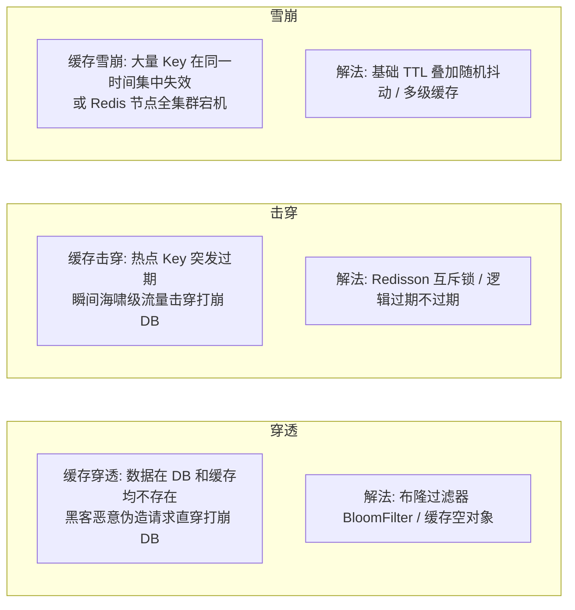
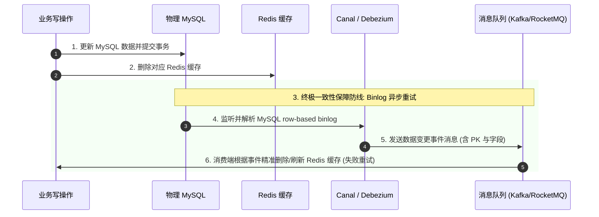

# Redis核心原理高并发三大难题与双写一致性

Redis 凭借纯内存读写与单线程非阻塞 I/O，能够轻松支撑数十万级 QPS，是现代互联网架构中抗击高并发流量的最前线护城河。然而，高并发场景下的**缓存穿透、击穿、雪崩**，以及 Redis 与关系型数据库（MySQL）之间的**双写一致性**，是引发线上数据混乱和系统瘫痪的高发地带。本文将从底层数据结构的物理演进入手，彻底讲透三大难题的防御体系与双写一致性的终极闭环方案。

---

## 核心底层机制与全景架构

### 1. Redis 核心数据结构底层演进矩阵

在 Redis 7.0+ 中，经典的底层存储结构全面升级为更加节约内存、无连锁更新风险的 `listpack`：

| 外部数据类型 | 底层物理编码结构（Redis 7.0+） | 底层结构核心优势 | 时间复杂度 |
| :--- | :--- | :--- | :--- |
| **String** | `int` / `embstr` / `raw` (SDS 简单动态字符串) | 预分配空间防内存频繁重分配；存 `len` 长度 $O(1)$ 取长；二进制安全 | $O(1)$ |
| **List** | `quicklist` (双向链表 + `listpack` 紧凑列表) | 兼具双向链表的快速插入与内存连续块的极高 CPU 缓存局部性 | 头部/尾部 $O(1)$，中间 $O(N)$ |
| **Hash** | `listpack` (小数据量) / `hashtable` (大数据量) | 小数据量紧凑无指针开销；大数据量支持**渐进式 Rehash**，杜绝瞬时阻塞 | 均摊 $O(1)$ |
| **Set** | `intset` (整数集合) / `hashtable` | 全整数时内存压缩；海量数据利用哈希表快速去重 | 查找 $O(1)$ |
| **ZSet** | `listpack` (小数据量) / `skiplist` (跳表) + `dict` | 跳表按分值索引，支持快速范围检索（`ZRANGEBYSCORE`），`dict` 支持 $O(1)$ 查分值 | $O(\log N)$ |

#### 深度推导：ZSet 跳表（SkipList）层高与空间平衡
- 跳表通过概率跳跃建立多级索引。Redis 规定跳表节点的最大层高为 32。
- **几何分布概率**：当生成一个新节点时，第一层概率为 100%；第二层概率为 $p = 1/4$；第三层概率为 $p^2 = (1/4)^2 = 1/16$。
- **数学推导**：每个节点的平均指针数量为：
  $$E = \sum_{i=1}^{\infty} \left(\frac{1}{4}\right)^{i-1} = \frac{1}{1 - 1/4} = 1.333$$
  **每个节点平均仅耗费 1.33 个指针**，相比平衡二叉树（AVL 或红黑树）每个节点必须强制维护左右子树指针、父指针及颜色/平衡因子，跳表不仅内存利用率更高，且在并发和范围查询实现上更为简洁高效。

---

### 2. Redis 为什么单线程还能这么快？Redis 6.0 为什么引入多线程？



- **单线程快的本质**：Redis 的性能瓶颈通常不是 CPU 算力，而是**内存带宽与网络 I/O 吞吐**。单线程架构彻底避开了多线程上下文切换、锁获取与死锁风险。
- **Redis 6.0 多线程的边界**：
  - **核心命令执行（内存读写）依然严格由单个主线程串行执行**，维持事务与数据操作的线程安全；
  - 仅将最耗 CPU 的**网络 I/O 读取、RESP 协议解析、数据写回**交由额外的 `io-threads` 线程池并行处理，将单机网卡吞吐推向数百万 QPS 极限。

---

## 高并发缓存三大难题终极方案



### 1. 缓存穿透防御：布隆过滤器（BloomFilter）

- **工作机制**：由一个超长二进制位图（Bit Array）和 $k$ 个独立的哈希函数构成。
  - **写入**：对 Key 进行 $k$ 次哈希计算，将位图对应的 $k$ 个位置置为 1；
  - **查询**：若 $k$ 个位置中存在任意一个 0，则该 Key **绝对不存在**；若全为 1，则判定该 Key **大概率存在（存在假阳性率 False Positive）**。
- **工程最佳实践**：在 API 网关或应用最外层挂载布隆过滤器（如 Redisson `RBloomFilter`），不符合的数据直接拦截拒绝；对于穿透落到 DB 且确实不存在的数据，缓存一个空对象 `{}` 并设置短 TTL（如 30 秒），彻底封死恶意扫描。

---

### 2. 缓存击穿防御：互斥锁 vs 逻辑永不过期

| 方案 | 原理 | 优缺点与适用场景 |
| :--- | :--- | :--- |
| **分布式互斥锁（Mutex）** | 缓存未命中时，仅允许竞争到分布式锁（`SETNX` / Redisson）的单个线程去查 DB 回填，其余线程自旋等待 | **保证强一致性**，但并发线程会排队，吞吐有微弱下降；适用于金融、订单对准确度要求极高的场景 |
| **逻辑永不过期（Logical Expiration）** | 物理上在 Redis 中永不设置过期时间。在 Value 中封装一个 `expireAt` 字段。查询发现逻辑过期时，异步开启线程去查 DB 刷新 | **高吞吐零等待**，但会短暂读出脏数据（最终一致性）；适用于首页大促、热点推荐等高可用优先场景 |

---

### 3. 缓存雪崩防御：抖动打散与多级架构
- **TTL 随机抖动公式**：
  $$\text{RealTTL} = \text{BaseTTL} + \text{Random}(1,\; 300)\text{ 秒}$$
  将集中的过期时间在时间轴上均匀抹平，消除瞬时流量波峰。
- **构建三级缓存防线**：
  `客户端本地缓存 (Caffeine / Guava) -> 分布式缓存 (Redis Cluster) -> 物理数据库 (MySQL)`。

---

## 终极对决：Redis 与 MySQL 双写一致性

在数据发生变更时，如何保证 MySQL 与 Redis 保持一致？我们通过逻辑推导证明各个方案的优劣：

### 1. 为什么不能“先删缓存，再更新 DB”？
- **致命并发缺陷**：
  1. 线程 A 执行写操作，删除了 Redis 缓存；
  2. 线程 B 恰好发起读操作，发现缓存为空，向 MySQL 查询出**旧数据（Old Data）**；
  3. 线程 B 将查询到的旧数据重新写回 Redis；
  4. 线程 A 终于将**新数据（New Data）**写入了 MySQL。
- **后果**：此时 MySQL 是最新值，但 Redis 永远沉睡着旧值，**造成永久脏数据**！

---

### 2. 为什么不能“先更新 DB，再更新缓存”？
- **并发写乱序缺陷**：
  1. 线程 A 先更新 DB（设置为 1）；
  2. 线程 B 后更新 DB（设置为 2）；
  3. 由于网络原因，线程 B 先完成了 Redis 更新（缓存为 2）；
  4. 线程 A 后完成了 Redis 更新（缓存被覆盖为 1）。
- **后果**：MySQL 存的是 2，Redis 存的是 1，再次产生脏数据。

---

### 3. 标准推荐：先更新 DB，再删除缓存（Cache-Aside Pattern）

**核心逻辑**：修改数据时先更新数据库，成功后再删除缓存。下次读取时再触发懒加载回填。



#### Cache-Aside 的微弱并发极端情况分析：
- **触发条件**：读线程先查 DB 拿到旧值，在写回 Redis 之前；写线程恰好更新了 DB 并删除了缓存；随后读线程才把旧值塞回 Redis。
- **为什么发生概率极低？**：写数据库由于涉及磁盘 I/O 和行锁，耗时通常远大于读数据库。读线程要想在写线程完整的“更新DB + 删缓存”期间正好卡在中间，概率低到微乎其微。
- **终极保底防线：Canal + MQ 监听 Binlog 异步补偿**：
  即使应用层删缓存由于网络抖动失败，或者遭遇了微弱并发竞争，后端的 Canal 监控到 MySQL Binlog 变更后，会将事件投递进 RocketMQ。消费端通过指数退避重试执行 Redis 删除，确保**毫秒级最终一致性**。

---

## 社招高频硬核连环追问

### Q1: 延时双删（Delayed Double Deletion）的第二次删除为什么必须延时？延时时间怎么确定？
- **考点**：延时双删的物理推导。
- **解析**：
  - 延时双删流程：`删缓存 -> 写 DB -> sleep(N 毫秒) -> 再次删缓存`。
  - **第二次删除的目的**：是为了确保在“写 DB”期间，其他并发读线程从数据库读出的旧数据、并写回缓存的操作全部完成之后，再把这个被写回的脏数据再次干掉！
  - **延时时间的判定**：必须严格**大于“主从同步延迟时间 + 业务并发读请求的最大耗时”**（通常设置为 500ms ~ 1000ms）。
  - **局限性**：由于需要 `Thread.sleep` 或异步延迟任务，代码侵入性高且时间难以绝对精确，生产上更推荐 Canal 监听方案。

### Q2: 布隆过滤器支持删除元素吗？如何解决？
- **考点**：布隆过滤器位图物理限制与计数布隆过滤器（Counting Bloom Filter）。
- **解析**：
  - **不支持物理删除**。因为布隆过滤器的位图中的某一位 `1`，可能是被成百上千个不同的 Key 哈希映射共用的。如果将该位置为 0，会同时把其他原本存在的 Key 错误判定为“不存在”，彻底破坏其“判定不存在即绝对不存在”的数学铁律。
  - **解决方案**：采用**计数布隆过滤器（Counting Bloom Filter，CBF）**，将每个位（Bit）扩展为一个计数器（如 4 位或 8 位的整数）。添加时计数器加 1，删除时减 1。缺点是内存消耗相比普通布隆过滤器暴增 4~8 倍。

---

## 生产级避坑指南与故障排查 SOP

### 1. 热点 Key（Hot Key）探测与防打爆 SOP

**现象**：全站 Redis 集群整体压力不高，但某单个 Redis 分片 CPU 突然飙升至 100%，大量连接等待超时。

#### 排查与定位步骤
1. **排查命令**：
   ```bash
   redis-cli -p 6379 --hotkeys
   ```
   输出各数据类型中访问频次最高的 Key。
2. **紧急治理方案**：
   - **开启本地二级缓存（Caffeine）**：利用客户端监控组件（如 Sentinel 热点流控或美团开源的 Hermes）动态探测 Hot Key，一旦发现某个 Key QPS 突破阈值，自动将其加载进应用本地 JVM 缓存，直接在应用内存拦截 99% 的请求，完全不向 Redis 发送流量。
   - **分片打散（Key 散列）**：针对高频写 Hot Key（如大促秒杀计数器），将其拆分为多个子 Key：`hot_key_1, hot_key_2, ..., hot_key_10`，读写时通过哈希模算法分散到不同的 Redis 物理节点上，最后聚合统计。
