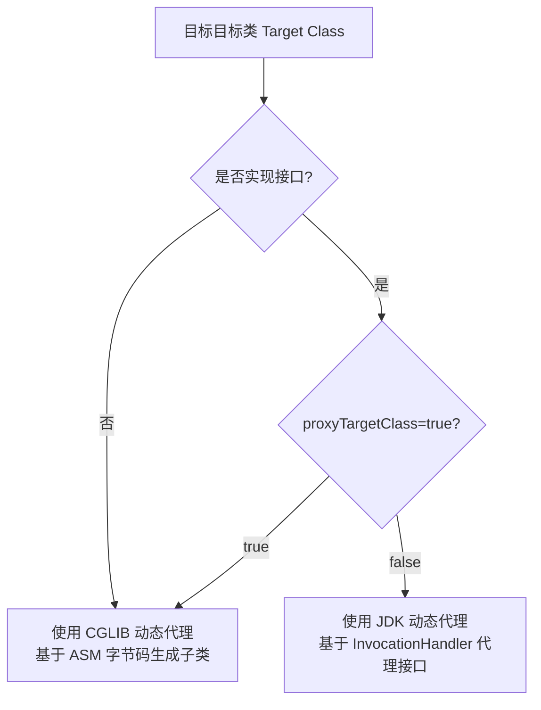
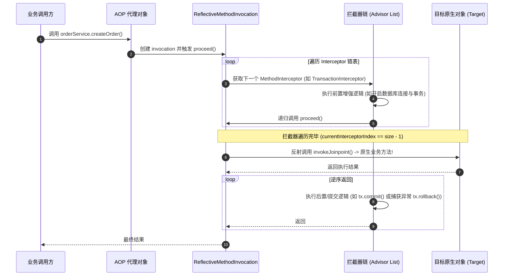

# Spring-AOP原理与方法内部自调用失效全解

Spring AOP（面向切面编程）是 Spring 框架中实现非侵入式业务增强（日志、鉴权、监控、声明式事务、分布式锁）的核心技术基石。然而，在实际生产开发中，**“方法内部自调用导致切面增强彻底失效”**是出现频率极高的隐蔽 Bug。本篇将从 AOP 的动态代理实现、拦截器链执行机制出发，彻底剖析自调用失效的物理本质，并给出业界标准的工程化解决方案。

---

## 核心底层机制与全景架构

### 1. Spring AOP 的动态代理选型决策

Spring AOP 底层依赖动态代理技术，在运行时动态生成目标对象的代理对象：



#### 关键演进：
- **Spring 原生默认**：有接口用 JDK，无接口用 CGLIB。
- **Spring Boot 2.x+ 变革**：默认将 `spring.aop.proxy-target-class` 设置为 `true`，**全量统一使用 CGLIB 代理**。这样可以彻底避免客户端注入具体实现类时发生类型转换异常（`BeanNotOfRequiredTypeException`）。

---

### 2. AOP 核心组件全景图

- **JoinPoint（连接点）**：程序执行的具体点（在 Spring AOP 中仅支持方法执行级别）。
- **Pointcut（切入点）**：用于匹配 JoinPoint 的谓词表达式（如 `execution(* com.example.service..*.*(..))`）。
- **Advice（通知/增强）**：在切入点执行的具体逻辑（`@Before`, `@AfterReturning`, `@AfterThrowing`, `@After`, `@Around`）。
- **Advisor（顾问）**：包含一个 Pointcut 和一个绑定的 Advice，是 Spring AOP 内部管理的原子执行单元。

---

## 源码级架构物理拆解

### 1. ReflectiveMethodInvocation 责任链执行机制

当调用 AOP 代理对象的某个方法时，调用会进入 `JdkDynamicAopProxy#invoke` 或 `CglibAopProxy$DynamicAdvisedInterceptor#intercept`，最终委托给 `ReflectiveMethodInvocation.proceed()` 以递归责任链形式执行：



---

### 2. 物理剖析：方法内部自调用失效的本质

我们来看一段生产开发中最容易踩坑的代码：

```java
@Service
public class OrderService {

    // 无事务注解
    public void processOrder(Long orderId) {
        // ... 基础校验 ...
        // 直接调用内部方法
        this.insertOrderWithTx(orderId); 
    }

    // 声明了事务
    @Transactional(rollbackFor = Exception.class)
    public void insertOrderWithTx(Long orderId) {
        orderDao.insert(...);
        throw new RuntimeException("模拟异常回滚");
    }
}
```

**问题现象**：外部调用 `orderService.processOrder(1L)`，当 `insertOrderWithTx` 抛出异常时，**数据并没有回滚，事务彻底失效！**

#### 底层物理原因推导：
1. Spring 容器在注入 `OrderService` 时，提供给外部调用者的是由 CGLIB 生成的**代理对象（Proxy Object）**；
2. 外部调用 `orderService.processOrder(1L)` 时，命中了代理对象。但由于 `processOrder` 本身没有事务切面，代理对象直接将调用委托给内部真实的**原生目标对象（Target Object）**；
3. **关键致命点**：在原生目标对象内部执行代码时，`this` 关键字在 JVM 运行时指针寻址中，**指向的是当前原生物件在堆中的内存地址，而不是外层的代理对象！**
4. 因此，`this.insertOrderWithTx()` 是一次普通的 JVM 内部方法栈帧压栈，**完全绕过了 Spring 代理对象，根本不会触发任何 `TransactionInterceptor` 或 AOP 拦截器链！**
5. 同理，`@Async`、`@Cacheable` 等所有依赖 Spring AOP 的注解在自调用时全部失效。

```mermaid
flowchart TD
    Caller[外部调用方] -->|调用 processOrder| Proxy[OrderService 代理对象]
    Proxy -->|反射委派调用| Target[OrderService 原生目标对象 (Target)]
    
    subgraph Target 内部方法栈
        TargetMethod[processOrder 方法体] -->|this.insertOrderWithTx<br/>直接通过原生 this 指针寻址| InnerMethod[insertOrderWithTx 方法体]
    end
    
    InnerMethod -.->|完全绕过了外层代理| Proxy
    style InnerMethod stroke:#ff0000,stroke-width:2px;
```

---

## 4 种优雅解决自调用失效的工程化方案

### 方案 1：暴露代理对象并显式调用（`AopContext.currentProxy()`）
- **实现原理**：通过 ThreadLocal 暂存当前正在执行的代理对象。
- **配置与代码**：
  ```java
  // 1. 启动类开启 exposeProxy
  @EnableAspectJAutoProxy(exposeProxy = true)
  @SpringBootApplication
  public class Application {}

  // 2. 业务层通过 AopContext 获取当前代理对象
  @Service
  public class OrderService {
      public void processOrder(Long orderId) {
          // 通过 AopContext 拿到外层代理对象强转调用
          ((OrderService) AopContext.currentProxy()).insertOrderWithTx(orderId);
      }

      @Transactional
      public void insertOrderWithTx(Long orderId) { ... }
  }
  ```
- **优缺点**：性能损耗低，但与 Spring 强耦合，代码可读性略有侵入。

### 方案 2：自注入当前 Bean 实例（推荐）
- **实现原理**：在自身类中注入自身，通过 Spring 依赖注入拿到外层代理对象。
- **代码实现**：
  ```java
  @Service
  public class OrderService {
      // 延迟注入自身代理对象，防止循环依赖告警
      @Lazy
      @Autowired
      private OrderService self;

      public void processOrder(Long orderId) {
          // 通过代理对象调用
          self.insertOrderWithTx(orderId);
      }

      @Transactional
      public void insertOrderWithTx(Long orderId) { ... }
  }
  ```
- **优缺点**：直观清晰，符合依赖注入思维，也是目前主流项目最推荐的做法。

### 方案 3：拆分重构为独立的业务类（架构推荐）
- **实现原理**：遵循面向对象单一职责原则（SRP）。
- **治理方式**：如果一个方法需要独立的事务或异步控制，说明其具备独立的领域职责。将其剥离为一个独立的组件类（如 `OrderTxExecutorService`），由 `OrderService` 正常 `@Autowired` 调用。彻底消除自调用场景。

### 方案 4：使用原生 AspectJ 织入（Compile-Time / Load-Time Weaving）
- **实现原理**：Spring AOP 是运行时动态代理；而 AspectJ 采用字节码静态植入（CTW）或类加载时植入（LTW），在编译期或 Class 加载期直接修改字节码，即使是 `this` 内部调用也会被直接增强。
- **适用场景**：对极致性能有严苛要求、大量内部调用的复杂底层框架。

---

## 社招高频硬核连环追问

### Q1: CGLIB 和 JDK 动态代理在底层字节码生成上有何本质不同？
- **考点**：JVM 字节码机制与反射性能。
- **解析**：
  1. **JDK 动态代理**：依赖 `Proxy.newProxyInstance()`，在内存中动态生成实现了被代理接口的 `$Proxy0` 类。对方法的调用通过 `InvocationHandler.invoke()` 进行反射派发。限制是**只能代理接口中声明的方法**。
  2. **CGLIB 动态代理**：基于 ASM 字节码操作框架，在内存中动态生成目标类的**子类（Subclass）**。覆盖目标类的非 final 方法。其底层采用了 **FastClass 机制**，为目标类和代理类分别生成一个包含方法索引表（Index Switch）的 FastClass，调用时直接通过下标寻址直接调用，**避开了反射开销**，方法调用吞吐通常优于传统 JDK 反射代理。

### Q2: 为什么被 `private` 或 `final` 修饰的方法无法被 Spring AOP 增强？
- **考点**：面向对象多态与继承边界。
- **解析**：
  1. **JDK 代理维度**：`private` 方法无法被接口定义，JDK 代理根本感知不到；
  2. **CGLIB 维度**：CGLIB 是通过生成目标类的子类继承来实现代理的。
     - 若方法被 `final` 修饰，Java 语法规范禁止子类 override 重写该方法，因此 CGLIB 无法植入拦截代码；
     - 若方法被 `private` 修饰，子类不可见且无法重写，因此代理对象无法对其进行任何拦截包裹。

---

## 生产级避坑指南与故障排查 SOP

### 1. `AopContext.currentProxy()` 报 `IllegalStateException` 排查 SOP

**现象**：代码报错 `java.lang.IllegalStateException: Cannot find current proxy: Set 'exposeProxy' property on Advised to 'true' to make it available.`

#### 排查与治理
- **根因**：没有在配置类开启代理暴露。
- **快速修复**：
  - 在 `@EnableAspectJAutoProxy` 或 `@EnableTransactionManagement` 上显式添加属性：
    ```java
    @EnableAspectJAutoProxy(exposeProxy = true)
    ```
  - 如果使用 Spring Boot 自动装配，检查 `application.yml` 配置：
    ```yaml
    spring:
      aop:
        auto: true
        proxy-target-class: true
    ```
    并通过配置类显式注册 `@EnableAspectJAutoProxy(exposeProxy = true)`。
