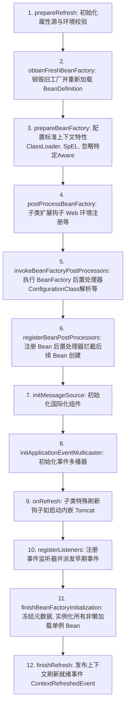
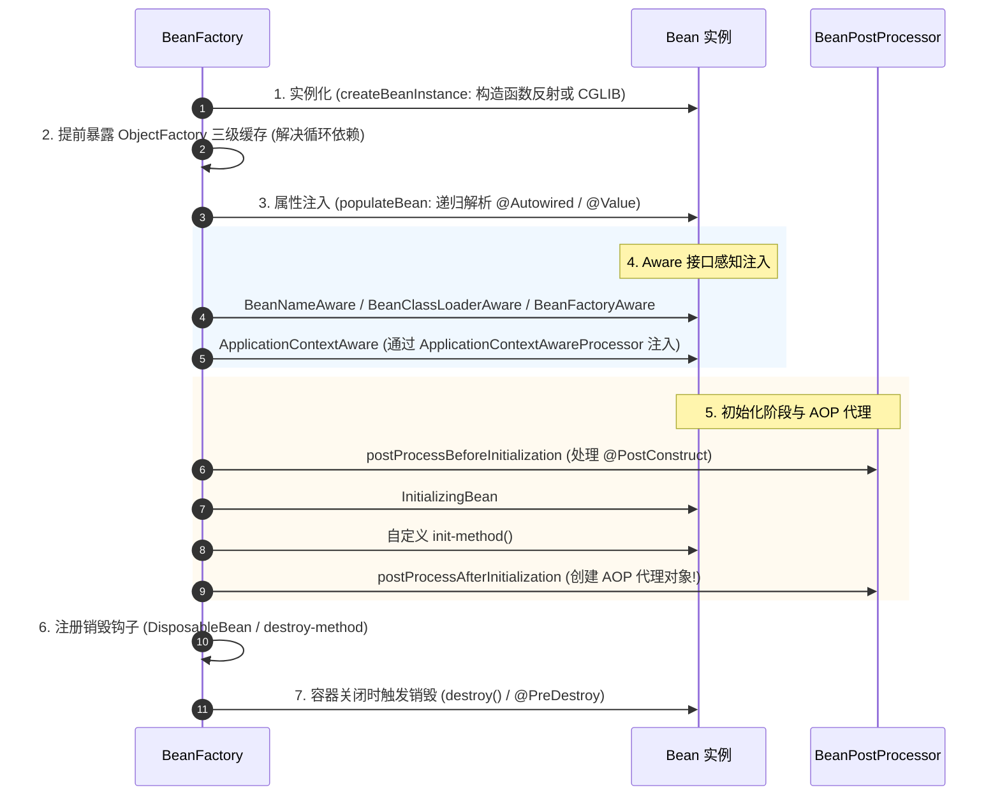

# Spring-IoC容器启动流程与Bean完整生命周期

Spring 的核心价值在于**控制反转（IoC，Inversion of Control）**与**依赖注入（DI，Dependency Injection）**。理解 IoC 容器的核心启动编排（`AbstractApplicationContext#refresh()`）以及单例 Bean 从元数据定义到最终销毁的完整生命周期，是深入理解 Spring 生态框架及各类扩展机制（如 AOP、事务、SpringBoot 自动装配）的必经之路。

---

## 核心底层机制与全景架构

### 1. `refresh()` 12 步核心启动编排全景

`AbstractApplicationContext.refresh()` 是 Spring IoC 容器初始化的中枢总线，包含了 12 个严格有序的执行步骤：

---

## 源码级架构物理拆解

### 1. BeanDefinition 元数据体系

在 Spring 中，业务编写的 Java 类、XML 配置或 `@Component` 注解，首先被扫描并转化为 `BeanDefinition`（Bean 定义元数据）。
- `BeanDefinition` 记录了：类全限定名、Scope（singleton/prototype）、懒加载标记、构造参数依赖、属性键值对、依赖关系（`depends-on`）、初始化及销毁方法名等。
- 最终保存在 `DefaultListableBeanFactory` 的 `beanDefinitionMap`（并发 ConcurrentHashMap）中，以 `beanName` 为 Key，供后续统一实例化。

---

### 2. 两大后置处理器接口的根本差异

Spring 提供了两组极具扩展力的后置处理器，二者所处的作用时机与操作对象完全不同：

| 接口 | 操作对象 | 执行时机 | 经典代表与核心用途 |
| :--- | :--- | :--- | :--- |
| **`BeanFactoryPostProcessor`** | 操作容器层级（`BeanFactory`、`BeanDefinition`） | 发生在**任何普通 Bean 实例化之前**（`refresh()` 步骤 5） | `ConfigurationClassPostProcessor`（解析 `@Configuration`、`@ComponentScan`、`@Import`）；`PropertySourcesPlaceholderConfigurer`（解析 `${...}` 占位符） |
| **`BeanPostProcessor`** | 操作具体的 **Bean 实例** | 发生在每个 Bean 的**实例化之后、初始化前后**（贯穿步骤 11 中 Bean 的生命周期） | `CommonAnnotationBeanPostProcessor`（处理 `@PostConstruct`、`@PreDestroy`）；`AbstractAutoProxyCreator`（生成 AOP 动态代理） |

---

### 3. 单例 Bean 完整生命周期物理流转

在 `refresh()` 步骤 11 `finishBeanFactoryInitialization()` 中，容器调用 `beanFactory.preInstantiateSingletons()` 遍历注册表，最终触发 `AbstractAutowireCapableBeanFactory#doCreateBean()`：

#### 关键源码节点剖析：
1. **实例化（Instantiation）**：
   - `createBeanInstance()`：决定使用无参构造器、有参构造器还是工厂方法，通过反射创建原生对象（此时内部属性全为 null 或默认值）。
2. **属性赋值（Populate）**：
   - `populateBean()`：解析 `@Autowired`、`@Resource` 以及 XML 属性，触发依赖注入。如果依赖了另一个未创建的 Bean，则递归调用 `getBean()`。
3. **初始化（Initialization）**：
   - 执行顺序极为严苛：
     1. `@PostConstruct`（由 `InitDestroyAnnotationBeanPostProcessor` 在 `postProcessBeforeInitialization` 中触发）；
     2. `InitializingBean.afterPropertiesSet()`；
     3. 自定义 `init-method`；
     4. `BeanPostProcessor.postProcessAfterInitialization()`（通常在此步骤生成动态代理对象并替换原实例返回）。

---

## 社招高频硬核连环追问

### Q1: `@PostConstruct`、`afterPropertiesSet()` 和 `init-method` 的执行顺序是怎样的？为什么？
- **考点**：BeanPostProcessor 与接口契约执行时机。
- **解析**：
  - **执行顺序**：`@PostConstruct` $\rightarrow$ `afterPropertiesSet()` $\rightarrow$ `init-method`。
  - **底层原因**：
    1. `@PostConstruct` 并非通过接口调用，而是由 `CommonAnnotationBeanPostProcessor` 实现。它在 Bean 初始化之前的 `postProcessBeforeInitialization` 阶段被扫描并反射执行；
    2. 随后 Spring 执行 `invokeInitMethods()`，首先检查 Bean 是否实现了 `InitializingBean`，若是则直接调用其 `afterPropertiesSet()`；
    3. 最后检查在 `BeanDefinition` 中是否配置了 `init-method` 属性，若配置且方法名不是 `afterPropertiesSet`，则通过反射执行用户自定义的 `init-method`。

### Q2: 为什么 Spring 不建议在 `@PostConstruct` 方法中启动异步长耗时线程操作依赖自身代理特性的方法？
- **考点**：AOP 代理生成时机与原生物件暴露。
- **解析**：
  - `@PostConstruct` 发生在 `postProcessBeforeInitialization` 阶段，此时该对象还是一个未经代理的原生对象（Raw Instance）。
  - AOP 代理（如 `@Async`、`@Transactional`）是在初始化之后的 `postProcessAfterInitialization` 阶段通过动态代理生成的。
  - 若在 `@PostConstruct` 内部启动异步线程去调用当前对象的其他 `@Transactional` 或 `@Async` 方法，此时调用的是尚未被代理的原生对象，导致事务或异步拦截彻底失效！
  - **优雅方案**：监听 `ContextRefreshedEvent` 事件或实现 `ApplicationListener<ContextRefreshedEvent>`，确保整容器初始化完毕且代理封装完成后再执行启动逻辑。

### Q3: `BeanFactory` 与 `ApplicationContext` 的区别是什么？
- **考点**：轻量级底层容器 vs 企业级高级容器。
- **解析**：
  1. `BeanFactory` 是 Spring 最底层的 IoC 接口，仅提供最基础的依赖注入、配置解析与 `getBean()` 功能，默认采用**懒加载**策略（按需实例化）；
  2. `ApplicationContext` 是 `BeanFactory` 的子接口，面向企业级应用。在拥有完整 BeanFactory 基础能力之上，集成了国际化支持（`MessageSource`）、资源加载（`ResourcePatternResolver`）、事件传播发布（`ApplicationEventPublisher`），且默认在容器启动时**预实例化所有非懒加载单例**，能及早发现配置缺陷。

---

## 生产级避坑指南与故障排查 SOP

### 1. Bean 初始化期执行慢导致容器启动超时（K8s 探针踩坑）

**生产场景**：在微服务发布时，Pod 经常被 Kubernetes 的 `livenessProbe` 或 `readinessProbe` 杀死重启（CrashLoopBackOff），日志显示卡在 `finishBeanFactoryInitialization`。

#### 排查与定位步骤
1. **抓取启动期堆栈**：
   在容器启动停顿时执行 `jstack <pid>`，或在应用中引入启动耗时追踪。
2. **分析根本原因**：
   开发人员在某个 `@Component` 的 `@PostConstruct` 方法或构造器中执行了：
   - 远程 RPC 探测或高延迟外部网络调用；
   - 包含超大规模全表数据预热的数据库查询。
3. **治理 SOP**：
   - 禁止在 Bean 生命周期（构造器、`@PostConstruct`、`init-method`）中执行重型网络/IO操作；
   - 将预热操作迁移至 `CommandLineRunner` / `ApplicationRunner`，或通过独立线程池异步执行并配合微服务健康就绪探针（Readiness State）受控暴露。
