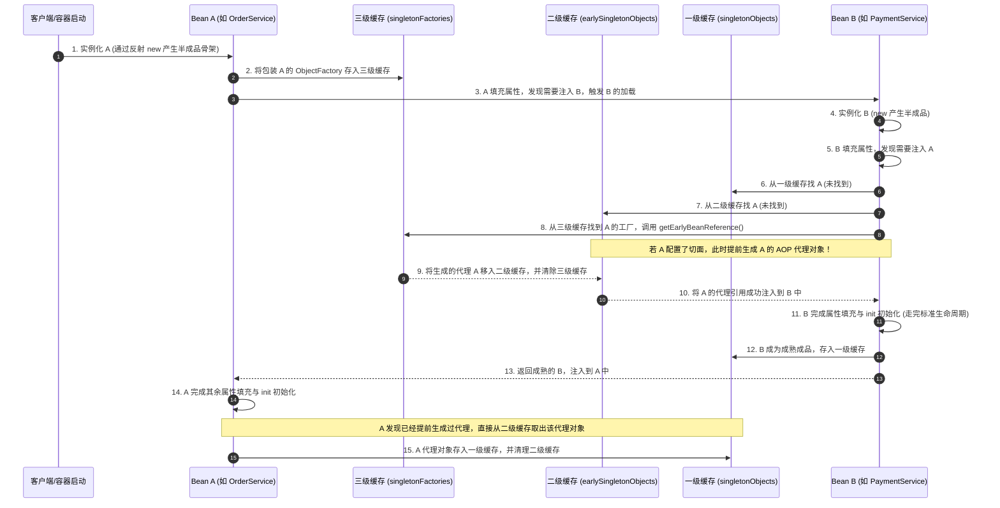

# AOP底层原理与三级缓存

## 使用入口：先解决问题，再做验证

统一实现日志、事务等横切行为。

**先做基本操作**：先为受管理 Bean 添加切面并验证外部调用与自调用，再观察代理及依赖循环；优先消除循环设计。初次学习可先完成[本模块基础实践](/doc/Java/Java语言基础与日常开发)。

**再逐步深入**：基本 API 与输入输出 → 常见失败和使用边界 → 场景排查与优化 → 本文机制分析与源码。面试先讲用途和自己的操作过程，再回答场景与原理追问。

> **一句话大白话**：
> - **AOP 原理**：AOP 不是黑魔法，就是“偷偷给你换了替身（动态代理）”。你以为调的是本尊，实际调的是替身，替身在跑你的代码前后加塞了风控、事务和日志。
> - **三级缓存**：三级缓存是 Spring 用来破除“先有鸡还是先有蛋”（Bean 循环依赖 A 依赖 B、B 又依赖 A）的巧妙解法；其中**第三级缓存（存工厂）之所以不可或缺，是为了在发生循环依赖时，能提前给半成品对象换上 AOP 代理替身**。

---

## 30 秒生活比喻：流水线拼装与借白条

- **AOP（明星演出与专业经纪人）**：
  明星（目标类）只管上台唱歌（核心业务逻辑）。但登台前必须有经纪人（代理对象）检查门票安检、登台后结账开发票（前置与后置切面增强）。观众以为在跟明星打交道，实际上全程都是经纪人在对接。
- **循环依赖（小红与小明互相等待）**：
  - 小红（Bean A）拼装积木需要小明（Bean B）的零件；小明拼装积木又必须依赖小红的零件。
  - **第一级缓存（成品货架 `singletonObjects`）**：存放完全拼装好、贴好合格证的成品。
  - **第二级缓存（半成品暂存区 `earlySingletonObjects`）**：放只搭了骨架、还没上螺丝的半成品。
  - **第三级缓存（借条工厂 `singletonFactories`）**：小红刚搭好骨架，就给工厂留下一张“白条（`ObjectFactory`）”：“如果一会儿小明急着要我，拿这张白条就能按需为我办理经纪人替身手续（AOP 代理）”。

---

## 一张图看懂三级缓存解决循环依赖与 AOP 代理



---

## 一、AOP 底层两大代理技术深度对决

Spring AOP 在底层通过两套成熟的动态代理机制实现：

| 对比维度 | JDK 动态代理 | CGLIB 动态代理 |
|---|---|---|
| **底层实现机制** | 基于 Java 原生反射包 `java.lang.reflect.Proxy` | 基于底层字节码操作框架（ASM）动态生成目标类子类 |
| **目标类限制** | **目标类必须实现至少一个接口**（因代理类已继承 `Proxy`） | 目标类**无需接口**，但不能是 `final` 类，方法不能是 `final` |
| **性能表现** | 早期 JDK 较慢；JDK 8+ 深度优化后性能与 CGLIB 基本持平 | 首次生成类稍慢，但调用时无需频繁反射，吞吐量极佳 |
| **SpringBoot 默认** | SpringBoot 1.x 默认在有接口时使用 JDK 动态代理 | **SpringBoot 2.x+ 统一默认强制开启 CGLIB**（`proxyTargetClass=true`） |

### 1. 手写原生 JDK 动态代理验证机制
```java
import java.lang.reflect.InvocationHandler;
import java.lang.reflect.Method;
import java.lang.reflect.Proxy;

// 1. 业务接口（JDK 动态代理强依赖接口）
interface OrderService {
    void createOrder(String orderId);
}

// 2. 真实实现类（被代理的目标对象）
class OrderServiceImpl implements OrderService {
    @Override
    public void createOrder(String orderId) {
        System.out.println("-> [目标执行] 订单正在落库: " + orderId);
    }
}

// 3. 动态代理验证
public class JdkProxyDemo {
    public static void main(String[] args) {
        OrderService target = new OrderServiceImpl();

        // 核心工厂方法：类加载器、实现的全部接口、拦截处理器 InvocationHandler
        OrderService proxy = (OrderService) Proxy.newProxyInstance(
            target.getClass().getClassLoader(),
            target.getClass().getInterfaces(),
            new InvocationHandler() {
                @Override
                public Object invoke(Object proxy, Method method, Object[] args) throws Throwable {
                    long start = System.currentTimeMillis();
                    System.out.println("[前置增强] 检查用户登录状态与库存...");
                    
                    // 通过反射唤起目标对象的实际方法
                    Object result = method.invoke(target, args);
                    
                    System.out.println("[后置增强] 耗时: " + (System.currentTimeMillis() - start) + "ms | 异步发送订单创建消息");
                    return result;
                }
            }
        );

        // 外部调用看起来调用的是 OrderService，其实是代理类 $Proxy0
        proxy.createOrder("ORDER_20261110_9988");
        System.out.println("代理对象的实际类型: " + proxy.getClass().getName()); // 输出: com.sun.proxy.$Proxy0
    }
}
```

---

## 二、Spring 单例 Bean 的三级缓存源码架构

Spring 容器在 `DefaultSingletonBeanRegistry` 类中定义了解决循环依赖的核心三级缓存：

```java
public class DefaultSingletonBeanRegistry extends SimpleAliasRegistry implements SingletonBeanRegistry {

    /** 一级缓存：成熟的单例 Bean 容器（完全经历过属性注入与初始化） */
    private final Map<String, Object> singletonObjects = new ConcurrentHashMap<>(256);

    /** 二级缓存：早期的单例 Bean 容器（半成品：已 new 实例，但尚未进行 @Autowired 依赖注入） */
    private final Map<String, Object> earlySingletonObjects = new ConcurrentHashMap<>(16);

    /** 三级缓存：单例工厂容器（存的是回调函数 ObjectFactory，专门在需要时生成代理对象） */
    private final Map<String, ObjectFactory<?>> singletonFactories = new HashMap<>(16);
}
```

### 为什么二级缓存不够？为什么非要第三级缓存？
这是面试官最喜欢追问的核心硬核考点。
- **如果系统里全是纯普通 Bean（没有 AOP、没有事物注解）**：
  **其实两级缓存就完全足够了**！Bean A 刚 `new` 出来就直接丢进二级缓存，Bean B 依赖 A 时直接去二级缓存取走半成品指针，循环引用就能解开。
- **关键矛盾在于 AOP（动态代理）**：
  按照 Spring 标准的设计生命周期规范：**所有的动态代理替换，都应该在 Bean 属性全部填充完毕、执行完 `init-method` 后的最终阶段（`AnnotationAwareAspectJAutoProxyCreator`）统一进行**。
  - 如果只有两级缓存，为了防止循环依赖注入了未代理的原始对象，Spring 就必须在 Bean 刚 `new` 出来的第一步，就提前把所有 Bean 全都强行做一遍 AOP 代理丢进二级缓存。
  - 这会彻底破坏 Spring 生命周期的优雅设计！
- **三级缓存的灵魂：惰性求值**：
  通过在三级缓存放入 `ObjectFactory`（挂钩 `getEarlyBeanReference`），Spring 实现：**正常情况下依然遵循在生命周期末尾生成代理；只有在真正被第三方循环依赖检测到、不得不提前注入时，才由三级缓存临时破例生成代理并转存二级缓存**！

---

## 三、生产避坑速查表

| 场景 | 根因机制 | 解决与避坑方案 |
|---|---|---|
| **构造器循环依赖报错** | 循环依赖发生在构造函数执行期间（`new A(b)`），此时 A 连半成品骨架都还没诞生，根本进不去三级缓存 | 1. 采用 Setter 或 `@Autowired` 属性注入；<br/>2. 在构造参数前添加 `@Lazy` 注解实现延迟加载 |
| **多例（Prototype）循环依赖报错** | Spring 默认**完全不缓存** Prototype 范围的 Bean，每次都是全新创建，导致递归死循环 | 原则上禁止多例之间强循环依赖，重构为单例或者工厂获取 |
| **`@Async` 异步组件导致的循环依赖** | `@Async` 的代理对象由 `AsyncAnnotationBeanPostProcessor` 产生，它不走三级缓存的早期代理提前暴露机制，初始化完成后发现 Bean 被偷换导致一致性校验报错 | 1. 在依赖处注入时加上 `@Lazy`；<br/>2. 拆分解耦，将 `@Async` 方法剥离到独立的异步调度 Service |
| **动态代理内部私有属性为 null** | CGLIB 是通过生成子类重写的，如果直接去反射读代理子类的属性，读到的是默认未初始化的字段 | 一律通过代理类的 Getter/Setter 方法访问属性，不直接越权反射子类属性 |

---

## 四、高频面试追问（含高分/低分特征）

| 追问 | 高分回答要点 | 低分回答特征 |
|---|---|---|
| **Q1: 为什么 SpringBoot 2.x 把 AOP 默认机制改成了 CGLIB？** | 即使类实现了接口，用户也经常会用具体的实现类类型进行 `@Autowired` 注入（如注入 `UserServiceImpl` 而非 `UserService`）。如果用 JDK 动态代理，生成的是实现接口的兄弟类 `$Proxy0`，强转注入会直接抛出类型转换异常；CGLIB 生成的是目标类的子类，天然支持子类多态注入。 | “因为 CGLIB 性能比 JDK 快很多”。（JDK 8 之后已基本无差距） |
| **Q2: 三级缓存各自的 key 和 value 存的是什么？** | 一级缓存：Key 是 beanName，Value 是成品成熟 Bean；<br/>二级缓存：Key 是 beanName，Value 是提前暴露的半成品 Bean 或早期代理对象；<br/>三级缓存：Key 是 beanName，Value 是生成半成品的函数式工厂 `ObjectFactory<?>`。 | 只知道一层和二层，说不清第三层存的是工厂。 |
| **Q3: 如果关闭循环依赖支持，Spring 会怎样？** | SpringBoot 2.6+ 默认就已经把 `spring.main.allow-circular-references` 设为了 `false`！官方强烈不鼓励在业务架构中出现循环依赖，出现时会抛出 `BeanCurrentlyInCreationException`，促使开发者重构拆分模块。 | 以为 Spring 永远默认支持循环依赖。 |
