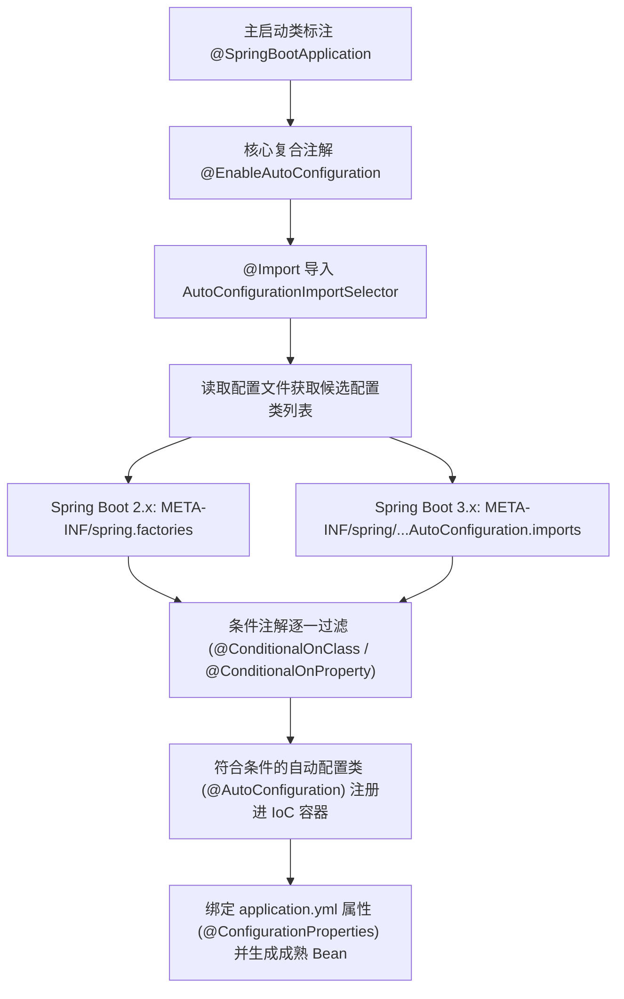

# SpringBoot自动装配与核心机制

## 使用入口：先解决问题，再做验证

减少基础配置并按环境启用组件。

**先做基本操作**：先启动最小应用，写配置并验证条件生效/缺失行为，再查看条件报告和自动装配入口。初次学习可先完成[本模块基础实践](/doc/Java/Java语言基础与日常开发)。

**再逐步深入**：基本 API 与输入输出 → 常见失败和使用边界 → 场景排查与优化 → 本文机制分析与源码。面试先讲用途和自己的操作过程，再回答场景与原理追问。

> **一句话大白话**：自动装配就是 SpringBoot 拿着一份「预备配置类清单」，根据你项目当前的 Classpath 环境（有没有引入对应的 Jar 包）和 `application.yml` 里的配置（有没有开启开关），**按需、按条件**把第三方库的 Bean 自动塞进 Spring 容器中，让你开箱即用、彻底告别繁琐的 XML 和手动 `@Bean` 配置。

---

## 30 秒生活比喻：精装房的「家电全包服务」

- **传统 Spring（毛坯房）**：
  你拿到房子后，想装空调得自己去电器城挑选品牌、买电线、找工人安装（手动写 XML 或 `@Bean` 实例化 `DataSource`、`RedisTemplate`）。
- **SpringBoot（精装修全包公寓）**：
  装修公司手里有一份**《全套家电配置清单》（`spring.factories` 或 `AutoConfiguration.imports`）**。
  - **按需触发（`@ConditionalOnClass`）**：装修师傅进屋一看，发现你订购了中央空调配件（pom.xml 引入了 `spring-boot-starter-data-redis`），师傅立马照着清单把空调装好。
  - **允许个性化（`@ConditionalOnMissingBean`）**：如果进屋发现你自带了一台心仪的复古冰箱（自己定义了一个同名 Bean），师傅就尊重你的选择，不再安装默认冰箱。
  - **配置参数定制（`@ConfigurationProperties`）**：空调温度、风速直接通过墙上的温控面板设置（在 `application.yml` 里填 `spring.redis.host`）。

---

## 一张图看懂自动装配全流程



---

## 一、核心三步底层全链路拆解

### 1. 入口注解：`@SpringBootApplication`
点开 `@SpringBootApplication` 源码，本质上它是由三大元注解组合而成的：
- `@SpringBootConfiguration`：声明当前类是配置类（底层就是 `@Configuration`）。
- `@ComponentScan`：扫描当前包及子包下的 `@Component`、`@Service`、`@Controller` 等业务组件。
- **`@EnableAutoConfiguration`**：**自动装配的真正总开关**！

### 2. 加载器：`AutoConfigurationImportSelector`
`@EnableAutoConfiguration` 内部通过 `@Import(AutoConfigurationImportSelector.class)` 注入选择器。
- 当 Spring 容器刷新执行 `ConfigurationClassPostProcessor` 时，会调用选择器的 `selectImports()` 方法。
- 选择器会去扫描所有类路径依赖 Jar 包下的固定描述文件：
  - **Spring Boot 2.x**：通过 `SpringFactoriesLoader` 读取 `META-INF/spring.factories` 文件中以 `EnableAutoConfiguration` 全类名为 Key 的列表。
  - **Spring Boot 3.x**：改为使用 `ImportCandidates.load()` 直接读取 `META-INF/spring/org.springframework.boot.autoconfigure.AutoConfiguration.imports`。每行一个配置类，加载效率更高且易维护。

### 3. 过滤器：`@Conditional` 条件装配（灵魂所在）
扫描出来的自动配置类有上百个，如果全部注入容器，启动会极其缓慢且浪费内存。SpringBoot 通过 `@Conditional` 系列注解决定是否真正生效：

| 条件注解 | 判定规则 | 典型生产应用场景 |
|---|---|---|
| **`@ConditionalOnClass`** | 类路径下存在指定类才生效 | 检查项目是否引入了 Jedis/Lettuce 依赖包 |
| **`@ConditionalOnMissingClass`** | 类路径下不存在指定类才生效 | 降级机制或备选适配方案 |
| **`@ConditionalOnBean`** | 容器中已存在指定 Bean 才生效 | 依赖另一个核心组件完成之后再装配 |
| **`@ConditionalOnMissingBean`** | 容器中**不存在**指定 Bean 才生效 | **开箱即用 + 允许开发者无缝覆盖**的根基 |
| **`@ConditionalOnProperty`** | 配置文件中指定属性符合预期才生效 | 例如 `redis.enabled=true` 时才初始化客户端 |

---

## 二、实战手写：自制一个企业级 `sms-spring-boot-starter`

通过亲手编写一个短信发送 Starter，把从配置属性、自动装配类到描述文件的全流程彻底打通。

### 第一步：编写配置属性类（温控面板）
```java
package com.example.sms.autoconfig;

import org.springframework.boot.context.properties.ConfigurationProperties;

/**
 * 读取 application.yml 中以 sms 为前缀的配置项
 */
@ConfigurationProperties(prefix = "sms")
public class SmsProperties {
    /** 是否开启短信发送能力，默认关闭 */
    private boolean enabled = false;
    /** 短信服务商分配的 SecretKey */
    private String secretKey = "default-key";

    public boolean isEnabled() { return enabled; }
    public void setEnabled(boolean enabled) { this.enabled = enabled; }
    public String getSecretKey() { return secretKey; }
    public void setSecretKey(String secretKey) { this.secretKey = secretKey; }
}
```

### 第二步：编写业务服务类与自动配置类
```java
package com.example.sms.autoconfig;

import org.springframework.boot.autoconfigure.AutoConfiguration;
import org.springframework.boot.autoconfigure.condition.ConditionalOnClass;
import org.springframework.boot.autoconfigure.condition.ConditionalOnMissingBean;
import org.springframework.boot.autoconfigure.condition.ConditionalOnProperty;
import org.springframework.boot.context.properties.EnableConfigurationProperties;
import org.springframework.context.annotation.Bean;

// 1. 业务核心服务接口与默认实现
public class SmsService {
    private final SmsProperties properties;
    public SmsService(SmsProperties properties) {
        this.properties = properties;
    }
    public boolean send(String phone, String content) {
        System.out.printf("[短信网关] 使用秘钥 %s 向手机号 %s 发送: %s%n",
                properties.getSecretKey(), phone, content);
        return true;
    }
}

// 2. 自动配置装配类
@AutoConfiguration
@EnableConfigurationProperties(SmsProperties.class)
@ConditionalOnClass(SmsService.class)
@ConditionalOnProperty(prefix = "sms", name = "enabled", havingValue = "true")
public class SmsAutoConfiguration {

    @Bean
    @ConditionalOnMissingBean(SmsService.class) // 只要业务工程没有自己注入 SmsService，就自动创建默认实现
    public SmsService smsService(SmsProperties properties) {
        return new SmsService(properties);
    }
}
```

### 第三步：注册导入文件（交出清单）
在 `resources` 目录下创建文件：
- **Spring Boot 3.x 规范**：`META-INF/spring/org.springframework.boot.autoconfigure.AutoConfiguration.imports`
- **内容写入**：
  ```properties
  com.example.sms.autoconfig.SmsAutoConfiguration
  ```

此时，任何业务子系统只需要在 `pom.xml` 中引入该 Starter，并在 `application.yml` 里声明：
```yaml
sms:
  enabled: true
  secret-key: production_aliyun_sms_key_998877
```
业务代码即可直接通过 `@Autowired private SmsService smsService;` 零配置使用！

---

## 三、生产避坑速查表

| 现象 | 根因剖析 | 快速排查与治理措施 |
|---|---|---|
| **配置项配了，Bean 却未注入** | `@ConditionalOnProperty` 参数大小写、前缀错误，或缺少 `matchIfMissing = true` | 启动参数添加 `--debug`，查看打印的 `CONDITIONS EVALUATION REPORT`（条件评估报告）寻找 `Negative matches` |
| **自己手写的 Bean 没有替换掉默认 Bean** | 自己的配置类加载顺序晚于自动配置类，或者写了同样的配置类名字 | 在自己的配置类上使用 `@AutoConfigureBefore`，或显式定义 `@Bean` 覆盖并移除 `@ComponentScan` 扫描冲突 |
| **自定义 Starter 在 Boot 3.x 下失效** | 沿用了 2.x 的 `META-INF/spring.factories`，Boot 3.x 已废弃此路径 | 迁移到 `META-INF/spring/org.springframework.boot.autoconfigure.AutoConfiguration.imports` |
| **依赖循环装配或启动极慢** | Starter 中 `@ComponentScan` 扫描范围过大，把业务代码的包也反向扫了进来 | Starter 中**严禁**使用通配的 `@ComponentScan`，一律采用按需注册或 `@Import` 显式装配 |

---

## 四、高频面试追问（含高分/低分特征）

| 追问 | 高分回答要点 | 低分回答特征 |
|---|---|---|
| **Q1: 自动配置的类是什么时候被加载进 JVM 的？** | 编译期不加载；在 SpringBoot 启动的 `refreshContext` 阶段，解析到 `@SpringBootApplication` 时通过选择器读取配置文件，利用反射确定 Class 是否存在，再由条件判断决定是否实例化。 | 只说“一开始启动就全加载了”。 |
| **Q2: Spring Boot 2.x 和 3.x 在自动装配底层有什么区别？** | 2.x 依赖 `META-INF/spring.factories`，所有配置塞一个文件容易冲突；3.x 遵循全新导入机制，采用专有 imports 文件，配合 Spring 6.0 的 AOT（提前编译）与原生镜像更加轻量化。 | “不知道有什么变化，都差不多”。 |
| **Q3: 如何临时禁用某一个自动配置？** | 1. 注解排查：`@SpringBootApplication(exclude = DataSourceAutoConfiguration.class)`；<br/>2. 配置文件：`spring.autoconfigure.exclude=...`。 | “把对应的 jar 包直接从依赖里删掉”。 |
