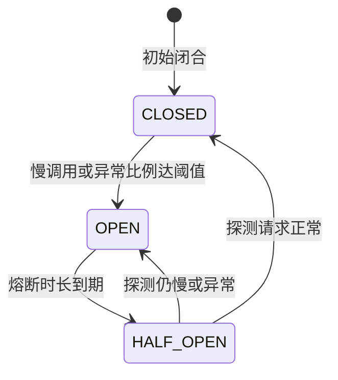

# SpringCloud微服务核心组件与架构实战

## 使用入口：先解决问题，再做验证

在服务拆分后管理发现、配置、调用和故障。

**先做基本操作**：先运行两个可独立调用的服务并设置 deadline，验证依赖失败；再引入发现、配置、熔断和追踪。初次学习可先完成[本模块基础实践](/doc/Java/Java语言基础与日常开发)。

**再逐步深入**：基本 API 与输入输出 → 常见失败和使用边界 → 场景排查与优化 → 本文机制分析与源码。面试先讲用途和自己的操作过程，再回答场景与原理追问。

## 🎯 核心技术原理与实战归纳
- **核心设问与思考**：“主流微服务架构（Spring Cloud Alibaba）的核心五大组件是什么？Nacos 是如何实现**服务注册、健康检查与 AP / CP 动态切换**的？”
- **深水区追问**：“使用 **OpenFeign** 进行微服务内部调用时，**前端传过来的 Authorization Token 是如何透传给下游服务的**？**Spring Cloud Gateway** 为什么比 Zuul 性能高数倍？如何编写全局 JWT 鉴权 Filter？高并发下微服务发生**级联雪崩**如何用 **Sentinel** 熔断隔离？**分布式事务 Seata 的 AT 模式**底层是如何通过 Undo Log 自动生成反向回滚补偿的？”

---

## 一、 Spring Cloud Alibaba 工业级微服务架构全景

```text
                                [客户端 / 移动端 / Web]
                                          │ HTTPS
                                          ▼
                      ┌──────────────────────────────────────┐
                      │    Spring Cloud Gateway (统一网关)    │
                      │    (Netty 反应式 / 鉴权 / 动态路由分发) │
                      └──────────────────┬───────────────────┘
                                         │
                 ┌───────────────────────┼───────────────────────┐
                 ▼ OpenFeign 负载均衡    ▼                       ▼
        ┌──────────────────┐    ┌──────────────────┐    ┌──────────────────┐
        │  用户服务 (User)  │    │  订单服务 (Order) │    │  库存服务 (Stock)│
        └────────┬─────────┘    └────────┬─────────┘    └────────┬─────────┘
                 │                       │                       │
                 └───────────────────────┴───────────────────────┘
                                         │
        ┌────────────────────────────────┴────────────────────────────────┐
        │                        微服务基础支撑中枢                        │
        │  • 注册与配置中心: Nacos (服务发现 + 动态刷新)                   │
        │  • 分布式流控与容错: Sentinel (熔断降级 + QPS限流)               │
        │  • 分布式事务协调器: Seata TC (AT 模式两阶段提交)                 │
        │  • 分布式链路追踪: SkyWalking / OpenTelemetry (全链路 TraceId)  │
        └─────────────────────────────────────────────────────────────────┘
```

---

## 二、 核心组件深度机制与选型对比

### 1. 注册与配置中心：Nacos（AP 与 CP 模型剖析）

| 注册中心 | 默认模式 | CAP 定位 | 心跳与健康检查机制 | 适用场景 |
| :--- | :--- | :--- | :--- | :--- |
| **Nacos** | **AP 模式（临时实例）**<br>可动态切换为 CP | **AP / CP 双模型支持** | 客户端主动每 5 秒发送一次心跳，15 秒无响应标记异常，30 秒剔除 | **现代微服务首选**（高可用与配置一体化） |
| **Eureka** | AP 模式 | **AP**（保可用性） | 客户端定时心跳续约，具备自我保护机制 | 早期 Netflix 体系（现已停止迭代） |
| **ZooKeeper** | CP 模式 | **CP**（保一致性） | 基于 ZAB 协议，Leader 选举期间集群对外不可用 | 强一致性协调服务（不适合万级微服务） |

- **为什么微服务注册中心必须偏向 AP？**
  - 服务实例的暂时状态不一致，不会直接阻断业务访问（客户端有缓存负载均衡兜底）；若为了强一致性（CP）在节点网络分区时暂停服务发现，会导致全网级业务瘫痪。

---

### 2. 跨微服务调用：OpenFeign 请求头 Token 透传拦截器（MVP）

#### 生产深坑：Feign 内部调用丢失用户上下文
- **现象**：网关在验证完用户 Token 后，将请求转发给订单服务 A；订单服务 A 通过 OpenFeign 调用库存服务 B，库存服务 B 从 Request Header 中拿不到 Authorization，直接返回 401 未登录！
- **原因**：OpenFeign 底层发起的是全新的 HTTP 请求，**默认不会继承上一级的 RequestContext**！

#### 生产解决方案：实现 `RequestInterceptor` 请求拦截器
```java
import feign.RequestInterceptor;
import feign.RequestTemplate;
import org.springframework.stereotype.Component;
import org.springframework.web.context.request.RequestContextHolder;
import org.springframework.web.context.request.ServletRequestAttributes;
import javax.servlet.http.HttpServletRequest;

@Component
public class FeignAuthRequestInterceptor implements RequestInterceptor {

    @Override
    public void apply(RequestTemplate template) {
        // 从当前线程的 ThreadLocal 中抓取主请求的 Servlet 属性
        ServletRequestAttributes attributes = 
            (ServletRequestAttributes) RequestContextHolder.getRequestAttributes();
        
        if (attributes != null) {
            HttpServletRequest request = attributes.getRequest();
            String token = request.getHeader("Authorization");
            if (token != null) {
                // 将原始请求头传递给即将发起的 Feign 内部请求
                template.header("Authorization", token);
                template.header("X-Trace-Id", request.getHeader("X-Trace-Id"));
            }
        }
    }
}
```

---

### 3. 微服务网关：Spring Cloud Gateway 全局鉴权 Filter（MVP）

Spring Cloud Gateway 底层基于 **Spring WebFlux 与 Netty 异步反应式编程**，单机吞吐量远超基于传统 Servlet 阻塞模型的 Zuul 1.x。

```java
import org.springframework.cloud.gateway.filter.GlobalFilter;
import org.springframework.cloud.gateway.filter.GatewayFilterChain;
import org.springframework.core.Ordered;
import org.springframework.http.HttpStatus;
import org.springframework.http.server.reactive.ServerHttpRequest;
import org.springframework.stereotype.Component;
import org.springframework.web.server.ServerWebExchange;
import reactor.core.publisher.Mono;

@Component
public class GlobalAuthFilter implements GlobalFilter, Ordered {

    @Override
    public Mono<Void> filter(ServerWebExchange exchange, GatewayFilterChain chain) {
        ServerHttpRequest request = exchange.getRequest();
        String path = request.getURI().getPath();

        // 1. 白名单直接放行
        if (path.startsWith("/api/auth/login") || path.startsWith("/public/")) {
            return chain.filter(exchange);
        }

        // 2. 检查 Header 中的 Token
        String token = request.getHeaders().getFirst("Authorization");
        if (token == null || !isValidJwt(token)) {
            // 401 拦截拒绝
            exchange.getResponse().setStatusCode(HttpStatus.UNAUTHORIZED);
            return exchange.getResponse().setComplete();
        }

        // 3. 将解析出的用户 ID 注入微服务内部专属请求头
        ServerHttpRequest mutatedRequest = request.mutate()
            .header("X-User-Id", parseUserIdFromToken(token))
            .build();

        return chain.filter(exchange.mutate().request(mutatedRequest).build());
    }

    @Override
    public int getOrder() { return -1; } // 优先级最高

    private boolean isValidJwt(String t) { return true; }
    private String parseUserIdFromToken(String t) { return "1001"; }
}
```

---

### 4. 分布式事务：Seata AT 模式底层运行原理（2PC）

#### 为什么不需要业务手写两阶段确认？
Seata AT 模式是无侵入式分布式事务：
1. **阶段一（准备阶段）**：
   - 业务 SQL 执行前，Seata 自动拦截并查询记录并保存为 **Before Image（前镜像）**。
   - 执行业务更新 SQL。
   - 查询更新后的记录保存为 **After Image（后镜像）**。
   - 生成 **Undo Log 记录** 并随业务 SQL 在同一个本地事务中提交入库。
2. **阶段二（提交/回滚阶段）**：
   - **全局提交**：分布式事务协调器（TC）下发 Commit 命令，各分支服务仅需**异步批量删除 Undo Log 记录**，极度迅速。
   - **全局回滚**：TC 下发 Rollback 命令，分支服务通过对比 After Image 与当前数据库数据（防止脏写），直接利用 Before Image **自动生成反向回滚补偿 SQL**，还原数据！

```java
// 生产业务使用：零侵入代码
@GlobalTransactional(name = "create-order-tx", rollbackFor = Exception.class)
public void createOrder(OrderParam param) {
    orderService.saveOrder(param);         // 1. 本地生成订单
    storageFeignClient.deductStock(param);  // 2. 远程扣减库存
    accountFeignClient.deductBalance(param);// 3. 远程扣减余额
    // 任意一步抛出异常，Seata 协调器自动全量反向补偿回滚！
}
```

---

## 三、流量防卫：Sentinel 限流、熔断与隔离

> 开篇「深水区追问」里承诺的级联雪崩治理，本节补完。仅有 Nacos + OpenFeign + Gateway + Seata 四件套，在生产环境属于「能跑但不能抗」的状态。

### 1. 底层执行链：SlotChain 责任链

Sentinel 的一切能力都挂在 `CtSph.entry()` 触发的 **Slot 责任链**上，插槽顺序由 SPI（`SlotChainBuilder`）装配，理解顺序才能解释「为什么限流规则在熔断规则之前生效」：

| 顺序 | Slot | 职责 | 关键点 |
| :--- | :--- | :--- | :--- |
| 1 | `NodeSelectorSlot` | 构建资源调用树，创建 `DefaultNode` | 区分同一资源在不同入口链路上的流量（`limitApp` 链路模式依赖它） |
| 2 | `ClusterBuilderSlot` | 创建 `ClusterNode` 聚合全局统计 | 一个资源对应一个全局节点，不分入口 |
| 3 | `LogSlot` | 记录 `BlockException` 日志 | 只记录被阻塞的请求 |
| 4 | `StatisticSlot` | **核心统计**：滑动窗口计数、线程数、RT | 先于规则校验执行，才有数据可判 |
| 5 | `AuthoritySlot` | 黑白名单 | `authorityRule` |
| 6 | `SystemSlot` | 系统自适应保护 | 基于全局 LOAD / QPS / RT / 线程数 |
| 7 | `FlowSlot` | **限流** | `FlowRule` |
| 8 | `DegradeSlot` | **熔断降级** | `DegradeRule` / `CircuitBreaker` |

- 任一 Slot 抛出 `BlockException` 即短路后续链路，由 `blockHandler` 兜底；`StatisticSlot` 在 `finally` 中补齐线程数与 RT 统计。
- `@SentinelResource` 底层同样是这套链，只是通过 AOP 把注解方法包成资源名。

### 2. QPS 为什么用滑动窗口而不是固定计数器

Sentinel 的 `LeapArray` 用 `AtomicReference<WindowWrap<T>>[]` 环形数组实现时间窗复用，**不回收窗口对象、只复用桶**，避免高频 GC：

| 统计维度 | `sampleCount` | `intervalInMs` | 单桶跨度 |
| :--- | :---: | :---: | :---: |
| 秒级（QPS 规则） | 2 | 1000 | 500 ms |
| 分钟级（异常数规则） | 60 | 60000 | 1000 ms |

- **固定窗口的临界突刺**：限流 100 QPS，第 1 秒最后 100ms 打进 100 个请求，第 2 秒前 100ms 又打进 100 个 —— 200ms 内实际承载 200 QPS，计数器却认为合规。滑动窗口按桶聚合，能平滑掉这个边界。
- 面试常问「滑动窗口和漏桶/令牌桶的区别」：**前者是统计手段，后两者是整形/放行策略**，不是同一层的东西。

### 3. 流控规则的三个维度与三种效果

| 维度 | 取值 | 生产用法 |
| :--- | :--- | :--- |
| 阈值类型 | QPS / 并发线程数 | 接口型用 QPS；下游慢、易堆积的 RPC 用线程数（防止线程池被拖死） |
| 流控模式 | 直接 / 关联 / 链路 | 关联：写接口压力过大时限流读接口，保住写链路；链路：只针对某个 `Entry` 入口 |
| 流控效果 | 快速失败 / Warm Up / 排队等待 | 见下 |

| 效果 | 底层算法 | 场景 |
| :--- | :--- | :--- |
| 快速失败 | 直接 `throw FlowException` | 常规接口，超额立即拒 |
| **Warm Up 预热** | 类令牌桶 `WarmUpController`，默认 `coldFactor=3`，允许 QPS 从 `threshold/3` 随令牌消耗速率逐步爬升到阈值 | **秒杀、缓存冷启动、DB 连接池刚建立**，避免瞬间把冷系统打崩 |
| 排队等待 | 漏桶 `RateLimiterController`，按 `1/QPS` 固定间隔放行，超过 `maxQueueingTimeMs` 拒绝 | 削峰填谷，把突刺拉平（如消息推送、报表导出） |

### 4. 熔断降级：三态状态机



三类规则对应 Sentinel 的两个 `CircuitBreaker` 实现：

| 规则 | 判据 | 实现 | 典型阈值 |
| :--- | :--- | :--- | :--- |
| 慢调用比例 | RT 超过 `maxAllowedRt` 的请求占比 | `SlowRequestCircuitBreaker` | 最大 RT 500ms，比例 0.5，最小请求数 5 |
| 异常比例 | 业务异常占比 | `ErrorCircuitBreaker` | 0.5，熔断 10s |
| 异常数 | 单位时间异常绝对数 | `ErrorCircuitBreaker` | 分钟级 5 次 |

- **`minRequestAmount`（最小请求数）是生产必配项**：不配时低流量期 1 个请求失败就熔断整个服务，属于典型配置事故。
- HALF_OPEN 只允许**一个**探测请求通过，避免恢复瞬间被流量二次打挂。

### 5. 隔离策略：信号量 vs 线程池

| 维度 | Sentinel（信号量/并发数） | Hystrix（线程池隔离） | Resilience4j |
| :--- | :--- | :--- | :--- |
| 隔离方式 | 计数器限制并发线程数，不创建线程池 | 每个依赖独立 `ThreadPool` | 信号量或线程池可配 |
| 开销 | 极低，无线程上下文切换 | 高，每次调用有线程切换与排队 | 低 |
| 超时控制 | 依赖调用方自身超时（Feign/Ribbon） | 线程池自带超时中断 | 显式 `TimeLimiter` |
| 隔离彻底性 | 弱：慢调用仍占着容器（Tomcat）工作线程 | **强**：慢依赖耗尽的是自己的池，不拖垮主容器 | 视配置 |
| 选型结论 | 高并发、依赖多、追求吞吐的国内主流 | 老系统存量维护（已停更） | Spring Boot 3 新项目常见 |

> 高分回答要主动说清这个权衡：信号量「省」但隔离不彻底，所以**必须配合下游超时时间对齐**（Feign connectTimeout/readTimeout < 上游熔断 RT 阈值），否则超时配置失配会让熔断永远来不及触发。

### 6. 生产最大坑：规则默认存内存，重启即失效

| 模式 | 机制 | 一致性 | 适用 |
| :--- | :--- | :--- | :--- |
| 原始模式 | 控制台推送到应用内存 | 重启丢失 | 仅限本地演示 |
| Pull | 应用定时读本地文件 / 配置中心 | 差，存在时间窗不一致 | 小规模、规则变更少 |
| **Push（生产推荐）** | Nacos/Apollo 作为规则源，应用监听变更实时生效；控制台改造为写配置中心 | **强** | 集群 |

MVP：`ReadableDataSource` 监听 Nacos 配置，`WritableDataSource` 把控制台变更回写 Nacos，形成闭环。

```java
@Configuration
public class SentinelRulePersistence {

    @Value("${spring.cloud.nacos.config.server-addr}")
    private String serverAddr;

    @PostConstruct
    public void init() throws Exception {
        // 1. 读：Nacos 配置变更 -> 实时推送到 FlowRuleManager
        ReadableDataSource<String, List<FlowRule>> flowDs =
            new NacosDataSource<>(serverAddr, "SENTINEL_GROUP", "order-flow-rules",
                source -> JSON.parseArray(source, FlowRule.class));
        FlowRuleManager.register2Property(flowDs.getProperty());

        // 2. 读：熔断规则同理
        ReadableDataSource<String, List<DegradeRule>> degradeDs =
            new NacosDataSource<>(serverAddr, "SENTINEL_GROUP", "order-degrade-rules",
                source -> JSON.parseArray(source, DegradeRule.class));
        DegradeRuleManager.register2Property(degradeDs.getProperty());

        // 3. 写：控制台改规则时回写 Nacos，否则集群内只有单台生效
        WritableDataSource<List<FlowRule>> wds =
            rules -> nacosConfigService.publishConfig(
                "order-flow-rules", "SENTINEL_GROUP",
                JSON.toJSONString(rules), ConfigType.JSON.getType());
        WritableDataSourceRegistry.registerFlowDataSource(wds);
    }
}
```

```yaml
# Nacos 中的 order-flow-rules 内容
- resource: createOrder
  limitApp: default
  grade: 1            # 1 = QPS
  count: 200
  strategy: 0         # 0 = 直接
  controlBehavior: 1  # 1 = Warm Up
  warmUpPeriodSec: 10
  clusterMode: false
```

**`blockHandler` 与 `fallback` 的分工**（面试高频混淆点）：

```java
@SentinelResource(
    value = "createOrder",
    blockHandler = "flowBlocked",       // 只处理 BlockException（限流/熔断/热点/系统规则）
    blockHandlerClass = OrderBlockHandler.class,
    fallback = "bizFallback",           // 处理所有业务异常（含超时、NPE）
    fallbackClass = OrderFallback.class,
    exceptionsToIgnore = {IllegalArgumentException.class} // 参数校验异常不该被兜底吞掉
)
public OrderVO createOrder(OrderParam param) { ... }
```

- 把业务异常也塞进 `blockHandler` 是错的：Sentinel 只认 `BlockException`。
- 兜底里**必须打点告警**，否则降级被静默吞掉，监控上完全看不出服务已处于半瘫状态。

### 7. 另外两个常被忽略的能力

- **热点参数限流** `ParamFlowRule`：按参数值（如 `userId`、`skuId`）单独计数，专治「大客户刷接口」和秒杀单品热点，配合 `ParameterMetric` 的 LRU 统计，不能对所有参数无脑开。
- **系统自适应保护** `SystemRule`：以应用整体 LOAD / 全局 RT / 总 QPS / 总线程数为阈值做最后一道兜底，只在入口流量不可预测时启用，粒度太粗，不能替代接口级规则。

---

## 四、配置热更新：Nacos 长轮询与 `@RefreshScope` 原理

### 1. 长轮询不是「定时轮询」

```text
客户端 ClientWorker                     Nacos Server (LongPollingService)
       │  HTTP 长轮询请求 (默认 30s 超时)         │
       │ ─────────────────────────────────────▶ │  hold 住请求，挂到 allSubs 队列
       │                                        │  (默认最多挂 29.5s)
       │     配置变更 → LocalDataChangeEvent     │
       │ ◀─────────── 立即返回变更 dataId/group ── │
       │  按返回的 key 拉取最新配置 + 比对 MD5    │
       │  写本地快照 ~/nacos/config/ + 发 RefreshEvent │
```

- **变更秒级生效，空闲时零空转**：与「每 5s 拉一次」相比，长轮询既保证了实时性又不产生大量无效请求。
- **本地快照是容灾设计**：Nacos 全挂时应用仍能从 `~/nacos/config/` 读取上次配置启动，这是 Nacos 敢当配置中心的关键。
- Namespace / Group / Data ID 三层隔离：`Namespace` 隔环境（dev/test/prod），`Group` 隔业务域，`Data ID` 对应单个配置文件；灰度配置靠 Group 或 `beta` 发布实现。

### 2. `@RefreshScope` 是「懒刷新 + 代理不变」

```text
@RefreshScope 的 Bean 定义 scope = "refresh"（GenericScope 子类）
  → 容器里注册的是 ScopedProxyFactoryBean 生成的【代理对象】
  → 真实目标对象缓存在 BeanLifecycleWrapperCache 中

配置变更 → Nacos 发 RefreshEvent → ContextRefresher.refresh()
  → RefreshScope.refreshAll() → super.destroy() 清空缓存（只标记，不重建）
  → 下一次方法调用经代理进入 GenericScope.get() → 缓存 miss → 重新 createBean
  → 重新走 @PostConstruct、重新绑定 @Value / @ConfigurationProperties
```

关键点：**是懒重建，不是热替换对象引用**。所以持有该 Bean 引用的单例不会失效，但重建瞬间的并发调用可能拿到不同实例，且 `@PostConstruct` 里的初始化逻辑会重复执行。

### 3. 四个生产坑

| 坑 | 现象 | 规避 |
| :--- | :--- | :--- |
| 静态常量不刷新 | `private static final String X = env.getProperty(...)` 永远不变 | 用实例字段 + `@RefreshScope`，或监听 `RefreshScopeRefreshedEvent` 手动赋值 |
| `@PostConstruct` 重复执行 | 重建时重复建连接池 / 重复注册定时任务 | 初始化逻辑做成幂等，或拆到不受刷新影响的独立 Bean |
| 被 `@Scheduled` 持有的类加刷新 | 任务调度器持有旧代理，重建后状态错乱 | 定时任务类不加 `@RefreshScope`，改为读取独立的动态配置 Bean |
| `@Value` 没加 `@RefreshScope` | 配置改了但值纹丝不动 | 类上加注解；或用 `@ConfigurationProperties`（Spring Cloud 下支持自动刷新绑定） |

### 4. 配置灰度与回滚

- 先按 `beta` 白名单 IP 发布，观察 5~10 分钟再全量；Nacos 保留配置历史版本，可一键回滚。
- **开关型配置优先于代码发布**：限流阈值、降级开关、功能灰度位都应放配置中心，线上出问题时改配置比重新发版快一个数量级。

---

## 五、全链路追踪：TraceId 透传与异步上下文丢失

### 1. 核心模型

```text
traceparent: 00-4bf92f3577b34da6a3ce929d0e0e4736-00f067aa0ba902b7-01
             │  │                                │                  │  └─ flags(采样)
             │  │                                └─ parent-id (32 hex)
             │  └─ trace-id (32 hex / 16 byte)
             └─ version
```

- `TraceId` 贯穿一次请求全程，`SpanId` 标识链路中的单个调用，`ParentSpanId` 组成树形调用关系；`Baggage` 携带业务标签（如租户 ID）跨服务透传。
- W3C `traceparent` 是现在的标准头；老系统里的 `X-B3-TraceId`（Zipkin B3）仍常见于存量服务，网关处要做兼容转换。

### 2. Spring Boot 3 选型（易踩的版本坑）

| 组合 | 状态 |
| :--- | :--- |
| Spring Cloud Sleuth + Boot 2.x | 存量维护，**Sleuth 已停止演进** |
| **Micrometer Tracing + OpenTelemetry / Brave + Boot 3.x** | 现行方案 |
| SkyWalking Java Agent | 无侵入字节码增强，跨语言、免改代码，适合异构系统 |

```yaml
management:
  tracing:
    sampling:
      probability: 0.1   # 生产 10% 头部采样，高 QPS 下必须限
  otlp:
    tracing:
      endpoint: http://otel-collector:4318/v1/traces
```

- **头部采样**（请求入口就决定是否记录）开销低但可能漏掉偶发慢请求；**尾部采样**（Collector 收集完整链路后再判，按错误/慢调用保留）更准但吃内存与带宽。生产常用「头部低概率 + 错误/慢链路尾部强制保留」组合。

### 3. 异步上下文丢失：最高频的追踪事故

`ThreadLocal` 不会跨线程传递，一旦业务里出现 `@Async`、线程池、`CompletableFuture`、MQ 异步消费，子线程的日志与 Span 全部丢失 TraceId，链路断成两截。

```java
// 方案 A：Spring 线程池 TaskDecorator（推荐，侵入最小）
@Bean("tracedExecutor")
public Executor tracedExecutor() {
    ThreadPoolTaskExecutor executor = new ThreadPoolTaskExecutor();
    executor.setTaskDecorator(runnable -> {
        // 提交任务时【在父线程】捕获当前上下文
        Map<String, String> context = MDC.getCopyOfContextMap();
        return () -> {
            try {
                if (context != null) MDC.setContextMap(context);  // 子线程恢复
                runnable.run();
            } finally {
                MDC.clear();  // 必须清理，线程复用会污染下一个任务
            }
        };
    });
    executor.initialize();
    return executor;
}

// 方案 B：Alibaba TTL（TransmittableThreadLocal），连第三方不可改线程池也能透传
// TtlExecutors.getTtlExecutorService(rawPool)
```

- 日志侧把 `traceId` 注入 MDC，pattern 改为 `%d{yyyy-MM-dd HH:mm:ss} [%thread] [%X{traceId:-}] %-5level %logger{36} - %msg%n`，才能从任意一条日志反查整条链路。
- Gateway、OpenFeign（前文 `FeignAuthRequestInterceptor` 已透传 `X-Trace-Id`）、MQ 消息头是三个必须埋点的边界；MQ 尤其容易被漏，消费端要显式从 header 恢复上下文。

### 4. 一次线上超时的定位路径

1. 网关日志拿 `traceId` → 2. 在链路图上看哪个 Span 的 RT 占比最高 → 3. 定位到是「订单服务调库存服务」的 Feign 调用 → 4. 查看该 Span 的 tags（DB 慢 SQL / 连接池等待 / GC pause）→ 5. 结合 `X-Trace-Id` 把上下游日志串起来验证。
- **没有 TraceId 时，这类问题只能靠各服务时间戳手工对齐，跨时钟偏差能消耗掉半天。**

---

## 六、级联雪崩、服务降级兜底与分布式 ID

### 1. 雪崩是怎么形成的

```text
下游 DB 慢查询 → 库存服务 RT 从 50ms 涨到 3s
  → 订单服务 Tomcat 线程池被 Feign 等待占满（默认无超时 / 超时过长）
  → 上游网关重试 ×3，流量放大 3 倍
  → 订单服务彻底无响应，购物车、支付等所有依赖方陆续被拖垮
  → 全站 502
```

**防线必须同时具备四件事，缺一不可**：超时对齐（Feign readTimeout < 熔断 RT 阈值）、熔断（Sentinel）、舱壁隔离（并发数/信号量）、重试退避（禁无限重试 + 指数退避 + 抖动）。只加熔断而不设超时，线程早就被占满了，熔断统计都来不及产出。

### 2. 三层降级兜底

| 层级 | 手段 | 兜底形态 |
| :--- | :--- | :--- |
| 网关层 | Gateway `fallback` + Sentinel 网关流控 | 返回静态页 / 排队中提示 / 统一 503 |
| 调用层 | Feign `FallbackFactory` | **能拿到 `Throwable`**，可按异常类型区分降级并记录告警 |
| 业务层 | `@SentinelResource(fallback=...)` | 返回空集合、只读缓存、上次成功快照、默认值 |

```java
@Component
public class StockFeignFallbackFactory implements FallbackFactory<StockFeignClient> {
    @Override
    public StockFeignClient create(Throwable cause) {
        // 用工厂而非普通 fallback，才能区分「熔断限流」与「真业务异常」
        log.error("库存服务降级，原因: {}", cause.getMessage(), cause);
        metrics.counter("feign.fallback", "target", "stock",
                        "type", cause instanceof BlockException ? "blocked" : "error").increment();
        return new StockFeignClient() {
            @Override
            public StockVO queryStock(Long skuId) {
                // 只读缓存兜底，绝不返回「有库存」的假阳性
                StockVO cached = redisTemplate.opsForValue().get("stock:snapshot:" + skuId);
                return cached != null ? cached : StockVO.unavailable();
            }
            @Override
            public Boolean deductStock(OrderParam param) {
                return false; // 写操作降级必须显式失败，由上层转异步补偿队列
            }
        };
    }
}
```

**降级三条铁律**：① 读可降级、写不可静默假成功；② 降级必须打点 + 告警，否则监控失真；③ 兜底逻辑自身不能再依赖已降级的服务，否则形成二次雪崩。

### 3. 分布式 ID：为什么不能用 UUID 做主键

| 方案 | 有序性 | 长度 | 问题 / 适用 |
| :--- | :--- | :--- | :--- |
| 数据库自增 ID | 严格递增 | 8 B | 分库分表后冲突；暴露业务量；可设不同 `auto_increment_offset` 缓解 |
| **UUID** | **无序** | 36 字符 | InnoDB 聚簇索引按主键物理排序，随机写入导致**频繁页分裂 + 缓冲池命中率下降**，且占用空间大。只适合做业务流水号，不适合做主键 |
| **雪花算法 Snowflake** | 趋势递增 | 8 B (Long) | 本地生成无网络开销，单机每毫秒 4096 个；依赖时钟 |
| 号段模式（Leaf-segment / 美团 Leaf） | 趋势递增 | 8 B | 每次从 DB 批量取一段 ID 缓存在内存，DB 压力低、容忍 DB 短时不可用；ID 不连续 |

雪花 64 bit 结构：

```text
 0 | 0000000000 0000000000 0000000000 0000000000 1 | 00000 00000 | 000000000000
 ↑               41 bit 时间戳(ms，相对起始纪元，约 69 年)   ↑ 10 bit 机器  ↑ 12 bit 序列
符号位(恒 0)                                        (5 dataCenter+5 worker)   (每 ms 4096)
```

**时钟回拨是雪花唯一的硬伤**，生产必须处理：

```java
public synchronized long nextId() {
    long now = System.currentTimeMillis();
    if (now < lastTimestamp) {
        long offset = lastTimestamp - now;
        if (offset <= 5) {                       // 小回拨：自旋等待时钟追上
            waitUntil(lastTimestamp);
            now = System.currentTimeMillis();
        } else {                                 // 大回拨：拒绝服务并告警，绝不发重复 ID
            throw new IllegalStateException("时钟回拨 " + offset + "ms，拒绝发号");
        }
    }
    if (now == lastTimestamp) {
        sequence = (sequence + 1) & SEQUENCE_MASK;
        if (sequence == 0) now = waitNextMillis(lastTimestamp); // 同一 ms 溢出，阻塞到下 1ms
    } else {
        sequence = 0L;
    }
    lastTimestamp = now;
    return ((now - EPOCH) << TIMESTAMP_SHIFT)
         | (dataCenterId << DC_SHIFT) | (workerId << WORKER_SHIFT) | sequence;
}
```

- `workerId` 必须**持久化并防重复**（用 DB / Redis / ZK 注册，或 K8s StatefulSet 固定编号）；容器化环境重启后靠随机数分配 workerId，是 ID 重复的最常见事故源。
- K8s 部署下更省心的选择是 **Leaf 号段模式**：不依赖节点时钟与机器编号，天然适配弹性扩缩容。

---

## 七、高频追问链与回答要点

| 追问 | 高分回答特征 | 低分回答特征 |
| :--- | :--- | :--- |
| 「Sentinel 和 Hystrix 有什么本质区别？」 | 说清信号量 vs 线程池的开销/隔离度权衡，并补一句「信号量隔离必须配下游超时对齐」 | 只答「Sentinel 更轻量、有控制台」 |
| 「限流规则重启后还在吗？」 | 直接点破默认内存态，给出 Push 模式下 `ReadableDataSource` + `WritableDataSource` 闭环 | 答「存在配置文件里」或「Nacos 自动就有」 |
| 「配置改了为什么没生效？」 | 分层排查：长轮询是否通 → 是否加 `@RefreshScope` → 是不是 `static final` / `@PostConstruct` 陷阱 | 只答「加个 @RefreshScope」 |
| 「异步线程里 TraceId 丢了怎么修？」 | 说出 `TaskDecorator` 捕获/恢复 + `finally MDC.clear()` 防线程复用污染，或 TTL | 答「用 InheritableThreadLocal」（线程池场景无效） |
| 「熔断了为什么还是雪崩？」 | 指出超时未对齐 / 无舱壁隔离 / 上游无限重试放大流量，四道防线缺一不可 | 只答「熔断阈值调小一点」 |
| 「分布式 ID 用 UUID 行不行？」 | 从聚簇索引页分裂、缓冲池命中率、存储成本三个角度说清「无序」代价，再给雪花 + 时钟回拨方案 | 只答「UUID 太长/不美观」 |
| 「Seata AT 和 TCC 怎么选？」 | AT 无侵入但锁全局、依赖 Undo Log 与本地事务；TCC 性能与隔离更好但要手写 Try/Confirm/Cancel 与空回滚/悬挂/幂等三件套 | 只背「AT 简单、TCC 复杂」 |

> **串讲建议**：被问「讲一下你们的微服务架构」时，用一条请求串起本文主线 —— Gateway 全局鉴权 → Nacos 服务发现 → OpenFeign Token/TraceId 透传 → Sentinel 流控熔断 → Seata 保证跨库事务 → 链路追踪定位 → 降级兜底。能自然带出「为什么这样选」和「踩过什么坑」，比逐个背组件名高出一个档次。

---

## 八、Spring Cloud 与 Dubbo：不是二选一

很多人把两者当竞品，其实维度不同：**Spring Cloud 是「微服务全家桶」，Dubbo 是「RPC 框架 + 服务治理」**。

| 维度 | Spring Cloud Alibaba | Dubbo 3.x |
| :--- | :--- | :--- |
| 通信 | HTTP/REST（Feign），文本协议，网关/前端友好 | dubbo 私有协议或 Triple（HTTP/2），二进制序列化，内部调用性能更高 |
| 能力边界 | 网关、配置、流控、事务、链路追踪一整套 | 聚焦 RPC 与服务治理，网关/事务需搭配其他组件 |
| 服务发现 | Nacos 应用级 | 3.x 默认应用级（解决接口级数据爆炸） |
| 典型组合 | 对外 API + BFF 层 + 中小团队快速起步 | 内部服务高频互调、接口数量多、治理要求细 |

**生产常见形态**：网关与前端-facing 接口用 Spring Cloud（Gateway + Feign/HTTP），内部交易链路用 Dubbo，**注册配置中心共用 Nacos**。两者可在同一套服务里共存，代价是学习与运维组件变多。

> RPC 调用链、SPI、集群容错、协议与序列化、灰度路由的完整拆解见 [Dubbo 分布式 RPC 核心原理与实战](/doc/Java/Dubbo分布式RPC核心原理与实战)。

