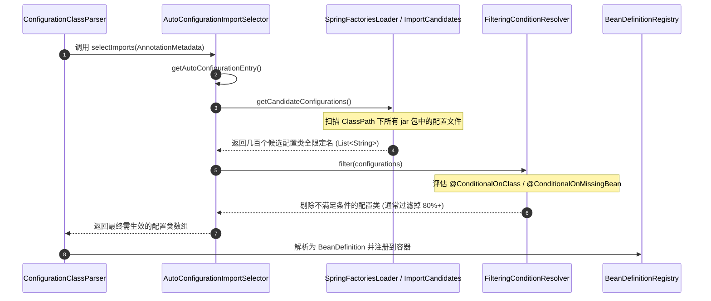

# SpringBoot自动装配原理与自定义Starter实战

Spring Boot 之所以能彻底颠覆传统的“配置地狱”（XML 配置与冗长 Bean 注入），实现“约定优于配置（Convention over Configuration）”与“开箱即用（Out of the box）”，其核心引擎正是**自动装配（Auto-Configuration）机制**。本文将彻底拆解自动装配的底层物理执行流，对比 Spring Boot 2.x 与 3.x 的演进变革，并手把手构建一个高内聚生产级自定义 Starter。

---

## 核心底层机制与全景架构

### 1. `@SpringBootApplication` 复合注解拆解

`@SpringBootApplication` 是一个三合一的复合注解：

```mermaid
flowchart TD
    App[@SpringBootApplication] --> C1[@SpringBootConfiguration<br/>本质是 @Configuration，标记为配置类]
    App --> C2[@ComponentScan<br/>默认扫描当前包及其子包下的 @Component]
    App --> C3[@EnableAutoConfiguration<br/>自动装配核心驱动引擎]
    
    C3 --> Import[@Import AutoConfigurationImportSelector.class]
    Import --> Load[读取并加载配置描述文件]
    Load --> FactorOld[Spring Boot 2.7 前: META-INF/spring.factories]
    Load --> FactorNew[Spring Boot 3.0+: META-INF/spring/org.springframework.boot.autoconfigure.AutoConfiguration.imports]
    
    Load --> Filter[条件注解 @Conditional 过滤链条]
    Filter --> Register[注入满足条件的配置类到 IoC 容器]
```

---

## 源码级架构物理拆解

### 1. AutoConfigurationImportSelector 执行全流程

Spring 容器在 `refresh()` 步骤 5 执行 `ConfigurationClassPostProcessor` 解析 `@Configuration` 时，会触发 `@Import(AutoConfigurationImportSelector.class)` 的执行：



#### Spring Boot 2.x 与 3.x 的加载机制演进

1. **Spring Boot 2.7 之前**：
   - 依赖 `SpringFactoriesLoader.loadFactoryNames()`。
   - 读取所有第三方 jar 包中的 `META-INF/spring.factories` 文件。
   - 痛点：`spring.factories` 文件中杂糅了监听器、环境后置处理器、自动配置类等多种配置，需要基于反射全量加载解析，冷启动耗时较长。
2. **Spring Boot 3.0+ 变革**：
   - 全面弃用在 `spring.factories` 中注册自动配置类。
   - 改为使用全新的 `ImportCandidates.load()`，精确定位 `META-INF/spring/org.springframework.boot.autoconfigure.AutoConfiguration.imports` 文件。
   - 该文件每行仅记录一个全限定类名，专职服务于自动配置，并针对 **GraalVM 原生镜像（Native Image）** AOT 编译进行了深度优化。

---

### 2. 条件注解 `@Conditional` 家族过滤机制

自动装配并非无脑将所有第三方类全部注入，而是通过强大的 `@Conditional` 条件判定按需装配：

| 注解 | 判定条件 | 底层机制与面试考点 |
| :--- | :--- | :--- |
| `@ConditionalOnClass` | 类路径下存在指定 Class 时生效 | **使用 ASM 字节码技术读取类元数据**，避免在类不存在时直接触发 `ClassNotFoundException` |
| `@ConditionalOnMissingBean` | 容器中**不存在**指定 Bean 时才注入 | **提供默认实现，允许业务开发者自定义 Bean 覆盖框架行为**（如自定义 RedisTemplate） |
| `@ConditionalOnProperty` | 配置文件中特定 key 包含指定 value 时生效 | `havingValue`, `matchIfMissing` 支持配置开关灵活控制组件启停 |
| `@ConditionalOnWebApplication` | 当前应用是 Web 环境（Servlet / Reactive）时生效 | 区分标准 Web 服务与后台 CLI 批量作业 |

---

## 生产级自定义 Starter 实战规范

### 1. Starter 命名与工程规范
- **官方 Starter 命名约定**：`spring-boot-starter-{name}`（如 `spring-boot-starter-web`）；
- **第三方/自研 Starter 命名约定**：`{name}-spring-boot-starter`（如 `mybatis-spring-boot-starter`、`limin-audit-spring-boot-starter`）。

---

### 2. 四步极简自研高内聚 Starter 实战

需求：构建一个用于全链路审计日志记录的 `audit-spring-boot-starter`。

#### 第一步：定义配置属性类（`AuditProperties.java`）
```java
@ConfigurationProperties(prefix = "limin.audit")
public class AuditProperties {
    /** 是否开启审计日志 */
    private boolean enabled = true;
    /** 系统标识 */
    private String systemId = "DEFAULT_SYS";

    public boolean isEnabled() { return enabled; }
    public void setEnabled(boolean enabled) { this.enabled = enabled; }
    public String getSystemId() { return systemId; }
    public void setSystemId(String systemId) { this.systemId = systemId; }
}
```

#### 第二步：实现核心能力服务类（`AuditService.java`）
```java
public class AuditService {
    private final String systemId;

    public AuditService(String systemId) {
        this.systemId = systemId;
    }

    public void recordLog(String action, String operator) {
        System.out.printf("[%s] 操作人: %s, 执行动作: %s%n", systemId, operator, action);
    }
}
```

#### 第三步：编写自动装配配置类（`AuditAutoConfiguration.java`）
```java
@AutoConfiguration // Spring Boot 3 推荐注解，替代 @Configuration
@EnableConfigurationProperties(AuditProperties.class)
@ConditionalOnProperty(prefix = "limin.audit", name = "enabled", havingValue = "true", matchIfMissing = true)
public class AuditAutoConfiguration {

    @Bean
    // 允许业务层自行注入自定义 AuditService 覆盖默认实现
    @ConditionalOnMissingBean(AuditService.class) 
    public AuditService auditService(AuditProperties properties) {
        return new AuditService(properties.getSystemId());
    }
}
```

#### 第四步：注册装配描述文件
- **Spring Boot 2.x**：在 `resources/META-INF/spring.factories` 添加：
  ```properties
  org.springframework.boot.autoconfigure.EnableAutoConfiguration=\
    com.limin.starter.audit.AuditAutoConfiguration
  ```
- **Spring Boot 3.x**：在 `resources/META-INF/spring/org.springframework.boot.autoconfigure.AutoConfiguration.imports` 文件中添加：
  ```text
  com.limin.starter.audit.AuditAutoConfiguration
  ```

---

## 社招高频硬核连环追问

### Q1: 为什么 Spring Boot 扫描类路径时，没有导入某个 jar 包对应的类却不会抛出 `ClassNotFoundException`？
- **考点**：ASM 字节码解析与 ClassLoader 惰性加载。
- **解析**：
  - Spring Boot 在解析 `@ConditionalOnClass(RedisOperations.class)` 时，并不会直接调用 `Class.forName()` 将该类加载入 JVM 方法区；
  - 它通过底层的 Spring ASM（基于字节码层面的访问者模式 Visitor）直接读取目标 `.class` 文件的字节码常量池（Constant Pool），检查字符串全限定名是否存在于 ClassLoader 的 URL 资源列表中；
  - 只有在确认该类能够被加载时，才会真正触发类加载，从而完美避开了 JVM 在类链接（Link）阶段抛出的 `NoClassDefFoundError` 或 `ClassNotFoundException`。

### Q2: 自动配置类与用户自定义的 `@Configuration` 谁先加载？
- **考点**：配置类加载优先级。
- **解析**：
  - **用户自定义的配置类优先加载**！
  - Spring Boot 的设计哲学是“用户配置第一，默认约定后补”。`ConfigurationClassParser` 会首先处理主启动类包路径下扫描到的用户自定义 `@Configuration` 与 `@Bean`；
  - 自动装配类（Auto-Configuration Classes）是在用户自定义类解析完毕后，才通过 `AutoConfigurationImportSelector` 导入。
  - 正因如此，自动配置类上的 `@ConditionalOnMissingBean` 才能准确探测到用户是否已经定义了专属 Bean，若已定义则自动装配主动让贤。

---

## 生产级避坑指南与故障排查 SOP

### 1. 自定义 Starter 不生效排查 SOP

**现象**：业务工程引入了自定义 Starter，但在业务代码中 `@Autowired` 提示找不到 Bean。

#### 排查清单
1. **检查自动装配描述文件路径与拼写**：
   - 检查文件名是否漏掉负号或扩展名：`META-INF/spring.factories` 或 `META-INF/spring/org.springframework.boot.autoconfigure.AutoConfiguration.imports`；
   - 检查路径是否被错误地放在了 `java` 目录下而非 `resources` 根目录下。
2. **使用 `--debug` 参数启动分析匹配日志**：
   在启动命令加上 `--debug`，Spring Boot 会输出详尽的 **CONDITIONS EVALUATION REPORT**：
   ```text
   ============================
   CONDITIONS EVALUATION REPORT
   ============================
   Positive matches:
      ... 匹配成功的配置 ...

   Negative matches:
      AuditAutoConfiguration:
         Did not match:
            - @ConditionalOnProperty (limin.audit.enabled=true) found value 'false'
   ```
   可清晰排查是哪一个 `@Conditional` 条件判定未通过。
