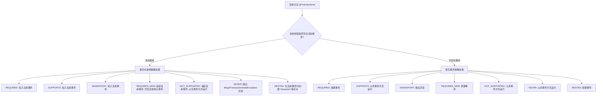

# Spring声明式事务传播机制与12种失效场景排查

Spring 的声明式事务（`@Transactional`）极大简化了企业级数据一致性的开发成本。但在高并发大型分布式系统中，事务失效不仅会导致**数据脏写、资损事故**，也是社招面试中必问的经典压轴题。深入理解 Spring 事务底层的传播原理与失效全场景，是每个中高级后端工程师的必备硬核素养。

---

## 核心底层机制与全景架构

### 1. Spring 7 种事务传播机制深度拆解

事务传播行为（Propagation Behavior）定义了当一个事务方法被另一个事务方法调用时，当前方法该如何运行：



#### 关键区别剖析：`REQUIRES_NEW` vs `NESTED`
- **`REQUIRES_NEW`（物理级独立事务）**：
  - 会将外层事务**挂起（Suspend）**，向连接池重新申请一个全新的物理数据库连接，开启独立的物理事务。
  - 外层事务回滚**不会影响**内层事务；内层事务回滚若未被外层 catch 吞掉，则会导致外层抛出异常进而回滚外层。
- **`NESTED`（逻辑级嵌套事务，基于 Savepoint）**：
  - 不会申请新连接，它始终运行在外层同一个物理数据库连接中。
  - 在进入内层方法前，通过 JDBC 执行 `SAVEPOINT savepoint_name`。
  - 若内层异常回滚，仅执行 `ROLLBACK TO SAVEPOINT`，**只回滚内层操作，外层事务可继续提交**。但如果外层事务最终发生异常回滚，**内层的所有嵌套更改将跟随外层一并彻底回滚！**

---

## 生产级大盘点：12 种事务失效场景与物理归因

### 场景 1：方法被修饰为非 `public`（如 `private` / `protected`）
- **物理原因**：Spring 事务切面 `AbstractFallbackTransactionAttributeSource.computeTransactionAttribute()` 在解析方法属性时，源码中硬编码了检查：
  ```java
  if (allowPublicMethodsOnly() && !Modifier.isPublic(method.getModifiers())) {
      return null; // 非 public 直接忽略事务注解！
  }
  ```
  直接返回 null，导致根本不会构建事务拦截器。

---

### 场景 2：同一个类内部方法自调用（`this.innerMethod()`）
- **物理原因**：`this` 关键字直接调用的是堆中原始未被代理的目标对象，绕过了外层 CGLIB/JDK 代理，没有经过 `TransactionInterceptor`。
- **解决**：使用 `@Lazy @Autowired` 自注入或提取为独立 Service。

---

### 场景 3：异常被业务代码 `try-catch` 吞噬且未重新抛出
- **物理代码**：
  ```java
  @Transactional
  public void doBiz() {
      try {
          dao.insertData();
      } catch (Exception e) {
          log.error("插入失败", e); // 吞掉异常，未抛出
      }
  }
  ```
- **物理原因**：`TransactionAspectSupport#invokeWithinTransaction` 依赖 `catch (Throwable ex)` 拦截异常后调用 `completeTransactionAfterThrowing(txInfo, ex)` 执行回滚。如果业务层自己捕获了异常且未向外抛出，事务切面会认为业务正常执行，从而执行 `commitTransactionAfterReturning` 提交事务！

---

### 场景 4：`rollbackFor` 属性未设置（遇到受检异常）
- **物理代码**：
  ```java
  @Transactional // 未指定 rollbackFor
  public void readFileAndSave() throws IOException {
      dao.insert();
      throw new IOException("文件未找到"); // Checked Exception
  }
  ```
- **物理原因**：Spring 事务默认回滚规则遵循 `DefaultTransactionAttribute`：**仅在遇到 `RuntimeException` 或 `Error` 时才触发回滚**。遇到 `IOException`、`SQLException` 等编译期受检异常时，Spring 默认不回滚并提交事务！
- **修复规范**：生产环境必须强制配置：`@Transactional(rollbackFor = Exception.class)`。

---

### 场景 5：数据库存储引擎不支持事务（如 MySQL MyISAM）
- **物理原因**：Spring 仅仅是调度者，最终的事务提交回滚必须由物理底层数据库支持。如果将表引擎指定为 MyISAM，它不具备事务与 Undo Log 支持，无论 Spring 怎么声明也无法回滚。

---

### 场景 6：数据源未交给 Spring 事务管理器托管或多数据源未对齐
- **物理原因**：项目配置了多数据源（Master/Slave 或分库），但在使用 `@Transactional` 时没有通过 `value = "primaryTransactionManager"` 指定事务管理器。Spring 默认取 primary 事务管理器，导致被操作的从数据源连接根本不在该事务管理器的作用域内。

---

### 场景 7：方法被 `final` 或 `static` 修饰
- **物理原因**：
  - `final` 方法：CGLIB 无法重写子类中的 final 方法，JDK 动态代理也无法代理未在接口中声明的 final 方法；
  - `static` 方法：静态方法属于类本身，在字节码层面无法被多态覆盖，动态代理完全无能为力。

---

### 场景 8：类未被 Spring 容器托管（缺少 `@Service` / `@Component`）
- **物理原因**：该对象直接通过 `new OrderService()` 实例化，根本不是 Spring IoC 容器所管理的 Bean，不具备动态代理能力。

---

### 场景 9：多线程异步调用脱离事务上下文
- **物理代码**：
  ```java
  @Transactional
  public void mainTx() {
      dao.insertMain();
      new Thread(() -> {
          dao.insertSub(); // 在子线程中执行
          throw new RuntimeException("子线程异常");
      }).start();
  }
  ```
- **物理原因**：Spring 事务管理器底层通过 `TransactionSynchronizationManager` 使用 `ThreadLocal<Map<Object, Object>> resources` 来绑定当前线程的数据库连接 `ConnectionHolder`。**不同线程拥有完全独立的 ThreadLocal 副本**，子线程获取的是全新的数据库连接，脱离了主线程的事务控制，子线程抛异常不会导致主线程回滚，主线程回滚也无法回滚子线程已提交的更改！

---

### 场景 10：传播机制配置错误（如 `SUPPORTS`、`NOT_SUPPORTED`、`NEVER`）
- **物理原因**：
  - `SUPPORTS`：若外层无事务，则以非事务运行；
  - `NOT_SUPPORTED`：若外层有事务，会将其挂起，当前方法始终以无事务运行；
  - `NEVER`：若外层有事务，直接抛出异常。

---

### 场景 11：代理类型不匹配或 AOP 切面顺序导致异常被外层拦截吃掉
- **物理原因**：如果开发者定义了全局业务切面（如自定义异常统一返回切面）且切面优先级（`@Order`）高于事务切面，业务切面在事务切面之前捕获了异常并返回了 `Result.fail()`，事务切面感知不到异常，就会误执行提交。

---

### 场景 12：`TransactionSystemException: Transaction rolled back because it has been marked as rollback-only`
- **物理代码**：外层方法 A（`REQUIRED`）调用内层方法 B（`REQUIRED`）。内层 B 发生异常回滚，但被外层 A `try-catch` 住了，外层 A 试图正常提交。
- **物理原因**：内层方法 B 在遇到异常时，由于与 A 共享同一个物理事务，B 会将全局事务状态标记为 `rollback-only = true`。当外层 A 结束并尝试 commit 时，Spring 检查发现事务已被污染标记为只能回滚，直接抛出该异常并回滚全局事务。

---

## 生产级排查 SOP 与编程式事务最佳实践

### 1. 为什么大厂严禁在大事务中使用 `@Transactional`？

在复杂业务流中（例如支付核销、订单下单），一个长方法可能包含：
1. 校验库存；
2. **远程 RPC 调用第三方支付网关（耗时 1~3 秒）**；
3. 更新本地订单表；
4. **生成 PDF 发票并上传 OSS（耗时 2 秒）**；
5. 发送 MQ 消息。

若直接在整个方法上加 `@Transactional`，会导致该物理数据库连接被**长时间独占长达数秒**！在高并发瞬间，数据库连接池（如 HikariCP）的 50~100 个连接瞬间被全部借出耗尽，引发全站级连接池等待超时与雪崩崩溃。

### 2. 编程式事务 `TransactionTemplate` 黄金实践

遵循原则：**网络调用、耗时计算、三方 RPC 必须剥离在事务外部，只将纯粹的数据库写操作纳入微事务包裹！**

```java
@Service
public class OrderOptimizationService {

    @Autowired
    private TransactionTemplate transactionTemplate;
    @Autowired
    private OrderDao orderDao;
    @Autowired
    private RemotePaymentClient paymentClient;

    public void processOrder(OrderDTO dto) {
        // 1. 事务外部：远程网络调用或复杂校验（不占数据库连接）
        PaymentResult result = paymentClient.pay(dto.getAmount());
        if (!result.isSuccess()) {
            throw new BizException("支付失败");
        }

        // 2. 事务内部：精确控制原子写操作，快速释放连接
        transactionTemplate.execute(status -> {
            try {
                orderDao.updateStatus(dto.getOrderId(), OrderStatus.PAID);
                orderDao.insertLog(dto.getOrderId(), "支付成功");
                return true;
            } catch (Exception e) {
                // 手动标记回滚
                status.setRollbackOnly();
                log.error("订单事务提交失败", e);
                throw e;
            }
        });

        // 3. 事务外部：异步发送 MQ 消息
        mqProducer.sendOrderSuccessMsg(dto.getOrderId());
    }
}
```
