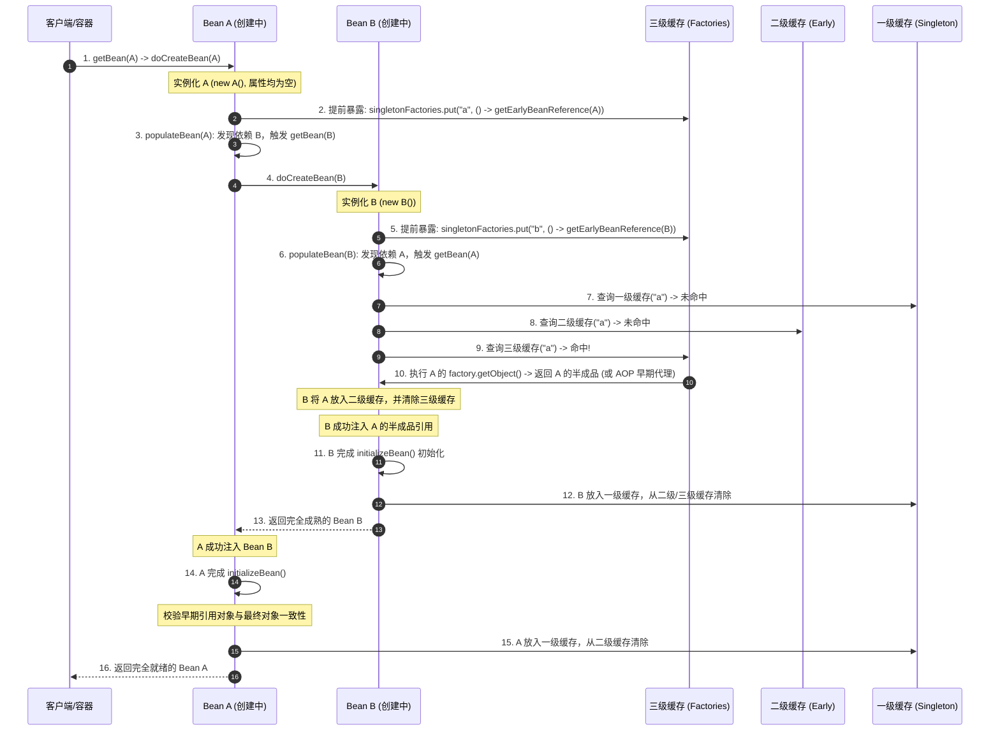

# Spring循环依赖与三级缓存终极推导

循环依赖（Circular Dependency）指的是两个或多个 Bean 相互持有对方的引用（例如 `A -> B`，同时 `B -> A`）。Spring 对单例作用域（Singleton）的 setter/属性注入循环依赖提供了优雅的自动解耦支持，其底层核心支撑正是 **DefaultSingletonBeanRegistry 的三级缓存体系**。

---

## 核心底层机制与全景架构

### 1. 三级缓存的物理定义与职责划分

在 `org.springframework.beans.factory.support.DefaultSingletonBeanRegistry` 中，三级缓存定义如下：

```java
/** 一级缓存：单例池，存放完全初始化完成、对外可用的成熟 Bean */
private final Map<String, Object> singletonObjects = new ConcurrentHashMap<>(256);

/** 二级缓存：存放提前暴露的半成品 Bean（已实例化、未填充属性/未初始化）或早期代理对象 */
private final Map<String, Object> earlySingletonObjects = new ConcurrentHashMap<>(16);

/** 三级缓存：存放单例工厂 ObjectFactory，用于延迟生成早期暴露对象（包含 AOP 代理判断） */
private final Map<String, ObjectFactory<?>> singletonFactories = new HashMap<>(16);
```

```mermaid
flowchart TD
    subgraph 三级缓存流转模型
        L3[三级缓存: singletonFactories<br/>保存 ObjectFactory 匿名函数]
        L2[二级缓存: earlySingletonObjects<br/>保存提前暴露的原始/代理半成品 Bean]
        L1[一级缓存: singletonObjects<br/>保存完全初始化就绪的成熟 Bean]
    end

    Req[getBean(A) 请求] -->|1. 先查一级缓存| L1
    L1 -->|未命中 且 A 正在创建中| L2
    L2 -->|未命中 且 允许早期引用| L3
    L3 -->|触发 factory.getObject() 执行 AOP 校验| L2
    L3 -.->|从三级缓存移除，存入二级缓存| L2
    L2 -.->|A 初始化彻底完成后晋升| L1
    L2 -.->|从二级缓存移除| L1
```

---

## 源码级架构物理拆解

### 1. 经典 A 与 B 循环依赖执行全时序图

假设类 A 与类 B 互相 `@Autowired` 依赖对方，且为默认单例作用域：



---

### 2. 核心数学与逻辑推导：为什么必须是“三级缓存”？

这是社招面试中最具深度与杀伤力的问题。我们需要逐层反证：

#### 推导一：为什么一级缓存绝对不够用？
- **反证**：如果只有一级缓存 `singletonObjects`，当实例化 A 后必须立刻放进缓存，供 B 注入。
- **后果**：此时并发线程如果同时调用 `getBean("a")`，将直接拿到属性全是 `null` 的半成品 A 开展业务，立即抛出空指针异常（NPE）。**已就绪对象与半成品对象必须物理隔离**。

#### 推导二：如果只有两级缓存，能否解决循环依赖？
- **结论**：**若没有 AOP 动态代理，二级缓存完全足够解决普通的循环依赖**。
  在实例化 A 之后，直接生成半成品 A 塞进二级缓存，B 注入该半成品即可。

#### 推导三：既然二级缓存能解，为什么 Spring 必须引入三级缓存？
- **核心矛头：AOP 与 Spring 架构设计契约的冲突**。
- Spring 的标准设计原则是：**所有 Bean 的 AOP 代理创建，必须推迟到初始化后置（`BeanPostProcessor.postProcessAfterInitialization`）统一生成**。在没有循环依赖的绝大多数情况下，Spring 不希望在 Bean 刚被 new 出来时就过早创建代理。
- **三级缓存的作用：实现“延迟按需创建代理”**：
  1. `singletonFactories` 存放的是一个 Lamdba 闭包 `() -> getEarlyBeanReference(beanName, mbd, bean)`。
  2. 如果**没有发生循环依赖**，这个闭包永远不会被调用！Bean 正常完成生命周期，在初始化后置处理器中按部就班地生成 AOP 代理；
  3. 只有**发生循环依赖时**，依赖方 B 调用 `getBean(A)` 才会主动触发三级缓存闭包执行 `getEarlyBeanReference`。此时提前执行 AOP 逻辑生成代理对象，并存入二级缓存，防止后续重复代理。

---

## 哪些循环依赖 Spring 默认无法解决？

并不是所有的循环依赖 Spring 都能化解。以下两种场景 Spring 无法自动解决，启动时会直接抛出 `BeanCurrentlyInCreationException`：

### 1. 基于构造函数的循环依赖（Constructor Injection）
```java
@Service
public class ServiceA {
    public ServiceA(ServiceB b) {} // 实例化阶段就需要 ServiceB
}

@Service
public class ServiceB {
    public ServiceB(ServiceA a) {} // 实例化阶段就需要 ServiceA
}
```
- **物理推导**：三级缓存暴露的时机是在 `createBeanInstance()` 实例化之后。构造器循环依赖在调用 `new ServiceA(...)` 时就要求传入 B，A 甚至还没完成对象的内存分配，**根本没有机会将 ObjectFactory 存入三级缓存**，双方在构造参数解析阶段死锁。

### 2. 原型作用域（Prototype）循环依赖
```java
@Component
@Scope("prototype")
public class BeanA {
    @Autowired private BeanB b;
}
@Component
@Scope("prototype")
public class BeanB {
    @Autowired private BeanA a;
}
```
- **物理推导**：Spring **只对单例作用域进行缓存管理**。对于多例 Bean，Spring 每次 `getBean()` 都要求创建全新实例，不缓存任何单例池或早期对象。遇到多例互相依赖，Spring 直接感知 `isPrototypeCurrentlyInCreation()` 命中死循环，抛出异常。

---

## 社招高频硬核连环追问

### Q1: 在二级缓存中，存入的到底是原生对象还是 AOP 代理对象？
- **考点**：`SmartInstantiationAwareBeanPostProcessor#getEarlyBeanReference` 源码执行细节。
- **解析**：
  - 如果 Bean **配置了切面（存在 AOP）**：三级缓存中的 `getEarlyBeanReference` 会调用 `AbstractAutoProxyCreator`，此时二级缓存中存放的是**最终的代理对象（Dynamic Proxy）**，并在内部 `earlyProxyReferences` 缓存该原始对象已被代理的标记；
  - 如果 Bean **没有被任何切面拦截**：三级缓存直接原样返回未初始化的**原始原生对象（Raw Instance）**。

### Q2: 既然 A 在循环依赖中提前生成了代理对象放进了二级缓存，那 A 后续走到正常生命周期末尾的 `postProcessAfterInitialization` 时，会不会重复被代理？
- **考点**：AOP 幂等性控制。
- **解析**：
  - **不会**。`AbstractAutoProxyCreator` 内部维护了一个并发 Set：
    ```java
    private final Map<Object, Object> earlyProxyReferences = new ConcurrentHashMap<>(16);
    ```
  - 当三级缓存提前触发代理时，会将原始对象记录进 `earlyProxyReferences`；
  - 当 A 走完初始化，进入 `postProcessAfterInitialization` 尝试生成代理时，会首先检查：
    ```java
    if (this.earlyProxyReferences.remove(cacheKey) != null) {
        return bean; // 已经提前生成过代理，直接原样返回原始对象
    }
    ```
  - 最终在 `doCreateBean` 末尾，Spring 会从二级缓存把之前提前生成的代理对象取出，替换掉原始对象作为容器最终返回结果。

---

## 生产级解决方案与避坑指南

### 1. 构造函数循环依赖的优雅破解：`@Lazy` 延迟注入

**方案代码**：
```java
@Service
public class OrderService {
    private final PaymentService paymentService;

    // 使用 @Lazy 打破构造死锁
    public OrderService(@Lazy PaymentService paymentService) {
        this.paymentService = paymentService;
    }
}
```

#### `@Lazy` 为什么能解决？
- 当 Spring 遇到构造参数带有 `@Lazy` 时，Spring **并不会立即去创建真实的 `PaymentService` 实例**；
- Spring 会通过 CGLIB 动态生成一个 `PaymentService` 的**虚拟轻量代理对象（Lazy Resolution Proxy / TargetSource）**注入到 `OrderService` 的构造函数中；
- `OrderService` 实例化成功，三级缓存得以正常运转。只有当业务代码真正第一次调用 `paymentService.pay()` 时，代理拦截器才会调用 `targetSource.getTarget()` 触发真正的 `PaymentService` 实例化。

### 2. 架构治理层面的解耦重构

依赖循环本质上是**类职责定义不清、领域模型边界混淆**的代码坏味道（Code Smell）：
1. **提取公共能力类**：将 A 和 B 互相调用的公共方法下沉到一个独立的第三方 `ServiceC`，打破依赖环（`A -> C <- B`）；
2. **基于 Spring Event 事件驱动异步解耦**：A 执行完成后发布领域事件 `ApplicationEventPublisher.publishEvent(new OrderCreatedEvent(this))`，B 监听该事件（`@EventListener`），将强编译期双向依赖转变为弱耦合的发布-订阅模式。
