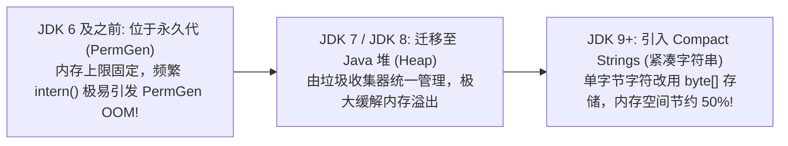

# String 深入与字符串常量池底层机制

在 Java 开发中，`String` 是最基础也是使用最频繁的引用类型。社招面试中，考察 `String` 绝非问“字符串如何拼接”，而是深挖其**不可变设计意图、内存常量池在各个 JDK 版本的变迁、以及底层 `intern()` 字节码指令的执行差异**。

---

## 1. String 的不可变性（Immutability）深度剖析

在 Java 中，`String` 类被设计为不可变类。

### 1.1 不可变性的底层实现
打开 `java.lang.String` 源码可以看到：
```java
public final class String
    implements java.io.Serializable, Comparable<String>, CharSequence {

    // JDK 8: private final char value[];
    // JDK 9+: 紧凑字符串优化 (Compact Strings)
    @Stable
    private final byte[] value;
    private final byte coder; // LATIN1 (0) 或 UTF16 (1)
    
    private int hash; // 缓存的哈希值
    ...
}
```
- **类声明为 `final`**：防止子类继承并通过重写破坏其不可变约定。
- **内部存储数组声明为 `private final`**：并且 `String` 没有对外暴露任何修改内部数组的公共方法。
- **保护性拷贝（Defensive Copy）**：任何返回字符数组的方法（如 `toCharArray()`）都会新建一个独立的数组副本返回，外部无法篡改内部数组。

### 1.2 为什么必须设计为不可变？（三大核心意图）
1. **支持字符串常量池（String Pool）共享**：
   如果字符串是可变的，当线程 A 修改了字符串常量池中的 `"hello"` 为 `"world"`，线程 B 引用该常量的值就会被静默篡改，常量池的内存复用机制将彻底崩溃。
2. **线程安全（Thread Safety）**：
   不可变对象在多线程并发环境下天然线程安全，无需任何同步加锁开销即可自由共享。
3. **缓存哈希码（Hashcode Caching）与安全性**：
   `String` 的哈希码在首次计算后会被缓存在成员变量 `hash` 中。由于字符串内容不可变，哈希值终生恒定，这使得 `String` 作为 `HashMap` 的 Key 时性能极高。此外，网络连接 URL、文件路径、数据库密码均以 `String` 形式传递，不可变性防范了黑客恶意劫持参数篡改系统状态。

---

## 2. 字符串常量池（String Pool）在 JVM 内存中的演进

字符串常量池的位置在不同的 JDK 版本中经历了重大物理迁移：



### 2.1 JDK 9 的紧凑字符串优化（Compact Strings）
- **JDK 8 及之前**：内部使用 `char[]` 存储，每个 `char` 固定占 **2 字节**。即使字符串全是英文字符（ASCII 只占 1 字节），也必须浪费一半内存。
- **JDK 9+**：改用 `byte[]` 配合编码标记 `coder`。
  - 若全为 Latin-1 字符（包含英文、常用符号），每个字符仅占 **1 字节**；
  - 只有出现中文等复杂字符时，才切换为 UTF-16 编码占 2 字节。
  - **收益**：大型堆内存中 String 占用的空间直接节约约 **50%**，大幅降低了 GC 频次。

---

## 3. 核心深水区：`String.intern()` 底层机制与面试经典判断

`intern()` 方法用于确保字符串在常量池中存在唯一副本。

### 3.1 经典考题：`new String("a") + new String("b")`
```java
String s1 = new String("a") + new String("b");
s1.intern();
String s2 = "ab";
System.out.println(s1 == s2); // 在 JDK 6 和 JDK 7+ 下分别输出什么？
```

#### 逐行字节码与内存推导：
1. `new String("a") + new String("b")`：
   - 底层通过 `StringBuilder` 的 `append` 操作拼接，最终调用 `new String(char[])`。
   - **关键细节**：生成的 `"ab"` 实例只存在于**Java 堆中**，**字符串常量池中此时并没有 `"ab"`**！
2. **JDK 6 的表现**：
   - `s1.intern()` 会在永久代常量池中**物理复制一份新的 `"ab"` 对象**，并返回永久代中的对象地址。
   - `s1` 依然指向 Java 堆中的对象，而 `s2` 指向永久代中的对象。
   - **结果：输出 `false`**。
3. **JDK 7+ 的质变表现**：
   - 由于常量池已经迁移到了堆中，为了极致节约内存，`s1.intern()` 发现 Java 堆中已经存在 `"ab"` 对象时，**不再拷贝对象，而是直接在常量池中记录一个引用指针，指向堆中的 `s1` 实例**！
   - 后续执行 `String s2 = "ab"` 时，从常量池拿到的是指向 `s1` 的引用。
   - **结果：输出 `true`**！

---

## 4. 社招高频面试追问

### Q1：`String s = new String("xyz");` 创建了几个对象？
- **答案：1 个或 2 个**。
- **推导**：
  1. 编译期遇到字面量 `"xyz"`，类加载时若常量池中尚无 `"xyz"`，首先在字符串常量池中创建 1 个对象。
  2. 运行期执行 `new String(...)`，在 Java 堆内存中开辟空间，创建 1 个包含常量池数据引用的 String 实例。
  3. 如果在执行该行代码之前，常量池中已经存在 `"xyz"`，则只在堆中创建这 1 个 `new` 出来的实例。

### Q2：高并发大规模字符串拼接，为什么不能使用 `+` 号？`StringBuilder` vs `StringBuffer` 如何选？
- 在循环体中使用 `+` 号拼接，Java 编译器在每次循环中都会 `new` 一个临时的 `StringBuilder` 并在循环末尾调用 `toString()`，产生大量短命临时对象，导致 Eden 区迅速打满并频繁触发 Young GC。
- **选型**：
  - 单线程或局部变量：坚决使用 **`StringBuilder`**（无锁，性能最高）。
  - 多线程共享环境：使用 **`StringBuffer`**（关键方法全加了 `synchronized` 关键字保证线程安全，但有锁开销）。
