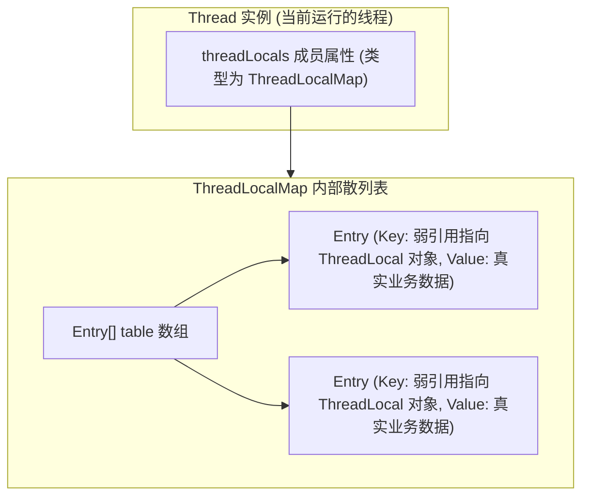
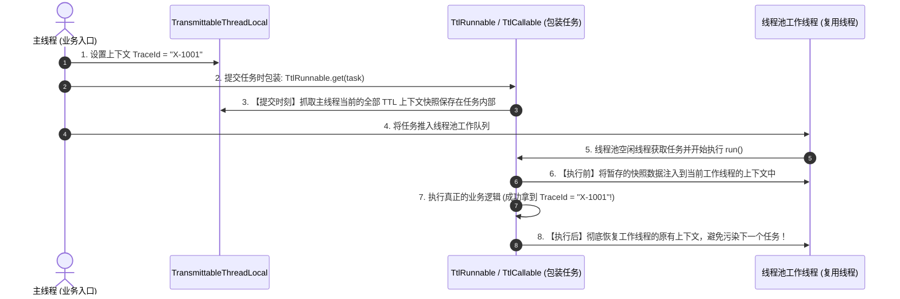

# ThreadLocal 核心原理、内存泄漏与全链路透传 (TTL)

在处理用户登录会话（Session/Token）、数据源动态切换（DynamicDataSource）、以及分布式链路追踪（TraceId 全链路染色）时，`ThreadLocal` 是无处不在的上下文传递工具。

但在社招面试中，围绕 `ThreadLocal` 的考察往往直击软肋：“`ThreadLocalMap` 的 Key 为什么要设计成弱引用？内存泄漏的真正元凶是 Key 还是 Value？为什么有了 `InheritableThreadLocal`，在线程池中依然会失效？阿里的 `TransmittableThreadLocal`（TTL）是如何破局的？”

---

## 1. ThreadLocal 物理架构全景

很多初学者误以为：`ThreadLocal` 内部维护了一个全局的 Map，以线程为 Key，存储各线程的变量。**这种理解是完全颠倒的！**

真实架构：**每个 `Thread` 对象内部，私自持有着一个专属的 `ThreadLocal.ThreadLocalMap` 成员变量**！



- **哈希冲突解决方式**：`ThreadLocalMap` 没有采用链表或红黑树，而是采用最纯粹的 **线性探测法（Linear Probing / 开放寻址法）**。如果计算出的槽位被占，直接沿着数组向后找下一个空槽。

---

## 2. 核心深水区：内存泄漏的真正元凶与弱引用设计之谜

查看 `ThreadLocalMap.Entry` 的源码定义：
```java
static class Entry extends WeakReference<ThreadLocal<?>> {
    /** 与此 ThreadLocal 关联的真实业务值 */
    Object value;

    Entry(ThreadLocal<?> k, Object v) {
        super(k); // 核心！Key 被作为弱引用包装传入父类
        value = v; // 核心！Value 依然是纯粹的强引用！
    }
}
```

### 2.1 为什么 Key 必须设计为“弱引用（WeakReference）”？
- 假设 Key 使用了普通强引用：当业务代码将外部的 `threadLocal = null` 彻底解绑后，只要当前线程还活着，`ThreadLocalMap` 中依然有强引用指向该 `ThreadLocal` 实例，导致该 `ThreadLocal` 永远无法被 GC 回收！
- **弱引用的设计精妙**：当外部强引用解除后，下一次系统 GC 会自动将 `Entry` 中的 `key` 置为 `null`，不再阻碍 `ThreadLocal` 对象本身的内存回收。

---

### 2.2 内存泄漏的真正元凶：Value 的强引用链路！
正因为 Key 变成了弱引用，才暴露出一个更致命的次生隐患：
1. 外部解除强引用，GC 触发，`Entry.key` 瞬间变成了 **`null`**；
2. 但是！**`Entry.value` 依然是一个纯正的强引用！**
3. 如果当前线程是一直存活的（**尤其是在常驻的核心线程池中的复用工作线程**），在堆内存中会形成一条坚不可摧的强引用链：
   $$\text{Thread} \to \text{threadLocals (ThreadLocalMap)} \to \text{Entry} \to \text{Value}$$
4. **灾难发生**：由于 `key` 已经变成了 `null`，业务代码在逻辑上**已经没有任何途径能再次访问或清理这个 Value**，但它却一直霸占着堆内存无法释放！随着成千上万个任务在线程池中流转，无效 Value 逐渐填满内存，最终引发惨烈的 **`java.lang.OutOfMemoryError: Java heap space`**！

```text
内存泄漏引用链：
Thread 实例 (长期存活)
  └──▶ ThreadLocalMap
         └──▶ Entry[] table
                └──▶ Entry 
                       ├──▶ Key: null (已被 GC 回收，无法再通过 get 获取)
                       └──▶ Value: 强引用！占用 10MB 内存，永远无法释放！ (内存泄漏产生!)
```

---

### 2.3 探测式清理（Expunge）与防泄漏铁律
虽然 AQS 设计者在 `get()`, `set()`, `rehash()` 等方法中内置了**探测式清理（`expungeStaleEntry`）**，会在遭遇 `key == null` 时尝试顺手将其擦除，但这是一种“顺带的被动触发”，不能作为系统安全的绝对指望。

> **生产绝对铁律**：  
> **在使用 ThreadLocal 的任何地方，必须强制使用 `try-finally` 块，在 `finally` 中显式调用 `remove()`！**
> ```java
> try {
>     threadLocal.set(userContext);
>     doBusiness();
> } finally {
>     threadLocal.remove(); // 极其关键！物理抹除 Entry，彻底根绝内存泄漏与线程复用脏数据污染！
> }
> ```

---

## 3. 跨线程上下文透传演进：从 ITL 到阿里 TTL

在分布式微服务和异步编程架构中，请求往往由主线程派发给异步子线程或线程池执行。

### 3.1 尝试一：`InheritableThreadLocal`（ITL）
JDK 提供了 `InheritableThreadLocal`：
- **原理**：在主线程调用 `new Thread()` 创建子线程时，子线程的初始化方法 `init()` 会自动将父线程的 `inheritableThreadLocals` 浅拷贝给子线程。
- **致命痛点：遇到线程池瞬间彻底失效！**
  在企业级微服务中，**严禁手动 `new Thread()`**，所有异步操作全部由线程池调度。而**线程池中的工作线程是预先创建并长期复用的**！一个任务被提交给线程池执行时，并没有触发 `new Thread()`，导致**子线程只能拿到当初它被创建时的历史过期快照，根本无法获取当前主线程最新的上下文信息**！

---

### 3.2 终极解决方案：阿里开源 `TransmittableThreadLocal`（TTL）

为了解决线程池复用场景下的上下文透传难题，阿里巴巴开源了业界事实标准的 **`TransmittableThreadLocal`（TTL）**。

#### 核心工作机制（任务提交期抓取 + 执行期回放 + 恢复）：

- **落地方式**：
  1. 使用 `TtlRunnable.get(runnable)` 包装提交的任务；
  2. 或者使用 `TtlExecutors.getTtlExecutor(executor)` 对线程池进行无侵入装饰代理；
  3. 或者直接借助 Java Agent 探针字节码无侵入增强。
