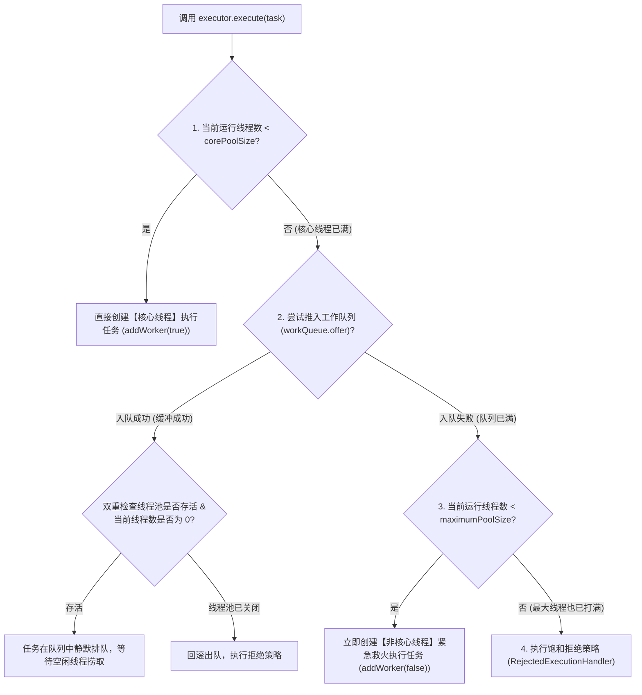

# ThreadPoolExecutor 线程池底层源码与动态调优实战

在阿里巴巴 Java 开发手册中，有一条标红的强制军规：“**线程资源必须通过线程池提供，严禁在代码中显式创建线程（`new Thread()`）；严禁使用 `Executors.newFixedThreadPool()` 或 `Executors.newCachedThreadPool()`！**”

社招面试中，线程池是考察并发编程综合素养的核心试验场：**7 大参数如何协同运转？任务进入时为什么先入队而不是先建非核心线程？ctl 变量的高低位状态机是如何设计的？线上突发报警时如何动态修改线程池参数？**

---

## 1. 核心成员与 32 位 `ctl` 状态机设计

在 `ThreadPoolExecutor` 中，作者仅用一个 32 位的原子整型变量 **`ctl`（AtomicInteger）**，同时精妙地管理了**线程池运行状态**和**有效工作线程数量**！

```java
// ctl 变量高 3 位表示线程池运行状态，低 29 位表示当前有效线程数 (CAPACITY)
private final AtomicInteger ctl = new AtomicInteger(ctlOf(RUNNING, 0));
private static final int COUNT_BITS = Integer.SIZE - 3; // 29 位
private static final int COUNT_MASK = (1 << COUNT_BITS) - 1; // 掩码: 00011111...
```

### 1.1 5 大生命周期状态单向流转
- **`RUNNING`（`111` 开头，-1 << 29）**：正常运行，接收新任务，处理队列任务。
- **`SHUTDOWN`（`000` 开头，0）**：不接收新任务，但**会继续把已入队的剩余任务执行完**。
- **`STOP`（`001` 开头，1 << 29）**：不接收新任务，不处理队列任务，并且**中断正在执行的任务**。
- **`TIDYING`（`010` 开头，2 << 29）**：所有任务已终止，工作线程数为 0，即将调用 `terminated()` 钩子。
- **`TERMINATED`（`011` 开头，3 << 29）**：`terminated()` 方法执行完毕，线程池彻底终结。

---

## 2. 7 大核心参数与完整任务调度流转链路

```java
public ThreadPoolExecutor(
    int corePoolSize,                   // 1. 核心线程数 (常驻线程)
    int maximumPoolSize,                // 2. 最大线程数 (极限救急线程)
    long keepAliveTime, TimeUnit unit,  // 3 & 4. 非核心线程空闲超时与时间单位
    BlockingQueue<Runnable> workQueue,  // 5. 任务阻塞缓冲队列
    ThreadFactory threadFactory,        // 6. 线程创建工厂 (务必自定义命名!)
    RejectedExecutionHandler handler    // 7. 饱和拒绝策略
)
```

### 2.1 任务提交（`execute`）执行全景推导



---

### 2.2 核心深度思考：为什么先放工作队列，而不是先创建非核心线程？
很多同学直觉上认为：人手不够就应该赶紧建线程，为什么非要等队列满了才去建非核心线程？
- **操作系统维度的深刻考量**：
  在操作系统中，线程是**极其沉重的高耗物理资源**（创建销毁耗时、占用内存栈、引入 CPU 上下文切换）。
  - 线程池的设计初衷是**资源复用与平滑削峰**；
  - 既然 `corePoolSize` 已经代表了系统评估的最佳长期并发承载能力，遇到突发流量时，**最理智的做法是先利用内存队列进行无害缓冲**；
  - 只有在缓冲队列真正被打满、说明任务积压已经危急时，才“万不得已”临时抽调系统 CPU 开辟非核心线程来救急！

---

## 3. 为什么严禁使用 `Executors` 快速创建线程池？

这是生产事故的高发源头：
1. **`Executors.newFixedThreadPool(n)` 与 `newSingleThreadExecutor()`**：
   - 其底层传入的阻塞队列是 **`new LinkedBlockingQueue<Runnable>()`**！
   - 该队列的默认容量是 **`Integer.MAX_VALUE`（约 21 亿，近乎无界！）**！
   - 一旦遇到下游服务慢或短时间流量涌入，核心线程处理不过来，任务会无限制堆积在内存队列中，**直接引发 JVM 堆内存彻底耗尽：`OutOfMemoryError: Java heap space`**！
2. **`Executors.newCachedThreadPool()`**：
   - 其允许的最大线程数是 **`Integer.MAX_VALUE`**！
   - 伴随着高并发请求，系统会无限制疯建数千个线程，**直接把操作系统进程数和内存耗尽：`OutOfMemoryError: unable to create new native thread`**！

---

## 4. 科学配置线程数与美团动态化调优实战

### 4.1 传统经验公式（仅作为冷启动参考基线）
- **CPU 密集型（计算、加解密、排序）**：
  $$\text{线程数} = N_{\text{CPU}} + 1$$
  （$+1$ 是为了在极少数因缺页中断等短暂挂起时，充当候补保持 CPU 100% 满载运转）。
- **I/O 密集型（绝大多数 Web 业务，RPC/DB 访问为主）**：
  $$\text{线程数} = N_{\text{CPU}} \times \left(1 + \frac{\text{I/O 等待时间}}{\text{CPU 计算时间}}\right) \approx 2 \times N_{\text{CPU}}$$

---

### 4.2 现代高级演进：美团动态化线程池设计思路
在真实复杂的生产环境中，I/O 耗时和业务流量是动态波动的，**根本不存在一个放之四海而皆准的静态参数**。
美团技术团队开源了动态化线程池思想（利用 `ThreadPoolExecutor` 自带的 API）：

1. **动态热修改核心参数**：
   ```java
   // 运行时通过 Nacos / Apollo 配置中心下发，动态无感调整！
   executor.setCorePoolSize(newCore);
   executor.setMaximumPoolSize(newMax);
   ```
2. **重写/定制可变容量的阻塞队列**：
   官方的 `LinkedBlockingQueue` 的 `capacity` 是 `final` 无法修改的。通过手写或引入 `ResizableCapacityLinkedBlockIngQueue`，暴露 `setCapacity()` 接口，支持动态调控队列缓冲区大小。
3. **指标实时采集监控与报警**：
   通过 Micrometer / Prometheus 实时采集：
   - `getPoolSize()`（当前线程数）
   - `getActiveCount()`（活跃工作线程数）
   - `getQueue().size()`（队列排队积压数）
   - `getCompletedTaskCount()`（已完成数）
   - 当队列使用率超过 80% 或活跃线程数打满时，提前向飞书/钉钉群推送告警，运维在后台一键调大参数，实现**生产 0 停机动态救火**！
