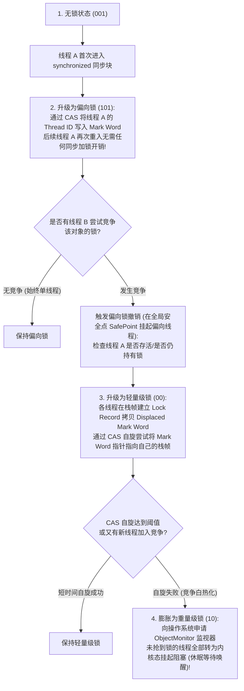

# synchronized 锁与对象头 Mark Word 锁升级全过程

在 JDK 1.6 之前，`synchronized` 是一个人人避之不及的“重量级锁”。只要加了锁，底层直接调用操作系统原语进行互斥，未抢到锁的线程立刻被强行挂起并进行内核态（Kernel Space）与用户态（User Space）之间的上下文切换，性能损耗极其惊人。

从 JDK 1.6 开始，JVM 团队对 `synchronized` 进行了革命性的锁优化，引入了 **偏向锁、轻量级锁、自适应自旋、锁消除与锁粗化**。

---

## 1. Java 对象在堆内存中的物理布局

在深入锁之前，必须先看清一个普通 Java 对象在 64 位 JVM 内存堆中究竟长什么样：

```text
┌────────────────────────────────────────────────────────┐
│                   1. 对象头 (Header)                   │
│ ┌────────────────────────────────────────────────────┐ │
│ │ Mark Word (64 位 / 8 字节): 存储哈希码、GC年龄、锁标记 │ │
│ ├────────────────────────────────────────────────────┤ │
│ │ Klass Word (64 位 / 8 字节，开启指针压缩后为 4 字节)   │ │
│ │ 指向该对象对应的类元数据 (InstanceKlass) 指针         │ │
│ ├────────────────────────────────────────────────────┤ │
│ │ [数组长度 Array Length] (仅数组对象独有，占 4 字节)    │ │
│ └────────────────────────────────────────────────────┘ │
├────────────────────────────────────────────────────────┤
│ 2. 实例数据 (Instance Data) : 包含对象的真实成员变量字段│
├────────────────────────────────────────────────────────┤
│ 3. 对齐填充 (Padding) : 保证对象总字节数是 8 的整数倍  │
└────────────────────────────────────────────────────────┘
```

---

## 2. 核心命脉：64 位 Mark Word 的 5 大锁状态演进

Mark Word 是一块高度复用的动态数据结构。在 64 位系统下，最后 3 个二进制位（1 位偏向标记 + 2 位锁标志）决定了当前对象的锁状态：

| 锁状态 (Lock State) | 64 位 Mark Word 前 61 位二进制内容 | 偏向标志 (1位) | 锁标志位 (2位) |
|:---|:---|:---:|:---:|
| **无锁状态 (Normal)** | `unused(25bit) | hashCode(31bit) | cms_free(1bit) | age(4bit)` | `0` | **`01`** |
| **偏向锁 (Biased)** | `threadId(54bit) | epoch(2bit) | cms_free(1bit) | age(4bit)` | `1` | **`01`** |
| **轻量级锁 (Lightweight)** | 指向持有锁线程的栈帧中 **Lock Record（锁记录）** 的 62 位物理内存指针 | - | **`00`** |
| **重量级锁 (Heavyweight)** | 指向操作系统底层 **`ObjectMonitor` 互斥监视器** 的 62 位物理内存指针 | - | **`10`** |
| **GC 标记 (Marked)** | 垃圾收集器标记使用（通常为空） | - | **`11`** |

---

## 3. 锁升级（Lock Escalation）全生命周期推导演进

在运行期间，锁只能**由低到高单向升级（无锁 $\to$ 偏向锁 $\to$ 轻量级锁 $\to$ 重量级锁）**，在常规业务执行期间不可逆。



---

### 3.1 详细升级阶段原理解析

#### 阶段 1：偏向锁（Biased Lock）
- **核心思想**：大部分情况下，锁不仅不存在多线程竞争，而且总是由**同一个线程反复重入获得**。
- **机制**：当线程第一次获取锁时，JVM 通过一次 CAS 操作，把自己的 `Thread ID` 写入该对象的 Mark Word 中。以后该线程再次进入和退出同步块时，**只需比对当前 Thread ID 是否是自己，完全不需要进行任何 CAS 或加锁操作**，开销几乎等同于无锁代码！

#### 阶段 2：轻量级锁（Lightweight Lock）
- **触发时机**：当有第二个线程（线程 B）尝试争夺锁时，偏向锁被打破并升级为轻量级锁。
- **机制**：
  1. 争夺锁的线程会在自己的线程栈帧中，开辟一块名为 **锁记录（Lock Record）** 的空间；
  2. 将对象头当前的 Mark Word 官方原样复制一份到 Lock Record 中（称为 Displaced Mark Word）；
  3. 线程尝试通过 **CAS 操作**，将对象头中的 Mark Word 替换为指向自己栈帧 Lock Record 的物理指针：
     - 若 CAS 成功：代表当前线程成功抢占轻量级锁；
     - 若 CAS 失败：代表锁已被他人持有，当前线程进入**自适应自旋（Adaptive Spinning）**，在原地 CPU 空转等待锁释放，避免立刻挂起。

#### 阶段 3：重量级锁（Heavyweight Lock）
- **触发时机**：当自旋超过一定次数仍未拿到锁，或者同时有多个线程在排队争夺锁时。
- **机制**：轻量级锁彻底膨胀为重量级锁。
  - JVM 向操作系统申请一个原生的 **`ObjectMonitor`（C++ 对象）**；
  - 对象头 Mark Word 指向该 `ObjectMonitor`，状态位变为 `10`；
  - 未抢到锁的线程不再自旋，而是直接加入 `ObjectMonitor` 内部的 `_EntryList` 队列中，**调用操作系统的 `pthread_mutex_lock` 将线程从用户态切换到内核态彻底挂起（Block）**！

---

## 4. 编译器优化：锁消除与锁粗化

JIT 即时编译器在运行期还会执行两大黑科技优化：

### 4.1 锁消除（Lock Elimination）
通过 JIT 的**逃逸分析（Escape Analysis）**：如果 JIT 发现某个锁对象**仅仅在当前方法内部被创建和使用，绝对不可能逃逸到方法外部被其他线程访问**（例如在局部方法内 `new StringBuffer().append("a")`），JIT 在编译为机器码时会**彻底抹杀并消除该锁**，直接以纯无锁方式执行！

### 4.2 锁粗化（Lock Coarsening）
如果在一段循环体内部频繁进行对同一个对象的加锁和解锁：
```java
for (int i = 0; i < 10000; i++) {
    synchronized (lock) { /* 短暂操作 */ }
}
```
频繁的锁申请和释放会极大消耗 CPU。JIT 会智能地将加锁的范围**直接扩大（粗化）到整个循环体外部**，一次性加锁，执行完 10000 次后再释放！

---

## 5. 社招高频面试追问

### Q1：为什么 JDK 15 正式废弃了偏向锁（`-XX:-UseBiasedLocking` 默认关闭），并在后续版本中彻底移除？
- **偏向锁的时代变迁**：偏向锁是在早年单核向多核演进的过渡期设计的。
- **致命代价：撤销成本极高**：
  偏向锁的撤销（Revocation）必须等待 JVM 所有的线程走到**全局安全点（SafePoint）**，引发全系统 **Stop-The-World（STW）**！
- 在现代云原生、高并发、重度使用 Netty/微服务框架的场景中，几乎不存在“纯单线程长效持锁”的理想情况，反而会导致大量的偏向锁撤销 STW 停顿。团队实测发现：**关闭偏向锁后，现代高并发系统的整体吞吐量和 P99 延迟反而有了显著改善**。
