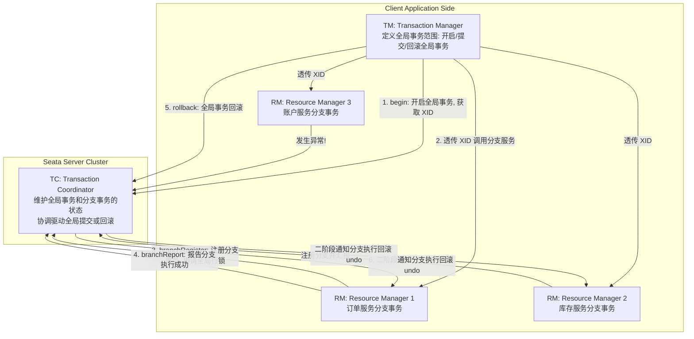
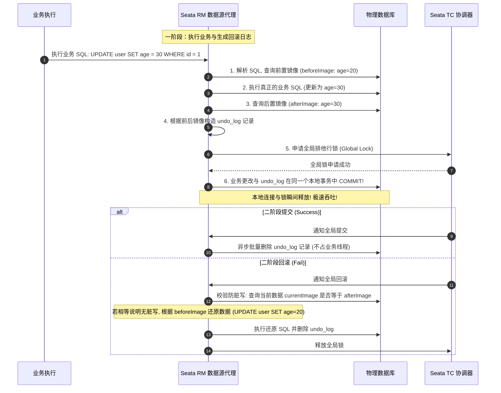
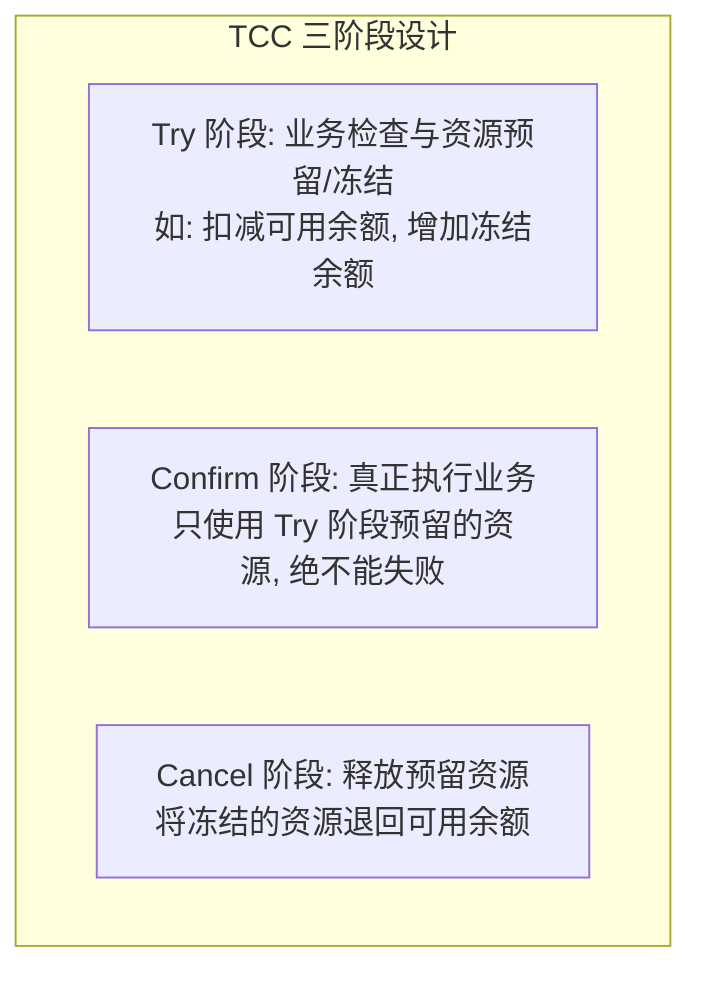

# 分布式事务Seata核心原理与AT-TCC模式深度实战

在单体应用向微服务拆分后，原本由单个数据库本地事务保证的 ACID 约束，被打破为跨越多个独立数据库、多个独立服务进程的分布式调用链。传统的两阶段提交（2PC/XA）因锁资源过长、性能低下，无法满足互联网高并发需求。阿里巴巴开源的 **Seata** 成为目前国内分布式事务解决方案的领航者。本篇将深度解析 Seata 的三大角色交互、AT 模式的无侵入前后镜像机制与全局锁，以及 TCC 模式的防悬挂、空回滚核心治理。

---

## 核心底层机制与全景架构

### 1. Seata 核心架构与三大角色交互模型



- **TC（Transaction Coordinator，事务协调器）**：独立的 Seata 服务端集群，维护全局事务与分支事务的运行状态，驱动全局提交或回滚；
- **TM（Transaction Manager，事务管理器）**：通常位于发起分布式调用的根服务，负责向 TC 发起开启全局事务（生成全局唯一 XID），并在业务完成或报错时通知 TC 提交或回滚；
- **RM（Resource Manager，资源管理器）**：位于各个分支微服务中，管理分支事务资源，向 TC 注册分支事务并汇报分支状态，接收 TC 指令执行最终的提交或回滚。

---

## 源码级架构物理拆解

### 1. Seata AT 模式：无侵入前后镜像机制

AT 模式是 Seata 最核心、最受欢迎的模式，其核心优势是对业务代码**零侵入（只需加 `@GlobalTransactional` 注解）**。



#### 关键机制剖析：
1. **本地锁极速释放**：与传统 2PC 必须等待所有人就绪才释放数据库本地行锁不同，Seata AT 在**一阶段就直接提交了本地物理事务**，数据库物理连接立即归还连接池，性能极大提升。
2. **全局锁（Global Lock）防脏写**：一阶段提交前，RM 必须向 TC 注册并获取**全局锁**（由 TC 在内存中维护的一张包含 `tableName + PK` 的映射表）。只有拿到全局锁，本地事务才允许提交。若其他全局事务试图修改同一行数据，会被全局锁阻塞直到超时。
3. **脏写校验（Dirty-Write Detection）**：在二阶段回滚时，RM 会比较物理数据库当前最新值 `currentImage` 是否与 `afterImage` 一致。如果不一致，说明在回滚前有未受 Seata 纳管的外部 SQL 篡改了数据，此时 Seata 拒绝执行回滚并报警，必须人工介入干预。

---

### 2. Seata TCC 模式：防悬挂、空回滚与幂等治理

对于性能有极致苛刻要求（如秒杀、支付结算），或者非关系型数据库（Redis/MongoDB）以及老旧系统，AT 模式无法施展，**TCC（Try-Confirm-Cancel）编程式事务**是终极武器。



#### TCC 生产三大死穴与标准解决方案：

| 异常现象 | 发生的物理场景 | 严重后果 | 标准工程解决方案 |
| :--- | :--- | :--- | :--- |
| **空回滚（Empty Rollback）** | 网络延迟导致服务未收到 `Try` 请求，事务超时失败，TC 直接向其下发了 `Cancel` 指令 | `Cancel` 在 `Try` 没有执行的情况下去释放资源，产生资损 | **引入 TCC 事务控制记录表**。在 `Cancel` 执行时先查该全局事务的 `Try` 记录是否存在，若不存在则只记录“空回滚标记”，不执行任何实际反向补偿。 |
| **防悬挂（Suspended Call）** | 网络极度拥堵，TC 先判定超时并触发了 `Cancel` 且已空回滚；随后网络恢复，迟到的 `Try` 请求才到达！ | 迟到的 `Try` 成功预留了资源，但 `Cancel` 已经走完了，预留的资金/库存被**永久悬挂冻结**！ | `Try` 阶段必须首先检查控制表中是否已存在该事务的 `Cancel` 记录。如果发现已有 `Cancel` 记录，**拒绝执行 Try 业务逻辑，直接拦截报错！** |
| **幂等（Idempotence）** | 由于网络抖动或 TC 重试，`Confirm` 或 `Cancel` 被重复调用了多次 | 资产被多次划转或多次退回 | 控制表中记录事务状态流转（`INIT -> CONFIRMED / CANCELLED`），利用唯一索引或版本号做行级幂等阻断。 |

---

## 4 种分布式事务技术选型对比

| 模式 | 一致性 | 业务代码侵入性 | 性能表现 | 适用典型场景 |
| :--- | :--- | :--- | :--- | :--- |
| **Seata AT** | 最终一致 | **极低（注解零侵入）** | 高（一阶段提交） | 关系型数据库（MySQL/Oracle），常规企业级微服务 |
| **Seata TCC** | 最终一致 | **极高（需手写 Try/Confirm/Cancel 三套逻辑）** | **极高（无全局锁阻塞）** | 核心支付链路、跨平台多数据源、非关系型存储 |
| **Saga 状态机** | 最终一致 | 中等（编写正向操作与补偿操作） | 极高（长事务异步编排） | 银行长流程审批、跨组织多系统异步协调 |
| **本地消息表 + MQ** | **最终一致** | 较低（依赖本地事务写消息表） | 极高（异步削峰解耦） | 跨部门异步履约（如：下单成功后发积分、短信通知） |

---

## 社招高频硬核连环追问

### Q1: Seata AT 模式的一阶段如果已经提交，此时机器突然断电宕机，二阶段回滚怎么继续执行？
- **考点**：Seata Crash-Safe 崩溃恢复机制与 TC 状态机持久化。
- **解析**：
  1. 一阶段提交时，业务数据的更新与 `undo_log` 表的插入被包裹在**同一个本地数据库事务中**，遵循 ACID 原则原子性落盘。
  2. TC 服务端记录了全局事务的状态（`Begin -> Rollbacking`），并持久化到注册中心/数据库中。
  3. 当 RM 服务重启后，Seata 客户端恢复与 TC 的长连接通信。TC 发现该 XID 处于 `Rollbacking` 状态但未汇报完成，会主动发起**重试回滚指令**；
  4. RM 再次读取数据库中尚未删除的 `undo_log`，执行反向补偿 SQL，回滚完成后向 TC 汇报并删除 `undo_log`。因此即使任意节点宕机，分布式系统依然具备 Crash-Safe 容灾自愈能力。

### Q2: 如果绕过 Seata，其他业务方直接更新了被纳入 AT 模式的行，会发生什么？
- **考点**：脏写（Dirty Write）与数据补偿保护。
- **解析**：
  - 如果外部人员直接通过数据库客户端（如 Navicat）或非 Seata 应用修改了这行数据：
    - 若全局事务正常提交（Commit）：二阶段只是删除 undo_log，数据不会报错，但外部修改的数据可能被掩盖；
    - 若全局事务**需要回滚（Rollback）**：Seata 在执行二阶段回滚时，会用 `afterImage`（当时修改后的快照）与数据库当前最新数据比对。比对发现当前数据被外部修改，触发脏写拦截，**停止自动回滚并抛出 `BranchRollbackFailed_Unretriable` 异常**，发出紧急企业级报警，通知运维或 DBA 人工对账修复。

---

## 生产级避坑指南与故障排查 SOP

### 1. undo_log 表高频读写导致数据库膨胀

**现象**：业务高并发运行数周后，数据库空间暴涨，`undo_log` 表积累了数千万行废弃数据。

#### 治理方案：
1. **确保全局事务正常提交闭环**：排查日志中是否存在大量因超时或网络中断悬挂的未决全局事务；
2. **启用定期归档与清理任务**：
   ```sql
   -- 定期清理超过 7 天且已完成的孤儿 undo_log
   DELETE FROM undo_log WHERE log_created < DATE_SUB(NOW(), INTERVAL 7 DAY);
   ```
3. **针对不需要分布式事务的普通查询方法**：严禁在非写操作上滥用 `@GlobalTransactional`，避免产生不必要的 TC RPC 往返与全局锁申请开销。
