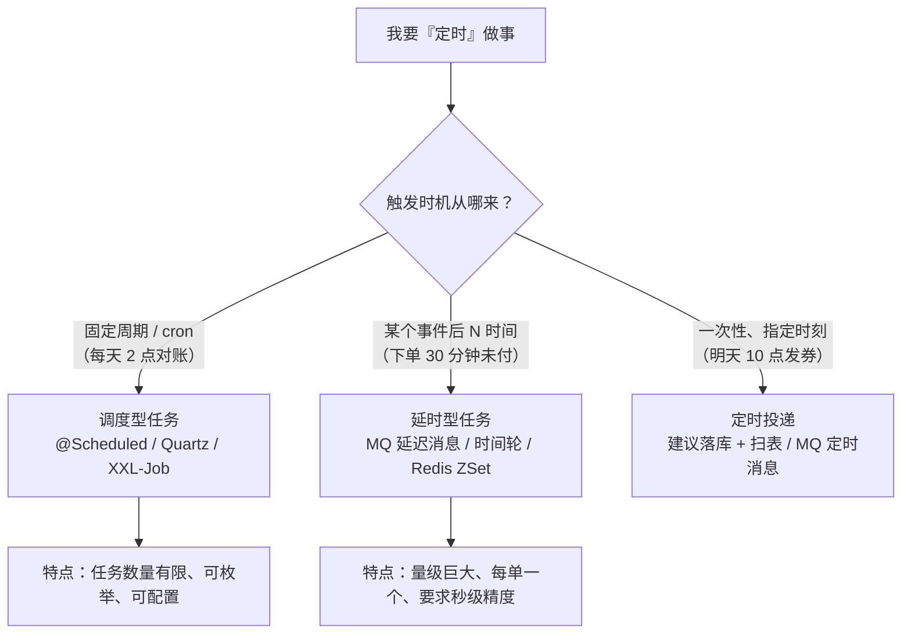
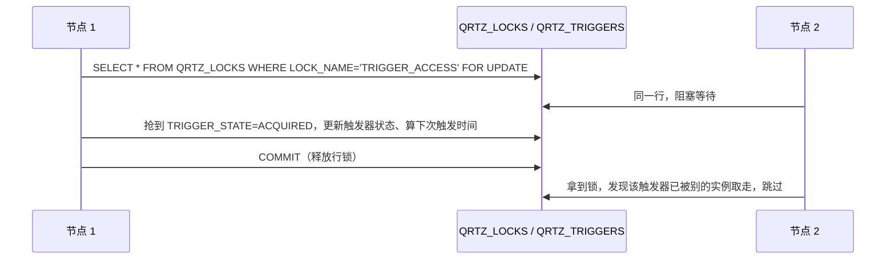
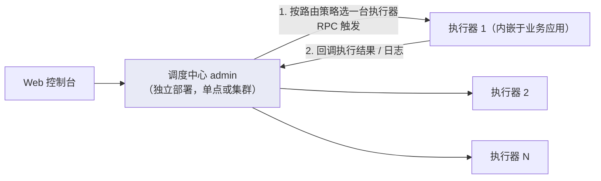
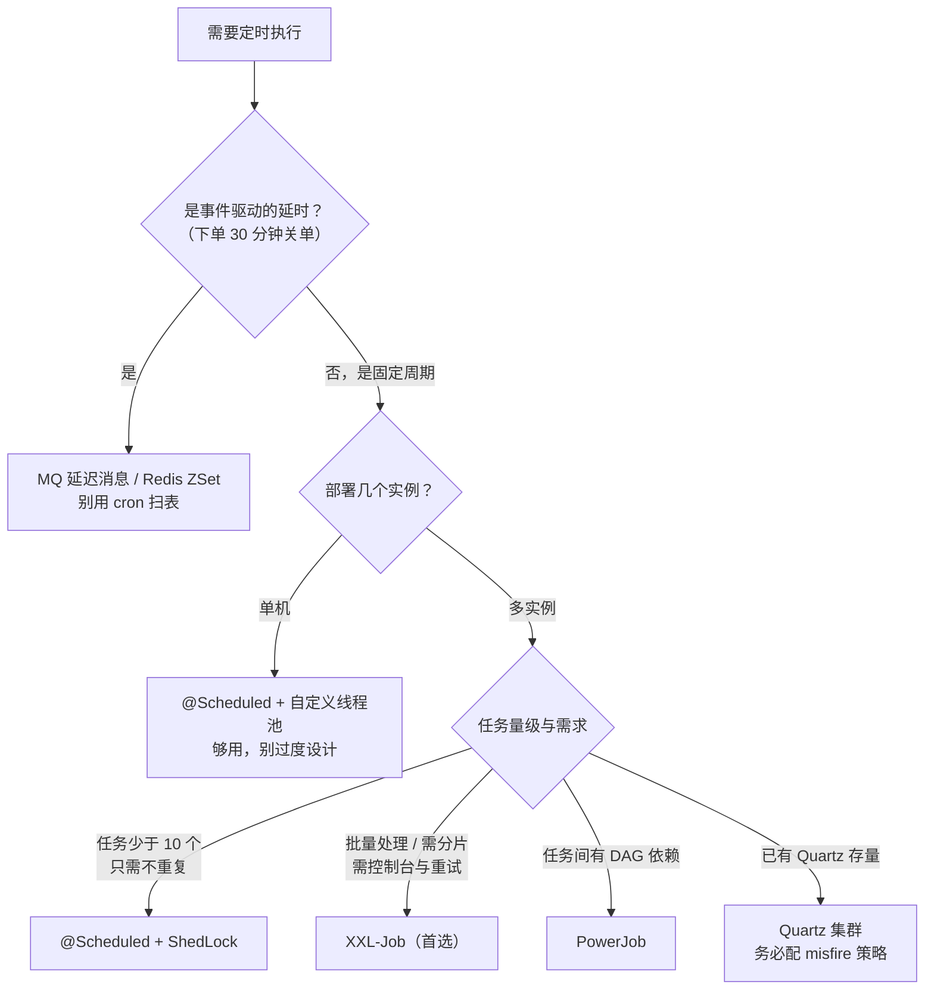

# 分布式定时任务与调度框架实战

## 使用入口：先解决问题，再做验证

按时执行可恢复任务并避免多实例重复业务。

**先做基本操作**：先用持久任务记录和 Scheduled 完成小批次任务，验证重复运行/宕机恢复，再选择分布式调度。初次学习可先完成[本模块基础实践](/doc/Java/Java语言基础与日常开发)。

**再逐步深入**：基本 API 与输入输出 → 常见失败和使用边界 → 场景排查与优化 → 本文机制分析与源码。面试先讲用途和自己的操作过程，再回答场景与原理追问。

> **一句话结论**：定时任务的唯一核心矛盾是「**一次触发，怎么保证只被一个节点执行一次**」——`@Scheduled` 没有这个能力，Quartz 用数据库行锁解决但重，XXL-Job 用调度中心 RPC 派发 + 执行器注册解决且可视化；但任何框架都只能保证「调度一次」，**业务幂等永远得自己做**。

## 30 秒速览：五种方案对比

| 方案 | 集群去重 | 分片 | 可视化 | 失败重试 | 动态改 cron | 适用场景 |
|---|---|---|---|---|---|---|
| `@Scheduled` | ❌ 多实例重复跑 | ❌ | ❌ | ❌ | ❌ 需重启 | 单机、本地开发、非关键任务 |
| `@Scheduled` + ShedLock | ✅ 分布式锁 | ❌ | ❌ | ❌ | ❌ | 小项目、任务少、不想引入调度中心 |
| Quartz | ✅ DB 行锁（`FOR UPDATE`） | ❌ 需自己实现 | 弱 | ✅ | ✅ 存库可改 | 已有 Quartz 存量、任务强依赖触发器语义 |
| **XXL-Job** | ✅ 调度中心派发 | ✅ **分片广播** | ✅ 完善 | ✅ | ✅ | **国内主流首选**，批量对账、报表、数据同步 |
| Elastic-Job | ✅ ZK 选举 | ✅ 弹性分片 | 弱（需 Mesos/Cloud 版） | ✅ | ⚠️ | 分片要求高、ZK 体系内 |
| PowerJob | ✅ | ✅ MapReduce 式 | ✅ 强 | ✅ | ✅ | 复杂工作流、需要 DAG 编排 |

**口语版**：新项目直接 XXL-Job，别自己造轮子；单机小工具用 `@Scheduled` 就够，但**上线前必须确认只部署一个实例**，否则就是给数据库埋雷。

## 一、把「定时任务」拆成三种不同的问题

很多人把三种东西混为一谈，选型就必然错：



| 类型 | 数量级 | 精度要求 | 别用什么 |
|---|---|---|---|
| 调度型（cron） | 几十~几百个 | 分钟级 | 不要用 MQ 延迟消息去实现 cron（消息数量爆炸） |
| 延时型（事件驱动） | 百万~千万 | 秒级 | **不要用 `cron` 扫表**，见 [MQ 消息队列与延迟任务](/doc/Java/MQ消息队列与延迟任务实战) |
| 一次性定时 | 中等 | 分钟级 | 不要靠「内存里 sleep 一个线程」，重启即丢 |

> 经典追问：「订单 30 分钟未支付自动取消，为什么不用定时任务扫表？」——因为扫表是 `WHERE status=0 AND create_time < ...` 的全表范围扫描，百万级表每分钟一次就是慢性自杀，而且精度受调度周期限制（5 分钟跑一次，实际可能 34 分钟才关单）。

## 二、`@Scheduled`：原理、三个坑、正确姿势

### 2.1 原理

`@EnableScheduling` 导入 `SchedulingConfiguration`，注册 `ScheduledAnnotationBeanPostProcessor`。它在 Bean 初始化后扫描 `@Scheduled` 方法，包装成 `Runnable` 注册到 `TaskScheduler`：

- `fixedRate` → `scheduleAtFixedRate`（按**上次开始时间**推算下次，任务超时会堆积）
- `fixedDelay` → `scheduleWithFixedDelay`（按**上次结束时间**推算，任务慢就整体变慢，更安全）
- `cron` → `schedule(Runnable, Trigger)`

```java
@Configuration
@EnableScheduling
public class ScheduleConfig implements SchedulingConfigurer {
    @Override
    public void configureTasks(ScheduledTaskRegistrar registrar) {
        // 默认只有一个线程！多个任务会串行互相阻塞，必须自定义线程池
        ThreadPoolTaskScheduler scheduler = new ThreadPoolTaskScheduler();
        scheduler.setPoolSize(10);
        scheduler.setThreadNamePrefix("sched-");
        scheduler.setErrorHandler(t -> log.error("task error", t));
        scheduler.setWaitForTasksToCompleteOnShutdown(true);
        scheduler.setAwaitTerminationSeconds(30);
        scheduler.initialize();
        registrar.setTaskScheduler(scheduler);
    }
}
```

### 2.2 三个必踩的坑

| 坑 | 现象 | 原因与正解 |
|---|---|---|
| **单线程串行** | 一个任务跑 10 分钟，其他任务全部延迟 | 默认 `ThreadPoolTaskScheduler` 池大小 1，必须 `setPoolSize(n)` |
| **cron 只支持 6 位** | 写 `0 0 2 * * ?` 报错或行为异常 | Spring 的 `CronExpression` 是 `秒 分 时 日 月 周`（6 位），**不支持年**；Quartz 是 7 位（多一位年） |
| **多实例重复执行** | 3 个 Pod，日志里同一任务跑了 3 次 | `@Scheduled` 无集群协调。要么保证单实例（`replicas: 1` + 禁止扩缩容），要么换框架或加分布式锁 |
| 异常吞掉任务 | 抛异常后该任务再也不执行 | Spring 6 前某些版本异常会导致 trigger 失效，配置 `ErrorHandler` 并自行 try-catch |

### 2.3 用 ShedLock 给 `@Scheduled` 加锁（小项目救急方案）

```xml
<dependency>
  <groupId>net.javacrumbs.shedlock</groupId>
  <artifactId>shedlock-spring</artifactId>
  <version>5.13.0</version>
</dependency>
<dependency>
  <groupId>net.javacrumbs.shedlock</groupId>
  <artifactId>shedlock-provider-jdbc-template</artifactId>
  <version>5.13.0</version>
</dependency>
```

```sql
CREATE TABLE shedlock (
  name       VARCHAR(64)  NOT NULL PRIMARY KEY,
  lock_until TIMESTAMP(3) NOT NULL,
  locked_at  TIMESTAMP(3) NOT NULL,
  locked_by  VARCHAR(255) NOT NULL
);
```

```java
@Configuration
@EnableScheduling
@EnableSchedulerLock(defaultLockAtMostFor = "PT30M")
public class ShedLockConfig {
    @Bean
    public LockProvider lockProvider(DataSource ds) {
        return new JdbcTemplateLockProvider(ds, "shedlock");
    }
}

@Component
public class ReconcileJob {
    // lockAtMostFor 防止节点崩溃后永久锁死；lockAtLeastFor 防止时钟漂移导致的重复
    @Scheduled(cron = "0 0 2 * * *")
    @SchedulerLock(name = "dailyReconcile", lockAtMostFor = "PT20M", lockAtLeastFor = "PT1M")
    public void reconcile() { /* 业务 */ }
}
```

**局限**：只有「抢锁」没有「分片」，任务再慢也只能一台干；没有控制台、没有重试、没有告警。任务超过 10 个就该上 XXL-Job。

## 三、Quartz：数据库行锁的经典实现

### 3.1 三个核心概念

| 概念 | 说明 |
|---|---|
| `Job` | 业务逻辑，`JobDetail` 是它的元数据（JobKey、参数） |
| `Trigger` | 触发规则，`SimpleTrigger`（间隔）或 `CronTrigger`（cron 7 位，含年） |
| `Scheduler` | 调度器，把 JobDetail 与 Trigger 绑定 |

### 3.2 集群原理（这是面试重点）

Quartz 集群**不通信**，全靠数据库表抢锁：



- 核心是 `QRTZ_LOCKS` 表的行锁 + `SELECT ... FOR UPDATE`，保证同一 trigger 只被一个节点 `ACQUIRED`。
- 需要建 **11 张** `QRTZ_*` 表（`quartz_tables_mysql.sql`），`org.quartz.jobStore.class=JobStoreTX`、`isClustered=true`。
- 节点时间必须 NTP 同步，否则 `misfire` 判断混乱。

### 3.3 misfire（错过触发）策略——最容易出事故的地方

节点重启、线程池打满、任务执行超过间隔，都会产生 misfire。策略决定「错过的那些次怎么补」：

| 策略 | 行为 | 用在 |
|---|---|---|
| `withMisfireHandlingInstructionFireAndProceed`（默认） | 立即补一次，然后按原节奏 | 需要尽快执行一次的 |
| `withMisfireHandlingInstructionDoNothing` | 直接跳过错过的那几次 | **报表、对账类（补跑无意义还可能算重）** |
| `withMisfireHandlingInstructionIgnoreMisfires` | 把所有错过的全部立即重放 | 几乎别用，会瞬间打满资源 |
| `withMisfireHandlingInstructionNowWithExistingCount` | 立刻执行并保留原触发次数 | 计数敏感任务 |

```java
@Bean
public JobDetail reconcileJob() {
    return JobBuilder.newJob(ReconcileQuartzJob.class)
            .withIdentity("reconcileJob", "finance")
            .storeDurably()
            .build();
}

@Bean
public Trigger reconcileTrigger(JobDetail reconcileJob) {
    return TriggerBuilder.newTrigger()
            .forJob(reconcileJob)
            .withIdentity("reconcileTrigger", "finance")
            .withSchedule(CronScheduleBuilder
                    .dailyAtHourAndMinute(2, 0)
                    // 关键：错过的直接丢弃，不要让集群一启动就补跑一堆
                    .withMisfireHandlingInstructionDoNothing())
            .build();
}
```

**Quartz 的取舍**：任务信息全在库里，容器无状态、可水平扩容，这是优点；但配置改 cron 要操作库表、无执行日志可视化、分片要自己写、大量 trigger 时行锁竞争明显。国内新项目大多转向 XXL-Job。

## 四、XXL-Job：调度中心 + 执行器

### 4.1 架构



| 角色 | 职责 |
|---|---|
| 调度中心 | 存任务配置、算 cron、按路由策略发起触发、收结果、告警 |
| 执行器 | 内嵌在业务应用里（`XxlJobSpringExecutor`），注册到调度中心，收到触发后交给业务线程池执行 |
| 通信 | 调度中心 → 执行器用 HTTP（Netty/自研 RPC），执行器 → 调度中心用 HTTP 回调 |

**关键设计**：调度中心**不执行业务代码**，所以它自身很轻，挂了只影响「新触发」，不影响正在跑的任务；执行器与业务应用同生命周期，能直接注入 Service、读配置。

### 4.2 完整接入（可直接抄）

**① 调度中心部署**

```bash
# 拉取 xxl-job 源码，初始化数据库
mysql -uroot -p < doc/db/tables_xxl_job.sql
# 改 application.properties 的数据源，打包运行
java -jar xxl-job-admin-2.4.1.jar --server.port=8080
# 默认账号 admin / 123456，登录后一定要改密码
```

**② 执行器依赖**

```xml
<dependency>
  <groupId>com.xuxueli</groupId>
  <artifactId>xxl-job-core</artifactId>
  <version>2.4.1</version>
</dependency>
```

**③ 执行器配置**

```yaml
xxl:
  job:
    admin:
      addresses: http://10.0.0.20:8080/xxl-job-admin   # 多个用逗号分隔
    accessToken: change-me-please                      # 必须与调度中心一致，否则 401
    executor:
      appname: order-executor        # 执行器名，控制台按它分组
      address: ""                    # 为空则自动取本机 IP，容器内建议显式指定
      ip: ""
      port: 9999                     # 执行器内嵌服务端口，同一台机器多应用要错开
      logpath: /data/logs/xxl-job/jobhandler
      logretentiondays: 30
```

```java
@Configuration
public class XxlJobConfig {
    @Value("${xxl.job.admin.addresses}") private String adminAddresses;
    @Value("${xxl.job.accessToken}") private String accessToken;
    @Value("${xxl.job.executor.appname}") private String appname;
    @Value("${xxl.job.executor.port}") private int port;
    @Value("${xxl.job.executor.logpath}") private String logPath;
    @Value("${xxl.job.executor.logretentiondays}") private int logRetentionDays;

    @Bean
    public XxlJobSpringExecutor xxlJobExecutor() {
        XxlJobSpringExecutor executor = new XxlJobSpringExecutor();
        executor.setAdminAddresses(adminAddresses);
        executor.setAppname(appname);
        executor.setPort(port);
        executor.setAccessToken(accessToken);
        executor.setLogPath(logPath);
        executor.setLogRetentionDays(logRetentionDays);
        return executor;
    }
}
```

**④ Handler 写法（分片 + 进度 + 超时）**

```java
@Component
public class OrderReconcileHandler {

    @XxlJob("orderReconcileHandler")
    public void execute() {
        int shardIndex = XxlJobHelper.getShardIndex();   // 当前分片号，从 0 开始
        int shardTotal = XxlJobHelper.getShardTotal();   // 分片总数
        String param = XxlJobHelper.getJobParam();       // 控制台填的任务参数（可传日期等）
        XxlJobHelper.log("开始对账，分片 {}/{}，参数={}", shardIndex, shardTotal, param);

        long lastId = 0L;
        int handled = 0;
        try {
            while (true) {
                // 关键：按主键游标 + 分片条件，避免深分页与全表扫描
                List<Order> batch = orderMapper.selectBatch(lastId, shardIndex, shardTotal, 500);
                if (batch.isEmpty()) break;
                for (Order o : batch) {
                    if (XxlJobHelper.isStopRequested()) {       // 支持控制台「终止任务」
                        XxlJobHelper.log("收到终止指令，已处理 {}", handled);
                        XxlJobHelper.handleFail("手动终止");
                        return;
                    }
                    reconcile(o);
                    handled++;
                }
                lastId = batch.get(batch.size() - 1).getId();
                XxlJobHelper.log("进度：已处理 {} 条，lastId={}", handled, lastId);
            }
            XxlJobHelper.handleSuccess("对账完成，共 " + handled + " 条");
        } catch (Exception e) {
            XxlJobHelper.log(e);
            XxlJobHelper.handleFail("对账失败：" + e.getMessage());  // 失败才会触发重试与告警
        }
    }
}
```

```sql
-- 对应的分片查询：用 id % total 或按区间切，别用 OFFSET 深分页
SELECT * FROM t_order
WHERE id > #{lastId} AND MOD(id, #{total}) = #{index}
ORDER BY id LIMIT 500;
```

**⑤ 控制台配置要点**

| 配置项 | 推荐值 | 理由 |
|---|---|---|
| 路由策略 | 第一个 / 轮询 / **分片广播** | 单机任务用「第一个」；批量处理用「分片广播」 |
| 阻塞处理策略 | 单机串行 / 丢弃后续 / 覆盖之前 | 慢任务必须显式设「丢弃后续」，否则任务堆积 |
| 任务超时时间 | 按 P99 × 2 设置 | 超时会被强制中断并标记失败 |
| 失败重试次数 | 1~2 | **必须配幂等**，重试会真的重跑整个 Handler |
| 报警邮件 | 必配 | 失败无人知是定时任务最大的风险 |
| 调度过期策略 | 忽略 / 立即执行一次 | 与 Quartz misfire 同理，报表类选「忽略」 |

### 4.3 分片广播：批量任务提速的核心

```text
任务配置「分片广播」，执行器有 3 台 → 每台都收到触发，分别拿到 index=0/1/2, total=3
每台只处理 MOD(id,3)=index 的数据 → 数据天然不重叠，3 倍吞吐
```

**三个坑**：
1. 分片数取自「在线执行器数量」，某台宕机后分片数变化，`MOD(id, total)` 的归属会整体漂移——所以**必须幂等**，或用「分片参数」固定区间。
2. 分片不均（数据倾斜）：如果主键是雪花 ID，`MOD(id,3)` 相对均匀；如果按时间区间切，注意冷热。
3. 别忘了 SQL 里带分片条件，否则每个分片都全表扫，比单机还慢。

## 五、Elastic-Job 与 PowerJob（了解即可）

| 框架 | 核心机制 | 亮点 | 短板 |
|---|---|---|---|
| Elastic-Job | ZK 临时节点选主 + 分片；`ShardingTotalCount` 可大于实例数，实例增减触发**重新分片** | 分片弹性好、有失效转移 | 依赖 ZK，控制台能力弱，社区活跃度下降 |
| PowerJob | Server + Worker，支持**工作流 DAG**、MapReduce 式任务、在线代码 | 复杂编排、单机多副本、可视化管理强 | 相对新，团队规模小于 XXL-Job |

选型结论：**只需要 cron + 分片 → XXL-Job；需要任务之间依赖编排（A 完成才跑 B）→ PowerJob**。

## 六、延时任务的四种实现（按量级选）

| 方案 | 精度 | 量级上限 | 成本 | 适用 |
|---|---|---|---|---|
| `cron` 扫表 | 分钟级 | 低（万级表就吃力） | 低 | 任务极少、精度要求低 |
| **MQ 延迟消息** | 秒级 | 高 | 中 | 订单超时关闭、支付回调重试（推荐） |
| Redis ZSet（score=到期时间戳）+ 定时轮询 | 秒级 | 中高 | 中 | 无 MQ、量级中等，注意 ZSet 大 key |
| **时间轮**（Netty `HashedWheelTimer` / Kafka 内部） | 毫秒级 | 单机内存级 | 低 | 单机内存任务、连接超时管理；重启会丢 |

```java
// RocketMQ 5.x 任意时间延迟消息（替代 18 个固定等级）
Message msg = new Message("order-topic", "CLOSE", orderId.getBytes());
msg.setDelayTimeSec(30 * 60);
producer.send(msg);
```

```java
// Redis ZSet 版：延时任务队列
public void addDelayTask(String bizId, long delaySeconds) {
    redisTemplate.opsForZSet().add("delay:order", bizId,
            System.currentTimeMillis() / 1000.0 + delaySeconds);
}

@Scheduled(fixedDelay = 1000)
public void poll() {
    long now = System.currentTimeMillis() / 1000;
    // 用 Lua 保证「取出 + 删除」原子，避免多实例重复取
    Set<String> due = redisTemplate.opsForZSet().rangeByScore("delay:order", 0, now, 0, 200);
    for (String id : due) {
        if (Boolean.TRUE.equals(redisTemplate.opsForZSet().remove("delay:order", id) > 0)) {
            closeOrder(id);   // 业务必须幂等
        }
    }
}
```

> 详细方案与 RabbitMQ TTL+DLX 实现见 [MQ 消息队列与延迟任务实战](/doc/Java/MQ消息队列与延迟任务实战)。

## 七、生产铁律：框架解决不了的四件事

| 铁律 | 说明 | 不做会怎样 |
|---|---|---|
| **① 任务必须幂等** | 重试、手动触发、分片漂移、网络超时重发都会重复执行。用唯一键（`biz_date + type`）、状态机（`待处理→处理中→已完成`，用 `UPDATE ... WHERE status=?` 抢占）、或去重表 | 重复对账、重复发券、重复扣款 |
| **② 长任务要有进度与断点** | 每批提交后记录 `lastId`/游标，重启从断点续跑 | 跑 3 小时后 OOM/发布重启，从头再来 |
| **③ 数据量大必须分批 + 分片** | 单次 `SELECT *` 拉全表 = OOM；用游标分页（`WHERE id > lastId LIMIT n`），别用 `OFFSET` | 深分页慢查询 + 堆内存爆 |
| **④ 必须有监控与告警** | 执行失败、执行时长突增、**「本该执行却没执行」**（最危险）都要告警。XXL-Job 靠失败邮件，调度中心宕机则需额外心跳监控 | 静默失败数天，财务对不上才发现 |

**「没执行」怎么监控**：业务侧写一张 `job_execution_log(job_name, biz_date, status, cost_ms)`，每天由一个独立的看板查询「昨天应有 N 个任务，实际成功 M 个」，M < N 就告警。这是很多团队的盲区——调度中心挂了，所有任务都不跑，而失败告警也发不出来。

## 八、选型决策树



## 九、高频追问

| 追问 | 高分回答要点 |
|---|---|
| `@Scheduled` 多实例会重复执行吗？ | 会，它没有任何集群协调，每个实例都各自算 cron 各自跑。要么单实例部署，要么加 ShedLock，要么换 XXL-Job |
| `fixedRate` 和 `fixedDelay` 区别？ | rate 按上次**开始**时间推下次，任务超时会堆积连跑；delay 按上次**结束**时间推下次，绝不会并发但会整体延后 |
| Spring cron 和 Quartz cron 区别？ | Spring 6 位（秒分时日月周），Quartz 7 位（多一位年）；`?` 只能用于日或周之一 |
| Quartz 集群靠什么保证不重复？ | 不靠通信，靠 `QRTZ_LOCKS` 表的行锁 + `SELECT FOR UPDATE`，抢到锁的实例把 trigger 置为 ACQUIRED |
| misfire 是什么？ | 触发器该触发时没有空闲线程/节点宕机导致错过。策略决定补跑还是丢弃，报表类必须选 DoNothing，否则启动瞬间补跑一堆 |
| XXL-Job 调度中心挂了任务还跑吗？ | 正在执行的继续跑完（执行器独立进程），但**不再有新触发**；所以调度中心要集群部署 + 独立监控 |
| XXL-Job 为什么比 `@Scheduled` 可靠？ | 调度集中、配置热更新、失败重试与告警、执行日志可查、支持分片广播与手动补偿 |
| 分片广播怎么保证数据不重复不遗漏？ | 按 `MOD(主键, total) = index` 划分，天然互斥且并集为全集；但实例数变化会重分布，因此必须幂等 |
| 定时任务和消息队列怎么分工？ | 固定周期用调度框架，事件驱动延时用 MQ；两者都只保证「至少一次」，幂等是业务底线 |

**延伸阅读**：[MQ 消息队列与延迟任务实战](/doc/Java/MQ消息队列与延迟任务实战)、[常用中间件核心原理与选型速查](/doc/Java/常用中间件核心原理与选型速查)、[Kafka 与 RocketMQ 生产级接入实战](/doc/Java/Kafka与RocketMQ生产级接入实战)、[幂等性设计与重复请求治理](/doc/SystemDesign/幂等性设计与重复请求治理)。
