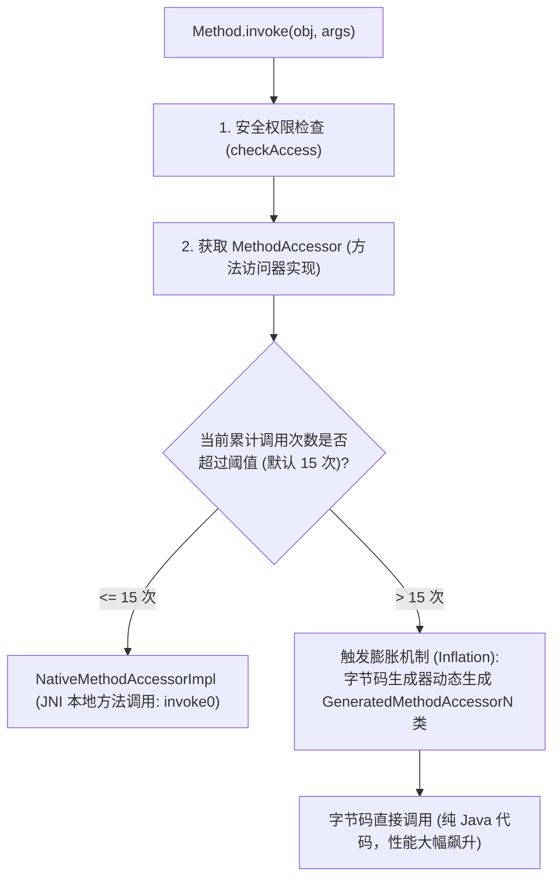

# 反射机制底层原理与性能损耗深度分析

反射（Reflection）赋予了 Java 在运行期动态洞察和操纵类、对象、方法与字段的能力。可以说，没有反射，就没有 Spring 的依赖注入（IoC）、MyBatis 的 ORM 映射以及各类 RPC 框架。

但在大型高并发系统中，反射也是臭名昭著的性能隐患点。本篇深度剖析反射底层的 **`Method.invoke()` 执行链路、膨胀机制（Inflation）与性能优化策略**。

---

## 1. 反射核心调用链：`Method.invoke()` 源码深度剖析

当我们在 Java 中执行如下反射调用时：
```java
Method method = TargetService.class.getMethod("doSomething", String.class);
method.invoke(targetInstance, "param");
```

其底层真实的源码流转链路如下：



---

## 2. 核心深水区：反射膨胀机制（Inflation）

查看 OpenJDK 的 `sun.reflect.NativeMethodAccessorImpl` 源码：
```java
class NativeMethodAccessorImpl extends MethodAccessorImpl {
    private final Method method;
    private DelegatingMethodAccessorImpl parent;
    private int numInvocations; // 调用次数计数器

    public Object invoke(Object obj, Object[] args) {
        // 当调用次数超过阈值 (默认 15 次)
        if (++numInvocations > ReflectionFactory.inflationThreshold() 
                && !ReflectUtil.isVMAnonymousClass(method.getDeclaringClass())) {
            // 动态生成 Java 字节码访问器，替换当前的 Native 访问器！
            MethodAccessorImpl acc = (MethodAccessorImpl)
                new MethodAccessorGenerator().
                    generateMethod(method.getDeclaringClass(),
                                   method.getName(),
                                   method.getParameterTypes(),
                                   method.getReturnType(),
                                   method.getExceptionTypes(),
                                   method.getModifiers());
            parent.setDelegate(acc);
        }
        // 前 15 次走 JNI C++ 本地调用
        return invoke0(method, obj, args);
    }
}
```

### 为什么 JVM 要设计这种“先走本地调用，再切动态字节码”的奇特机制？
1. **冷启动与初始内存考量**：
   动态生成字节码类（通过字节码生成器在内存中拼装 `.class` 并定义新类加载器）本身是一个高昂的操作，需要占用 Metaspace 元空间内存。如果某个反射方法整个生命周期只调用一两次，直接使用 C++ JNI 本地方法调用是最快、最省内存的。
2. **高频调用的性能跃迁**：
   如果某个反射方法被反复调用（超过 15 次），JVM 判定其为热点操作，立即自动生成纯 Java 字节码类。在这个新类中，直接使用目标对象的真实类型执行普通调用（如 `((TargetService)obj).doSomething((String)args[0])`）。这使得 JIT 即时编译器能够像普通代码一样对它进行**内联优化（Method Inlining）**，执行速度提升数十倍！

---

## 3. 反射性能损耗的 4 大根本原因

即便有膨胀机制，反射调用相比直接的方法调用（Direct Call）依然存在明显的性能差距：

1. **JIT 方法内联（Inlining）难度剧增**：
   直接调用的目标在编译期或运行早期即已确定，JIT 能够将调用方法的目标指令直接内嵌到调用方消除压栈开销；而反射涉及多态和抽象接口委派，阻碍了内联优化。
2. **安全检查开销（`checkAccess`）**：
   每次调用前，JVM 都必须递归检查调用方是否有权限访问目标类的私有成员。
3. **参数装箱与数组解包（Boxing & Varargs）**：
   `Method.invoke(Object obj, Object... args)` 的参数必须封装为 `Object[]` 数组。如果参数是基本数据类型（如 `int`、`long`），必须先经历**自动装箱（Auto-boxing）**，在堆中分配 `Integer` 包装对象；方法返回时若为基本类型，又必须经历强制拆箱，产生大量短命垃圾对象。
4. **异常包装处理**：
   反射抛出的实际业务异常会被强制包装进 `InvocationTargetException` 中，增加了异常栈的解包开销。

---

## 4. 生产优化反射调用的 3 大工业级策略

### 4.1 策略一：强制调用 `setAccessible(true)`
```java
Method method = clazz.getMethod("doSomething", String.class);
method.setAccessible(true); // 彻底压制 Java 语言访问安全检查
```
调用 `setAccessible(true)` 可以彻底跳过 `checkAccess()` 的权限校验，显著减少单次反射调用的 CPU 消耗（提升 20%~30% 性能）。

### 4.2 策略二：全局缓存反射元数据（Method / Field 绝不重复查找）
`Class.getMethod()` 会在底层遍历整个类的所有方法列表并在堆中创建新的 `Method` 实例副本。**高频场景下严禁在业务热路径中重复调用 `getMethod`**，必须在系统启动时一次性解析完毕并放入静态 `ConcurrentHashMap` 中长期复用。

### 4.3 策略三：拥抱高性能替代方案（MethodHandle 与 LambdaMetafactory）
在 JDK 7+ 和 JDK 8+ 中，Java 引入了现代高效动态调用基础设施：
- **`MethodHandle`（方法句柄）**：配合 `invokedynamic` 指令，底层由 JVM 直接优化，性能无限逼近原生直接调用。
- **`LambdaMetafactory`**：将反射方法动态编译绑定为一个真实的函数式接口实例（如 `Function` 或自定义 SAM 接口），直接通过普通接口调用，**彻底消除反射开销**！
