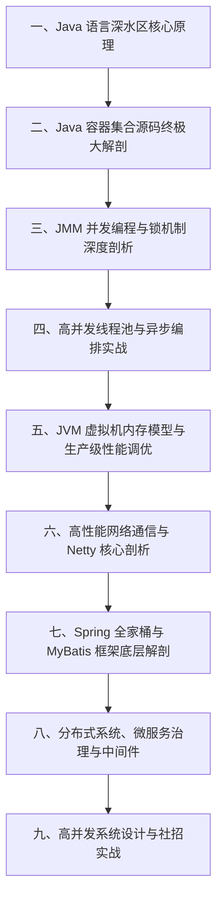

# Java 后端社招硬核学习地图

本知识库专为 **社招 2~5 年+ 资深 Java 后端工程师与架构师** 打造。彻底告别泛泛而谈的 API 介绍，以 **核心底层机制（Mermaid 架构全景） + 源码/算法物理推导 + 社招高频连环追问 + 生产级排障 SOP** 为核心支柱，建立由浅入深的 9 阶段技术阶梯。

---

## 9 大阶段阶梯式进阶全景

---

### 一、Java 语言深水区核心原理（7 篇）
深挖 JVM 常量池、泛型擦除、动态代理与非阻塞 I/O 底层：
1. [String深入与字符串常量池底层机制](/doc/Java/String深入与字符串常量池底层机制)
2. [Java泛型机制与类型擦除深挖](/doc/Java/Java泛型机制与类型擦除深挖)
3. [反射机制底层原理与性能损耗深度分析](/doc/Java/反射机制底层原理与性能损耗深度分析)
4. [动态代理深度对比JDK-Proxy与CGLIB](/doc/Java/动态代理深度对比JDK-Proxy与CGLIB)
5. [SPI机制底层原理与在开源框架中的演进](/doc/Java/SPI机制底层原理与在开源框架中的演进)
6. [Java异常体系语法糖底层与try-with-resources](/doc/Java/Java异常体系语法糖底层与try-with-resources)
7. [Java-IO演进从传统BIO到NIO三大核心组件](/doc/Java/Java-IO演进从传统BIO到NIO三大核心组件)

---

### 二、Java 容器集合源码终极大解剖（5 篇）
逐行推导主流集合数据结构扩容、树化与并发控制：
8. [ArrayList与CopyOnWriteArrayList源码剖析](/doc/Java/ArrayList与CopyOnWriteArrayList源码剖析)
9. [HashMap-1.8源码终极大解剖-结构演进与Hash算法](/doc/Java/HashMap-1.8源码终极大解剖-结构演进与Hash算法)
10. [HashMap-1.8源码终极大解剖-put流程树化与扩容](/doc/Java/HashMap-1.8源码终极大解剖-put流程树化与扩容)
11. [ConcurrentHashMap-1.7与1.8架构演进与并发控制](/doc/Java/ConcurrentHashMap-1.7与1.8架构演进与并发控制)
12. [LinkedHashMap与TreeMap底层原理](/doc/Java/LinkedHashMap与TreeMap底层原理)

---

### 三、JMM 并发编程与锁机制深度剖析（6 篇）
汇编级内存屏障、无锁并发与 AQS 同步队列设计：
13. [JMM内存模型与Happens-Before原则深度解析](/doc/Java/JMM内存模型与Happens-Before原则深度解析)
14. [volatile关键字底层原理与内存屏障汇编分析](/doc/Java/volatile关键字底层原理与内存屏障汇编分析)
15. [CAS机制与无锁并发编程Unsafe与LongAdder](/doc/Java/CAS机制与无锁并发编程Unsafe与LongAdder)
16. [synchronized锁与对象头MarkWord锁升级全过程](/doc/Java/synchronized锁与对象头MarkWord锁升级全过程)
17. [AQS核心架构设计与源码深度逐行解析](/doc/Java/AQS核心架构设计与源码深度逐行解析)
18. [JUC核心并发锁与同步工具实战](/doc/Java/JUC核心并发锁与同步工具实战)

---

### 四、高并发线程池与异步编排实战（3 篇）
掌控异步计算吞吐量与线程池核心生命周期：
19. [ThreadLocal核心原理内存泄漏与全链路透传TTL](/doc/Java/ThreadLocal核心原理内存泄漏与全链路透传TTL)
20. [ThreadPoolExecutor线程池底层源码与动态调优实战](/doc/Java/ThreadPoolExecutor线程池底层源码与动态调优实战)
21. [CompletableFuture异步编排实战与并发吞吐量提升](/doc/Java/CompletableFuture异步编排实战与并发吞吐量提升)

---

### 五、JVM 虚拟机内存模型与生产级性能调优（5 篇）
现代垃圾收集器、生产 GC 参数与线上突发排障：
22. [JVM内存区域划分与对象创建生命周期](/doc/Java/JVM内存区域划分与对象创建生命周期)
23. [类加载机制与破坏双亲委派3大经典场景](/doc/Java/类加载机制与破坏双亲委派3大经典场景)
24. [现代垃圾收集器深度G1与ZGC核心原理解析](/doc/Java/现代垃圾收集器深度G1与ZGC核心原理解析)
25. [JVM核心性能调优参数与GC日志分析](/doc/Java/JVM核心性能调优参数与GC日志分析)
26. [线上CPU-100与OOM疑难故障排查与Arthas实战](/doc/Java/线上CPU-100与OOM疑难故障排查与Arthas实战)

---

### 六、高性能网络通信与 Netty 核心剖析（4 篇）
掌握百万级网络长连接、Epoll 事件驱动与零拷贝：
27. [IO多路复用模型与epoll底层工作机制](/doc/Java/IO多路复用模型与epoll底层工作机制)
28. [Reactor反应堆线程模型与Netty核心架构](/doc/Java/Reactor反应堆线程模型与Netty核心架构)
29. [ByteBuf内存分配与Netty零拷贝机制全景](/doc/Java/ByteBuf内存分配与Netty零拷贝机制全景)
30. [Netty网络编解码粘包拆包与心跳检测实战](/doc/Java/Netty网络编解码粘包拆包与心跳检测实战)

---

### 七、Spring 全家桶与 MyBatis 框架底层解剖（6 篇）
打通 IoC 启动 12 步、循环依赖推导、事务失效与插件机制：
31. [Spring-IoC容器启动流程与Bean完整生命周期](/doc/Java/Spring-IoC容器启动流程与Bean完整生命周期)
32. [Spring循环依赖与三级缓存终极推导](/doc/Java/Spring循环依赖与三级缓存终极推导)
33. [Spring-AOP原理与方法内部自调用失效全解](/doc/Java/Spring-AOP原理与方法内部自调用失效全解)
34. [Spring声明式事务传播机制与12种失效场景排查](/doc/Java/Spring声明式事务传播机制与12种失效场景排查)
35. [SpringBoot自动装配原理与自定义Starter实战](/doc/Java/SpringBoot自动装配原理与自定义Starter实战)
36. [MyBatis核心架构SQL映射与插件拦截器实战](/doc/Java/MyBatis核心架构SQL映射与插件拦截器实战)

---

### 八、分布式系统、微服务治理与中间件（4 篇）
构建高可用分布式防线，攻克事务一致性与高并发缓存：
37. [微服务核心组件架构与技术选型对比](/doc/Java/微服务核心组件架构与技术选型对比)
38. [分布式事务Seata核心原理与AT-TCC模式深度实战](/doc/Java/分布式事务Seata核心原理与AT-TCC模式深度实战)
39. [Redis核心原理高并发三大难题与双写一致性](/doc/Java/Redis核心原理高并发三大难题与双写一致性)
40. [Kafka与RocketMQ生产级高可靠投递与积压治理](/doc/Java/Kafka与RocketMQ生产级高可靠投递与积压治理)

---

### 九、高并发系统设计与社招实战（2 篇）
全链路秒杀漏斗设计与 40 道跨越全领域的社招连环追问：
41. [高并发秒杀系统全链路设计与社招40道硬核连环炮](/doc/Java/高并发秒杀系统全链路设计与社招40道硬核连环炮)
42. [高并发大数据与线上疑难故障排查](/doc/Java/高并发大数据与线上疑难故障排查实战)

---

## 学习与面试通关建议

1. **先抓主干**：针对社招面试，核心突破 **JMM 并发（锁升级、AQS、线程池）**、**JVM 调优（G1/ZGC、OOM排查）** 与 **MySQL 物理底层（B+树推导、MVCC、Next-Key Lock、日志二阶段提交）** 三座大山；
2. **源码推导**：重点掌握 Spring 三级缓存推导、HashMap 树化与扩容推导、Netty 零拷贝与责任链机制；
3. **闭环表述**：回答面试题时，先用一句话亮出核心结论，随后铺展底层物理数据结构与时序图，最后结合生产避坑案例升华。
