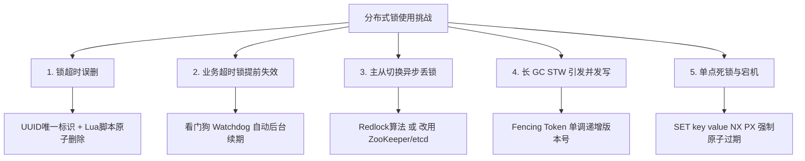
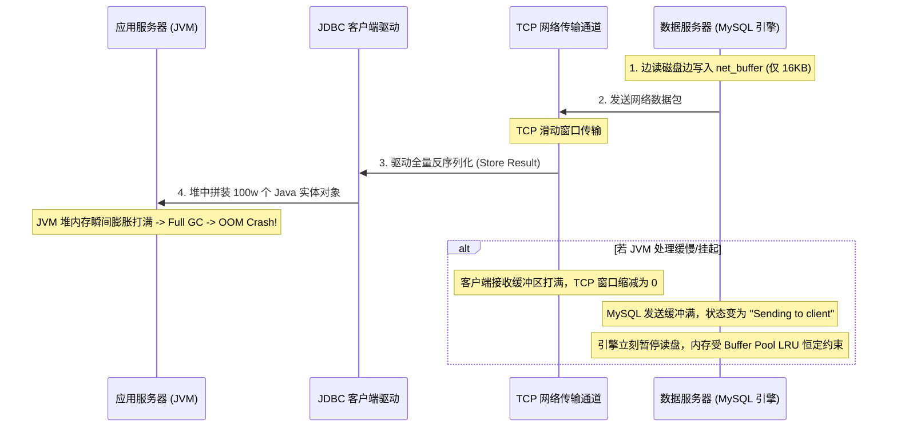
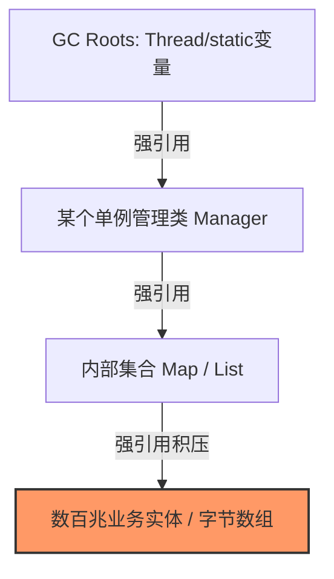

# 🚀 后端核心避坑与生产实战全解

## 使用入口：先解决问题，再做验证

排查业务并发、数据与资源失败，并形成可复现的修复。

**先做基本操作**：先完成 CRUD、事务与线程任务，记录失败/超时，再按证据选择锁、分页或内存治理。完整前置实践见[基础入口](/doc/Java/SpringBoot业务开发实战入门)。

**再逐步深入**：用途与基本 API → 场景与失败 → 原理/源码 → 取舍与验证。

> 本篇系统汇总了日常开发与生产架构中最核心的 5 大硬核技术要点，深度剖析底层运作机制、故障成因、真实案发现场及业界标准解法。

---

## 目录
- [一、分布式锁使用过程中会遇到什么问题？怎么解决？](#一、分布式锁使用过程中会遇到什么问题-怎么解决)
- [二、用什么管理线程？使用多线程会遇到什么问题？怎么解决？](#二、用什么管理线程-使用多线程会遇到什么问题-怎么解决)
- [三、MySQL 里面有哪些锁？项目里面用到哪种？](#三、mysql-里面有哪些锁-项目里面用到哪种)
- [四、查询 100w 条数据，是数据服务器内存先崩还是应用服务器内存先崩？为什么？](#四、查询-100w-条数据-是数据服务器内存先崩还是应用服务器内存先崩-为什么)
- [五、内存溢出与内存泄漏是什么场景导致的？怎么排查与解决？](#五、内存溢出与内存泄漏是什么场景导致的-怎么排查与解决)

---

## 一、分布式锁使用过程中会遇到什么问题？怎么解决？

分布式锁的核心使命是：**在分布式多节点环境下，保证同一时刻只有一个服务进程执行临界区代码**。但在真实生产环境中，单纯使用 `SETNX` 会面临五大经典“翻车”场景。

### 1. 经典五大故障场景与应对之道



#### ① 锁提前失效导致误删他人的锁
* **案发现场**：
  1. 线程 A 获取锁并设置过期时间 30s；
  2. 线程 A 因慢 SQL、耗时远程 RPC 或长事务，执行了 40s；
  3. 第 30s 时，Redis 发现 TTL 到期自动删除了锁；
  4. 线程 B 成功加锁进入临界区；
  5. 第 40s 时，线程 A 业务执行完毕执行 `DEL lock_key`，**把线程 B 刚加的锁删掉了**！
* **解决方案**：
  * **唯一标识**：`SET lock_key uuid+threadId NX PX 30000`；
  * **Lua 脚本原子校验释放**：释放锁时必须比对 Value 是否为当前线程自身的持有者标识，匹配成功才删除：
    ```lua
    if redis.call('get', KEYS[1]) == ARGV[1] then
        return redis.call('del', KEYS[1])
    else
        return 0
    end
    ```

#### ② 业务执行时间难以预估（锁续期问题）
* **案发现场**：过期时间设太短，业务尚未执行完锁就自动失效，并发互斥性被击破；设太长，若节点异常宕机，锁迟迟不释放导致后续所有请求被长时间阻塞。
* **解决方案**：
  * **看门狗（Watch Dog）守护线程自动续期**（如 Redisson 机制）：
    - 加锁成功后，后台启动一个定时任务（`TimerTask`）；
    - 默认每隔 `lockWatchdogTimeout / 3`（通常为 10s）触发一次心跳检查；
    - 若当前业务线程仍在运行，则向 Redis 发送续期指令重新将 key 的 TTL 刷新为 30s；
    - 业务执行完毕显式释放锁，或者进程宕机后看门狗停止续期，30s 后自动释放，彻底兼顾安全性与活性。

#### ③ 主从异步复制引发丢锁（脑裂与延迟）
* **案发现场**：Redis 主从架构采用异步复制。线程 A 在 Master 上加锁成功，此时数据尚未异步同步至 Slave，Master 突然断电宕机。哨兵（Sentinel）发起故障转移，将 Slave 晋升为新 Master。此时新 Master 上没有这把锁，线程 B 即可重复加锁成功。
* **解决方案**：
  * **业务绝大多数场景**：接受极低概率丢锁（发生率往往低于硬件故障率），下游存储通过**数据库唯一索引**或**版本号乐观锁**进行终极兜底；
  * **强一致性金融场景**：
    - **Redlock 算法**：向 $N$ 个独立的 Redis 物理 Master（通常 $N=5$）申请加锁，只有在多数派（$\ge 3$）节点成功且加锁总耗时小于有效时长时，才认定锁有效；
    - **改用强一致性 CP 系统（推荐）**：使用 **ZooKeeper** 或 **etcd**。ZooKeeper 利用临时顺序节点与 ZAB 协议强一致落盘，Master 宕机选举期间对外不可写，选举完成后数据绝不丢失，从架构根源上杜绝异步复制丢锁。

#### ④ 长 GC STW / 网络拥塞并发写（Fencing Token 机制）
* **案发现场**：线程 A 拿锁后遭遇 JVM Full GC STW（系统停顿 60s），Redis 锁因超时失效；线程 B 成功加锁并更新了数据；随后线程 A 恢复执行，继续提交写请求，**覆盖了线程 B 已经更新的数据**。
* **解决方案**：
  * **分布式栅栏（Fencing Token）**：每次获取锁成功时，服务端生成并返回一个单调递增的数字令牌（Token）。下游数据库在更新时进行条件比对：
    ```sql
    UPDATE account_balance SET balance = 500, lock_token = 102 
    WHERE id = 1 AND lock_token < 102;
    ```
    线程 A 带着旧的 `token = 101` 恢复提交时，会被数据库通过版本校验拒绝。

---

## 二、用什么管理线程？使用多线程会遇到什么问题？怎么解决？

### 1. 为什么必须用线程池（ThreadPoolExecutor）管理线程？
裸创建线程（`new Thread()`）存在三大严重缺陷：
1. **线程创建与销毁开销昂贵**：操作系统创建内核级线程需要分配独立调用栈（通常 1MB）、初始化上下文寄存器并陷入内核态；
2. **缺乏生命周期与数量上限约束**：无节制创建线程会消耗耗尽系统 PID 和内存资源，导致系统假死崩盘；
3. **缺乏队列调度与拒绝降级策略**。

> [!WARNING]
> **生产严禁直接使用 `Executors` 快速创建线程池！**
> - `Executors.newFixedThreadPool()` 和 `newSingleThreadExecutor()` 的任务阻塞队列为 `LinkedBlockingQueue`，**默认容量是 `Integer.MAX_VALUE`（无界）**，高并发任务积压时直接导致堆内存 **OOM**！
> - `Executors.newCachedThreadPool()` 的最大线程数为 `Integer.MAX_VALUE`，极端情况下会瞬间疯狂创建几十万个线程，导致 CPU 占用 100% 并耗尽系统线程句柄。

### 2. 工业级 ThreadPoolExecutor 7 大参数黄金规范

```java
ThreadPoolExecutor executor = new ThreadPoolExecutor(
    corePoolSize,                     // 1. 核心线程数
    maximumPoolSize,                  // 2. 最大线程数
    60L, TimeUnit.SECONDS,            // 3 & 4. 空闲线程保活时间与单位
    new ArrayBlockingQueue<>(2000),   // 5. 必须是有界阻塞队列！
    new CustomThreadFactory("order"), // 6. 必须定制线程名称前缀！
    new ThreadPoolExecutor.CallerRunsPolicy() // 7. 拒绝策略
);
```

* **核心线程数估算公式**：
  * **CPU 密集型**（如复杂算法、加解密、JSON 序列化）：配置 $N_{cpu} + 1$，最大化利用 CPU 核心同时预留一个缓冲容错。
  * **I/O 密集型**（如数据库操作、RPC 调用、网络文件上传）：线程大部分时间处于阻塞等待状态，可配置 $2 \times N_{cpu} \sim 4 \times N_{cpu}$，或结合公式：
    $$\text{线程数} = N_{cpu} \times \left(1 + \frac{\text{I/O 耗时}}{\text{CPU 耗时}}\right)$$
  * **最佳实践**：生产环境务必配合动态线程池（如 **Hippo4j** 或 **Dynamic-TP**）支持免重启热调整。

### 3. 多线程四大高频并发问题与解法

| 常见并发问题 | 底层根因 | 生产标准解决方案 |
| :--- | :--- | :--- |
| **数据竞争与竞态条件** | 复合操作缺乏原子性；JMM 缓存一致性与指令重排导致可见性缺失 | ① 单变量原子更新：`AtomicLong` / `LongAdder`（分段 CAS）<br>② 复合业务临界区：`ReentrantLock`、`synchronized`<br>③ 读多写少：`ReentrantReadWriteLock` 或 `StampedLock` |
| **死锁（Deadlock）** | 互斥、持有并等待、不可剥夺、环路等待 4 大条件同时满足 | ① **固定加锁顺序**（按资源 ID 字典序由小到大加锁）<br>② 使用带超时的 `tryLock(timeout)` 避免无限挂起<br>③ 线上排查：`jstack <pid>` 查看堆栈中 `Found one Java-level deadlock` |
| **上下文切换过高拖垮 CPU** | 线程数量远超 CPU 核心承载力，OS 频繁调度保存/恢复寄存器现场 | ① 压测校准线程数，减少无谓线程创建<br>② 减小锁粒度，采用无锁队列（如 Disruptor 环形缓冲区）<br>③ JDK 21+ 接入**虚拟线程（Virtual Threads）**解耦并发与系统内核线程 |
| **ThreadLocal 内存泄漏与数据污染** | 线程池复用线程；`ThreadLocalMap.Entry` 中 Key 是弱引用被 GC 回收后，Value 仍是强引用驻留堆中 | ① **编码铁律**：业务末尾必须在 `finally` 块中调用 `threadLocal.remove()`<br>② 异步跨线程传递数据使用阿里开源的 `TransmittableThreadLocal (TTL)` |

---

## 三、MySQL 里面有哪些锁？项目里面用到哪种？

### 1. MySQL 锁体系全景分类

```
MySQL 锁全景体系
├── 按锁粒度
│   ├── 全局锁 (FTWRL - Flush tables with read lock)
│   ├── 表级锁
│   │   ├── 表读锁 / 表写锁 (LOCK TABLES ... READ/WRITE)
│   │   ├── 元数据锁 (MDL - Metadata Lock，DDL 与 DML 互斥)
│   │   ├── 意向锁 (IS 意向共享锁 / IX 意向排他锁，InnoDB 快速校验表级冲突)
│   │   └── AUTO-INC 锁 (自增主键并发插入控制)
│   └── 行级锁 (InnoDB 特有)
│       ├── Record Lock (记录锁: 锁定单条索引项)
│       ├── Gap Lock (间隙锁: 锁定开区间，RR 级别下防止幻读)
│       ├── Next-Key Lock (临键锁: Record + Gap 左开右闭，默认加锁单元)
│       └── Insert Intention Lock (插入意向锁: 间隙并发插入协调机制)
└── 按读写互斥性
    ├── 共享锁 (S 锁 / 读锁 - SELECT ... LOCK IN SHARE MODE)
    └── 排他锁 (X 锁 / 写锁 - SELECT ... FOR UPDATE / 增删改自带)
```

### 2. 真实项目中具体用到了哪种锁？

#### ① 日常绝大多数查询：MVCC 快照读（完全无锁）
在日常并发读（如商品浏览、订单列表、个人中心）中，InnoDB 通过 **MVCC（多版本并发控制）** 读取当前事务的 Read View 与 Undo Log 版本链，**读写完全互不阻塞，无需申请任何行锁**。

#### ② 扣减库存与防超卖：行级排他锁（X 锁 / `FOR UPDATE`）
在核心交易链路（如扣减库存、账户扣款）中，需要强行悲观串行化：
```sql
-- 必须开启事务
START TRANSACTION;
SELECT stock FROM t_sku WHERE id = 10086 FOR UPDATE; -- 锁住该行 Record X 锁
-- 业务校验 stock > 0
UPDATE t_sku SET stock = stock - 1 WHERE id = 10086;
COMMIT;
```
> [!IMPORTANT]
> **行锁避坑军规**：`WHERE` 条件**必须命中索引**（最好为主键或唯一索引）。如果未走索引，InnoDB 会升级为扫描全表行锁，直接将整表阻塞死！

#### ③ 状态机流转与轻量并发：应用层乐观锁（无锁 CAS）
对于并发冲突低、读多写少的实体（如订单状态流转、商品属性修改）：
```sql
UPDATE t_order 
SET status = 'PAID', version = version + 1 
WHERE id = 8888 AND version = 1;
```
通过比对影响行数 `affected_rows == 1` 判断是否成功，失败则在应用层选择重试或抛出“并发冲突，请稍后再试”，避免数据库级锁等待。

#### ④ 生产大表加字段：无锁在线 DDL 工具
针对千万级单表修改结构（`ALTER TABLE`），为防止长事务持有 MDL 读锁引发级联死锁阻塞全库，严禁直接执行原生 DDL，生产统一走 **gh-ost** 或 **pt-online-schema-change**（通过创建影子表并在后台建立 Binlog 触发式异步同步，最终仅占用极短瞬间完成原子切换 rename）。

---

## 四、查询 100w 条数据，是数据服务器内存先崩还是应用服务器内存先崩？为什么？

### 1. 核心结论
> **绝大多数情况下，应用服务器（Java / 客户端）内存先崩（触发 OOM）！数据服务器（MySQL）依然安然无恙。**

### 2. 深度底层机制剖析



#### ① 为什么 MySQL（数据服务器）不会崩？
1. **边读边发，流式推送**：
   MySQL 执行器并不是先把 100w 条记录全部载入内存打成一个几百 MB 的包才开始发送。它是**从存储引擎（InnoDB）读出一行或一批数据，就写入通信缓存 `net_buffer`（默认仅 16KB）**。
2. **TCP 滑动窗口与 Backpressure（背压反压机制）**：
   `net_buffer` 写满后通过网络 Socket 发送给客户端。如果应用服务器处理变慢，客户端操作系统 TCP 接收缓冲区填满后，会向服务端发送“窗口大小为 0”的通知（Zero Window）。MySQL 发现 Socket 发送缓冲区打满后，**会立刻暂停从磁盘读取数据，线程进入 `Sending to client` 等待状态**。
3. **Buffer Pool 严格受两段式 LRU 淘汰机制保护**：
   扫描 100w 行数据确实需要从磁盘载入大量数据页到 Buffer Pool，但 Buffer Pool 的大小是预先固定分配的（如物理内存的 70%）。新增的页通过 LRU 淘汰机制挤出冷数据页（且有 `innodb_old_blocks_time` 专门防范全表扫描污染），**内存占用始终处于恒定上限，绝对不会因为单次大查询发生内存溢出**。

#### ② 为什么 Java 应用服务器（客户端）会瞬间被打爆？
1. **JDBC 驱动默认行为：全量拉取（Store Result）**：
   以官方 `mysql-connector-java` 驱动为例，默认执行 `Statement.executeQuery()` 时，底层会将网络返回的 100w 行二进制记录全部下载到本地，反序列化成 Java 对象放入 `ResultSetImpl` 的巨型内存结构中。
2. **Java 对象的严重内存膨胀效应**：
   - 数据库中 100w 条结构化记录文本可能仅占 100MB 磁盘空间；
   - 转换为 JVM 堆内的 Java 对象（包含 16 字节对象头、对齐填充、包装类、String 内部 `byte[]` 等），**对象体积在堆中会膨胀 5~10 倍**！
   - 100w 个实体对象在堆中可能吞噬 1GB ~ 3GB 内存，瞬间占满新生代并触发 Eden 与 Survivor 溢出直接进入老年代；老年代打满触发数次昂贵的 Full GC STW 依旧无法回收，最终抛出：
     ```
     java.lang.OutOfMemoryError: Java heap space
     ```

### 3. 生产级正确处理海量数据查询方案
1. **强制滚动分页处理**：
   ```sql
   -- 严禁一次性拉取，按主键滚动分页
   SELECT * FROM t_large_data WHERE id > #{lastId} ORDER BY id ASC LIMIT 2000;
   ```
2. **开启 JDBC 流式游标（Streaming ResultSet）**：
   如确需数据批量导出，必须显式通知驱动开启逐行按需消费，禁止本地缓存全量数据：
   ```java
   Statement stmt = conn.createStatement(ResultSet.TYPE_FORWARD_ONLY, ResultSet.CONCUR_READ_ONLY);
   // 必须设置为 Integer.MIN_VALUE，MySQL 驱动识别后转为逐行网络消费模式
   stmt.setFetchSize(Integer.MIN_VALUE);
   ResultSet rs = stmt.executeQuery("SELECT * FROM t_large_data");
   while (rs.next()) {
       // 逐行消费写入文件，内存占用恒定保持在几十 KB
       processRow(rs);
   }
   ```

---

## 五、内存溢出与内存泄漏是什么场景导致的？怎么排查与解决？

### 1. 概念本质区别
* **内存泄漏（Memory Leak）**：对象在业务逻辑上已经“死亡”，但存在未切断的 **GC Roots 强引用链**，垃圾收集器认为它依然存活而**无法回收它**。内存被无意义占用，逐渐累积。
* **内存溢出（Out Of Memory / OOM）**：JVM 申请的内存空间超过了系统设定的硬件或容器最大上限（如 `-Xmx`），已无可用内存容纳新对象。**长期的内存泄漏最终必然导致内存溢出**。

### 2. 六大高频经典故障场景

```
典型内存泄漏 / OOM 根因场景
├── 1. ThreadLocal 缺乏清理 (线程池复用导致 Value 强引用无法回收)
├── 2. 静态容器与无界缓存 (static Map / 单例集合无淘汰机制与容量上限)
├── 3. 资源未关闭 (FileInputStream, Connection, Socket 未关闭引发 Native 泄漏)
├── 4. 监听器与回调未解绑 (长生命周期对象持有短生命周期组件的匿名内部类)
├── 5. 堆外内存泄漏 (DirectByteBuffer / Netty 堆外缓冲区未手动释放)
└── 6. 元空间 Metaspace 溢出 (CGLIB / 反射动态生成海量 Class 且无法卸载)
```

### 3. 生产排查四步闭环实战

#### 步骤一：配置 JVM 参数，保留事故现场
在服务启动脚本中，**必须标配以下参数**，在发生 OOM 的瞬间自动生成二进制 Dump 快照：
```bash
-XX:+HeapDumpOnOutOfMemoryError 
-XX:HeapDumpPath=/data/logs/jvm-dump.hprof
```

#### 步骤二：线上紧急排查与初步定位
```bash
# 1. 实时查看各内存分代使用比例与 Full GC 频次 (每 1 秒刷新一次)
jstat -gcutil <pid> 1000

# 2. 快速统计当前内存中存活对象的大小排行 (前 20 位)
jmap -histo:live <pid> | head -n 20

# 3. 借助 Arthas 进行动态线程与对象探测
dashboard
thread -n 5  # 定位消耗 CPU 最高的线程 (通常为正在疯狂做 Full GC 的 GC 线程)
```

#### 步骤三：离线深度分析（使用 MAT - Memory Analyzer Tool）
1. 将 `jvm-dump.hprof` 导入 MAT；
2. **第一步看【Leak Suspects Report（内存泄漏嫌疑报告）】**：MAT 会自动以饼图标识出哪一个对象或类加载器占据了超过 50% 的堆内存；
3. **第二步查【Dominator Tree（支配树）】**：
   - 关注 **Retained Heap（深堆/保留堆内存）** 排行榜（代表该对象被回收后能释放的总内存大小）；
4. **第三步追查【Path to GC Roots】**：
   - 右键嫌疑对象 $\rightarrow$ `Path to GC Roots` $\rightarrow$ `Exclude all phantom/weak/soft references`（排除所有弱引用、软引用干扰）；
   - **立即精准定位到底是哪一个静态变量（`static`）、哪个线程池（`Thread`）在强行引用它！**



### 4. 根治与预防解决方案
1. **编码规范与语法防御**：
   * `ThreadLocal` 统一封装进拦截器，所有调用必须在 `finally` 显式 `threadLocal.remove()`；
   * I/O 流、网络连接必须采用 Java 7 `try-with-resources` 语法糖自动关闭。
2. **规范本地缓存选型**：
   * **严禁裸写 `static Map` 作为缓存！** 必须使用工业级缓存库（如 **Caffeine** 或 **Guava Cache**）；
   * 必须强制设置 `maximumSize`（最大承载条数）和 `expireAfterWrite`（过期淘汰策略），必要时开启弱引用（`weakKeys`/`weakValues`）。
3. **元空间与容器资源调优**：
   * 合理设定 `-XX:MetaspaceSize=256m -XX:MaxMetaspaceSize=512m`；
   * 容器环境下避免频繁使用自定义 ClassLoader 重新热加载；
   * 严守物理堆大小配置：`-Xms` 必须与 `-Xmx` 保持一致（防止运行时动态扩容停顿），且堆内存一般配置为容器内存上限的 65%~75%，给操作系统内核与堆外内存留足安全缓冲。
