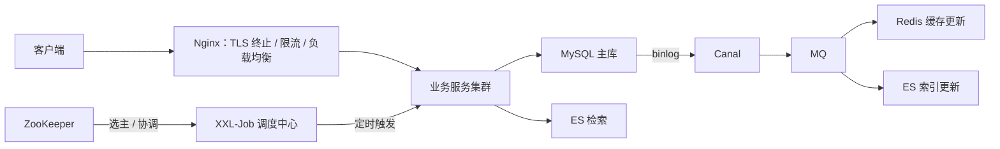
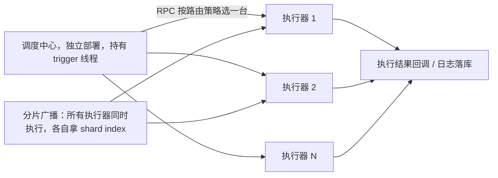
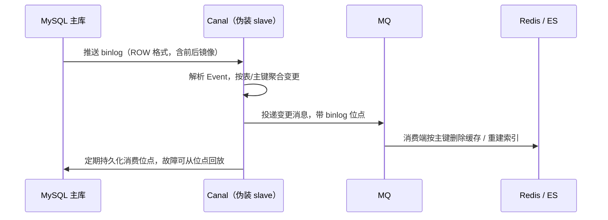

# 常用中间件核心原理与选型速查

## 使用入口：先解决问题，再做验证

按查询、代理、任务或同步需求选择组件。

**先做基本操作**：先说明业务瓶颈，跑通一个最小调用并测量失败行为，避免同时引入所有中间件。初次学习可先完成[本模块基础实践](/doc/Java/Java语言基础与日常开发)。

**再逐步深入**：基本 API 与输入输出 → 常见失败和使用边界 → 场景排查与优化 → 本文机制分析与源码。面试先讲用途和自己的操作过程，再回答场景与原理追问。

> **一句话结论**：中间件不外乎「**存、传、算、调**」四类——ES 解决检索、Nginx 解决流量入口、XXL-Job 解决调度、Canal/ZooKeeper 解决数据同步与协调；选型先定场景与一致性要求，再谈性能参数。

## 30 秒速览

| 组件 | 归类 | 核心机制 | 一句话场景 | 最典型的坑 |
|---|---|---|---|---|
| Elasticsearch | 存/检索 | 倒排索引 + 分片 + segment | 商品搜索、日志检索 | 当数据库用，忽略近实时与深分页 |
| Nginx | 传 | master/worker + epoll 多路复用 | 反向代理、网关、静态资源 | location 优先级、keepalive 未配 |
| XXL-Job | 调 | 调度中心 + 执行器 RPC 注册 | 定时对账、报表、批量任务 | 多实例重复执行、无幂等 |
| Canal | 传 | 伪装 MySQL slave 解析 binlog | 缓存失效、异构数据同步 | 延迟与重复、DDL 变更 |
| ZooKeeper | 协调 | ZAB + 临时节点 + Watcher | 选主、分布式锁、配置 | Watcher 一次性、CP 可用性取舍 |
| Nacos | 协调 | 长轮询 + 临时/持久实例 | 注册中心、配置中心 | 见 [SpringCloud 篇](/doc/Java/Spring/SpringCloud微服务核心组件与架构实战) |

## 一张图看它们在链路里的位置



## 二、Elasticsearch：倒排索引与近实时

| 概念 | 说明 |
|---|---|
| 倒排索引 | `term → docId 列表`，与「文档 → 词」的正排相反；配合 FST 词典与跳表加速 |
| 分词 | 中文需 IK 等分词器；`match` 走分词，`term` 不分词，用错查不到是高频事故 |
| `doc_values` | 列式存储，支撑排序与聚合；`text` 字段默认无 doc_values，需 `keyword` 子字段 |
| 写入流程 | 写内存 buffer + translog → `refresh`（1s，生成可搜索 segment）→ `flush` 落盘 → segment merge |
| 近实时 NRT | refresh 之前查不到，所以「写完立刻查」会失败；可手动 `?refresh=wait_for` |
| 分片 | `number_of_shards` 建索引后**不可改**（7.x 前），要改只能 reindex；分片数按数据量与节点数预估 |
| 深分页 | `from + size` 在深页会把各分片前 N 条汇总，O(N) 爆内存；用 `search_after` 或 scroll |

```json
// 典型 mapping：text 用于搜索，keyword 用于精确过滤与聚合
{
  "mappings": { "properties": {
    "title":   { "type": "text", "analyzer": "ik_max_word", "fields": { "kw": { "type": "keyword" } } },
    "status":  { "type": "keyword" },
    "created": { "type": "date" }
  }}
}
```

**定位**：ES 是**检索与聚合引擎**，不是主存储。数据以 MySQL/Canal 为源，ES 只存索引副本，通过 MQ 增量同步；要接受秒级延迟与最终一致，并做全量对账兜底。

## 三、Nginx：事件驱动与转发

```nginx
upstream backend {
    least_conn;                       # 也可用 round_robin / ip_hash / hash $request_uri
    server 10.0.0.1:8080 max_fails=3 fail_timeout=30s;
    server 10.0.0.2:8080 backup;
    keepalive 64;                     # 到上游的长连接，不配则每次请求新建 TCP
}
server {
    listen 443 ssl http2;
    location /api/ {
        proxy_pass http://backend;
        proxy_set_header Host $host;
        proxy_set_header X-Real-IP $remote_addr;
        proxy_http_version 1.1;
        proxy_set_header Connection "";   # 配合 keepalive 必须清空 Connection
        proxy_next_upstream error timeout http_502;
    }
    location ~* \.(js|css|png)$ { expires 1y; add_header Cache-Control "public, immutable"; }
    location / { try_files $uri $uri/ /index.html; }   # SPA history 回退
}
```

| 机制 | 要点 |
|---|---|
| 进程模型 | 1 master（管理配置/重载）+ N worker（= CPU 核数），worker 各自 epoll 事件循环，无锁accept（用 `accept_mutex` 或 `reuseport`） |
| 为什么高并发 | 事件驱动非阻塞 IO，单 worker 可维持数万连接，内存与上下文切换成本远低于线程模型 |
| location 优先级 | `=` 精确 > `^~` 前缀 > `~`/`~*` 正则（按出现顺序）> 普通前缀（最长匹配）；配错会导致静态资源被代理到后端 |
| 限流 | `limit_req_zone` 令牌桶 + `limit_conn_zone` 并发连接数，配合 `burst` 与 `nodelay` |
| 灰度/回滚 | 按 Cookie/Header split_clients 分流到不同 upstream；静态资源版本目录切换，见 [工程化部署](/doc/Vue/工程化构建与部署实战) |

## 四、XXL-Job：分布式调度



| 能力 | 说明 |
|---|---|
| 路由策略 | 第一个/最后一个/轮询/随机/一致性哈希/最不经常使用/故障转移/忙碌转移/分片广播 |
| 阻塞策略 | 单机串行（默认）、丢弃后续调度、覆盖之前调度；慢任务必须显式配置 |
| 分片广播 | `XxlJobHelper.getShardIndex() / getShardTotal()`，按 `id % total == index` 分数据，是批量处理提速的关键 |
| 失败处理 | 失败重试次数 + 告警邮件 + 手动补偿入口 |
| 对比 `@Scheduled` | 后者单实例执行、无法集中管理、多实例会重复跑；Quartz 基于数据库锁，集群模式重且无可视化 |

**三条铁律**：① 调度中心的「一次触发」不等于「业务只执行一次」（重试、手动触发、网络超时重发都会重复），**任务逻辑必须幂等**；② 长任务加超时与进度记录，避免重启后从头跑；③ 分片广播时每个分片只处理自己那份数据，别在 SQL 里忘了分片条件。

> 完整接入代码、分片广播实现、`@Scheduled` / Quartz 集群 / misfire 策略 / 延时任务方案对比，见 [分布式定时任务与调度框架实战](/doc/Java/分布式定时任务与调度框架实战)。

## 五、Canal 与 ZooKeeper



Canal 要点：**只解析不侵入业务代码**，是缓存双写一致性的主流方案（详见 [Redis 高并发缓存与一致性实战](/doc/Java/Redis高并发缓存与一致性实战)）；必须消费端幂等（同一 binlog 可能重复投递），并处理 DDL 变更、延迟监控与位点回放。

| ZooKeeper 能力 | 机制 | 注意 |
|---|---|---|
| 选主 / 分布式锁 | 临时顺序节点 + 最小序号获锁 + 前一节点 Watcher | Watcher 一次性触发，需重新注册；客户端会话超时会释放锁，参见 [分布式锁](/doc/SystemDesign/分布式锁与Redisson源码全解) |
| 一致性 | ZAB 协议，过半写成功，CP | 半数节点不可用则集群不可写；Nacos 默认 AP 更适合服务发现 |
| 配置/命名服务 | 持久节点 + Watcher 推送 | 不适合存大量数据（每个 ZNode 有大小限制） |

## 六、选型速查表

| 需求 | 首选 | 备选 | 别用 |
|---|---|---|---|
| 千万级商品多条件检索 | Elasticsearch | OpenSearch | MySQL `LIKE '%x%'` |
| 日志集中检索 | ES / Loki | ClickHouse | 直接 grep 服务器文件 |
| 七层流量入口、灰度、限流 | Nginx / 云 LB | Envoy / APISIX | 业务应用自己扛 TLS |
| 定时批量对账 | XXL-Job + 分片广播 | Quartz 集群 | `@Scheduled` 多实例 |
| MySQL 变更同步缓存/索引 | Canal → MQ | Debezium | 业务代码双写（易不一致） |
| 强一致协调 / 选主 | ZooKeeper / etcd | — | Redis SETNX 做严谨选主 |

## 七、高频追问（含高分/低分特征）

| 追问 | 高分回答要点 | 低分回答 |
|---|---|---|
| ES 为什么查得快？ | 倒排索引 term→docId + FST 词典 + 列式 doc_values 聚合，分片并行 | 「用了索引」 |
| ES 写完为什么立刻查不到？ | refresh 默认 1s 生成 segment 才可搜索，NRT 模型；可用 `refresh=wait_for` | 「有延迟，等一下」 |
| ES 深分页怎么破？ | `from+size` 各分片汇总前 N 条爆内存，改 `search_after` / scroll | 「加分页插件」 |
| Nginx 为什么能扛高并发？ | master/worker + epoll 事件驱动，单进程数万连接，无线程切换开销 | 「C 语言写的」 |
| XXL-Job 多实例会重复跑吗？ | 路由策略决定单台执行，但分片广播/重试/手动触发都会重复，任务必须幂等 | 「不会，框架保证了」 |
| Canal 原理？ | 伪装 MySQL slave 请求 binlog，解析 ROW event 后投递 MQ，位点可回放 | 「监听数据库触发器」 |
| ZK 和 Nacos 怎么选？ | ZK 是 CP 强一致协调，Nacos 默认 AP 更适合服务发现与配置 | 「都差不多」 |

**延伸阅读**：[消息中间件选型与高可靠投递](/doc/Java/消息中间件选型与高可靠投递全解)、[Kafka 与 RocketMQ 生产级接入实战](/doc/Java/Kafka与RocketMQ生产级接入实战)、[Dubbo 分布式 RPC 核心原理与实战](/doc/Java/Dubbo分布式RPC核心原理与实战)、[分布式定时任务与调度框架实战](/doc/Java/分布式定时任务与调度框架实战)、[MySQL 底层原理日志体系与 BufferPool](/doc/MySQL/MySQL底层原理日志体系与BufferPool)、[Docker 容器化与 CI/CD](/doc/DevOps/Docker容器化与CICD自动化部署实战)。
