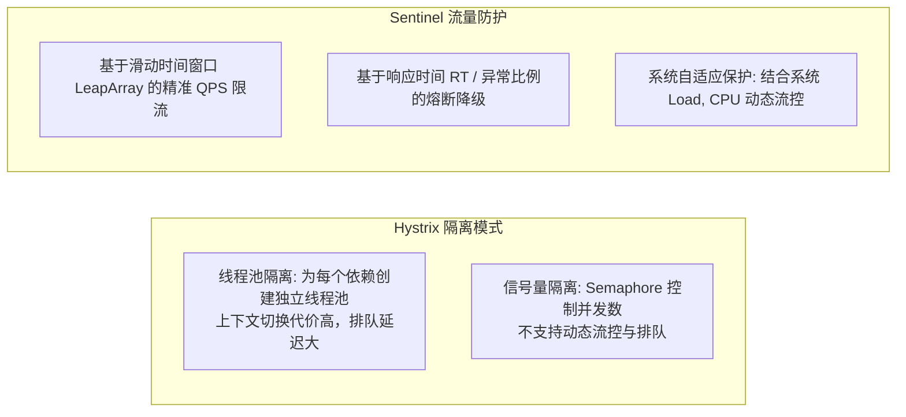
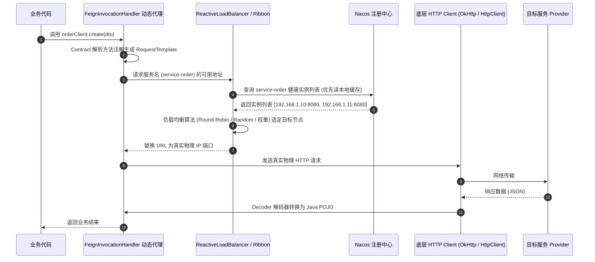

# 微服务核心组件架构与技术选型对比

随着单体架构向微服务架构演进，系统被拆分为数十甚至上百个自治的服务单元。微服务架构在带来独立部署与弹性伸缩能力的同时，也引入了网络不可靠、服务寻址复杂、级联故障（雪崩）等分布式固有限制。本文深入拆解现代微服务技术栈的核心组件架构，围绕 **CAP 定理、高并发吞吐与高可用防护** 给出权威横向选型对比。

---

## 核心底层机制与全景架构

### 1. 现代微服务系统全景拓扑

```mermaid
flowchart TD
    Client[客户端 App / Web / 小程序] --> Gateway[API 网关: Spring Cloud Gateway<br/>路由分发, 统一鉴权, 全局限流]
    
    subgraph 控制面 Control Plane
        Nacos[注册中心 & 配置中心<br/>Nacos / Consul / Eureka]
        Skywalking[分布式链路追踪<br/>SkyWalking / OpenTelemetry]
    end

    subgraph 数据面 Data Plane (微服务集群)
        Gateway --> ServiceA[用户服务 Service-A]
        ServiceA -->|OpenFeign RPC 负载均衡调用| ServiceB[订单服务 Service-B]
        ServiceB -->|RPC 调用| ServiceC[库存服务 Service-C]
        
        Sentinel[流量防护组件: Sentinel<br/>熔断降级, 系统自适应保护]
        ServiceA -.-> Sentinel
        ServiceB -.-> Sentinel
        ServiceC -.-> Sentinel
    end
    
    ServiceA -.->|心跳注册 / 服务发现 / 动态配置拉取| Nacos
    ServiceB -.->|心跳注册 / 服务发现 / 动态配置拉取| Nacos
    ServiceC -.->|心跳注册 / 服务发现 / 动态配置拉取| Nacos
    
    ServiceA -.->|Trace 上报| Skywalking
    ServiceB -.->|Trace 上报| Skywalking
    ServiceC -.->|Trace 上报| Skywalking
```

---

## 核心组件横向硬核对比与物理选型

### 1. 服务注册中心终极对决：Nacos vs Eureka vs Consul vs Zookeeper

在分布式系统中，CAP 定理明确指出：**一致性（C）、可用性（A）、分区容错性（P）不可兼得**。注册中心必须在网络分区（P）必然存在的前提下，在 C 和 A 之间做出取舍：

| 评估维度 | **Nacos（主流推荐）** | **Eureka（已闭源停更）** | **Consul** | **Zookeeper** |
| :--- | :--- | :--- | :--- | :--- |
| **CAP 定理属性** | **支持 AP 与 CP 动态无缝切换** | **纯 AP 模型** | **纯 CP 模型** | **纯 CP 模型** |
| **底层一致性算法** | AP: Distro 自研协议；CP: Raft | 无共识算法（Peer-to-Peer 最终一致） | Raft 共识协议 | ZAB 协议（类似 Paxos） |
| **节点健康检查** | 临时实例：客户端主动心跳；持久实例：服务端健康反向探测 | 客户端定时心跳（30s）续约 | 服务端反向探测（HTTP/TCP/Agent） | 基于 TCP 长连接与临时节点 Session 保持 |
| **多数据中心支持** | 优秀（支持多集群、跨机房容灾） | 弱（仅 Region 与 Zone 简单概念） | 极佳（原生多数据中心 Gossip 协议） | 较差（跨机房延迟会导致选主瘫痪） |
| **配置中心一体化** | **原生深度集成**（长轮询/Push 监听） | 不支持（需外挂 Spring Cloud Config） | 原生集成（KV 存储） | 需自研（通过 Watcher 机制） |
| **生产选型结论** | **国内 Java 生态第一首选** | 逐步淘汰，仅用于遗留系统维护 | 适合多语言（Go/Python/Node）混合栈 | 不适合大规模服务发现，易被网络抖动拖垮 |

#### Nacos AP 与 CP 架构的无缝切换机制
- **临时实例（Ephemeral = true，默认 AP 模式）**：
  - 实例信息仅保存在内存中，客户端每 5 秒发送一次心跳；
  - 采用 **Distro 协议**，各节点之间仅异步增量同步内存数据。如果集群发生网络分区，集群各分区依然能够对外提供注册与发现服务，**优先保证服务的高可用（Availability）**。
- **持久化实例（Ephemeral = false，CP 模式）**：
  - 实例数据通过 **Raft 算法**持久化到磁盘日志中；
  - 必须半数以上节点写入成功才返回，保证注册数据的强一致性，适用于对元数据一致性要求极高的场景（如分布式消息中间件 Broker 注册）。

---

### 2. API 网关：Spring Cloud Gateway vs Zuul 1.x

| 核心维度 | **Spring Cloud Gateway** | **Netflix Zuul 1.x** |
| :--- | :--- | :--- |
| **底层 I/O 模型** | **Netty + Project Reactor 异步非阻塞模型** | **传统 Servlet BIO 同步阻塞线程模型** |
| **并发与吞吐表现** | 单机能够轻松支撑数万并发长连接，内存和线程占用极低 | 一个请求独占一个线程，并发数百即受制于线程上下文切换 |
| **背压支持（Backpressure）** | 原生支持响应式流背压，防止下游压垮网关 | 不支持 |
| **过滤器生命周期** | GlobalFilter / GatewayFilter，链式流转 | Pre, Routing, Post, Error 四阶段 |

---

### 3. 服务熔断与限流降级：Sentinel vs Hystrix

Netflix Hystrix 已经停止维护，阿里巴巴开源的 **Sentinel** 成为当今微服务高可用防护的行业标准：



- **底层数据结构**：Sentinel 采用**滑动时间窗口（LeapArray）**记录瞬时 QPS 与耗时，统计精度精确到毫秒级，且无需维护复杂的线程池，资源损耗极低。
- **熔断策略**：Sentinel 2.0+ 废弃了传统的“线程隔离”，全面拥抱“并发线程数控制 + 慢调用比例熔断”。当服务接口在设定的时间窗口内，响应时间大于阈值的请求比例超过上限，自动熔断该接口，快速切断级联雪崩。

---

## 源码级架构物理拆解

### 1. OpenFeign + LoadBalancer 远程调用全流程



---

## 社招高频硬核连环追问

### Q1: 为什么 Zookeeper 不适合作为大规模微服务的注册中心？
- **考点**：分布式共识协议开销与雪崩效应。
- **解析**：
  1. **强一致性（CP）牺牲了可用性**：Zookeeper 遵循 CP 原则。当 Master 节点挂掉或发生网络分区时，Zookeeper 集群必须重新选主（Leader Election）。在选主期间（通常 30~120 秒），**整个 Zookeeper 集群完全停止对外提供服务**，微服务之间无法发现彼此，导致全站瘫痪。
  2. **Watcher 广播风暴（Broadcast Storm）**：当集群服务实例规模达到数万台，若某个基础服务实例发生抖动上下线，Zookeeper 会向全量监听该节点的客户端广播推送通知。海量的 TCP 流量瞬间将 Zookeeper 节点的网卡带宽与 CPU 打满。
  3. **长连接心跳保活代价大**：每个客户端必须与 ZK 维持长连接，数万个长连接对于 ZK 内存是沉重的负担。

### Q2: OpenFeign 在高并发下性能极差，默认配置存在什么重大隐患？
- **考点**：连接池复用与序列化性能。
- **解析**：
  - **默认使用 `HttpURLConnection`**：OpenFeign 底层默认使用的是 JDK 原生的 `java.net.HttpURLConnection`。它**没有任何连接池支持**！每次 RPC 调用都会触发一次完整的 TCP 三次握手和四次挥手，在高并发下会导致服务端堆积数万个 `TIME_WAIT` 连接，网络吞吐急剧恶化。
  - **优化规范**：必须强制替换为支持连接池的高性能客户端（如 **Apache HttpClient** 或 **OkHttp**），并配置合理的连接池参数（最大连接数、路由最大连接数、空闲保活连接清除机制）：
    ```yaml
    feign:
      okhttp:
        enabled: true
      client:
        config:
          default:
            connectTimeout: 2000
            readTimeout: 5000
    ```

---

## 生产级避坑指南与故障排查 SOP

### 1. OpenFeign 生产超时与重试引发的重复扣款事故

**血泪案例**：A 服务调用 B 服务的扣款接口，网络抖动导致 B 服务处理了 5.1 秒，而 A 服务的 `readTimeout` 配成了 5 秒。A 触发超时异常，且 OpenFeign 或 Ribbon 默认开启了 `MaxAutoRetriesNextServer = 1`，自动向另一台节点发起了重试，导致用户被**重复扣款两次**！

#### 生产治理规范：
1. **写接口必须保证全局幂等性（Idempotency）**：通过防重 Token 或分布式唯一业务 ID（BizId + 分布式锁）保证重试安全；
2. **读超时与连接超时严格分离**：
   - `connectTimeout`：建立连接超时，设短（如 1~2 秒）；
   - `readTimeout`：等待对端处理响应超时，根据接口 SLA 严格评估设置；
3. **针对非幂等接口禁用自动重试**：
   ```yaml
   ribbon:
     MaxAutoRetries: 0
     MaxAutoRetriesNextServer: 0
     OkToRetryOnAllOperations: false # 严禁对 POST 等非 GET 请求重试
   ```
