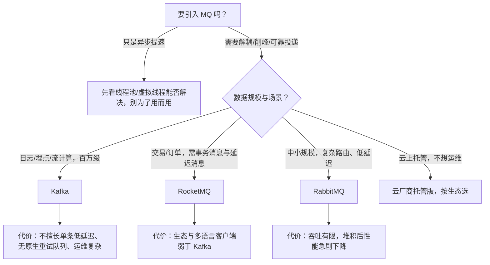
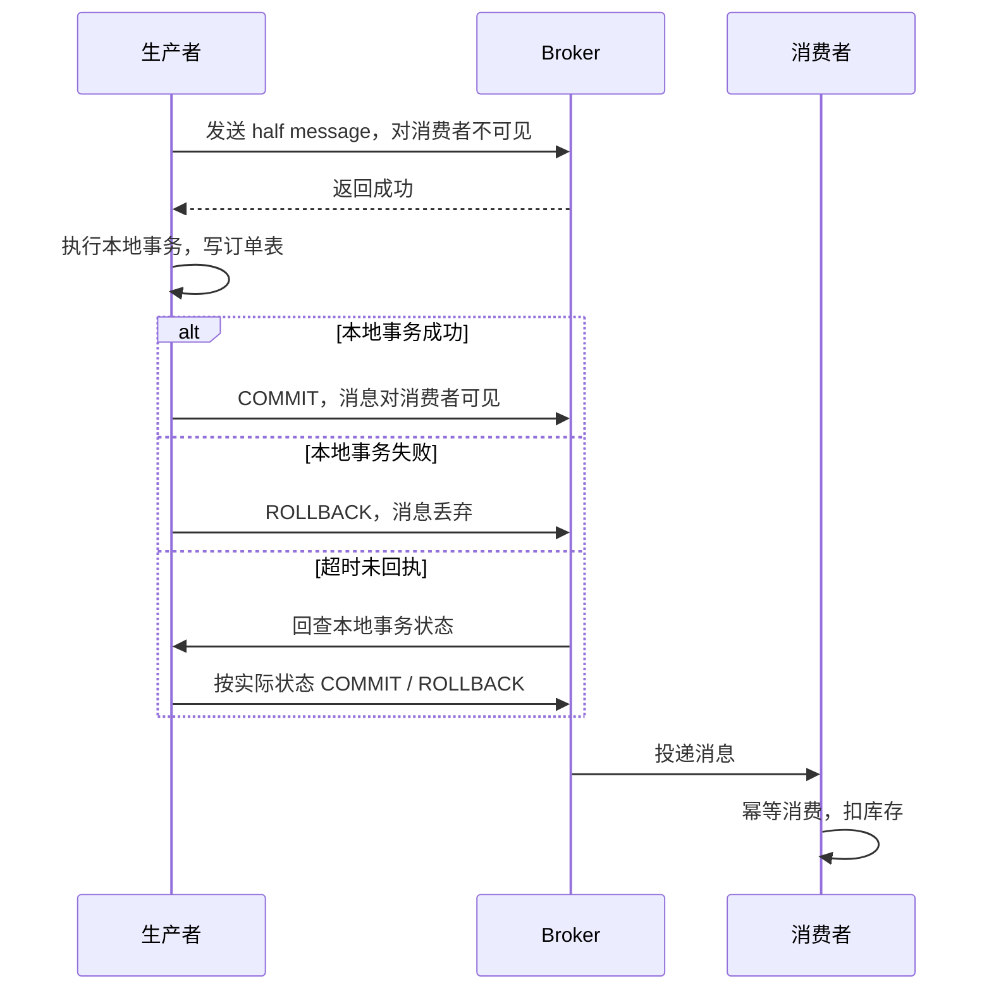

# 消息中间件选型与高可靠投递全解

## 使用入口：先解决问题，再做验证

异步解耦并在失败、重复和积压时保持业务可恢复。

**先做基本操作**：先跑通生产消费，设置消息标识、确认与重试，验证重复消息和下游故障，再讲协议保证。初次学习可先完成[本模块基础实践](/doc/Java/Java语言基础与日常开发)。

**再逐步深入**：基本 API 与输入输出 → 常见失败和使用边界 → 场景排查与优化 → 本文机制分析与源码。面试先讲用途和自己的操作过程，再回答场景与原理追问。

> **一句话结论**：三款 MQ 的差异根源是**存储模型与消费模型**（Kafka 分区追加日志 / RocketMQ CommitLog + 队列索引 / RabbitMQ Exchange 路由 + 队列），不是「谁更快」；可靠性要靠「生产确认 + Broker 持久化 + 消费手动 ack + 消费幂等」四段闭环，缺一段就丢消息。

## 30 秒速览

| 维度 | Kafka | RocketMQ | RabbitMQ |
|---|---|---|---|
| 存储模型 | 分区追加日志，顺序 IO，零拷贝 | 所有消息混写 CommitLog + ConsumeQueue 索引 | Exchange→Queue，内存/磁盘队列 |
| 吞吐 | 十万~百万级 TPS（批量+压缩） | 十万级 | 万级 |
| 延迟 | ms 级（批量换吞吐） | ms 级 | 微秒~ms，最低 |
| 顺序保证 | 分区内有序（按 key 哈希） | 队列内有序（MessageQueue 选择器） | 单队列单消费者有序 |
| 事务消息 | 幂等生产者 + 事务 API（有限） | **原生 half message + 回查** | 无原生，靠本地消息表 |
| 延迟消息 | 无原生（需时间轮/外部实现） | 18 个固定等级 + 5.x 任意时间 | TTL + 死信交换机 |
| 消费模型 | 消费者组 + offset 自主提交 | 集群/广播消费 + 位点 | push/pull + ack |
| 典型场景 | 日志采集、流计算、大数据管道 | 电商交易、订单、金融业务消息 | 中小规模业务解耦、复杂路由 |

## 一张图看懂消息在哪里会丢


**三个丢失点的对应解法**：

| 环节 | 丢失原因 | 正解 |
|---|---|---|
| 生产 | 默认异步/ fire-and-forget，异常被吞 | Kafka `acks=all` + `enable.idempotence=true` + 重试 + `Future.get()`；RocketMQ `send` 检查 `SendStatus.SEND_OK` + 同步刷盘；RabbitMQ publisher confirm + mandatory + Return 回调 |
| Broker | 只写 Page Cache 就返回，宕机丢数据 | Kafka `replication.factor>=3`、`min.insync.replicas=2`、`unclean.leader.election.enable=false`；RocketMQ 同步刷盘 `flushDiskType=SYNC_FLUSH` + 主从同步复制 |
| 消费 | 拉取后自动提交 offset，业务还没处理完就崩 | 关闭自动提交，业务成功后再 `commitSync`；RabbitMQ 手动 `basicAck`，失败 `basicNack(requeue)` |

> **必须承认的事实**：前三个环节做到极致，也只能保证「至少一次投递」，重复消费无法消灭。所以**消费端幂等是第 4 段闭环**，必须做（唯一键 / 状态机 / 去重表 / Redis SETNX + 业务主键），详见 [幂等性设计与重复请求治理](/doc/SystemDesign/幂等性设计与重复请求治理)。

## 二、选型决策树



面试高分关键是**说出代价**：「我们选 Kafka 是因为日志管道吞吐优先，代价是单条消息延迟不如 RabbitMQ、且没有原生的延迟消息与重试队列，订单超时关闭另用 [TTL + 死信队列](/doc/Java/MQ消息队列与延迟任务实战) 实现」。

## 三、顺序消息：只能保证「局部有序」

| 产品 | 实现方式 | 关键限制 |
|---|---|---|
| Kafka | `key` 相同 → 同一 Partition → 单线程消费 | `max.in.flight.requests.per.connection` 需配合幂等；分区数变更会打乱映射 |
| RocketMQ | `MessageQueueSelector` 按业务 id 选队列 | 消费端需 `MessageListenerOrderly`（加锁单队列单线程） |
| RabbitMQ | 单 Queue 单 Consumer，且 `prefetch=1` | 无法横向扩展，吞吐最低 |

```java
// RocketMQ：同一订单的所有消息进同一队列，保证订单维度有序
producer.send(msg, (mqs, arg) -> {
    long orderId = (Long) arg;
    int idx = (int) (orderId % mqs.size());   // 固定哈希，不要取随机数
    return mqs.get(idx);
}, orderId);
```

**两个必答坑**：① 消费失败会**阻塞整个队列**（顺序消费不能跳过），所以要用「失败重试 N 次 → 进死信队列 + 告警人工处理」，绝不能无限重试；② 全局有序只能靠单分区单消费者，等于放弃吞吐，业务上几乎总要接受按业务键局部有序。

## 四、事务消息与本地消息表（分布式事务最终一致）



RocketMQ 原生支持这套流程；Kafka/RabbitMQ 常用**本地消息表**替代：业务数据与消息记录在同一本地事务落库 → 定时任务扫描未发送记录补投 → 消费端幂等。代价是多一次扫表与延迟，好处是不依赖特定 MQ 特性。

> 易错点：事务消息保证的是「本地事务与消息投递的一致性」，**不保证消费方事务成功**，消费失败仍要靠重试 + 死信 + 对账兜底。

## 五、消息积压：定位比扩容更急

```bash
# Kafka 查看消费滞后
kafka-consumer-groups.sh --bootstrap-server localhost:9092 --describe --group order-group
# 关注 LAG = LOG-END-OFFSET - CURRENT-OFFSET 及其增长速率
```

| 根因 | 判断依据 | 处理 |
|---|---|---|
| 消费逻辑慢（每条查库/调外部接口） | 单条耗时高，CPU 不高 | 批量查、加缓存、并行化，先优化单条耗时 |
| 消费并发不足 | 分区数少、消费者实例少 | 扩分区 + 加实例（**实例数 ≤ 分区数**，超过部分空转） |
| 上游突发流量 | LAG 快速上升后趋稳 | 临时扩容 + 限流 + 降级非关键消费者 |
| 消费线程卡死/死锁 | LAG 不降，实例 CPU 异常 | 打线程栈，重启实例，检查锁与连接池 |
| 某条毒消息反复重试 | 位点不动、错误日志同一条 | 重试 N 次后转死信队列，跳过继续消费 |

**应急三板斧**：① 扩容消费者与分区（注意分区只能增不能减，且增分区会破坏 key→分区映射）；② 临时把积压消息转储到新 topic 由「快消费者」批量处理；③ 关闭非核心消费者、降级日志等级，把资源让给核心链路。根治要靠**积压告警（LAG 阈值 + 增长率）**而不是事后救火。

## 六、重试、死信与延迟消息

| 机制 | 设计要点 |
|---|---|
| 重试队列 | 指数退避（1s/5s/30s/2min…），避免立即重试打垮下游；RocketMQ `%RETRY%group` 主题天然支持 |
| 死信队列 | 超过最大重试次数进 `%DLQ%`，带原始消息、失败原因、时间，必须配告警与人工重放入口 |
| 延迟消息 | RocketMQ 固定等级（5.x 支持任意时间，基于时间轮）；RabbitMQ TTL + DLX（已有实战）；Kafka 需自建时间轮或分层 topic |
| 幂等 | 用业务主键做唯一索引，重放死信消息不会重复扣款（详见幂等篇） |

> 反模式：把重试间隔全设成 1s、最大次数设成 Integer.MAX_VALUE——下游一挂，重试风暴会直接把 MQ 和数据库一起打爆。

## 七、生产避坑清单

| 现象 | 根因 | 处理 |
|---|---|---|
| 消息偶发丢失 | 用了 `acks=1` / 异步发送未检查结果 | 生产确认 + 多副本 + 同步刷盘 |
| 重复扣款 | 只做了「至少一次」，没做幂等 | 业务唯一键 + 去重表 / 状态机 |
| 顺序乱了 | 按随机哈希选队列、消费端多线程并发 | 固定业务键 + 顺序监听器 |
| 扩容消费者没效果 | 实例数超过分区数 | 先扩分区，且注意 key 映射变化 |
| 消息体巨大导致吞吐骤降 | 把大 JSON / 图片 base64 塞进 MQ | MQ 只传 id 或事件摘要，大内容放对象存储 |
| 消费卡住不报 | 无 LAG 告警、无死信监控 | 建 LAG / 重试次数 / DLQ 三条告警 |

## 八、高频追问（含高分/低分特征）

| 追问 | 高分回答要点 | 低分回答 |
|---|---|---|
| 如何保证消息 100% 不丢？ | 生产确认、Broker 刷盘+副本、手动 ack、消费幂等四段闭环，并说明只能做到至少一次 | 「开启持久化」 |
| Kafka 为什么吞吐高？ | 顺序追加写、Page Cache、零拷贝 sendfile、批量压缩、分区并行 | 「用 Scala 写的」 |
| 顺序消息怎么保证？ | 按业务键固定分区/队列 + 单线程顺序消费，代价是失败阻塞与无法全局有序 | 「设置 ordered=true」 |
| 事务消息解决什么？ | 本地事务与消息投递的原子性，half message + 回查；不保证消费方成功 | 「保证分布式事务」 |
| 积压怎么排查？ | 先算 LAG 增长率 → 区分消费慢/并发不足/毒消息 → 再扩容或分流，实例数不超分区数 | 「加机器」 |
| MQ 和线程池怎么选？ | 只需异步提速用线程池/虚拟线程；需要解耦、削峰、可靠投递、跨服务广播才上 MQ | 「都用 MQ 更专业」 |

**延伸阅读**：[Kafka 与 RocketMQ 生产级接入实战](/doc/Java/Kafka与RocketMQ生产级接入实战)（接入代码、关键参数、rebalance、运维排查）、[MQ 消息队列与延迟任务实战](/doc/Java/MQ消息队列与延迟任务实战)、[分布式定时任务与调度框架实战](/doc/Java/分布式定时任务与调度框架实战)、[幂等性设计与重复请求治理](/doc/SystemDesign/幂等性设计与重复请求治理)、[SpringCloud 微服务核心组件](/doc/Java/Spring/SpringCloud微服务核心组件与架构实战)。
