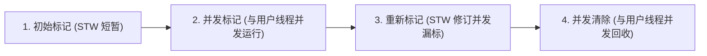

# 现代垃圾收集器深度：G1 与 ZGC 核心原理解析

垃圾收集（Garbage Collection, GC）是 Java 平台自动化内存管理的灵魂所在。随着物理服务器内存从早期的 4GB、8GB 膨胀到现代云原生的 64GB、256GB 甚至 TB 级别，垃圾收集器的架构演进始终围绕着一个终极目标：**如何在超大堆内存下，将全局停顿时间（Stop-The-World, STW）压缩到人类无感知的毫秒甚至亚毫秒级！**

---

## 1. 经典老牌收集器 CMS 的痛点与落幕

在 JDK 8 时代，**CMS（Concurrent Mark Sweep）** 曾是追求低停顿的 Web 系统的首选。



### 1.1 CMS 的两大致命缺陷：
1. **基于“标记-清除（Mark-Sweep）”算法产生大量内存碎片**：
   CMS 在清除垃圾后不会进行内存整理压缩。随着时间推移，老年代会布满离散碎片。一旦新晋升一个大对象，由于找不到连续内存空间，会直接触发最恐怖的 **`Concurrent Mode Failure`**：系统被迫停用并发收集，**降级为单线程古老的 Serial Old 收集器进行全堆 STW 整理，整个系统可能卡死数十秒之久！**
2. **并发浮动垃圾与 CPU 敏感**：
   在并发清除阶段，用户线程依然在运行并产生新的垃圾（浮动垃圾），这些垃圾本次无法被清理，必须预留部分堆空间，容易导致空间不足。

---

## 2. G1（Garbage-First）收集器：化整为零的 Region 时代

从 JDK 9 开始，**G1 成为官方默认的垃圾收集器**。G1 彻底打破了“物理上连续的新生代和老年代”传统划分格局。

### 2.1 核心思想：全堆 Region 化与动态角色分配
- G1 将整个 Java 堆内存，**均匀切分为约 2048 个大小恒定（1MB ~ 32MB，必须是 2 的幂）的独立小格子 —— Region**。
- 每个 Region 的角色不是写死的，而是根据需要动态扮演：
  - **Eden Region**（新生代）
  - **Survivor Region**（幸存区）
  - **Old Region**（老年代）
  - **Humongous Region**（大对象区）：专门存放超过半个 Region 大小的超大对象。

```text
G1 堆内存 Region 离散分布全景图：
┌────┬────┬────┬────┬────┬────┬────┬────┐
│ E  │ O  │ E  │ S  │ O  │ H  │ E  │ 空 │  (E: Eden, S: Survivor)
├────┼────┼────┼────┼────┼────┼────┼────┤
│ O  │ 空 │ E  │ O  │ S  │ H  │ O  │ E  │  (O: Old, H: Humongous)
└────┴────┴────┴────┴────┴────┴────┴────┘
```

---

### 2.2 核心数据结构：RSet（Remembered Set）与卡表（Card Table）
如果一个老年代 Region 中的对象，引用了一个新生代 Region 中的对象：在进行 Minor GC（只收集新生代）时，为了确认新生代对象是否存活，难道必须扫描全堆的老年代吗？

G1 给出的精妙解法是 **RSet（记忆集）+ Card Table（卡表）**：
- **卡表（Card Table）**：将每个 Region 划分为若干个 512 字节的“卡页（Card Page）”。
- **RSet（Remembered Set）**：**“谁引用了我”的反向记录表**。每个 Region 拥有自己独立的 RSet。
- **工作机制**：当老年代对象修改指针引用了一个新生代对象时，JVM 通过**写屏障（Write Barrier）**拦截该动作，并在对应新生代 Region 的 RSet 中记录下“某老年代 Region 的某张卡页引用了我”。
- **收益**：GC 扫描时，**只需扫描当前待收集 Region 的 RSet**，即可准确得到所有跨代引用的根节点，完全杜绝了全堆扫描！

---

### 2.3 Mixed GC（混合收集）与“Garbage-First”的真谛
G1 不仅有收集全部新生代的 Young GC，更有独创的 **Mixed GC（混合收集）**：
- **价值判定模型**：G1 会在后台持续跟踪统计每个 Region 的垃圾回收价值（回收该 Region 能释放多少空闲空间、以及需要花费多长的 STW 时间）。
- **软性实时停顿预测（`-XX:MaxGCPauseMillis`，默认 200ms）**：
  在触发 Mixed GC 时，G1 会**优先选择垃圾最多、回收收益最大的那一部分 Old Region**，配合新生代一起回收（这就是 Garbage-First 名字的由来！）。
- **算法优势**：G1 内部基于**“标记-整理（Mark-Compact）”**和**“复制（Copying）”**算法，将存活对象拷贝到空 Region 中，**彻底消灭了内存碎片**！

---

## 3. ZGC：新一代亚毫秒级停顿革命（JDK 11+ / 21 生产就绪）

如果说 G1 的停顿时间在 100~200ms 级别，那么 **ZGC（Z Garbage Collector）** 则是将垃圾收集的停顿时间直接拉到了 **亚毫秒级（$< 1\text{ms}$）**！

更具颠覆性的是：**ZGC 的 STW 停顿时间与堆内存大小完全无关！无论是 8GB 堆还是 16TB 超大堆，STW 停顿均严格控制在 1 毫秒以内！**

---

### 3.1 ZGC 核心黑科技一：着色指针（Colored Pointers）
在传统垃圾收集器中，对象的 GC 标记信息是保存在对象头中的 Mark Word 里的。
而 ZGC 突破性地**将 GC 元数据直接标记在“64 位对象的内存引用指针本身”上**！

```text
64 位虚拟地址指针内部结构 (ZGC):
┌───────────┬─────────────┬──────────────────────────────────────────────┐
│ 16 bit    │ 4 bit: 颜色位│ 44 bit: 真正物理内存寻址空间 (可支持最大 16TB 堆!)│
│ unused    │ Mark0,Mark1 │                                              │
│ (高位固定0)│ Remapped    │                                              │
└───────────┴─────────────┴──────────────────────────────────────────────┘
```
- **核心价值**：
  直接检查指针的颜色标记，就能瞬间知道该对象是否被标记存活、是否已经被移动到新位置，无需再去读取对象头，极大提升了 CPU 缓存效率。

---

### 3.2 ZGC 核心黑科技二：读屏障（Read Barrier）与自愈机制（Self-Healing）
在传统 GC 中，将存活对象复制移动到新位置（Compact 阶段）是必须全局 STW 暂停用户线程的，否则用户线程拿旧指针访问会发生内存错乱。

ZGC 实现了震撼的 **并发重定位（Concurrent Relocate）**：
1. 垃圾收集线程可以**一边并发移动对象到新内存页，用户线程一边继续正常执行读写**！
2. **读屏障拦截**：当用户线程尝试通过指针读取一个对象时，底层触发极其轻量（仅几条汇编指令）的**读屏障**；
3. 如果读屏障发现该指针的颜色标记为“尚未更新，对象已被移动到新地址”：
   - 读屏障会立刻在转发转发表中查询该对象的新地址；
   - **自愈机制（Self-Healing）**：**在向用户返回新对象引用的同时，顺手直接把原指针变量的地址原子纠正为新地址！**
   - 下一次任何线程再次访问该指针时，由于已经被自愈修复，读屏障判定通过，直接光速返回，开销归零！

---

## 4. 现代企业级垃圾收集器精准选型矩阵

| 场景与指标诉求 | 推荐垃圾收集器 | 核心优势 |
|:---|:---|:---|
| **中小堆内存（< 4GB ~ 8GB）、传统微服务** | **G1 GC** | 成熟稳定、兼顾高吞吐与较低停顿（百毫秒级）、内存占用紧凑 |
| **超大堆内存（16GB ~ 数百 GB）、海量并发缓存** | **ZGC** | 亚毫秒级极限低停顿、无碎片、彻底消除长 STW 导致的超时掉线 |
| **单核小容器微服务、纯跑批批处理（追求极限吞吐）** | **Parallel Scavenge + Parallel Old** | 吞吐量之王，单次专注计算，不关心停顿时间 |
