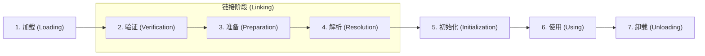
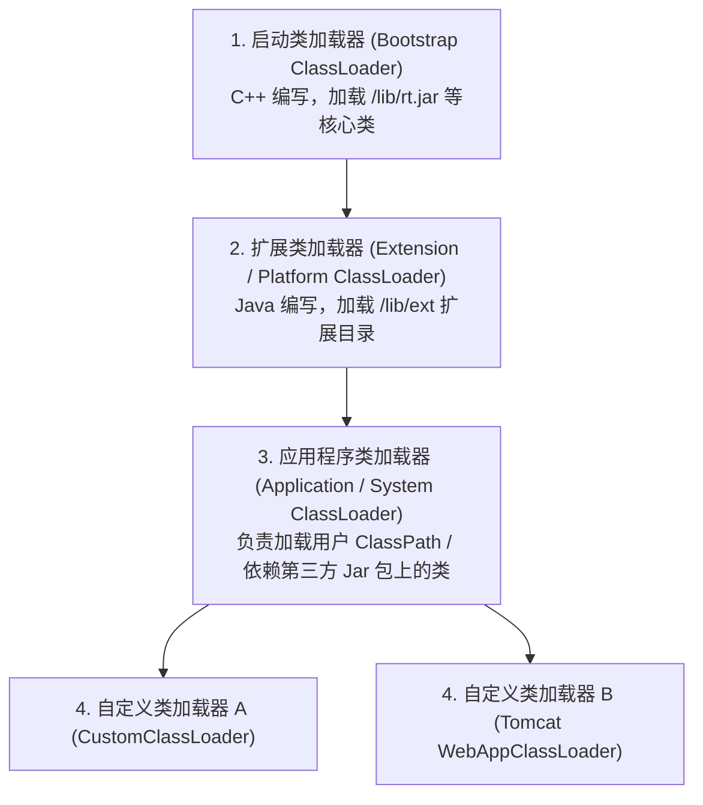

# 类加载机制与破坏双亲委派 3 大经典场景

Java 语言的“动态性”很大程度上归功于其运行时的 **类加载机制（Class Loading）**。代码在编译后生成的 `.class` 二进制字节码，并不是在系统启动时一次性全部塞入内存，而是在真正被使用时由类加载器动态载入、链接并初始化的。

而在社招面试中，“准备阶段与初始化阶段的区别是什么？双亲委派是如何保护核心 Java 类的？Tomcat 为什么必须打破双亲委派？它是如何做到不同 WebApp 之间的类隔离的？”是考察 JVM 深度的标配题目。

---

## 1. 类加载的完整生命周期 7 大阶段



### 1.1 关键阶段核心细节：

#### 准备阶段（Preparation）vs 初始化阶段（Initialization）
这是最容易被面试官拿来设坑的知识点：
```java
public static int value = 123;
public static final int CONST_VALUE = 456;
```
- **在准备阶段**：
  - 虚拟机只为类变量（`static` 修饰的变量）在方法区/元空间开辟内存，并赋予 **类型的默认零值**！
  - 此时 `value` 的值是 **`0`**，而不是 123！
  - **特例**：若包含 `final` 修饰（编译期常量），准备阶段就会直接根据 `ConstantValue` 属性赋予真实初值，因此 `CONST_VALUE` 在此时即为 **`456`**。
- **在初始化阶段**：
  - 真正开始执行类中编写的 Java 程序代码。
  - 编译器在此阶段会自动生成 **`<clinit>()` 类构造器方法**，将所有静态变量的赋值动作和静态代码块（`static {}`）按代码顺序合并执行。此时 `value` 才真正被赋值为 **`123`**。
  - **JVM 底层保障**：虚拟机会在底层对 `<clinit>()` 加锁同步，确保在多线程并发环境下，同一个类只会被一个线程成功执行一次初始化。

---

## 2. 四大类加载器与双亲委派模型（Parents Delegation Model）

JVM 默认存在一个具有层级结构（Parent-Child 关系）的类加载器体系：



### 2.1 双亲委派模型的工作原理
当一个类加载器收到类加载请求时：
1. 它**绝不会自己首先去尝试加载**该类，而是把这个请求**层层无条件向上委派给父类加载器**；
2. 每一个层次的类加载器都是如此，因此所有的加载请求最终都会汇聚到最顶层的 **启动类加载器（Bootstrap ClassLoader）**；
3. 只有当父加载器在其搜索范围内**反馈无法完成加载（抛出 `ClassNotFoundException`）** 时，子加载器才会尝试自己去本地磁盘查找并加载。

### 2.2 为什么需要双亲委派？
- **防御核心类被篡改与伪造**：
  如果黑客在自己的项目中自定义了一个全限定名为 `java.lang.String` 的类，里面植入了恶意后门代码；
  当系统尝试加载时，由于双亲委派，加载请求直接上缴给最顶层的 Bootstrap ClassLoader，系统只会加载 JDK 官方原生的 `String.class`，黑客编写的假类永远没有机会被载入，**筑牢了 JVM 的底层安全沙箱防线**！
- **保证类在 JVM 内部的全局唯一性**：
  在 JVM 判定中，两个类“是否相等”，**不仅类全名必须相同，且加载它们的类加载器必须是同一个**！双亲委派保证了所有基础类在各个代码路径中被唯一定义。

---

## 3. 核心深水区：破坏双亲委派的 3 大经典历史场景

在技术演进中，双亲委派虽然安全，但在某些高度动态化、容器化的场景下成为了束缚，被业界主动打破：

### 3.1 场景一：SPI 服务发现与线程上下文类加载器（TCCL）
- **矛盾冲突**：
  JDK 核心包中的 `java.sql.DriverManager` 位于 `rt.jar` 中，由顶层的 **Bootstrap ClassLoader** 加载。而第三方的数据库驱动实现类（如 MySQL 驱动）位于用户的 ClassPath 中。
- **打破机制**：
  Bootstrap 无法向下委派加载用户类。为此 Java 引入了 **线程上下文类加载器（Thread Context ClassLoader, TCCL）**：
  `DriverManager` 通过 `Thread.currentThread().getContextClassLoader()` 拿到应用类加载器（AppClassLoader），**逆向向下**把用户实现类加载进 JVM，打破了双亲委派严格自底向上的约束。

---

### 3.2 场景二：Tomcat 容器类隔离与热部署（最核心实战）

作为一个支持同时部署多个不同 Web 应用程序的 Servlet 容器，Tomcat 面临着极其严苛的隔离诉求：
1. **隔离性**：WebApp 1 依赖 Spring 4.0，WebApp 2 依赖 Spring 5.0，两者的类名完全相同。Tomcat 必须保证它们在同一个 JVM 进程中互不干扰、各自独立加载！
2. **共享性**：Tomcat 自身的服务器基础类必须与应用程序隔离，且不同应用之间的公共类库可以被共享。
3. **热加载（HotSwap）**：修改了某个 JSP 或 Class，只需单独重新创建对应的类加载器重新加载，无需重启整个 Tomcat 进程。

#### Tomcat 打破双亲委派的自定义类加载树：
```text
               Bootstrap ClassLoader
                         ▲
                         │
               System ClassLoader (Tomcat 启动类)
                         ▲
                         │
               Common ClassLoader (共享类库)
                    ▲          ▲
          ┌─────────┘          └─────────┐
          │                              │
WebAppClassLoader 1            WebAppClassLoader 2
(针对应用 1: WEB-INF/classes)    (针对应用 2: WEB-INF/classes)
```

- **打破规则的实现源码**：
  在 Tomcat 的 `WebAppClassLoader.loadClass()` 中，**改变了默认的委派优先级**：
  1. 先查本地缓存和 JVM 系统核心类（防止伪造 String）；
  2. **核心打破点**：**它首先尝试在自己应用的 `/WEB-INF/classes` 和 `/WEB-INF/lib` 中自己加载目标类！自己找不到时，才向上传递委派给 CommonClassLoader！**
  - **效果**：不同 WebApp 的 `WebAppClassLoader` 互不相通，各自加载属于自己版本的 Spring，彻底实现了**容器内多应用的物理版本隔离**！

---

### 3.3 场景三：OSGi 与热插拔模块化规范
在 OSGi 架构中，类加载器不再是一棵层级树，而是一个**错综复杂的网状依赖图（Mesh）**。当需要加载类时，直接沿着 Bundle 之间的导出与导入声明网络跨节点跳转查找，实现了真正的热插拔热部署。
