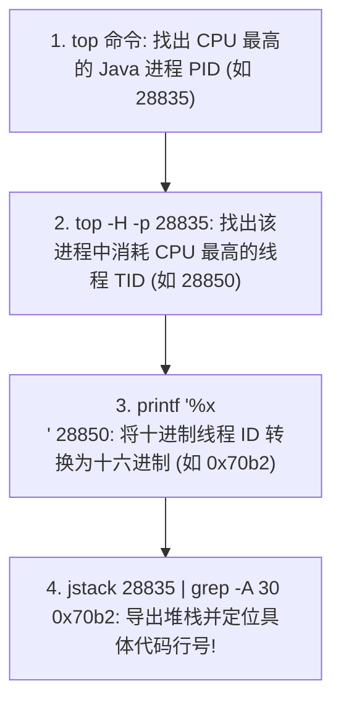

# 线上 CPU 100% 与 OOM 疑难故障排查与 Arthas 实战

在社招面试中，“请讲一次你在生产环境中排查并解决的线上疑难故障？”是考察候选人真实实战经验的“试金石”问题。回答如果只是泛泛而谈“重启一下就好了”，直接失去竞争力。

本篇手把手带你掌握两大最经典线上极端故障（**CPU 飙高 100%** 与 **堆内存溢出 OOM**）的标准排查 SOP，并熟练运用阿里开源的诊断核武器 —— **Arthas**。

---

## 1. 经典故障一：生产 CPU 飙高 100% 排查标准流（4 步绝杀法）

线上监控告警突然打响，某台应用服务器 CPU 使用率达到 100%，系统接口大面积超时。



### 1.1 实战步骤逐行演练：

#### 步骤 1：定位罪魁祸首进程
在终端输入 `top`，按 `P`（按 CPU 排序），发现 PID 为 **`28835`** 的 `java` 进程 CPU 占用高达 395%（占用接近 4 个核心）：
```text
  PID USER      PR  NI    VIRT    RES    SHR S  %CPU %MEM     TIME+ COMMAND
28835 app       20   0 7892120 4.120g  18432 S 395.2 26.5  12:35.80 java
```

#### 步骤 2：定位进程中最狂暴的线程
执行 `top -H -p 28835`（`-H` 代表以线程模式展示）：
```text
  PID USER      PR  NI    VIRT    RES    SHR S  %CPU %MEM     TIME+ COMMAND
28850 app       20   0 7892120 4.120g  18432 R  98.5 26.5   5:20.12 java
```
抓到导致 CPU 飙高的具体线程 ID 为 **`28850`**！

#### 步骤 3：转换为十六进制
因为在 JVM 导出的线程堆栈（jstack）中，线程 nid（Native Thread ID）是以十六进制表示的：
```bash
printf "%x\n" 28850
# 输出结果为：0x70b2
```

#### 步骤 4：精准定位源码具体行号
```bash
jstack 28835 | grep -A 30 "0x70b2"
```
终端瞬间清晰打印出故障现场的调用栈：
```text
"http-nio-8080-exec-10" #45 daemon prio=5 os_prio=0 tid=0x00007f9c2400 nid=0x70b2 runnable [0x00007f9c5a1fe000]
   java.lang.Thread.State: RUNNABLE
        at com.mall.service.OrderService.calculateDiscount(OrderService.java:185)
        at com.mall.service.OrderService.submitOrder(OrderService.java:92)
```
- **破案**：直接打开 `OrderService.java` 第 185 行，发现代码中写了一个错误的 `while (list.size() > 0)` 循环，由于移除逻辑未生效，导致线程陷入了死循环空转！

---

## 2. 经典故障二：堆内存溢出（OOM）排查与 MAT 实战

当控制台抛出 **`java.lang.OutOfMemoryError: Java heap space`** 时，说明堆内存中的有效存活对象已经超过了 `-Xmx` 限制。

### 2.1 排查三步走：
1. **抓取现场 Dump 文件**：
   依靠预先配置的启动参数 `-XX:+HeapDumpOnOutOfMemoryError`，JVM 在崩溃瞬间会自动在磁盘生成 `heapdump.hprof` 快照。
2. **下载并使用 Eclipse MAT（Memory Analyzer Tool）打开分析**。
3. **查看三大核心视图**：
   - **`Leak Suspects（内存泄漏嫌疑报告）`**：MAT 会自动分析并给出一份总结报告（例如：`Problem Suspect 1: One instance of "com.mall.common.CacheManager" loaded by ... occupies 78.5% of memory.`），直接揪出占用内存最大的嫌疑人！
   - **`Dominator Tree（支配树）`**：按对象的“保留内存大小（Retained Size）”降序排列，清晰看到到底是哪个对象及其子树吃掉了几百兆内存。
   - **`Paths from GC Roots（查找 GC Roots 引用链）`**：右键点击嫌疑大对象，选择 `Merge Shortest Paths to GC Roots -> exclude all phantom/weak/soft references`。
     - **核心目的**：顺藤摸瓜，找出到底是哪一个静态变量或存活线程，一直持有该对象的**强引用**导致其无法被垃圾收集器回收！

---

## 3. 生产诊断终极核武器：阿里开源 Arthas 核心实战

如果在生产排查时不想反复繁琐地敲 `top -H`，不想为了加一行排查日志而重启微服务，阿里巴巴开源的 **Arthas（阿尔萨斯）** 是业内第一神器。

### 3.1 极速启动接入
在服务器终端执行：
```bash
curl -O https://arthas.aliyun.com/arthas-boot.jar
java -jar arthas-boot.jar
# 终端会出现当前所有的 Java 进程列表，输入对应的数字编号即可一键 Attach 挂载进入 Arthas 终端！
```

---

### 3.2 生产最高频必杀核心命令：

#### 1. `thread -n 3`（一步绝杀 CPU 100%）
根本不需要自己算十六进制、敲 grep！在 Arthas 终端输入：
```bash
thread -n 3
```
- **效果**：直接在一秒内打印出当前整个 JVM 中**消耗 CPU 最高的 Top 3 线程的完整源码堆栈**！

#### 2. `dashboard`（全景监控大屏）
输入 `dashboard`，每 5 秒刷新一次全局大屏：所有线程状态、各代内存占用比率、GC 频次与耗时、系统环境变量尽收眼底。

#### 3. `jad`（反编译线上运行的字节码）
```bash
jad com.mall.service.OrderService
```
直接在终端将 JVM 内存中加载的真实 `.class` 反编译为可读的 Java 源码。常用于确认：“我刚才提交的代码到底发上去生效了没有？配置的常量到底是多少？”

#### 4. `watch`（无侵入动态抓包方法入参和返回值）
在线上遇到偶发 Bug 时，无需修改代码重新发版：
```bash
# 实时捕获 submitOrder 方法被调用时的入参 (params)、返回值 (returnObj) 与抛出的异常 (throwExp)
watch com.mall.service.OrderService submitOrder "{params, returnObj, throwExp}" -x 3
```
只要有用户发起请求，终端立刻格式化打印出真实的入参对象和执行结果，直接把生产环境变成带有断点观察能力的本地 Debug 环境！

#### 5. `trace`（方法内部链路耗时逐行追踪）
某个接口偶尔耗时 3 秒，但不知道是第几行代码慢：
```bash
trace com.mall.service.OrderService submitOrder '#cost > 500'
```
`- '#cost > 500'`：过滤只打印耗时超过 500ms 的慢调用。
- Arthas 会将 `submitOrder` 内部调用的每个子方法及其具体执行耗时逐行展开为树形图，**精准标注哪一行耗时 2800ms（如某个第三方 HTTP 请求或慢 SQL）**，瞬间锁定性能瓶颈！
