# 🚀 高并发大数据与线上疑难故障排查实战

## 使用入口：先解决问题，再做验证

按证据定界导出、热点、积压与 OOM。

**先做基本操作**：先完成普通查询导出和有限任务处理，测延迟、内存与资源，再依据瓶颈升级而不是直接堆组件。初次学习可先完成[本模块基础实践](/doc/Java/Java语言基础与日常开发)。

**再逐步深入**：基本 API 与输入输出 → 常见失败和使用边界 → 场景排查与优化 → 本文机制分析与源码。面试先讲用途和自己的操作过程，再回答场景与原理追问。

> 本文针对生产环境中四大极其残酷的典型场景——千万级数据导出超时、高并发高频更新热点排名系统设计、MQ 消息积压与下游异动容灾、复杂微服务拓扑下 OOM 快速定界与根因排查，展开全方位的架构级解法与底层真理归纳。

---

## 目录导航

- [一、千万级数据表条件导出超时（代理超时）全链路优化](#一、千万级数据表条件导出超时-代理超时-全链路优化)
  - [1. 痛点深度剖析与瓶颈矩阵](#_1-痛点深度剖析与瓶颈矩阵)
  - [2. 整体解法架构：全异步任务化解耦](#_2-整体解法架构-全异步任务化解耦)
  - [3. 数据库读取层：游标流式拉取与主键寻址](#_3-数据库读取层-游标流式拉取与主键寻址)
  - [4. 文件生成与压缩：EasyExcel 与 CSV 内存极致压缩](#_4-文件生成与压缩-easyexcel-与-csv-内存极致压缩)
  - [5. 并发分片加速与落地方案](#_5-并发分片加速与落地方案)
- [二、超大用户量高频更新热点数据排名架构设计](#二、超大用户量高频更新热点数据排名架构设计)
  - [1. 核心挑战与单点瓶颈](#_1-核心挑战与单点瓶颈)
  - [2. 架构设计全景图：多级缓冲与分片聚合](#_2-架构设计全景图-多级缓冲与分片聚合)
  - [3. 写入链路：本地内存聚合削峰与分片打散](#_3-写入链路-本地内存聚合削峰与分片打散)
  - [4. 读取链路：Top N 截断与本地多级缓存](#_4-读取链路-top-n-截断与本地多级缓存)
  - [5. 容灾与降级策略](#_5-容灾与降级策略)
- [三、MQ 数据堆积处理与下游异常系统容灾](#三、mq-数据堆积处理与下游异常系统容灾)
  - [1. MQ 消息积压的根因排查体系](#_1-mq-消息积压的根因排查体系)
  - [2. 紧急抢救：十倍扩容泄洪大法](#_2-紧急抢救-十倍扩容泄洪大法)
  - [3. 对接下游系统异常时的容灾四原则](#_3-对接下游系统异常时的容灾四原则)
  - [4. 指数退避重试与死信队列（DLQ）落地](#_4-指数退避重试与死信队列-dlq-落地)
- [四、复杂微服务拓扑下线上 OOM 快速定界与根因定位](#四、复杂微服务拓扑下线上-oom-快速定界与根因定位)
  - [1. 区分“案发源头”与“受害者/连带雪崩”](#_1-区分-案发源头-与-受害者-连带雪崩)
  - [2. APM 链路监控如何快速锁定故障微服务](#_2-apm-链路监控如何快速锁定故障微服务)
  - [3. 单服务 OOM 深度排查四部曲（HeapDump + MAT）](#_3-单服务-oom-深度排查四部曲-heapdump-mat)
  - [4. 常见四种 OOM 诱因与针对性解法](#_4-常见四种-oom-诱因与针对性解法)
- [五、真理归纳：后端高并发与高可用底层思维模型](#五、真理归纳-后端高并发与高可用底层思维模型)

---

## 一、千万级数据表条件导出超时（代理超时）全链路优化

### 1. 痛点深度剖析与瓶颈矩阵

用户在管理后台点击“导出符合条件的千万级订单数据”，通常会遭遇以下连环崩塌：

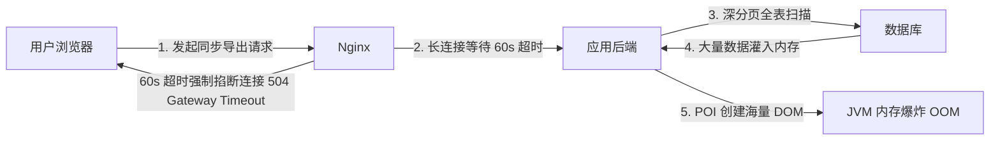

| 环节 | 故障现象 | 底层物理成因 |
| :--- | :--- | :--- |
| **接入层 (Nginx)** | 客户端收到 `504 Gateway Timeout`，连接被强行切断。 | Nginx 的 proxy_read_timeout 衡量两次读取间的等待，不是整个请求的绝对总时限；长时间没有上游输出可能触发超时。这是代理读取上游的超时，不直接杀死 Java 工作线程；后端可能继续执行，需明确取消和资源释放。 |
| **应用层 (JVM)** | 服务报 `java.lang.OutOfMemoryError: Java heap space` 甚至挂掉。 | 1. 采用 `List<Order> list = mapper.selectAll()` 一次性全量加载数据到堆内存。<br/>2. 使用原生 Apache POI（如 HSSFWorkbook / XSSFWorkbook）操作 Excel，一个单元格在内存中会膨胀为其体积的 10~20 倍，数万行即产生 GB 级垃圾。 |
| **数据库层 (MySQL)** | 数据库 CPU 飙升 100%，连接池打满，引发线上业务雪崩。 | 1. 采用传统物理分页 `LIMIT 5000000, 1000`，数据库需扫描 500 万行并丢弃，I/O 剧增。<br/>2. 长事务占用 Undo Log 无法清理，Buffer Pool 被冷数据冲刷，热点数据被淘汰。 |
| **网络 I/O 层** | 文件数十上百 GB，网络带宽占满，客户端中途网络抖动失败重来。 | 未启用流式传输，未采用高效压缩格式（如未启用 GZIP 流）。 |

---

### 2. 整体解法架构：全异步任务化解耦

**核心第一法则**：**千万级数据导出绝不能走同步 HTTP 请求！必须全链路异步化与任务化。**

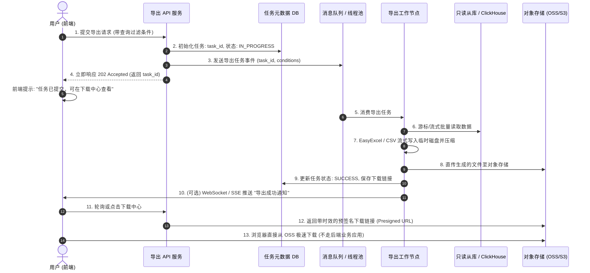

---

### 3. 数据库读取层：游标流式拉取与主键寻址

#### ① 坚决摒弃 `LIMIT offset, size`，改用“主键游标寻址法”（Seek Method）
* **错误写法**：
  ```sql
  -- 随着 offset 增大，查询耗时呈线性甚至指数级上升，严重拖垮数据库
  SELECT * FROM orders WHERE create_time >= '2026-01-01' ORDER BY id ASC LIMIT 10000000, 5000;
  ```
* **正确优化写法**：
  ```sql
  -- 记录上一批次的最大主键 ID，直接利用聚簇索引树精确定位
  SELECT * FROM orders 
  WHERE id > #{lastMaxId} AND create_time >= '2026-01-01' 
  ORDER BY id ASC 
  LIMIT 5000;
  ```

#### ② 采用流式查询（Streaming Query），避免应用堆内存积压
如果使用 MyBatis，默认会将查询结果全部映射为 List 后一次性返回。千万级数据会瞬间撑爆应用内存。
必须使用 MyBatis 的 **`ResultHandler`** 或 **`Cursor`** 游标：

```java
// 1. Mapper 声明为 Cursor 游标流式返回
@Select("SELECT * FROM orders WHERE create_time >= #{startTime}")
@Options(resultSetType = ResultSetType.FORWARD_ONLY, fetchSize = 1000)
Cursor<Order> streamOrderByCondition(@Param("startTime") String startTime);

// 2. Service 层流式消费，处理一行丢弃一行，内存占用近乎恒定
@Transactional(readOnly = true)
public void exportStreamData(String startTime, OutputStream outputStream) {
    try (Cursor<Order> cursor = orderMapper.streamOrderByCondition(startTime)) {
        cursor.forEach(order -> {
            // 流式逐行写入 CSV 或 EasyExcel
            writeRow(order);
        });
    }
}
```

> **底层参数细节**：MySQL 驱动底层必须设置 `statement.setFetchSize(Integer.MIN_VALUE)`，告诉 MySQL JDBC 驱动不要在本地客户端缓存全部结果集，而是每次从服务端 TCP 缓存流式拉取一行（或设置 `useCursorFetch=true` 与合适 fetchSize），实现真正的 $O(1)$ 客户端内存占用。

#### ③ 读写分离与引擎选型
* 严禁在**主库（Master OLTP 库）** 上执行千万级全表大查询！
* **方案 A**：路由至**只读从库（Read-Only Slave）**，并在从库上调大 `net_write_timeout`。
* **方案 B**：将历史数据或宽表同步至**列式数据库（ClickHouse / StarRocks / Doris）**，列存对一些分析扫描有优势，收益要按查询、数据、硬件和一致性要求实测，不能给通用倍数。

---

### 4. 文件生成与压缩：EasyExcel 与 CSV 内存极致压缩

#### ① 格式选型：CSV + GZIP 是大数据导出的王者
* 为什么不用 Excel（.xlsx）？
  即使是最优秀的 EasyExcel，千万级数据导出为单个 Excel 文件也会面临 Office 自身的行数限制（单 Sheet 最多 1048576 行，必须拆分数十个 Sheet），且内部 XML 压缩仍有额外 CPU 与内存损耗。
* **最佳实践：导出为纯文本 CSV 格式**：
  1. CSV 没有行数上限，格式极其扁平。
  2. 采用字符流追加写入（`BufferedWriter`），零对象额外开销。
  3. **边写边挂载 `GZIPOutputStream` 进行动态流式压缩**：千兆文本经过 GZIP 压缩后通常体积缩减 **80%~90%**，极大节省网络带宽与磁盘空间。

#### ② 若业务强制要求 Excel：使用 Alibaba EasyExcel
EasyExcel 底层重写了 POI 对 07 版 XML 的解析与构建，采用 **SAX 逐行写入模型**，一行数据写入磁盘后立刻在内存中销毁引用，整个导出过程内存恒定保持在几十 MB 之间，彻底避免 OOM。

---

### 5. 并发分片加速与落地方案

单线程处理 1000 万条数据，即使数据库和内存不崩，磁盘 I/O 和计算仍需较长时间。
可以利用**分片并发（Parallel Sharding）**技术：

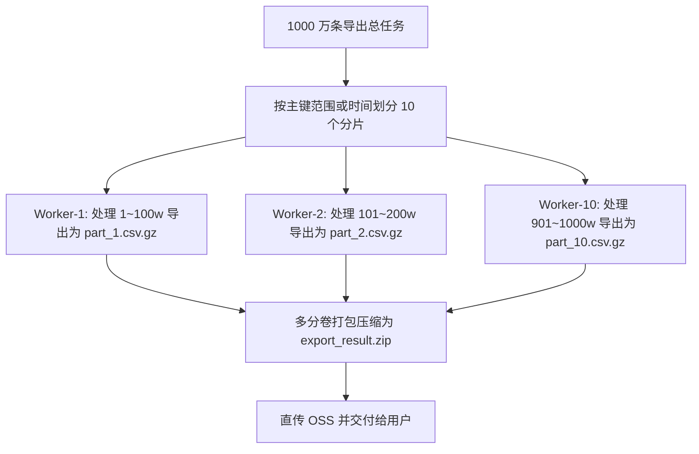

* **效率提升**：10 线程并发执行，总体处理时间由 10 分钟压缩至 1 分钟以内！

---

## 二、超大用户量高频更新热点数据排名架构设计

### 1. 核心挑战与单点瓶颈

在游戏天梯榜、直播间打赏榜、电商大促带货榜或实时热搜榜中，常见特征是：**上千万活跃用户、写操作极度密集（每秒数万甚至数十万次积分更新）、读操作极其频繁（亿级查看）**。

* **单 Redis 架构死穴**：
  - Redis 是单线程处理命令模型（虽然 6.0 引入多线程 I/O，但核心命令执行仍是单线程）。
  - 若所有更新都直接执行 `ZINCRBY total_rank score userId`，这个全局 Key 会成为**超级大热点（Hotkey）**，单分片 CPU 瞬间 100%，引发大量网络超时。
  - 频繁执行 `ZREVRANGE total_rank 0 99 WITHSCORES`，在密集写入时会产生锁与内存复制竞争，导致延迟陡增。

---

### 2. 架构设计全景图：多级缓冲与分片聚合

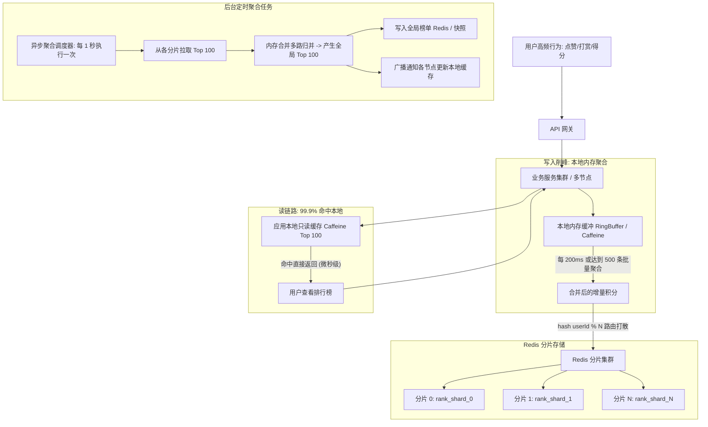

---

### 3. 写入链路：本地内存聚合削峰与分片打散

#### ① 本地内存聚合削峰（Local Batch Aggregation）
* **核心思想**：真实世界中，一个热点用户（如头部大主播或火爆商品）短时间内会被成千上万次打赏或点赞。**绝对不要让每一次打赏都直穿到 Redis！**
* **实现方案**：
  - 应用节点在本地维护一个微型聚合器（利用 `ConcurrentHashMap` 或 Disruptor 队列）。
  - 键为 `userId`，值为 `AtomicLong`（积分累计）。
  - 后台开启微批处理定时器（如每 100ms 或累积满 1000 条），将合并后的最终增量积分一次性通过 Redis **Pipeline** 或批量命令提交：
    ```java
    // 聚合后 1000 次操作合并为 1 次批量提交，写 QPS 直降 99%!
    pipeline.zincrby("rank_shard_1", aggregatedScore, userId);
    ```

#### ② 分片打散机制（Split Keys）
* 若单个榜单用户量过大，将一个总榜按 `hash(userId) % BucketNum` 拆分为 $K$ 个子榜单（如 `rank_shard_0` ~ `rank_shard_9`）。
* 每个子榜单均匀分布在 Redis 集群的不同 Master 节点上，将原本单节点的 CPU 与网络带宽压力平摊到整个集群。

---

### 4. 读取链路：Top N 截断与本地多级缓存

* **动静分离哲学**：**99% 的用户只看前 100 名（Top 100）**，根本没人去翻第 500 万名的数据！
* **本地多级缓存落地**：
  1. 后台定时任务（每 1 秒）从 Redis 中获取各分片的 Top 100，使用**优先队列/多路归并排序（Merge Sort）**计算出全局总榜的 Top 100。
  2. 将计算好的全局 Top 100 数据序列化后直接推送到**所有业务节点的本地内存（Caffeine 缓存）**。
  3. 用户进入页面查询排行榜时，**100% 命中应用节点本地内存**，无任何网络 I/O，单机 QPS 可支撑数十万，耗时在 0.1ms 内。
* **用户查询自身排名**：
  - 如果自身在 Top 100 内，本地缓存直接带出。
  - 如果自身不在 Top 100，根据用户 ID 算出所属分片，单独去该分片查 `ZSCORE` 算出一个估算区间展示（如“9999+”或准实时名次），避免耗费全量扫描资源。

---

### 5. 容灾与降级策略

1. **峰值限流与降级**：
   - 当 Redis 负载过高时，关闭 1 秒级实时更新，平滑降级为“每 1 分钟更新一次榜单”。
2. **极端宕机兜底方案**：
   - 每次定时任务计算出全局 Top 100 后，除了写入缓存，同时将 JSON 静态文件上传到 CDN / 对象存储。
   - 若 Redis 集群发生意外瘫痪，网关或应用层直接降级拉取 CDN 静态 JSON 返回，**保证页面 100% 可用、绝不报错白屏**。

---

## 三、MQ 数据堆积处理与下游异常系统容灾

### 1. MQ 消息积压的根因排查体系

当监控告警显示 MQ 积压量（Lag）从几百条飙升至几十万甚至数千万时，必须第一时间顺藤摸瓜定位瓶颈：

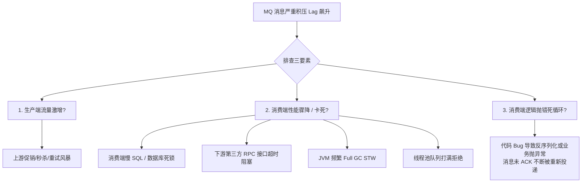

---

### 2. 紧急抢救：十倍扩容泄洪大法

如果线上积压了几千万条数据，上游还在源源不断写入，常规消费速度已经无法追赶，必须立即执行**生产级十倍扩容泄洪**：

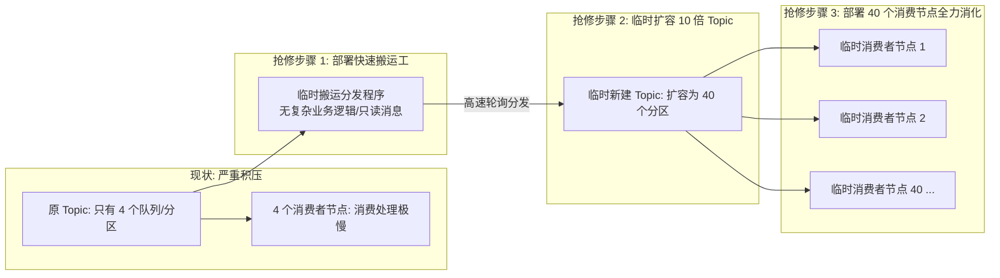

#### 实施五步法：
1. **紧急修复消费者致命 Bug**：如果消费端存在代码 Bug 导致反复报错无法 ACK，先紧急修复上线，杜绝无效重试循环。
2. **临时新建扩容 Topic**：新建一个临时 Topic，将 **Queue / Partition（分区数）直接扩容 10 到 20 倍**（如从原先的 4 个扩容到 40 个或 80 个）。
3. **上线快速搬运程序（无业务逻辑）**：编写并部署一个精简的消费者程序，**不走任何数据库和复杂 RPC 业务逻辑**，专门负责以极高速度（毫秒级拉取）把原 Topic 积压的消息批量转发写入到新建的扩容 Topic。
4. **横向扩展 10~20 倍消费者全力泄洪**：部署 40~80 个临时消费者节点，并行消费新建的临时 Topic。原本需要 10 小时消化的积压，将在 30 分钟内彻底被吃掉。
5. **平稳回切**：积压清除完毕后，下线临时程序与临时 Topic，恢复原有架构。

---

### 3. 对接下游系统异常时的容灾四原则

当你的消费端依赖外部系统（如第三方支付网关、仓储 ERP、供应商 API），而对方突然宕机、响应变慢或大面积报 500 时，必须执行以下防御四原则：

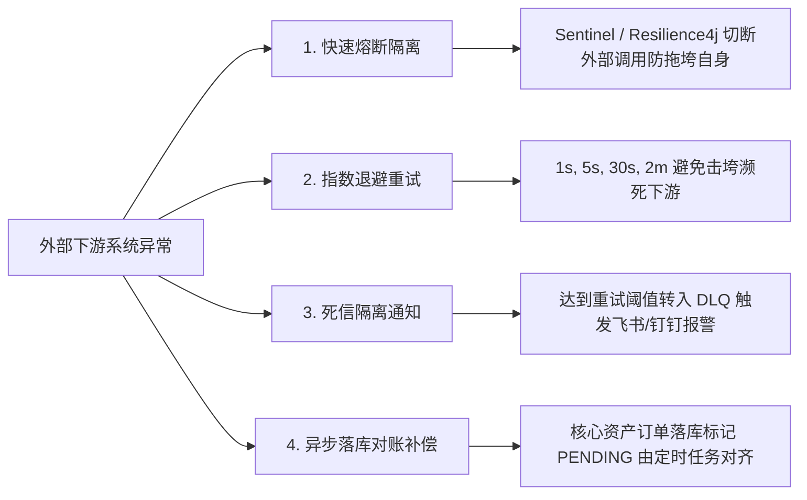

1. **快速熔断隔离（Circuit Breaker）**：
   - 使用 Sentinel 或 Resilience4j 设置熔断规则。
   - 当调用外部接口的失败率超过 50% 或平均耗时超过 2 秒，**立即触发熔断，短路后续调用**，直接执行本地降级逻辑，严防自身服务的 HTTP 连接池和线程池被活活拖死引发雪崩。
2. **指数退避重试（Exponential Backoff）**：
   - 绝不可固定死循环立即重试！下游已经快宕机了，密集的立即重试只会成为“压死骆驼的最后一根稻草”。
   - 必须采用**指数退避算法**（如间隔 1s、5s、30s、2m、10m 后重试），给下游系统自我恢复的喘息时间。
3. **死信队列（Dead Letter Queue, DLQ）隔离**：
   - 超过最大重试次数（如 3~5 次）依然失败的消息，**判定为“毒消息（Poison Message）”**。
   - 绝不能丢弃，也不能卡在原队列阻塞其他正常消息！直接转入死信队列（DLQ），并在日志中记录详细上下文，同时向运维与研发推送飞书/钉钉告警。
4. **对账与主动拉取补偿机制**：
   - 对于金融、支付、核心订单等强一致性场景，本地将该笔消息保存为 `STATUS = PENDING_RETRY`。
   - 后台启动定时任务，待下游服务恢复后，主动调用对方的**状态查询接口**进行数据对账与状态回补（以拉代推），确保最终一致性。

---

### 4. 指数退避重试与死信队列（DLQ）落地

先区分可重试故障（短暂网络/依赖不可用）和不可重试故障（非法参数/永久业务拒绝）。为可重试任务配置有限次数、指数退避、抖动和总 deadline，避免立即 requeue 形成紧密循环。

消费业务提交后再确认；失败消息保留事件 ID、原始必要上下文、错误原因、重试次数和版本，超过策略进入 DLQ 并告警。DLQ 回放需校验问题已修复、业务幂等、当前权限和状态，限制回放速度；不能把消息直接丢掉后宣称积压治理成功。

当下游持续故障时优先隔离、熔断并保留可恢复任务，扩容消费者可能进一步压垮下游。验证重复投递、事务失败、Broker/下游恢复和人工回放过程。

## 四、复杂微服务拓扑下线上 OOM 快速定界与根因定位

### 1. 区分“案发源头”与“受害者/连带雪崩”

在几百个微服务交织调用的网格中，某一个服务抛出 OOM 挂掉，**绝不能武断地认为该服务就是元凶**！微服务间极易产生“多米诺骨牌式”雪崩：

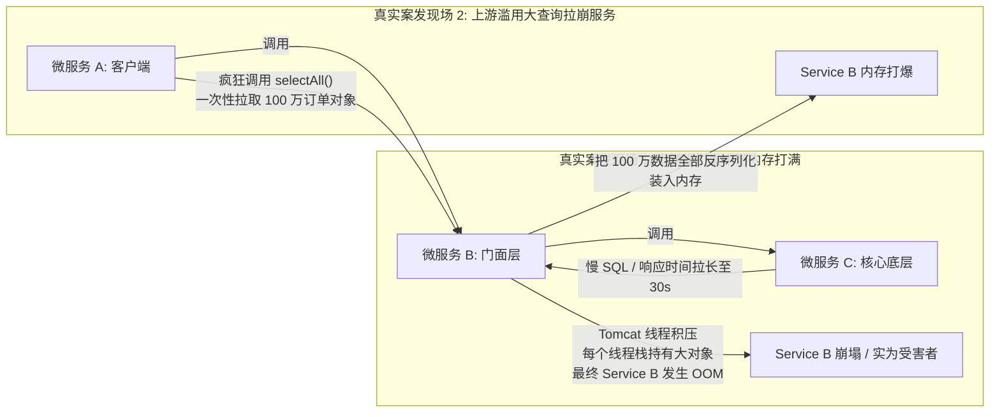

* **判定铁律**：
  - **看堆栈根源对象**：如果是内部堆积了大量 `Request/Response` 线程上下文或等待队列对象，说明是**下游慢调用拖死当前服务（当前服务是受害者）**。
  - **看数据实体内容**：如果是内存中全是一模一样的业务实体（如 50 万个 `UserOrderDTO`），说明是**上游调用方发起的不合理大查询打爆了服务**。

---

### 2. APM 链路监控如何快速锁定故障微服务

无需盲目翻看成千上万台机器日志，按以下标准观测流程在 **APM（SkyWalking / Prometheus + Grafana / ARMS）** 中快速定位：

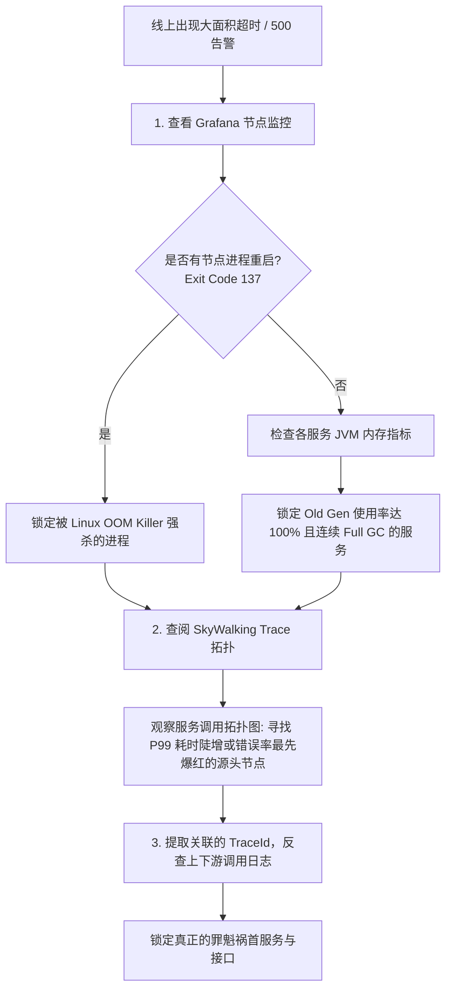

1. **Linux OOM Killer 证据**：执行 `dmesg -T | grep -i oom-killer`，如果看到 `Killed process xxx (java)`，代表容器或物理机因物理内存超限，被操作系统强制发送 `SIGKILL`（退出码 137）。
2. **JVM 指标联动**：观察 Grafana 的 JVM 看板，寻找 **老年代（Old Gen）使用率最先飙到 100%、Full GC 频率持续飙高至每分钟数十次、STW 耗时达几十秒** 的具体服务实例。
3. **分布式链路追踪（Trace ID）定界**：沿着报错请求的 `TraceId`，查看整条链路的耗时瀑布图，观察是哪个子调用（Span）最先变红并耗时极长。

---

### 3. 单服务 OOM 深度排查四部曲（HeapDump + MAT）

#### 第一步：保留现场（生产必配 JVM 启动参数）
```bash
# 遇到 OOM 自动生成内存快照 Dump 文件，绝不能让现场丢失
-XX:+HeapDumpOnOutOfMemoryError 
-XX:HeapDumpPath=/data/logs/dump/heapdump.hprof
```

#### 第二步：使用 MAT（Eclipse Memory Analyzer）分析支配树（Dominator Tree）
1. 将 `.hprof` 文件导入 **MAT**。
2. 打开 **Leak Suspects（内存泄漏疑点报告）**，MAT 会直接给出饼图并用红字标出疑似泄漏的大对象（如：“Problem Suspect 1: The thread ... occupies 85.3% of the heap”）。
3. 查看 **Dominator Tree（支配树）**：
   - 按 **Retained Heap（保留内存，即对象被回收时能释放的总内存）** 从大到小排序。
   - 找到排名第一的根对象，右键选择 **`Path to GC Roots -> exclude all phantom/weak/soft references`（排除虚弱软引用，只看强引用）**。
   - 一眼看穿是哪根“救命稻草”拉住了这个巨型对象不让 GC 回收！

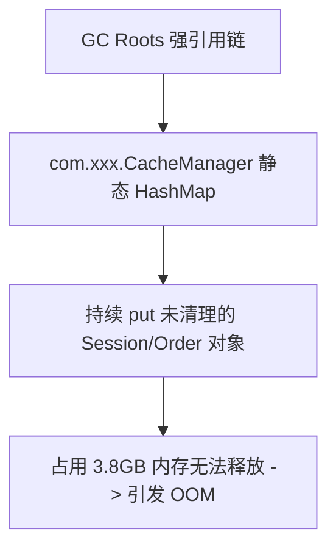

#### 第三步：Arthas 在线火线诊断（不重启排查）
若服务尚未完全瘫痪，可快速连接 Arthas：
* `dashboard`：全局查看各内存分代使用百分比与高占用线程。
* `memory`：查看当前内存分配详情。
* `thread -n 5`：打印当前占用 CPU 最高的 5 个线程调用栈，快速判断是否在执行死循环或深层递归。
* `vmtool --action getInstances --className xxx.Class --limit 10`：统计内存中某个类的实例数。

---

### 4. 常见四种 OOM 诱因与针对性解法

| OOM 异常报错 | 产生根本原因 | 生产典型案发现场 | 针对性绝杀解法 |
| :--- | :--- | :--- | :--- |
| **`java.lang.OutOfMemoryError: Java heap space`** | 堆内存耗尽，垃圾回收器使出全力依然无法腾出空间分配新对象。 | 1. 内存泄漏（`ThreadLocal` 未调用 `remove()`、静态集合无限累积）。<br/>2. 巨型对象加载（如大批量查询全表加载到内存）。 | 1. 严禁 `ThreadLocal` 跨请求残留，必须在 `finally` 中 `remove()`。<br/>2. 强制分页与流式查询。 |
| **`java.lang.OutOfMemoryError: Metaspace`** | 元空间（方法区）物理内存打满。 | 运行时利用 CGLIB、ASM、动态代理不断生成海量动态 Class 且未被回收；RPC 框架动态编译类泄漏。 | 1. 调大元空间 `-XX:MetaspaceSize=256m -XX:MaxMetaspaceSize=512m`。<br/>2. 排查动态代理生成类的类加载器是否无法被回收。 |
| **`java.lang.OutOfMemoryError: Direct buffer memory`** | 堆外内存（直接内存）耗尽。 | Netty、NIO `ByteBuffer.allocateDirect()` 分配的堆外空间未被及时释放，堆内又未触发 GC 来清理虚引用关联的堆外内存。 | 1. 显式设置 `-XX:MaxDirectMemorySize`。<br/>2. 检查 Netty ByteBuf 是否配套调用了 `ReferenceCountUtil.release()` 避免引用计数泄漏。 |
| **`java.lang.OutOfMemoryError: unable to create new native thread`** | 操作系统无法再创建新的操作系统线程。 | 线程无节制创建（如代码中 `new Thread()` 未使用线程池），或线程池最大线程数配置几万，达到 Linux `max user processes` 上限。 | 1. 严格使用线程池，限制最大核心与最大线程数。<br/>2. 调整 Linux 系统的 `ulimit -u`（最大进程/线程数限制）。 |

---

## 五、真理归纳：后端高并发与高可用底层思维模型

从千万级数据导出、热点排名、MQ 消息积压到 OOM 线上排障，所有架构技艺与排障策略最终均能收敛为**四大底层通用哲学**：

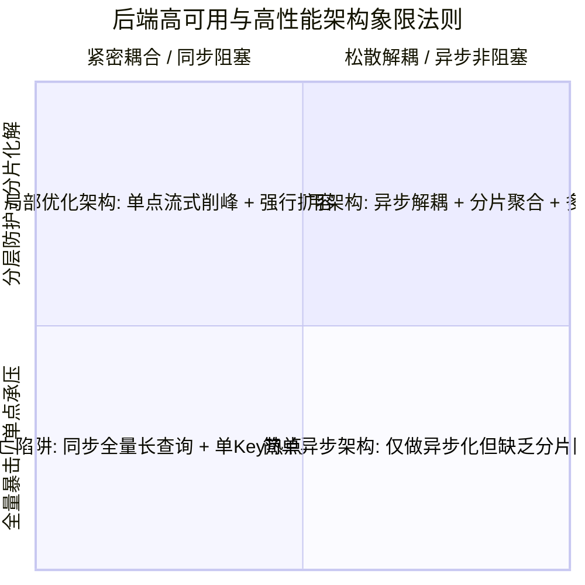

### 1. 空间换时间 vs 时间换空间
* **空间换时间**：通过多级缓存（Caffeine + Redis）、增加分片分区（Partition）、多线程并发分片拉取，用内存与硬件资源换取微秒级的极致吞吐。
* **时间换空间**：针对千万级导出，放弃在内存中全量保留对象，改用**游标流式拉取（Streaming）**与**逐行写磁盘**，用微小的执行时间延长换取稳定的恒定内存（$O(1)$ 空间占用）。

### 2. 动静分离与冷热分治
* **动静分离**：高频更新的积分（动）在本地微批聚合后刷入 Redis；静态的 Top 100 排行榜（静）推送到前端或 CDN 缓存。
* **冷热分治**：99% 的请求只访问 Top 100 榜单（热数据），老旧冷门名次按需计算；千万级导出任务路由到只读从库或列式引擎，不让冷数据冲刷 OLTP 生产核心缓存。

### 3. 同步转异步，推拉解耦
* **长耗时请求异步化**：凡是耗时超过 3 秒的操作（大数据导出、复杂报表、批量扣款），坚决不走同步 HTTP，全部转为“任务提交 $\rightarrow$ 异步执行 $\rightarrow$ 状态轮询/通知 $\rightarrow$ 直传存储”的标准异步模式。
* **推拉弹性**：MQ 削峰填谷，在下游处理能力受限时，消费端按需“拉取（Pull）”，保护下游不被冲垮。

### 4. 快速失败与有损服务（Graceful Degradation）
* **有损服务优于全盘瘫痪**：宁可给用户展示 1 分钟前延迟的排行榜静态快照，也绝不能让 Redis 被热点打垮导致整个系统报 500。
* **快速失败（Fail-Fast）**：当下游接口异常时，通过熔断器立即抛出降级结果，保护自身线程池，防止多米诺骨牌式雪崩；对反复失败的毒消息及时打入死信队列，绝不阻塞整个队列的正常流动。
