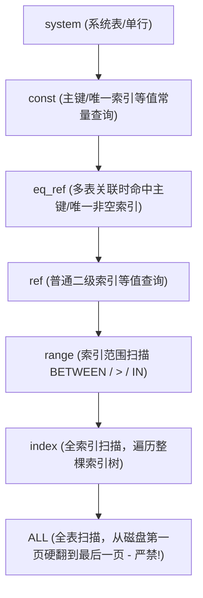

# EXPLAIN 执行计划各字段深度拆解

`EXPLAIN` 是每一位后端工程师进行 SQL 性能调优的“听诊器”。然而绝大多数人看 `EXPLAIN` 只会看一眼 `type` 是不是 `ALL`、有没有命中 `key`。

社招中高级面试要求的是：**能根据 `key_len` 精确推算出联合索引命中了前几列，能准确说出 `ref` 和 `eq_ref` 的本质差异，能彻底读懂 `Extra` 每一个标记代表的物理含义。**

---

## 1. EXPLAIN 输出全列全貌一览

在 SQL 前加上 `EXPLAIN`，会输出包含以下 12 列的执行计划表格：

```text
id | select_type | table | partitions | type | possible_keys | key | key_len | ref | rows | filtered | Extra
```

### 1.1 `id`：执行顺序的核心裁决者
- **`id` 相同**：执行顺序**由上至下**（多表关联中，排在上面的就是驱动表）。
- **`id` 不同**：如果是子查询，`id` 的序号会递增，**`id` 值越大，执行优先级越高，越先被执行**。
- **`id` 为 NULL**：代表这是一个 `UNION` 结果集的合并阶段，最后执行。

---

## 2. `type`：访问类型性能金字塔

`type` 反映了 MySQL 寻找目标记录时的访问路径，其性能从最优到最差排序如下：

$$\text{system} > \text{const} > \text{eq\_ref} > \text{ref} > \text{range} > \text{index} > \text{ALL}$$



### 详细级别剖析：
1. **`system` / `const`**：
   - 表中只有一行（system），或通过**主键/唯一索引进行等值查询**（`WHERE id = 1`）。因为记录唯一，优化器在查询开始就能将它转为一个常量。
2. **`eq_ref`**：
   - 发生在**多表关联**场景中。对于驱动表的每一行，被驱动表**通过主键或唯一非空索引进行等值匹配**。最多只返回一行匹配项，效率极高。
3. **`ref`**：
   - 命中**普通二级索引（非唯一）**的等值查询。可能会返回多条相同的行。
4. **`range`**：
   - 索引上的**范围扫描**，常见于使用 `>`, `<`, `BETWEEN`, `IN`, `LIKE 'abc%'` 等操作符。
5. **`index`**：
   - **Full Index Scan（全索引树扫描）**。虽然走了索引，但并没有通过 B+ 树二分查找缩小范围，而是**把整棵二级索引树的所有叶子节点沿着双向链表从头到尾扫了一遍**。通常是因为查询的列被覆盖索引包含（无需回表），所以代价比全表扫描稍小。
6. **`ALL`**：
   - **Full Table Scan（全表物理扫描）**。没有任何索引可用，必须遍历磁盘上聚簇索引的每一个数据页。线上高频业务必须坚决消灭 `ALL`！

---

## 3. `key_len` 计算公式与精准判定（社招必考算术题）

`key_len` 表示**索引中被真正使用的字节数**。掌握 `key_len` 计算，是判定复合索引到底命中了前几列的唯一科学手段！

### 3.1 各字段类型的 `key_len` 换算规则
1. **字符集倍率**：
   - `latin1`：1 字符 = 1 字节；
   - `utf8`（utf8mb3）：1 字符 = 3 字节；
   - **`utf8mb4`**：1 字符 = **4 字节**。
2. **基本数据类型字节占用**：
   - `TINYINT`：1 字节；`INT`：4 字节；`BIGINT`：8 字节；
   - `DATE`：3 字节；`DATETIME`：5 字节；`TIMESTAMP`：4 字节。
3. **变长与 NULL 标志位开销**：
   - 只要字段允许为 `NULL`，必须额外增加 **1 字节** 记录 NULL 标志。
   - 只要字段是变长类型（如 `VARCHAR`），必须额外增加 **2 字节** 记录长度信息。

---

### 3.2 实战算力推导演练

假设建表如下（字符集为 `utf8mb4`）：
```sql
CREATE TABLE `test_key_len` (
  `id` INT NOT NULL AUTO_INCREMENT PRIMARY KEY,
  `a` INT NOT NULL,
  `b` VARCHAR(10) NULL,
  `c` VARCHAR(20) NOT NULL,
  INDEX `idx_a_b_c` (`a`, `b`, `c`)
) ENGINE=InnoDB DEFAULT CHARSET=utf8mb4;
```

#### 各列单列作为索引时的理论最大长度：
- 列 `a`：`INT NOT NULL` $\to 4$ 字节。
- 列 `b`：`VARCHAR(10) NULL` $\to 10 \times 4 + 2\text{(变长)} + 1\text{(NULL)} = \mathbf{43 \text{ 字节}}$。
- 列 `c`：`VARCHAR(20) NOT NULL` $\to 20 \times 4 + 2\text{(变长)} = \mathbf{82 \text{ 字节}}$。

#### 场景 1：
```sql
EXPLAIN SELECT * FROM test_key_len WHERE a = 1 AND b = 'test';
```
- 输出 `key_len = 47`。
- **推导判定**：$4 + 43 = 47$。精确说明本次查询**完全命中了索引前两列 `a` 和 `b`**！

#### 场景 2：
```sql
EXPLAIN SELECT * FROM test_key_len WHERE a = 1 AND b LIKE 'abc%' AND c = 'test';
```
- 输出 `key_len = 47`。
- **推导判定**：由于 `b LIKE 'abc%'` 是范围模糊查询，打断了后续列，`c` 列无法用于走树查找。`key_len` 依然是 47，说明**只用到了 `a` 和 `b`，`c` 根本没走索引查找**！

---

## 4. `Extra` 核心指标权威大字典

`Extra` 列包含非常重要的扩展执行细节，其中常见关键标记如下：

| Extra 标记 | 含义与性能评价 | 优化建议 |
|:---|:---|:---|
| **`Using index`** | **覆盖索引**（极大优势）。查询所需字段在索引树上完全覆盖，**完全无需回表**。 | 维持现状，最佳状态 |
| **`Using index condition`**| **索引下推 (ICP)**。在二级索引遍历时提前过滤条件，极大削减了回表次数。 | 维持现状，性能极佳 |
| **`Using where`** | 存储引擎返回数据后，Server 层额外进行了 `WHERE` 条件逐行过滤。 | 评估是否可以通过调整索引将过滤前置 |
| **`Using filesort`** | **文件排序**（高危）。无法利用索引的有序性直接输出排序结果，必须在内存或磁盘建立排序区（sort_buffer）单独排序。 | 针对排序字段和查询条件建立联合索引 |
| **`Using temporary`** | **临时表**（高危）。MySQL 必须建立内部临时表（可能在磁盘上）暂存数据，常见于 `GROUP BY` 或 `DISTINCT` 字段无法走索引。 | 重新设计联合索引，让分组字段走索引 |
| **`Using join buffer (Block Nested Loop)`** | 多表关联时被驱动表**没有走索引**，导致低效的块嵌套循环比较。 | 立即给被驱动表的关联列补齐索引！ |
