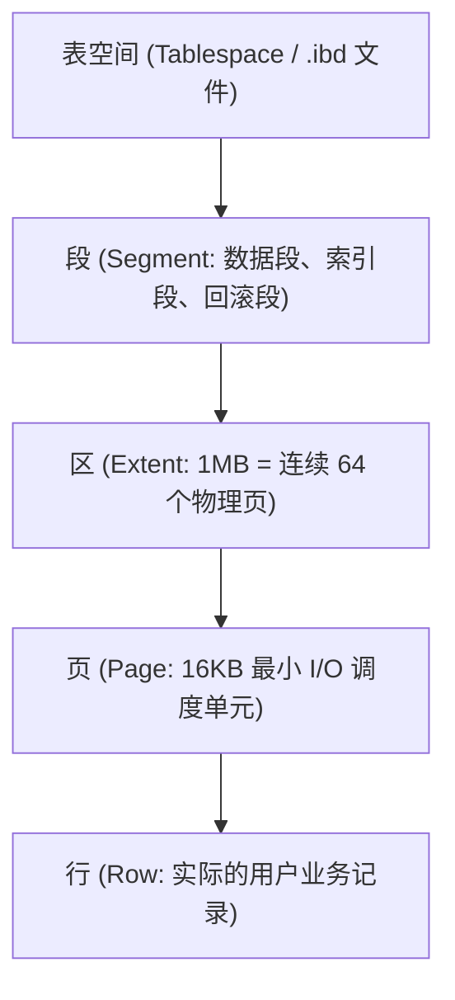

# InnoDB 逻辑存储结构与页结构深度剖析

很多工程师对 MySQL 的理解停留在“行与表”的抽象概念上。但在磁盘与内存交互的物理层面，MySQL 既不是按“表”也不是按“行”直接读写的，它的物理 I/O 基本单位是 **数据页（Page，默认 16KB）**。

深入理解页的物理组织，是搞懂 B+ 树为什么高度只有 3 层、以及为什么索引能毫秒级定位目标行的关键。

---

## 1. InnoDB 逻辑存储层次体系

从宏观到微观，InnoDB 的数据存储分为 5 个层次：



### 1.1 各层次概念与职责
1. **表空间（Tablespace）**：
   - 最高逻辑容器。在参数 `innodb_file_per_table=ON`（默认推荐）下，每个表都有一个独立的 `.ibd` 磁盘物理文件。
2. **段（Segment）**：
   - 常见的有**叶子节点数据段**（Leaf Node Segment，存储真实行数据）、**非叶子节点索引段**（Non-leaf Node Segment，存储索引目录项）以及事务用到的**回滚段**（Rollback Segment）。段是逻辑概念，由多个区组成。
3. **区（Extent）**：
   - 大小恒定为 **1MB**。对于默认 16KB 的页，**1 个区由 64 个物理上连续的页组成**。
   - **为什么需要“区”？**  
     B+ 树叶子节点之间是双向链表。如果每次需要新空间都在磁盘上随机申请 1 个离散的页，会导致范围扫描时磁盘磁头进行巨量的随机寻道。引入“区”的概念后，InnoDB 可以一次性向操作系统申请连续的 1MB 空间，**将随机 I/O 转化为高效的顺序 I/O**。
4. **页（Page）**：
   - InnoDB 读写磁盘的**最小基本单位**，默认大小为 **16KB**（可通过 `innodb_page_size` 在初始化实例时配置）。
5. **行（Row）**：
   - 业务数据真实记录。

---

## 2. 16KB 数据页内部结构全解

一个 16KB 的数据页并不是杂乱无章堆放数据的，它由 **7 大核心逻辑部分** 严格组成：

```text
┌────────────────────────────────────────────────────────┐
│ 1. File Header (38 字节) : 页类型、前一页/后一页物理指针  │
├────────────────────────────────────────────────────────┤
│ 2. Page Header (56 字节) : 页状态信息、记录槽位数量      │
├────────────────────────────────────────────────────────┤
│ 3. Infimum + Supremum Records (26 字节) : 最小/最大虚拟伪记录 │
├────────────────────────────────────────────────────────┤
│ 4. User Records (可变大小) : 真实插入的用户业务行记录    │
├────────────────────────────────────────────────────────┤
│ 5. Free Space (可变大小) : 页内尚未被使用的未分配空闲空间│
├────────────────────────────────────────────────────────┤
│ 6. Page Directory (可变大小) : 页目录，由多个槽位指针组成│
├────────────────────────────────────────────────────────┤
│ 7. File Trailer (8 字节) : 校验和 Checksum，防断电页损坏 │
└────────────────────────────────────────────────────────┘
```

### 2.1 核心组件详述

#### 1. File Header（38 字节）
- **`FIL_PAGE_PREV`** 与 **`FIL_PAGE_NEXT`**（各 4 字节）：记录当前页在磁盘上的物理页号。**这就是 B+ 树同层叶子节点之间构成双向链表的物理指针来源**。
- **`FIL_PAGE_TYPE`**（2 字节）：标记页类型（如数据页/索引页 `0x45BF`、undo 日志页、溢出页等）。
- **`FIL_PAGE_SPACE_OR_CHKSUM`**（4 字节）：当前页的校验和。

#### 2. Infimum 与 Supremum Records（26 字节）
- InnoDB 在每个数据页初始化时，会自动创建两个特殊的**虚拟边界记录**：
  - **Infimum Record**：当前页内物理逻辑上的“最小记录”。
  - **Supremum Record**：当前页内物理逻辑上的“最大记录”。
- 页内的所有用户记录通过单向链表串联，起点始终是 `Infimum`，终点始终指向 `Supremum`。

#### 3. Page Directory（页目录）与快速二分查找算法
当一个数据页加载到内存后，如果页内包含了上千行数据，MySQL 是如何避免全页线性遍历、快速找到目标行的？
答案就是 **Page Directory（页目录）**：

1. **分组机制**：InnoDB 将页内的所有有效记录分成若干个组（Group）。
   - `Infimum` 记录单独占 1 组。
   - `Supremum` 所在的组规定包含 1~8 条记录。
   - 中间的普通记录组，每组规定包含 **4~8 条记录**。
2. **槽位（Slot）与指针**：
   - 每个组的最后一条记录（即该组内主键最大的记录）的记录头中，会记录本组的记录条数（`n_owned`）。
   - Page Directory 本质上是一个**数组**，每个元素被称为一个**槽（Slot，占 2 字节）**，每个槽存放对应组最大记录的相对地址偏移量。

```text
Page Directory:  [Slot 0]       [Slot 1]        [Slot 2]        [Slot 3]
                   │               │               │               │
                   ▼               ▼               ▼               ▼
Records 链表: [Infimum] ──▶ [id:10 ──▶ id:15] ──▶ [id:20 ──▶ id:28] ──▶ [id:35 ──▶ Supremum]
```

3. **页内二分查找执行过程**：
   - 当需要查找 `id = 25` 的记录时：
   - 首先利用 Page Directory 数组，直接通过**二分查找法**在 $O(\log_2 K)$ 次计算内定位到目标槽位（例如落在 Slot 2 对应的组）；
   - 从 Slot 1 指向的记录开始，沿着链表顺序向后遍历 4~8 条记录，即可瞬间精准命中目标行！

#### 4. File Trailer（8 字节）防断电数据页损坏
- 计算机在向机械硬盘或 SSD 写入数据时是以 4KB 扇区为单位的。如果向磁盘写入 16KB 页面的过程中服务器突然断电，可能导致“只写了前 8KB，后 8KB 没写完”的物理损坏（Partial Page Write）。
- **校验机制**：File Trailer 前 4 字节记录校验和，后 4 字节记录最后修改的 LSN（Log Sequence Number）。
- 当从磁盘读取一个页时，InnoDB 会比对 File Header 与 File Trailer 中的 Checksum 和 LSN。如果两者不一致，说明物理页遭遇了断电损坏，此时会依赖 **Doublewrite Buffer（双写缓冲区）** 中的备份副本进行无损恢复。

---

## 3. 社招高频面试追问

### Q1：为什么 InnoDB 数据页大小默认选 16KB？可以修改吗？
- **为什么选 16KB？** 这是平衡**索引树深度**与**物理 I/O 代价**的最佳工业折中。
  - 若页太小（如 4KB）：单页能存的索引项变少，B+ 树高度会从 3 层变成 5~6 层，定位一条记录需要发起的磁盘 I/O 次数成倍增加。
  - 若页太大（如 64KB）：修改一条 100 字节的数据就需要把 64KB 全部同步刷新到磁盘，写放大严重，且 Buffer Pool 内存页的置换争用剧烈。
- **可以修改吗？** 可以。在数据库实例初始化（`mysqld --initialize`）时，可以通过 `innodb_page_size` 参数配置为 4KB、8KB、16KB、32KB 或 64KB。但在实例创建后便不可更改。

### Q2：页分裂（Page Split）和页合并（Page Merge）是如何发生的？
- **页分裂**：当向一个已经存满数据的数据页中间插入新数据时，为了保证单向链表和主键的物理顺序，InnoDB 会申请一个全新的数据页，并将原页面中后半部分约 50% 的数据移动到新页面中，同时调整上层父节点 B+ 树指针。页分裂开销巨大，通常由随机无序主键（如 UUID）引起。
- **页合并**：当删除记录或更新导致行收缩，使得相邻两个数据页的使用率低于 `MERGE_THRESHOLD`（默认 50%）时，InnoDB 会自动触发物理合并，将两个页的数据合为一个页，释放空页回表空间。
