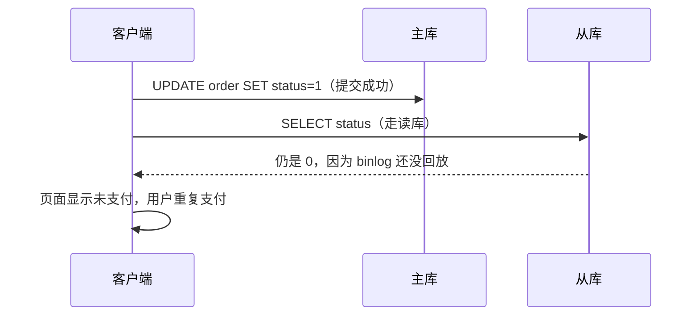

# MySQL 主从复制与读写分离实战

## 使用入口：先解决问题，再做验证

扩展读取并设计复制延迟和切换行为。

**先做基本操作**：先完成复制和读副本查询，观察位点、延迟并测试写后读，再决定一致性路由与切换。初次学习可先完成[本模块基础实践](/doc/MySQL/SQL编写与生产维护实战)。

**再逐步深入**：基本 API 与输入输出 → 常见失败和使用边界 → 场景排查与优化 → 本文机制分析与源码。面试先讲用途和自己的操作过程，再回答场景与原理追问。

> **一句话结论**：主从延迟的根因是「**主库并发写、从库回放追不上**」，读写分离的一切坑（写完立刻读不到、事务内路由错乱、切换丢数据）都由「复制是异步的」这一条推出来；先搞清复制链路，再谈方案。

## 30 秒速览

| 概念 | 一句话 | 关键参数 |
|---|---|---|
| binlog | 主库记录逻辑/行变更，复制与恢复的共同基础 | `log_bin`、`binlog_format=ROW` |
| 复制链路 | dump thread → relay log → SQL thread / 并行回放 | `SHOW REPLICA STATUS` |
| 异步复制 | 主库不等从库，性能最好但可能丢最后一段写 | 默认 |
| 半同步 | 至少一个从库收到 relay log 才返回 | `rpl_semi_sync_master_enabled` |
| GTID | 全局事务 ID，切换与定位不再依赖文件+位点 | `gtid_mode=ON` |
| 并行回放 | 按组提交/逻辑时钟并行，解决单线程回放瓶颈 | `replica_parallel_type=LOGICAL_CLOCK` |
| 读写分离 | 写走主、读走从 | 代理层 / 框架层 / Hint |

## 一张图看懂复制链路与延迟来源


延迟的本质：**主库可以 N 个事务并行提交，从库回放若串行就会持续累积 lag**。MySQL 5.7+ 的 `LOGICAL_CLOCK` 基于组提交判断哪些事务能并行回放，8.0 用 `writeset` 进一步放宽并行度。

## 二、binlog 三种格式与 GTID

| 格式 | 内容 | 优点 | 风险 |
|---|---|---|---|
| STATEMENT | 记 SQL 原文 | 日志小 | `NOW()`、`UUID()`、不确定函数导致主从不一致，已不推荐 |
| ROW | 记每行变更前/后镜像 | 确定性强，Canal 依赖此格式 | 大批量 UPDATE 日志暴涨 |
| MIXED | 自动切换 | 折中 | 行为不可预测，排障困难 |

```sql
-- 排查延迟第一步
SHOW REPLICA STATUS\G
-- 重点看：Replica_IO_Running / Replica_SQL_Running、Seconds_Behind_Master、
--         Retrieved_Gtid_Set / Executed_Gtid_Set、Last_SQL_Error
```

> `Seconds_Behind_Master` 在大事务场景下会失准（事务未提交前不更新），生产应**以 GTID 差值或心跳表时间戳**为准做延迟监控。

## 三、延迟七大根因与治理

| 根因 | 现象 | 治理 |
|---|---|---|
| 大事务 / 批量 UPDATE 百万行 | lag 突增后缓慢回落 | 拆成小批次（每批 1000~5000 行）+ 分批提交 |
| 大表 DDL、加索引 | 从库回放单线程卡数小时 | 用 gh-ost / pt-online-schema-change，低峰执行 |
| 从库硬件弱于主库 | lag 长期存在且随流量波动 | 从库配置不低于主库，尤其 IOPS |
| 从库承担大量读 | 回放与查询争抢 IO/CPU | 加从库或把分析类查询迁到只读副本/数仓 |
| 无主键表 + ROW 格式 | 每行回放都要全表扫描定位 | **所有表必须有主键**（硬性规范） |
| 并行回放未开启 | 单 worker 追不上 | 开 `replica_parallel_workers=8~16` + `LOGICAL_CLOCK` |
| 跨机房网络 | 延迟稳定在几百 ms | 同机房部署从库，异地仅做灾备 |

## 四、读写分离最经典的坑：写完立刻读不到



| 解法 | 做法 | 适用 | 代价 |
|---|---|---|---|
| 强制走主 | 写后短时间内（如 2s）该用户/该业务的读走主库 | 最常用、最稳 | 主库读压力上升，需要缓存标记 |
| 缓存标记 | 写后在 Redis 打 `read_master:{key}` 标记，读前检查 | 精细化控制，按 key 粒度 | 多一次 Redis 访问，标记过期时间要 > 最大延迟 |
| 等待位点 | 写后拿到 GTID，读前 `WAIT_FOR_EXECUTED_GTID_SET` 等从库追上 | 强一致读，金融场景 | 阻塞读请求，延迟大时超时 |
| 业务规避 | 写后不立即读，直接用写操作的返回值渲染 | 最优解，零成本 | 需要前端/交互配合 |

```java
// 方案一：注解 + AOP 强制路由主库（最简单可控）
@Master   // 自定义注解，AOP 在 ThreadLocal 打标，DynamicDataSource 据此选主库
public Order pay(Long id) { /* 写 + 立刻读，整个方法内所有 SQL 都走主库 */ }
```

> **事务内的所有 SQL 必须走主库**：事务一旦开启就绑定连接，若中途切数据源会导致事务失效或读到未提交数据。这是框架层读写分离最常见的 bug。

## 五、三种读写分离实现

| 方式 | 代表 | 优点 | 缺点 |
|---|---|---|---|
| 代理层 | ShardingSphere-Proxy、MyCat、ProxySQL | 应用无感，多语言通用 | 多一跳网络、代理自身要高可用、SQL 兼容性受限 |
| 框架层 | ShardingSphere-JDBC、Spring `AbstractRoutingDataSource` | 无额外组件，性能损耗最小 | 与语言/框架绑定，升级成本高 |
| 云端 | 云数据库读写分离地址 | 运维零成本，自动故障转移 | 黑盒、延迟可见性差、绑定厂商 |

选型建议：**Java 单体/微服务优先 ShardingSphere-JDBC**（无额外部署）；多语言混合或需要统一治理再用 Proxy。分库分表另见 [分库分表与全局主键设计](/doc/SystemDesign/分库分表与全局主键设计)。

## 六、连接池治理（HikariCP）

```properties
# 经验公式：connections = ((core_count * 2) + effective_spindle_count)
# 8 核 SSD 通常 10~20 个连接即可，盲目设 200 反而因上下文切换变慢
maximumPoolSize=20
minimumIdle=5
connectionTimeout=30000      # 获取连接超时，必须小于上游网关超时
idleTimeout=600000
maxLifetime=1800000         # 略小于 MySQL wait_timeout，避免使用已被服务端关闭的连接
leakDetectionThreshold=60000 # 连接泄漏检测，生产开此项但别设太小
```

| 现象 | 根因 | 处理 |
|---|---|---|
| `Connection is not available, request timed out` | 池太小 / 慢 SQL 占着连接 / 连接泄漏 | 先看慢 SQL 与未关闭连接，别急着调大池子 |
| 连接数暴涨 | 每次请求新建连接池、或事务边界过大 | 连接池全局单例，缩小事务范围 |
| 主从切换后仍连旧主 | 连接池里残留旧连接 | 配合探活 + 连接池刷新 / 重启应用 |
| 偶发 `Communications link failure` | `maxLifetime` > MySQL `wait_timeout` | 调小 maxLifetime 或调大 wait_timeout |

## 七、高可用切换与数据一致性权衡

| 方案 | 切换方式 | 数据丢失风险 | 适用 |
|---|---|---|---|
| 异步复制 + MHA/Orchestrator | 提升最靠前的从库 | 可能丢主库最后一段 binlog | 一般业务 |
| 半同步复制 | 至少一个从库确认才提交 | 大幅降低丢失，仍非绝对 | 交易类 |
| MGR / InnoDB Cluster | 组复制，多数派提交 | 强一致，但写性能与网络敏感 | 金融核心 |

**两个必答题**：① 切换时如何防脑裂？—— 旧主库必须被隔离（VIP 摘除 / fencing / `super_read_only`），否则双写直接数据错乱；② 切换后如何校验？—— 对比 GTID 集合、关键表 checksum、业务对账任务，补回不一致数据。

## 八、高频追问（含高分/低分特征）

| 追问 | 高分回答要点 | 低分回答 |
|---|---|---|
| 主从延迟根因是什么？ | 主库并发写、从库回放串行/受限；大事务、DDL、从库读压力、无主键表、网络 | 「网络慢」 |
| 写完立刻读不到怎么办？ | 强制走主 / 缓存标记 / 等待 GTID / 用写返回值渲染，并说明各自代价 | 「睡 500ms」 |
| binlog 为什么必须用 ROW？ | 确定性、避免不确定函数导致主从不一致，Canal 等同步也依赖行镜像 | 「ROW 更省空间」（恰好相反） |
| 并行回放怎么实现？ | 基于组提交的 LOGICAL_CLOCK，同一组事务可并行；8.0 writeset 放宽判定 | 「多个线程随便并行」 |
| 半同步能保证不丢数据吗？ | 保证至少一个从库收到 relay log，但仍有极小窗口，强一致需 MGR/多数派 | 「绝对不丢」 |
| 连接池越大越好吗？ | 不是，受 CPU/磁盘与 MySQL 线程模型限制，过大反而增加切换与锁竞争 | 「越大越快」 |
| 读写分离事务为什么必须走主？ | 事务绑定单一连接，切换会破坏事务语义与隔离性 | 「配置一下就行」 |

**延伸阅读**：[MySQL 底层原理日志体系与 BufferPool](/doc/MySQL/MySQL底层原理日志体系与BufferPool)、[MySQL 事务隔离与 MVCC 原理](/doc/MySQL/MySQL事务隔离与MVCC原理)、[常用中间件核心原理与选型速查](/doc/Java/常用中间件核心原理与选型速查)。
