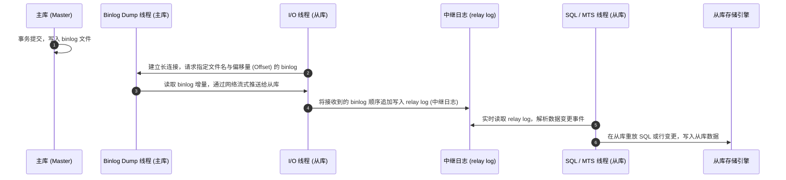

# MySQL 主从复制底层原理与主从延迟 6 大破局方案

在高并发互联网架构中，单台数据库实例的读写承载能力终有上限。为了实现高可用（HA）、读写分离与容灾，**主从复制（Master-Slave Replication）** 是最基础的标准设施。

而在社招面试中，“主从复制的底层工作链路是怎样的？主从延迟（Replication Lag）是如何产生的？线上发生主从延迟导致刚插入的数据查不到，你有哪些破局解法？”是必考的高分题。

---

## 1. 主从复制底层三大线程模型

MySQL 主从复制的物理本质，就是**从库（Slave）持续拉取主库（Master）的 `binlog` 日志并在本地完整回放**。



### 1.1 三大核心线程职责
1. **Binlog Dump 线程（运行在主库）**：
   - 当从库连接主库时，主库会为其创建一个 Dump 线程。
   - 读取主库上的 `binlog`，将其打包发送给从库。
2. **I/O 线程（运行在从库）**：
   - 与主库建立网络通信，负责接收 Dump 线程发送过来的 binlog 变更数据。
   - 将其顺序追加写入到本地磁盘的 **`relay log（中继日志）`** 文件中。
3. **SQL 线程（运行在从库）**：
   - 读取并解析 `relay log`，在从库本地存储引擎中逐行重新执行，完成数据状态的同步。

---

## 2. 复制模式的技术演进

### 2.1 异步复制（Asynchronous Replication，默认）
- **特点**：主库在事务写入 `binlog` 并提交后，**直接向客户端返回成功**，丝毫不关心从库是否已经收到或执行。
- **优缺点**：性能最高；但如果主库瞬间宕机且尚未同步到从库，主从切换可能导致**数据丢失**。

### 2.2 半同步复制（Semi-Synchronous Replication）
- **特点**：主库执行完事务后，**必须等待至少一个从库接收到 binlog 并成功写入 relay log 向主库返回 ACK 确认包**，主库才会向客户端返回提交成功！
- **增强半同步（After-Sync，MySQL 5.7+ 默认）**：
  在主库写完 binlog 并在存储引擎 `COMMIT` 之前等待从库 ACK，彻底杜绝了早前 `After-Commit` 模式下“主库已能读到、从库还没收到，若主库挂掉引发幻读”的经典缺陷。

### 2.3 GTID 复制（Global Transaction Identifiers）
- **特点**：为全局每一个事务分配一个全局唯一标识 `GTID = source_id:transaction_id`。
- **彻底告别位点同步**：不再需要人工记录和指定 `binlog 文件名` 与 `position 偏移量`，故障主从自动切换时系统可自动精准补齐缺失事务。

---

## 3. 核心深水区：主从延迟的本质与 `Seconds_Behind_Master`

### 3.1 如何监控主从延迟？
在从库执行：
```sql
SHOW SLAVE STATUS\G
```
重点查看 **`Seconds_Behind_Master`** 字段：
- 如果为 `0`：表示主从数据实时同步，完全一致。
- 如果大于 `0`：表示从库当前落后主库的秒数。
- 如果为 `NULL`：表示主从复制线程（I/O 或 SQL）已经断开异常！

> **`Seconds_Behind_Master` 的计算底层逻辑**：  
> 它表示 **“从库当前正在执行的 relay log 事务在主库上产生的时间戳”与“从库系统当前时间”的差值**。如果网络延迟很大，该值也可能被放大。

---

### 3.2 产生主从延迟的四大核心根因
1. **主库并发写 vs 从库单线程回放（根本瓶颈）**：
   主库拥有数十甚至上百个应用并发连接线程同时写入；而早期从库**只有一个 SQL 线程单线程串行回放**！主库 1 秒产生 5000 次写入，从库 1 秒只能执行 1000 次，延迟必然无限拉大。
2. **大事务（Large Transaction）执行**：
   主库执行了一条耗时 5 分钟的大 SQL（如 `UPDATE orders SET status=0 WHERE created_time < '2025-01-01'` 一次性修改百万行，或大表 `ALTER TABLE`）。
   - 该事务在主库执行了 5 分钟才写完 binlog；
   - 从库拿到后回放必须也花整整 5 分钟，期间后续所有小事务全部被卡死在队列中！
3. **从库服务器硬件降配与读负载过重**：
   有些公司把较差淘汰的机器做从库，同时在从库上执行大量耗尽 CPU 和 I/O 的大数据导出或分析报表，导致从库资源耗尽、回放极其缓慢。
4. **主从网络丢包与带宽被打满**。

---

## 4. 主从延迟 6 大工业级破局方案

针对主从延迟引发的“用户刚下单/付款，页面一刷新却提示订单不存在”问题，业界有 6 套标准落地方案：

### 4.1 方案一：开启 MTS 多线程并行复制（彻底击碎单线程瓶颈）
从 MySQL 5.7+ 和 8.0 起，必须开启基于 **逻辑时钟（Logical Clock / 组提交 Group Commit）** 的多线程并行回放：
```ini
# my.cnf 从库配置
slave_parallel_type = LOGICAL_CLOCK
slave_parallel_workers = 8  # 开启 8 个并行回放工作线程
slave_preserve_commit_order = 1 # 保证从库事务提交顺序与主库严格一致
```
主库在同一组组提交（Group Commit）中提交的事务必然互不冲突，从库可以直接**并发并行回放**，从库 TPS 提升数倍！

---

### 4.2 方案二：拆解大事务与大表在线无锁 DDL
- 针对大批量删除或更新，强制采用**批处理（Chunk Batching）**：
  ```sql
  -- 每次只更新 500 条，循环提交，绝不积压大事务
  UPDATE orders SET status = 0 WHERE status = 1 AND id <= 10000 LIMIT 500;
  ```
- 大表 DDL 严禁直接执行，统一使用 `gh-ost` 或 `pt-online-schema-change`。

---

### 4.3 方案三：业务层关键链路“强制路由读主库”
对于对实时性要求极高的场景（如“用户下单后立刻跳转支付结果页”、“修改密码后立刻重登”）：
- 在 DAO 层（如 MyBatis、ShardingSphere-JDBC 或 DynamicDataSource）：
- **加入强制读主标记（`HintManager`）**，让这些强一致性读请求直接绕过从库，直连主库查询。

---

### 4.4 方案四：缓存辅助标记法（写穿缓存）
- 用户刚提交发布了一条新评论或动态；
- 写入数据库主库的同时，**以 `userId` 为 Key 向 Redis 写入一条带有 3~5 秒短暂 TTL 的标记缓存**；
- 当客户端立即刷新页面时，业务层首先检查 Redis 中是否存在该用户的写入标记：
  - 若存在：判定大概率会遭遇主从延迟，本次查询**直接打向主库**；
  - 若不存在（说明已过了延迟窗口期）：安全打向从库。

---

### 4.5 方案五：半同步复制降级与强一致 MGR 集群
金融级核心账户，采用多主强同步的 **MGR（MySQL Group Replication）** 架构，底层基于 Paxos 协议实现全节点数据强一致，消灭单点主从延迟。
