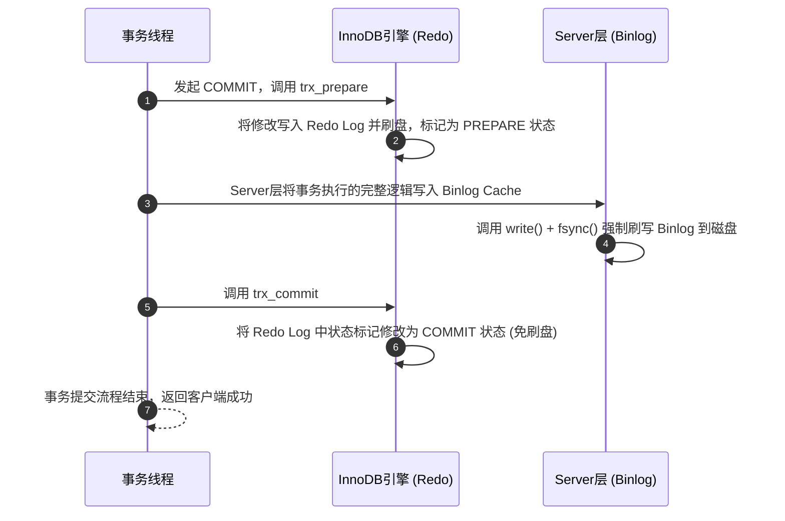

# MySQL全阶段面试通关-高级资深架构50道连环炮全景通关

本篇面向 5 年以上高级后端专家、资深数据库架构师及技术专家，深度拆解 MySQL 底层存储引擎内核、事务并发控制、锁冲突排查、高可用集群演进、海量数据分库分表与生产级运维调优体系。题目设计突出**底层物理推导**、**源码时序链路**、**架构权衡选型**与**生产避坑根治**，全面对标社招 P7+/资深专家职级硬核面试标准。

---

### Q1: InnoDB 逻辑存储架构从 Tablespace 到 Row 的层级关系是什么？各层设计动机？
**答**：
InnoDB 逻辑存储结构自顶向下分为五层：
1. **表空间（Tablespace）**：最高逻辑容器。分为系统表空间、独立表空间（`file-per-table`，即 `.ibd` 文件）、临时表空间与 Undo 表空间。其动机是解耦底层物理操作系统文件与数据库逻辑对象；
2. **段（Segment）**：逻辑分配单元。常见包括数据段（B+ 树叶子节点段）、索引段（B+ 树非叶子节点段）与回滚段（Rollback Segment）。动机是避免叶子数据与非叶子索引混合存放引发的离散 I/O；
3. **区（Extent）**：物理分配连续空间单元。固定大小为 1MB（对应 64 个连续的 16KB 页）。动机是保证顺序 I/O，段申请空间时以区为单位一次性分配，支持顺序预读；
4. **页（Page）**：磁盘与内存数据交换的最小基本单位。默认 16KB。动机是提供统一的块级二分查找、行组织与缓存管理；
5. **行（Row）**：存放单行用户记录的最小物理逻辑单位。按 Compact/Dynamic 等行格式紧凑编码。

---

### Q2: 详解 16KB 数据页（Page）的内部物理构造与 Page Directory 二分查找原理。
**答**：
标准 16KB 数据页内部划分为 7 大物理区域：
1. **File Header（38 字节）**：记录页类型、页号（Page Number）、上一页与下一页指针（构建双向链表）、页的 LSN（Log Sequence Number）与 Checksum 校验和；
2. **Page Header（56 字节）**：记录页状态统计信息（记录数、槽位数、Free Space 起始偏移、最后插入位置等）；
3. **Infimum + Supremum 伪记录（26 字节）**：页内固定边界记录，作为单向链表的最小虚节点与最大虚节点；
4. **User Records（大小动态）**：实际存储的用户记录行，行与行之间通过行头部的 `next_record` 指针构建升序单向链表；
5. **Free Space（大小动态）**：页内未分配的连续可用空闲内存空间；
6. **Page Directory（页目录，大小动态）**：将页内所有记录按 4~8 条分为若干组，每个组最后一个记录在页内的相对偏移量抽取为一个“槽（Slot）”，逆序存放在 Page Directory 中；
7. **File Trailer（8 字节）**：存储检验和与 LSN，用于校验刷盘是否发生写断页。

**Page Directory 查找原理**：
在页内查找指定主键时，执行器先通过 Page Directory 中的槽进行 **$O(\log K)$ 二分查找** 快速定位目标记录所在的“组”，随后从该组前一个槽指向的记录开始，沿着 `next_record` 单向链表进行最多 4~8 次线性遍历命中目标行。

---

### Q3: 什么是行溢出（Row Overflow）？Compact 与 Dynamic 行格式在溢出处理上有何本质差异？
**答**：
InnoDB 规定一个 16KB 的数据页中至少必须能存放 2 条完整记录（以维持 B+ 树平衡树特性）。若单行包含 `VARCHAR(65535)`、`TEXT` 或 `BLOB` 等超大字段导致单页容纳不下时，超出的字节将被存储到专门的**溢出页（Off-page / Overflow Page）**中，这种现象称为行溢出。
- **Compact 行格式**：在聚簇索引页内保留大字段前 768 个字节的前缀数据，紧接着追加 20 个字节的指针（指向外部溢出页物理地址）；
- **Dynamic 行格式（MySQL 5.7+ 默认）**：若发生行溢出，聚簇索引页内**完全不保留**前 768 字节前缀，仅存放一个 20 字节的溢出页物理指针，真实大字段内容 100% 剥离至外部溢出页。
- **架构收益**：Dynamic 格式使得主键索引页内能容纳更多的记录行，极大提升了 B+ 树的扇出比（Fan-out），降低树高并大幅减少内存与磁盘 I/O。

---

### Q4: 什么是 Redo Log 的 Mini-Transaction (mtr)？它如何保障 B+ 树分裂时的原子性？
**答**：
Mini-Transaction (mtr) 是 InnoDB 底层用来保障对物理数据页修改的原子性与持久性的最小操作单元。
- **场景痛点**：在 B+ 树插入新记录引发页分裂（Page Split）时，涉及申请新页、拷贝数据、修改双向链表前后指针、修改父节点槽位等多个连续物理动作。若在分裂中途数据库宕机，B+ 树的物理拓扑结构将被彻底破坏。
- **mtr 机制**：
  1. 任何对数据页的物理修改都被包装在一个 mtr 内；
  2. mtr 运行期间产生的多条 Redo Log 物理日志先缓存在线程私有的 `mtr_buf` 中；
  3. 待整个物理操作（如页分裂全部指针变更）完成后，mtr 提交时一次性将私有日志原子追加到公共的 Redo Log Buffer 中，并以特定标志位 `MLOG_MULTI_REC_END` 封顶；
  4. 崩溃恢复时，若扫描到没有 `MLOG_MULTI_REC_END` 结尾的半截 mtr 日志，将直接全盘废弃，绝不回放，从而保证了 B+ 树底层数据结构永远处于自洽的物理一致状态。

---

### Q5: Buffer Pool 的冷热分离 LRU 算法是如何工作的？为什么要有 `innodb_old_blocks_time`？
**答**：
传统标准 LRU 在数据库场景下存在致命缺陷：**全表扫描或批量统计查询会瞬间将所有热点数据全部挤出内存**，引发严重的磁盘 I/O 抖动（缓存污染）。
InnoDB 采用**冷热分离分段 LRU** 解决此问题：
1. **分段比例**：LRU 链表被切分为两部分，头部约 63% 为热区（New Sublist），尾部约 37% 为冷区（Old Sublist），交界处称为 Midpoint；
2. **首次载入**：磁盘新读入的页一律放入冷区头部（Midpoint 位置），不直接进入热区；
3. **晋升延迟阈值（`innodb_old_blocks_time`，默认 1000ms）**：
   - 处于冷区的页在首次访问后，必须在间隔超过该阈值后再次被访问，才会被移入热区头部；
   - 若在 1000ms 窗口期内被多次访问（例如全表扫描时同一数据页内的连续几百行迭代访问），该页依然停留在冷区；
   - 全表扫描结束后，这批冷页随 LRU 淘汰机制自然从尾部被释放，热区核心热点缓存毫发无损。

---

### Q6: 为什么引入 Change Buffer？在哪些业务场景下 Change Buffer 会导致性能反向衰退？
**答**：
- **设计初衷**：针对**非唯一普通辅助索引（Non-Unique Secondary Index）**的写操作（INSERT/UPDATE/DELETE）。因为辅助索引叶子节点物理分布通常极度离散，若每次写入都直接触发磁盘随机 I/O 将页面载入内存更新，代价极大。Change Buffer 会在目标页不在 Buffer Pool 时，直接在内存中记录本次修改变更，待后续目标页被读取时再进行合并（Merge），大幅降低离散 I/O。
- **性能反向衰退场景**：
  - **写后即读业务**：写入数据后毫秒级立即执行读取（例如支付流水写入后立即回查展示），导致 Change Buffer 刚缓存修改便立刻触发磁盘随机 I/O 加载数据页并进行 Merge。不仅未能省去磁盘 I/O，反倒额外增加了 Change Buffer 内存写入与检索计算的开销；
  - **唯一索引（Unique Index）场景**：唯一索引必须每次向磁盘读取页以验证唯一性约束，无法使用 Change Buffer。

---

### Q7: 详解 Buffer Pool 刷脏页（Flush）的四大触发场景与 Page Cleaner 线程优化。
**答**：
Dirty Page（脏页）是指内存中已修改但尚未同步写回磁盘的数据页。刷脏触发场景如下：
1. **Redo Log 检查点追平（Sync Flush）**：写入速率过猛导致 `checkpoint_lsn` 距离最新写入点的物理空间逼近 Redo Log 文件末尾警戒线（Free Space 枯竭），触发全系统阻塞并强制刷脏；
2. **Buffer Pool 内存不足（LRU Flush）**：空闲页枯竭，淘汰冷区脏页时必须先落盘释放；
3. **系统空闲时后台定时刷盘（Master Thread Flush）**：后台异步周期性平滑刷新；
4. **MySQL 正常关闭（Shutdown Clean Flush）**：优雅停机时将全部脏页同步落盘。

**优化调优**：
- 核心参数 `innodb_io_capacity` 与 `innodb_io_capacity_max` 必须根据真实存储介质（如 NVMe SSD）合理调高（如从默认 200 调高至 2000~10000），避免刷盘吞吐受限；
- 在多核高并发场景下，配置 `innodb_page_cleaners`（与 `innodb_buffer_pool_instances` 对齐），由多个独立的 Page Cleaner 线程并发并行刷脏，杜绝因单线程刷脏瓶颈拖垮 I/O 造成全库停顿（Stall）。

---

### Q8: 什么是 Doublewrite Buffer（双写缓冲区）？为什么需要它来防范 Partial Page Write（写断页）？
**答**：
- **Partial Page Write 痛点**：操作系统与物理文件系统的基本写入块单位通常为 4KB，而 InnoDB 数据页默认大小为 16KB。当向磁盘刷写一个 16KB 脏页时，若在写入第 8KB 时服务器突然断电，该数据页物理损坏（只有前半部被写入，校验和不一致）。此时 Redo Log 记录的是物理差异偏移修改，若作为基准的底层物理页本身已损毁，Redo Log 根本无法在其上进行正确重放。
- **Doublewrite Buffer 原理**：
  1. 在系统表空间（或 8.0 独立双写文件）中开辟一块连续的物理磁盘空间（通常 2MB）；
  2. 脏页落盘时，Page Cleaner 线程先将 16KB 脏页**顺序写入**到内存中的 Doublewrite Buffer，并一次性顺序刷盘到物理 Doublewrite 空间；
  3. 待双写空间顺序落盘成功后，再将脏页离散写入到各自独立的 `.ibd` 数据文件中；
  4. **崩溃恢复**：若离散写入 `.ibd` 时遭遇写断页，InnoDB 直接从 Doublewrite 空间中拉出完整的原始页备份覆盖损坏页，再基于 Redo Log 完整回放。

---

### Q9: 为什么 SSD 普及后，有些公司建议关闭 Doublewrite Buffer？这种做法有什么物理前提？
**答**：
- **物理前提**：
  1. 底层存储文件系统本身具备**原子写（Atomic Write）**能力（如 Fusion-ioDirectFS 或支持原子写的定制企业级 NVMe SSD 固件）；
  2. 或底层支持 Copy-on-Write（COW）特性的文件系统（如 ZFS），其本身在文件系统层面杜绝了覆盖写导致的写断页。
- **关闭动因与风险**：
  - 双写机制带来了两次磁盘写入开销，在极致写入压测下对 IOPS 造成一定损耗；
  - 若在普通的通用 EXT4/XFS + 消费级或普通数据中心 SSD 上盲目关闭 `innodb_doublewrite`，一旦发生掉电写断页，数据库将彻底损坏且无法恢复，属于极高危操作。

---

### Q10: 深入剖析自适应哈希索引（Adaptive Hash Index, AHI）的运行机制与争锁隐患。
**答**：
- **运行机制**：
  InnoDB 持续监控各索引页的查询频率与模式。当发现某个辅助索引或聚簇索引页被连续、模式固定地（例如以相同的 `WHERE key = ?` 等值条件）访问多次，InnoDB 会在内存中以该键值和对应的数据页记录物理指针自动建立一个基于内存的哈希索引表（AHI）。后续等值查询无需再从根节点逐层遍历 B+ 树，而是以 $O(1)$ 复杂度直达目标页。
- **争锁隐患（Bottleneck）**：
  1. AHI 受内部全局或分区读写锁保护（`btr_search_latch`）；
  2. 在超高并发的大量 JOIN、模糊查询或频繁点更新场景下，多线程对 AHI 读写锁争抢极度剧烈，甚至成为整个系统的最大 CPU 瓶颈；
  3. 在高并发极端场景下，若通过性能监控发现大量等待在 `btr_search_latch`，官方推荐直接配置 `innodb_adaptive_hash_index = OFF` 彻底关闭 AHI。

---

### Q11: 详述 Redo Log、Undo Log、Binlog 在事务 ACID 保证中的各自分工与协同。
**答**：
- **原子性（A - Atomicity）**：由 **Undo Log** 保障。事务未提交或回滚时，通过 Undo Log 链条执行逻辑反向操作，恢复至修改前状态；
- **持久性（D - Durability）**：由 **Redo Log** 保障。Write-Ahead Logging（WAL）机制确保事务提交时只需将物理修改日志顺序刷盘，即使 Buffer Pool 脏页未落盘，宕机重启时通过重放 Redo Log 恢复数据；
- **隔离性（I - Isolation）**：由 **Undo Log（MVCC）+ 锁机制（Locks）** 保障。Undo Log 形成历史版本链支撑快照读，记录锁/间隙锁防止并发事务读写冲突与幻读；
- **一致性（C - Consistency）**：**ACID 的最终目标**。由 A、I、D 协同以及数据库业务完整性约束共同达成。
- **协同关系（Binlog）**：Binlog 是 Server 层的逻辑归档日志，与 InnoDB 引擎层的 Redo Log 通过 **XA 两阶段提交（2PC）** 紧密锚定，保障事务在崩溃恢复时与从库、数据备份保持绝对数据一致。

---

### Q12: 为什么 Undo Log 既保证了原子性（Rollback），又是 MVCC 实现的核心基础？
**答**：
Undo Log 记录的是逻辑反向操作：
1. 当事务执行 `INSERT` 时，Undo Log 记录对应的 `DELETE`；
2. 当事务执行 `DELETE` 时，Undo Log 记录整行的完整历史备份；
3. 当事务执行 `UPDATE` 时，Undo Log 记录被修改列的旧值。

**双重价值**：
- **原子性**：事务异常或主动执行 `ROLLBACK` 时，系统逆序执行 Undo Log 进行撤销；
- **MVCC 版本链**：聚簇索引的每一行记录内部都隐藏了 `DB_ROLL_PTR`（回滚指针），该指针正是指向对应的 Undo Log 历史镜像。多个事务对同一行记录的并发连续修改，由 `DB_ROLL_PTR` 穿针引线串成一条**从最新版本到最老版本的单向链表（版本链）**，其他读事务通过自身的 ReadView 计算判定，沿着版本链向上找到对自己可见的特定历史快照，实现非阻塞读取。

---

### Q13: 深入剖析 Undo Log 的 Purge 机制：为什么长事务不提交会导致 Undo 表空间急剧膨胀？
**答**：
- **Purge 机制**：针对 `INSERT` 的 Undo Log 在事务提交后可被立刻丢弃（因为新行没有历史版本）；但针对 `UPDATE`/`DELETE` 的 Undo Log 不能立即删除，因为系统中其他并发事务的活跃 ReadView 可能仍需读取这些被修改行的历史版本。InnoDB 后台通过专门的 **Purge 线程** 周期性比对当前系统中全量活跃 ReadView 的最小事务 ID（`min_trx_id`），只有所有活跃事务均不再需要该版本时，才会将其物理清理；
- **长事务膨胀根因**：
  若系统中存在一个运行数小时未提交的长事务（甚至是只读长事务），系统中的 `min_trx_id` 将永远停滞在长事务启动时的旧事务 ID。导致后续全库所产生的海量 UPDATE/DELETE Undo Log **全部无法被 Purge 线程回收**，持续在 Undo 表空间堆积，不仅造成磁盘空间急剧膨胀，还会导致单行版本链长达数万节点，严重拖垮全库查询性能。

---

### Q14: MVCC 的核心结构：DB_TRX_ID、DB_ROLL_PTR 与 ReadView 四大核心字段的判断算法是什么？
**答**：
**隐藏列**：
- `DB_TRX_ID`（6 字节）：最后一次插入或修改该行记录的事务 ID；
- `DB_ROLL_PTR`（7 字节）：回滚指针，指向 Undo Log 版本链上一版本。

**ReadView 四大核心字段**：
1. `m_ids`：生成 ReadView 时系统中当前活跃（未提交）的读写事务 ID 列表；
2. `min_trx_id`：生成 ReadView 时当前活跃的最小事务 ID；
3. `max_trx_id`：生成 ReadView 时系统即将分配给下一个事务的 ID（非最大活跃 ID，而是最大已分配 ID + 1）；
4. `creator_trx_id`：创建当前 ReadView 的事务自身的 ID。

**可见性判定算法**（针对待访问记录的 `trx_id`）：
- 若 `trx_id == creator_trx_id`：记录由自己修改，**可见**；
- 若 `trx_id < min_trx_id`：修改该记录的事务在快照创建前已提交，**可见**；
- 若 `trx_id >= max_trx_id`：修改该记录的事务在快照创建之后才开启，**不可见**；
- 若 `min_trx_id <= trx_id < max_trx_id`：
  - 若 `trx_id` 在 `m_ids` 活跃列表中：说明快照生成时该事务尚未提交，**不可见**；
  - 若 `trx_id` 不在 `m_ids` 中：说明该事务在快照生成前已提交完毕，**可见**。
- 若判定不可见，则顺着 `DB_ROLL_PTR` 回滚指针继续探查上一版本，直至命中可见版本或遍历完毕（返回空）。

---

### Q15: RC 隔离级别与 RR 隔离级别在生成 ReadView 时的本质时序差异是什么？
**答**：
- **RC（Read Committed，读已提交）**：
  在同一个事务中，**每一次执行 `SELECT` 语句都会重新独立生成一次全新的 ReadView**。
  因此，若其他并发事务在两次查询之间提交了修改，后一次 `SELECT` 生成新 ReadView 时该事务已不在 `m_ids` 中，从而可以读到最新提交的数据，导致不可重复读现象；
- **RR（Repeatable Read，可重复读）**：
  在同一个事务中，**只有在第一次执行普通 `SELECT` 语句时创建唯一的 ReadView**，随后整个事务生命周期内的所有后续快照读均复用该同一 ReadView。
  无论外部事务如何并发修改提交，当前事务看到的历史快照视图永远被冻结在首次查询的那一瞬间，彻底杜绝了不可重复读。

---

### Q16: 什么是快照读（Snapshot Read）与当前读（Current Read）？`SELECT ... FOR UPDATE` 属于哪种？
**答**：
- **快照读（Snapshot Read）**：
  普通的非加锁 `SELECT` 查询（如 `SELECT * FROM tbl WHERE id = 1`）。基于 MVCC 版本链和 ReadView 进行数据检索，不加任何锁，读写互不阻塞，读到的是数据在特定时间点的历史快照；
- **当前读（Current Read）**：
  读取被访问记录的**最新版本数据**，并且必须对读取的记录施加锁机制，防止其他并发事务对该数据进行并发修改。
  以下操作均为当前读：
  - `SELECT ... LOCK IN SHARE MODE`（共享锁 S）
  - `SELECT ... FOR UPDATE`（排他锁 X）
  - `INSERT`、`UPDATE`、`DELETE`（必须先通过当前读读取最新版本数据以判断约束并加 X 锁后执行变更）。

---

### Q17: RR 隔离级别到底有没有彻底解决幻读问题？为什么有人说解决了，有人说没彻底解决？给出具体场景。
**答**：
**结论**：在纯粹的快照读下解决了幻读；但在“快照读与当前读混用”的特殊执行交错时序下，RR 并没有彻底解决幻读。
- **快照读场景（已解决）**：通过静态 ReadView 冻结视图，后续查询哪怕其他事务已插入并提交新行，依然被 ReadView 过滤，无法查出，无幻读；
- **混用产生幻读的典型场景（未彻底解决）**：
  1. 事务 A 执行快照读 `SELECT * FROM users WHERE age = 18`，返回空（生成 ReadView）；
  2. 事务 B 此时插入一条 `age = 18` 的记录（ID=100）并立即 `COMMIT`；
  3. 事务 A 执行更新：`UPDATE users SET name = 'foo' WHERE age = 18`。由于 `UPDATE` 属于当前读，事务 A 强制读取最新物理行并成功将 ID=100 的行更新为 `name = 'foo'`。此时该行的隐藏列 `DB_TRX_ID` 变更为事务 A 自身的事务 ID；
  4. 事务 A 再次执行快照读 `SELECT * FROM users WHERE age = 18`：此时根据 MVCC 判定，ID=100 的记录 `DB_TRX_ID == creator_trx_id`（由自己修改过），判定为可见！事务 A 赫然查出了原本在自身快照中不存在的 ID=100 记录，产生了幻读现象。
- **根治方案**：若事务内严禁幻读，必须从事务一开始便全程使用当前读 `SELECT ... FOR UPDATE`，通过 Next-Key Lock 锁住物理间隙彻底阻断插入。

---

### Q18: 详述 XA 两阶段提交（2PC）全过程：从 Prepare 到 Commit 到底经历了哪些步骤？
**答**：
在事务提交时，MySQL 必须保证存储引擎层 Redo Log 与 Server 层 Binlog 的绝对一致：

1. **Prepare 阶段**：InnoDB 将事务操作写入 Redo Log，将事务状态置为 `PREPARE`，并调用 `fsync` 强制刷写物理磁盘；
2. **Commit 阶段**：
   - Server 层将逻辑日志写入 Binlog 并调用 `fsync` 强制落盘；
   - Server 层通知 InnoDB 写入 COMMIT 提交标记。此时已无需再强刷磁盘（内存标记即可），即便此时宕机，依靠已落盘的 Binlog 与处于 PREPARE 状态的 Redo Log 也能无损恢复。

---

### Q19: 崩溃恢复时，MySQL 如何基于 Redo Log 和 Binlog 决定事务是 Commit 还是 Rollback？
**答**：
数据库异常重启时，InnoDB 崩溃恢复模块会扫描 Redo Log 并核对状态：
1. **Redo Log 状态为 COMMIT**：说明事务在宕机前已完整落盘 Binlog 且完成了两阶段提交，直接无脑回放该 Redo Log，执行重做，保障持久性；
2. **Redo Log 状态为 PREPARE**：此时事务处于中途崩溃状态。InnoDB 必须拿着该事务的全局事务 XID，到 Server 层的 Binlog 文件中检索是否存在该 XID 对应的事件：
   - **若 Binlog 中存在该 XID**：说明 Binlog 已经成功刷盘（从库可能已经同步或后续重放需该日志），必须在引擎层将该事务**强制补全提交（Commit）**；
   - **若 Binlog 中不存在该 XID**：说明在 Binlog 刷盘前系统已断电崩溃。为了保证主从复制与归档备份的一致性，引擎层调用 Undo Log 对该事务进行**回滚（Rollback）**。

---

### Q20: 什么是组提交（Group Commit）？`sync_binlog=1` 和 `innodb_flush_log_at_trx_commit=1` 双 1 配置下，组提交是如何保吞吐量的？
**答**：
- **性能死穴**：在双 1 极致安全配置下，每个事务提交都需要触发两次 `fsync`（一次 Redo Log，一次 Binlog），磁盘 IOPS 上限直接决定了 TPS 上限（机械盘仅几百 TPS，普通 SSD 几千 TPS）；
- **组提交机制（Group Commit）**：
  将并发提交的多个事务打包合并为一组，只调用一次磁盘 `fsync`。
  MySQL 内部将事务提交流程拆分为三个有序队列阶段：
  1. **Flush Stage**：多个并发事务进入队列，队列头部线程成为 Leader，其他事务为 Follower。Leader 线程一次性将整组所有事务的 Redo Log / Binlog 写入操作系统缓存（write）；
  2. **Sync Stage**：Leader 线程调用一次底层的 `fsync`，整组事务数据一次性全部持久化至磁盘；
  3. **Commit Stage**：Leader 线程并发唤醒所有 Follower 在引擎层标记提交。
- **价值**：极大摊薄了单次 `fsync` 的昂贵物理开销，使并发事务量越高时组提交效益越显著，吞吐量提升一个数量级。

---

### Q21: MySQL 中的锁按颗粒度是如何划分的？全局锁、表级锁、元数据锁（MDL）和行锁各自的应用场景？
**答**：
1. **全局锁（Global Lock）**：
   - 语法：`FLUSH TABLES WITH READ LOCK;`（FTWRL）。
   - 效应：使整个数据库实例处于只读状态，阻塞所有 DDL 和 DML。
   - 场景：非 InnoDB 引擎做全库逻辑物理备份（InnoDB 引擎通常使用 `mysqldump --single-transaction` 快照备份，无需全局锁）；
2. **表级锁（Table Lock）**：
   - 语法：`LOCK TABLES t READ/WRITE;`。锁定整张表。现代高并发业务中极少显式使用；
3. **元数据锁（Metadata Lock, MDL）**：
   - 由 Server 层自动管理。对表执行 DML（CRUD）时自动加 MDL 读锁；对表执行 DDL（变更结构）时加 MDL 写锁。读写互斥，保证并发查询时表结构不会被篡改；
4. **行锁（Row Lock）**：
   - 引擎层（InnoDB）专有。加在索引项上。颗粒度最小，并发度最高。

---

### Q22: 为什么给大表添加索引或字段时，如果遇到长事务查询会导致整个系统的后续请求全部卡死（MDL 阻塞）？
**答**：
**根本原因（MDL 写锁优先级高于读锁与队列阻塞机制）**：
1. 事务 A 开启，执行了一个长达数分钟的慢查询 `SELECT * FROM tbl`，由于处于查询中，隐式持有 `tbl` 表的 **MDL 读锁**；
2. 此时运维或业务执行 DDL 语句：`ALTER TABLE tbl ADD COLUMN c INT`。DDL 需要申请该表的 **MDL 写锁**；
3. 由于读写锁互斥，且事务 A 尚未提交，DDL 无法获取 MDL 写锁，进入等待队列阻塞挂起；
4. **灾难扩散**：MySQL 的锁调度机制规定，**为了防止写锁饿死，在队列中等待的写锁请求优先于后续到达的所有读锁请求**；
5. 结果导致随后涌入该表的所有高频业务 CRUD 查询（申请 MDL 读锁）全部被排在 DDL 之后，发生连环阻塞堵死，连接池瞬时被打满爆仓。

---

### Q23: 详解 InnoDB 行锁的三大形态：Record Lock、Gap Lock、Next-Key Lock。
**答**：
1. **Record Lock（记录锁）**：
   - 锁定索引树上的单条物理索引记录；
   - 仅阻断其他事务对该精确索引记录的修改与删除；
2. **Gap Lock（间隙锁）**：
   - 锁定两个索引记录之间的开区间范围 `(L, R)`，不包含记录本身；
   - 仅在 RR 隔离级别下生效；
   - **唯一目的**：阻止其他事务在这个开区间内执行 `INSERT` 插入新行，杜绝幻读；
   - 间隙锁之间彼此不互斥（多个事务可以同时在同一个间隙上持有 Gap 锁）；
3. **Next-Key Lock（临键锁）**：
   - 是 Record Lock 与 Gap Lock 的结合体，锁定一个左开右闭区间 `(L, R]`；
   - 是 InnoDB 在 RR 隔离级别下执行当前读查询时的**默认行锁机制**。

---

### Q24: 在 RR 隔离级别下，Next-Key Lock 的加锁规则（加锁区间与退化规则）是怎样的？
**答**：
根据丁奇老师总结的经典 Next-Key Lock 加锁黄金法则：
1. **原则一（基本单位）**：加锁的基本单位是 Next-Key Lock，前开后闭区间 `(L, R]`；
2. **原则二（查找扫描访问）**：查找过程中访问到的所有索引项都会被加锁；
3. **优化一（唯一索引等值匹配退化）**：在唯一索引（主键或非空唯一索引）上进行**等值查询**时，若命中存在的行记录，Next-Key Lock 会降级退化为纯 **Record Lock**；
4. **优化二（向右遍历等值查询退化）**：向右遍历且最后一个访问的索引值不满足等值条件时，最后一个 Next-Key Lock 退化为 **Gap Lock**；
5. **范围查询规则**：范围查询时唯一索引不再退化，会持续沿着树节点扫描并将触碰到的所有区间加 Next-Key Lock 直至边界外第一个记录。

---

### Q25: 为什么主键/唯一索引的等值查询匹配到记录时 Next-Key Lock 会退化为记录锁，而普通辅助索引不会？
**答**：
- **唯一索引的唯一性担保**：
  主键与非空唯一索引在数据字典层面有着强一致约束，保证在整个表中**绝对不可能存在第二条相同键值的记录**。既然不可能被插入第二条同值记录，那么锁定该单条记录本身（Record Lock）就足以彻底封死所有修改与冲突，无需再锁住其前后的间隙；
- **普通辅助索引（Non-Unique Index）的幻读风险**：
  普通索引允许插入相同键值的数据。若对普通索引 `k` 执行 `WHERE k = 5 FOR UPDATE` 时仅锁定现有 `k=5` 的记录行，其他事务完全可以趁虚而入，向 `k=5` 的前后间隙插入一条全新的 `k=5` 数据。当原事务再次执行相同查询时就会查出新增行引发幻读。因此普通辅助索引必须同时锁死记录两端的间隙（Next-Key Lock + Gap Lock）。

---

### Q26: 什么是意向锁（Intention Lock，IS/IX）？为什么意向锁是表级锁？它的存在有什么价值？
**答**：
- **概念**：
  意向锁是 InnoDB 内部为了支持多粒度锁共存而设计的**表级锁**。分为意向共享锁（IS）与意向排他锁（IX）。在获取某行的行级 S/X 锁之前，引擎会自动先获取该表的 IS/IX 锁；
- **核心存在价值（快速判断表锁冲突）**：
  若没有意向锁，当一个事务 A 对表中某一行加了行 X 锁后，另一个事务 B 想要申请加全表的表级写锁（`LOCK TABLES t WRITE`）。事务 B 必须全表扫描遍历每一个数据页中的每一行记录，去检查是否存在任意一行被加了行锁，时间复杂度高达 $O(N)$，在大表上是不可接受的；
  引入意向锁后，事务 A 加行锁前已自动在表级别打上 IX 标记。事务 B 申请表写锁时，只需直接检查表头是否存在 IX 锁即可瞬间以 $O(1)$ 得知冲突并等待，极大提升了锁冲突检测效率。

---

### Q27: 什么是死锁？MySQL 是如何通过 `wait-for graph` 进行死锁自动检测并回滚哪个事务的？
**答**：
- **死锁定义**：两个或两个以上的事务在执行过程中，因争夺加锁资源而造成的一种互相等待、若无外力干预将永远无法推进的僵持状态；
- **wait-for graph 检测机制**：
  InnoDB 将并发事务抽象为**有向图（wait-for graph）**：
  - 节点（Node）代表处于运行中的各个事务；
  - 有向边（Edge）代表事务之间的锁等待关系（如事务 A 等待事务 B 释放锁，则由 A 指向 B）；
  - InnoDB 后台死锁检测线程持续实时检测图中是否存在**环路（Cycle）**；
- **回滚选择机制**：
  一旦图中检测到环路，即判定为发生死锁。InnoDB 绝不会同时回滚两个事务，而是采用贪心策略：**回滚产生 Undo Log 物理量最小（即事务修改数据量最小、持有锁最少）的“代价较小事务”**，从而让持有较多数据锁的大事务顺利完成，最大限度降低全局系统回滚成本。

---

### Q28: 如何利用 `SHOW ENGINE INNODB STATUS` 与死锁日志（LATEST DETECTED DEADLOCK）快速定位死锁代码并根治？
**答**：
**分析日志四部曲**：
1. 执行 `SHOW ENGINE INNODB STATUS;`，滑到 `LATEST DETECTED DEADLOCK` 区域；
2. **分析 TRANSACTION (1) 与 (2)**：定位两个事务各自执行的 SQL 语句文本、持有的锁类型（如 `lock_mode X waiting` 或 `lock-mode X locks gap before rec`）；
3. **定位冲突资源**：查看 `RECORD LOCKS` 中冲突的具体索引名（主键还是二级索引）、物理页号与具体锁定的键值；
4. **复原代码时序**：排查两个事务在业务代码中对多个资源加锁的顺序是否颠倒。

**生产根治 SOP**：
- **固定全局加锁顺序**：涉及多表或多行批量更新时，严格在业务代码层按主键 ID 升序排序后再执行锁定更新；
- **降低事务跨度**：长事务拆分为轻量原子小事务，非事务性 RPC 外部调用一律移出数据库事务上下文；
- **锁降级/优化**：将隔离级别从 RR 降至 RC（配合行格式与 Binlog ROW 模式），消灭绝大多数 Gap Lock 间隙冲突。

---

### Q29: 详解基于 Binlog 的异步复制、半同步复制（Semi-Sync）与组复制（MGR）的数据一致性保障级别对比。
**答**：
| 复制形态 | 核心工作原理 | 一致性与 RPO | 性能开销 | 故障转移场景 |
| :--- | :--- | :--- | :--- | :--- |
| **异步复制（Async）** | 主库写入 Binlog 完成后立刻返回成功，从库异步通过 I/O 线程拉取 relay log。 | 弱一致。主库宕机时未同步的 Binlog 会丢失，**RPO > 0**。 | 最高（无网络阻塞等待）。 | 需手动校验位点选主，容易产生主从脑裂与数据丢失。 |
| **半同步复制（Semi-Sync）** | 主库事务提交时，至少等待一个从库确认将日志写入 Relay Log 并返回 ACK 后才返回客户端成功。 | 强一致保障（防丢失）。若在超时时间内无 ACK 会降级为异步复制。**RPO = 0**。 | 居中（额外增加一次从库跨机房网络往返 RTT）。 | 结合 Orchestrator/MHA 可实现秒级零丢失主备切换。 |
| **组复制（MGR）** | 基于 Paxos 分布式共识协议。多节点组成复制组，事务必须经多数派（Quorum > N/2）决议投票通过才最终提交。 | 分布式强一致。任何单机宕机不影响强一致，**RPO = 0, RTO < 几秒**。 | 开销大（受集群最慢节点与网络延迟影响）。 | 组内全自动选主故障自愈，彻底杜绝脑裂。 |

---

### Q30: 什么是增强半同步（Lossless Semi-Sync，After Sync）？它与传统半同步（After Commit）有何本质区别？
**答**：
- **传统半同步（After Commit，MySQL 5.6 引入）**：
  主库本地引擎先执行事务 Commit，**然后再等待从库返回 ACK**。
  - **严重缺陷（幻读与脑裂数据不一致）**：若在主库本地已 Commit 但等待从库 ACK 的间隙，主库突然宕机。此时主库其他并发客户端已经能够读到刚刚 Commit 的数据；而由于该事务 Binlog 尚未成功同步到从库，选举出来的新主库上并没有这笔数据。客户端在新老主库上读到了数据倒退（Phantom Read），破坏了一致性；
- **增强半同步（Lossless Semi-Sync / After Sync，MySQL 5.7+ 默认）**：
  主库在将 Binlog 写入并调用 `fsync` 成功后，**立刻等待从库 ACK**；只有在收到至少一个从库成功写入 Relay Log 的 ACK 确认之后，**主库本地引擎才最后执行 COMMIT**。
  - **优势**：即使主库在等待 ACK 期间宕机，由于本地引擎尚未提交，外部客户端绝不可能提前看到脏数据；而从库已持有完整日志，新主接管后数据完美对齐，真正实现 RPO=0 无损高可用。

---

### Q31: 主从复制延迟形成的 6 大底层根因分别是什么？
**答**：
1. **从库单线程重放瓶颈**：主库支持数十上百个客户端并发高并发写入，而老版本从库仅有一个 SQL 线程串行重放 Relay Log；
2. **主库超长事务/大批次修改**：主库执行单笔 `DELETE/UPDATE ... WHERE id < 10000000` 耗时 5 分钟，该事务在从库重放时也必须串行耗时 5 分钟，期间后续所有复制全部停滞；
3. **主从硬件规格不对等**：从库配置低、磁盘 IOPS 差、CPU 核心少，无法跟上主库写入负荷；
4. **从库跑复杂报表长查询**：从库被赋予繁重的读报表统计任务，复杂的查询占用大量 CPU/内存并与 SQL 重放线程发生行锁/MDL 锁争抢；
5. **从库未配置双 1 性能优化**：主库双 1 依靠组提交平摊，从库若配置不当导致每次 SQL 重放单笔强刷磁盘；
6. **网络跨机房丢包抖动**：主从跨地域跨公网部署，网络延迟与丢包导致 Binlog 传输极慢。

---

### Q32: 针对主从复制延迟，MySQL 5.6 Schema 级、5.7 基于组提交的并行复制（MTS）、8.0 基于 Writeset 的并行复制演进历程是怎样的？
**答**：
1. **MySQL 5.6 基于库（Schema）的并行复制**：从库按不同数据库 Database 分配多个 Worker 并发重放。但现代微服务单库单表居多，单库下依然退化为单线程；
2. **MySQL 5.7 基于组提交（Logical Clock）的并行复制**：
   - 核心思想：**在主库上能够在同一个组提交批次内并发提交的事务，在底层必然不存在行锁冲突**；
   - 主库在 Binlog 中记录 `last_committed` 与 `sequence_number`，从库 Worker 线程将拥有相同 `last_committed` 的一批事务同时分发给多个 Worker 并发执行，性能跃迁；
3. **MySQL 8.0 基于 Writeset 的并行复制**：
   - 突破组提交批次的物理限制。主库维护一个基于行修改主键/唯一键哈希的 `Writeset` 追踪表；
   - **只要两个事务修改的行物理上没有交集（哪怕它们不在同一个组提交批次内发生），它们的 `last_committed` 就可以被强制对齐**；
   - 从库的并行并发度彻底逼近理论极限，基本根治了绝大部分常规主从复制延迟。

---

### Q33: 主从延迟导致业务读写分离时读到旧数据（脏读），工程上有哪 5 种成熟的破局解决方案？
**答**：
1. **强制读主库（Master Pinning）**：对强一致敏感核心接口（如支付下单、修改密码后立即回显），直接绕过读写分离中间件，代码中指定只查 Master 节点；
2. **写后短时读主（Cookie/Header 标记）**：用户修改数据后，前端将当前时间戳写入 Cookie/Session，在接下来的 1~2 秒内该用户的所有读请求全部路由到主库，窗口期过后再平滑切换为读从库；
3. **本地缓存暂存覆盖**：写操作成功后，将最新结果同步写入分布式缓存（Redis）。客户端读时优先查 Redis，若命中直接返回，规避从库未同步延迟；
4. **基于 GTID 强同步等待（`WAIT_FOR_EXECUTE_GTID_SET`）**：主库写成功后返回刚生成的 GTID。读请求路由到从库前，先向从库执行 `SELECT WAIT_FOR_EXECUTE_GTID_SET(gtid, timeout)`，直到从库同步回放到该 GTID 后才开始查询（若超时再 fallback 查主库）；
5. **从库代理层半同步延时阻断**：利用 ShardingSphere/MyCat 等中间件监控从库延迟秒数，一旦某个从库 `Seconds_Behind_Master > 1`，自动将该从库从只读权重池中剔除下线。

---

### Q34: 什么是 GTID（全局事务标识符）？相比于传统基于 Binlog File + Position，GTID 带来了哪些革命性优势？
**答**：
- **概念**：GTID（Global Transaction Identifier）由源服务器的 UUID 和全局递增单调事务编号组成，形式为 `UUID:Transaction_ID`。在整个复制拓扑中该标识符全局唯一且终生绑定；
- **传统 File + Position 致命痛点**：主库宕机发生故障转移时，多个从库重放的位置和文件名各不相同。运维必须极其艰难地去对比各个从库的位点差异，极易算错发生重复执行或事务遗漏；
- **GTID 革命性优势**：
  1. **全自动位点对齐**：从库连接新主库时，只需将自身已执行的 `GTID_EXECUTED` 集合上报给新主，新主自动比对并将该从库缺失的 `GTID_SET` 增量推送，彻底消灭人工计算位点的运维灾难；
  2. **天然防重复重放**：每个 GTID 在节点内只会被执行一次，杜绝了多路径复制引发的数据重复写入异常。

---

### Q35: Orchestrator 相比于 MHA，在架构探测、拓扑重组与防脑裂方面有哪些显著优势？
**答**：
1. **非侵入探测机制**：MHA 依赖 SSH 免密登录各个数据库节点，存在巨大内网安全风险与审计合规隐患；Orchestrator 采用纯标准 MySQL 客户端连接进行周期性心跳与拓扑探查，架构轻量无侵入；
2. **可视化拓扑动态重构**：提供极为优秀的 Web GUI，支持实时拖拽式主从拓扑重建、节点升降级与集群编排；
3. **先进的防脑裂决策**：MHA 容易在网络局部抖动时发生误判触发误切；Orchestrator 支持跨多个可用区部署多节点 Raft 集群，主节点下线必须经过集群多节点二次校验与多数派仲裁确认，彻底消灭误切与双主脑裂风险；
4. **原生支持基于 GTID 与 Pseudo-GTID 的智能恢复**：发生主库故障时，全自动智能识别各从库的数据最新度，精准重塑新主从链条。

---

### Q36: 简述 MySQL Group Replication (MGR) 的 Paxos 一致性协议与多主模式下的冲突检测机制。
**答**：
- **Paxos 一致性机制**：
  MGR 基于 Paxos 分布式算法变种协议（Corosync/Mascot/XCom）。事务本地准备就绪后，将变更集合（Writeset）向全组广播。事务必须在组内多数派（超过一半节点）达成全序共识（Total Order）后才能被正式赋予全局事务序列号并执行提交；
- **多主模式（Multi-Primary）冲突检测（Certification）**：
  在多主模式下，任何一个节点都可以接受写入。若节点 A 和节点 B 同时并发修改了同一行数据：
  1. 两者分别向组内广播包含各自修改行主键哈希的 Writeset；
  2. 每个节点根据本地已提交的事务快照版本号，对收到的 Writeset 按全局到达顺序进行**冲突认证（Certification Test）**；
  3. 先到达的事务判定通过并成功提交；后到达的事务发现其依赖的历史快照版本已过时，判定为发生写写冲突，直接被强制回滚（Rollback）并在节点本地抛出死锁冲突错误。

---

### Q37: 什么样的业务指标驱动团队必须进行分库分表？为什么要先经历“读写分离 $\to$ 垂直拆分 $\to$ 水平拆分”的演进？
**答**：
**硬性驱动指标**：
- **单表数据量突破警戒线**：单表行数超过 2000 万~5000 万行，B+ 树高度达到 3~4 层，辅助索引与数据页大幅超过 Buffer Pool 承载上限，离散查询磁盘 I/O 剧增；
- **单表物理文件体积过大**：单表 `.ibd` 超过 50GB~100GB，导致在线备份恢复时间（RTO）极长，且无法执行任何在线 DDL；
- **单实例写并发 TPS 打爆**：主库写入 TPS 超过 3000~5000，磁盘写 IOPS 与 CPU 彻底饱和。

**阶梯式演进逻辑**：
1. **读写分离**：代价最低。80% 以上业务为读多写少，读写分离能以极低改造成本释放主库读压力；
2. **垂直拆分（按微服务拆库拆表）**：将用户库、商品库、订单库物理解耦，单表列数过多的拆出大文本扩展表。清晰划分系统边界，减少高频表宽度；
3. **水平拆分（Sharding）**：代价极高、架构侵入最大（涉及跨库关联、分页、分布式事务难题）。只有在垂直拆分后单表写入与存储依然逼近物理极限时，才作为终极破局手段落地。

---

### Q38: 水平拆分时，分片键（Sharding Key）的选型考量是什么？如果遇到买家与卖家的双维度查询如何解决？
**答**：
- **分片键选型黄金三原则**：
  1. **数据分布均匀**：绝不能产生严重的数据倾斜（如避免选用状态、性别作为分片键）；
  2. **请求路由集中**：超过 80%~90% 的核心高频业务 SQL 必须能够精准带上分片键，实现单库路由，严禁产生跨库全广播扫描；
  3. **生命周期不可变**：业务一旦生成该值终生不可修改（如用户 ID、订单号）。

- **买家与卖家双维度查询破局方案**：
  1. **基因法（Gene Method）**：生成订单号时，将买家 ID 的后几位哈希作为特征基因嵌入到订单号后几位中。这样无论通过买家 ID 还是通过订单号查询，都能直接定位到买家分片库；
  2. **异构索引表（CQRS / 双写同步）**：
     - 主库以买家 ID 作为分片键，承载核心交易下单高频写；
     - 通过 Canal 监听主库 Binlog 异步解析，将数据反向以卖家 ID 作为分片键同步构建一份专供卖家视角的**卖家订单表**（或导入 Elasticsearch/ClickHouse 进行全量高并发多维检索）；
     - 读写分离、各取所需，彻底化解双向检索冲突。

---

### Q39: 常见的分布式全局唯一 ID 生成方案有哪些？在 MySQL B+ 树场景下为何严禁无序 UUID？
**答**：
**常见方案**：
1. **UUID**：本地生成无需网络交互，但 36 字符字符串过长且无序；
2. **数据库号段模式（如 Leaf-Segment）**：批量从 DB 申请号段加载至内存自增，性能极高；
3. **Snowflake（雪花算法）**：64 位 Long 整型，包含时间戳、机器 ID 与序列号，趋势单调递增，高并发吞吐超高；
4. **Redis `INCR`**：基于单线程递增，需考虑 Redis 集群高可用与持久化恢复。

**严禁无序 UUID 的物理根因**：
- InnoDB 聚簇索引要求物理数据必须严格按主键升序排列在叶子节点单向链表上；
- 若主键采用单调递增 ID，新数据永远追加在 B+ 树的最后一个物理页末尾，物理 I/O 为纯顺序写，页填充率逼近 100%；
- 若采用随机无序的 UUID 作为主键，每次写入都在已满的叶子节点之间强行随机插入，导致**频繁爆发极为昂贵的物理页分裂（Page Split）**，产生大量的磁盘随机写 I/O，并导致页碎片率畸高（空间膨胀 50% 以上），全库写入性能暴跌数倍。

---

### Q40: 客户端分片（如 ShardingSphere-JDBC）与服务端代理分片（如 ShardingSphere-Proxy/MyCat）的优劣对比与选型原则。
**答**：
| 架构维度 | 客户端分片（ShardingSphere-JDBC） | 服务端代理分片（ShardingSphere-Proxy） |
| :--- | :--- | :--- |
| **部署形态** | 以 Jar 包形式嵌入业务进程，无额外中间件部署运维。 | 独立部署的高可用代理集群，作为独立服务对外暴露标准 MySQL 协议。 |
| **网络性能开销** | **零额外网络跳转**。业务直连物理 MySQL，性能损耗极小（< 2%）。 | **多一层网络中转**（App $\to$ Proxy $\to$ DB），RTT 翻倍，网络开销大。 |
| **语言跨平台** | 强绑定 Java 生态，多语言支持差。 | 跨语言支持友好（Go/Python/Node 均视其为标准 MySQL）。 |
| **连接池管理** | 每个应用微服务节点都需要与所有物理分库维护连接池，实例多时底层连接数暴增。 | Proxy 集中管控物理数据库连接池，有效收敛物理连接数。 |
| **选型原则** | **Java 技术栈、高并发、极致低延迟业务首选客户端分片**；异构多语言团队、DBA 统一管控连接池场景选服务端代理。 |

---

### Q41: 分库分表后，跨库跨分片的聚合函数（SUM/AVG/COUNT）与全局 `ORDER BY LIMIT` 是如何实现的？
**答**：
分片中间件（如 ShardingSphere）在内核中引入了**归并引擎（Merge Engine）**：
1. **COUNT 归并**：向所有相关的物理分片库并行下发 `COUNT(*)`，中间件在内存中将各个分片返回的计数值进行简单的累加求和（Sum）；
2. **SUM 归并**：类似 COUNT，向各个分片并行下发 `SUM(col)`，内存中累加得出全局和；
3. **AVG 归并（重写拆解）**：中间件自动将 SQL 中的 `AVG(col)` 改写为 `COUNT(col)` 和 `SUM(col)`，并行下发到底层各库；中间件收集到各个分片的分部 COUNT 与 SUM 后，在内存中执行 $\frac{\sum \text{SUM}}{\sum \text{COUNT}}$ 算出精确平均值；
4. **ORDER BY 排序归并**：向各分库并发下发排序 SQL，各分库依靠本地索引返回有序结果集；中间件在内存中采用**多路归并排序（Heap / PriorityQueue）**算法流式滑动合并出全局有序结果流。

---

### Q42: 跨库分页中的“深度分页跳过大量数据”问题，在分库分表下为什么会引发网络与内存的灾难？如何优化？
**答**：
- **灾难根因**：
  若业务发起跨库查询 `ORDER BY create_time LIMIT 1000000, 10`，分库数共有 16 个。
  - 为了保证全局排序正确性，中间件必须向**全部 16 个分库分别下发 `LIMIT 0, 1000010` 的请求**；
  - 16 个分库将在网络上传输 $16 \times 1000010 \approx 1600$ 万条记录给中间件；
  - 中间件内存瞬间被打爆引发 OOM，CPU 负载拉满，网络带宽彻底瘫痪；
- **优化治理方案**：
  1. **业务禁用随意跳页**：全面推行“滚屏加载/流式分页（Cursor Pagination）”，改写为 `WHERE create_time > last_max_time ORDER BY create_time LIMIT 10`，每次各库只读 10 条数据，复杂度骤降至 $O(1)$；
  2. **二级索引/搜索引擎下沉**：深度分页检索需求统一下沉至 Elasticsearch/ClickHouse 完成游标深度读取；
  3. **延迟关联拆分**：先基于游标或覆盖索引获取符合条件的 ID 列表，再基于主键 ID 执行单库点查。

---

### Q43: 详解分布式事务的两阶段提交（XA/2PC）与柔性事务（TCC、Saga、本地消息表/最大努力通知）在金融电商场景下的落地方案。
**答**：
1. **刚性事务 XA（2PC）**：
   - 特点：数据库原生支持，强一致。但在整个准备阶段到提交阶段全局持有资源锁，网络阻塞时性能极差，高并发电商核心链路绝对禁用；
2. **TCC（Try-Confirm-Cancel）**：
   - 特点：业务代码层面的两阶段提交。Try 阶段冻结预留业务资源（如扣减可用库存增加冻结库存），Confirm 阶段正式扣除，Cancel 阶段解冻释放；
   - 场景：金融账单核算、资金核心流转，性能好且具备强一致保障，但对业务侵入性极大；
3. **Saga 状态机长事务**：
   - 特点：将分布式长事务切分为若干个顺序执行的正向本地子事务；若某个子事务失败，则逆序调用预先编写好的补偿操作（Compensating Action）撤销先前操作；
   - 场景：跨跨机构审批、订单物流多阶段长链路协同；
4. **本地消息表 + MQ（最终一致性）**：
   - 特点：业务操作与消息写入在同一个本地 MySQL 事务中完成（原子落库）；后台轮询或投递至 RocketMQ 事务消息，下游系统消费幂等处理；
   - 场景：电商 90% 以上场景（如支付成功后异步加积分、发优惠券、短信通知）。

---

### Q44: Seata AT 模式在无需业务入侵的情况下是如何实现数据反向补偿回滚的？全局锁与分支事务的关系是怎样的？
**答**：
- **无侵入回滚机制（Before / After Image）**：
  1. Seata 通过对 DataSource 进行 JDBC 动态代理，在解析到业务 UPDATE/DELETE SQL 时，自动在执行前执行一次当前读查询，保存数据的**前镜像（Before Image）**；
  2. 执行业务 SQL 更新；
  3. 执行后立刻查询当前行最新数据，保存数据的**后镜像（After Image）**；
  4. 将业务数据修改与一条包含前后镜像序列化数据的 `undo_log` 记录在同一个本地物理事务中一同原子提交；
  5. 若全局事务成功：异步批量清理对应的 `undo_log`；
  6. 若全局事务失败：Seata TC 驱动 RM，利用 After Image 比对当前数据是否被脏写；确认未被脏写后，使用 Before Image 自动生成反向补偿 SQL 覆盖回滚；
- **全局锁（Global Lock）**：
  在分支事务提交前，必须向 Seata TC 注册并申请该行主键的“全局锁”，从而防范并发读写产生脏写，保障了分布式全局隔离性。

---

### Q45: 为什么 HikariCP 被公认为最快连接池？其针对字节码优化、FastList 与 ConcurrentBag 做了哪些极致设计？
**答**：
1. **字节码与代码体积极致优化**：全库精简至仅约 130KB。大量使用 Java 字节码优化框架（Javassist）在编译期直接剔除委托代理层冗余调用，关键循环展开，全面迎合 JVM JIT 的内联（Inlining）优化；
2. **自研 FastList 替代 ArrayList**：
   - 原生 `ArrayList.remove(Object)` 会从头到尾进行 $O(N)$ 遍历；而在 JDBC 模式下，连接关闭时被移除的 Statement 通常是**刚刚最后打开的那一个**；
   - FastList 从数组末尾向头部逆序遍历，移除操作瞬间命中，复杂度降至 $O(1)$，且移除了多余的范围越界检查；
3. **无锁并发容器 ConcurrentBag**：
   - 采用 `ThreadLocal` 缓存借出的连接，优先从当前线程私有本地队列中无锁借还；
   - 本地未命中时再从全局共享队列通过 CAS 窃取（Work-Stealing），避免了传统 `LinkedBlockingQueue` 在海量并发线程下的粗粒度锁争抢，真正实现接近零锁竞争。

---

### Q46: 生产环境连接池连接数配置经验公式是什么？为什么连接数不是越大越好？过大的并发连接对 CPU 和上下文切换有何灾难性后果？
**答**：
- **PostgreSQL / HikariCP 官方权威经验公式**：
  $$\text{Connections} = (\text{Core Count} \times 2) + \text{Effective Spindle Count}$$
  （对于现代 NVMe SSD 存储，单盘通常视为 1 个 Spindle。一台 16 核物理 CPU 的专用数据库服务器，其最佳数据库连接池大小通常仅需 **32~40** 个左右）；
- **连接数不是越大越好的物理根因**：
  1. **CPU 时间片与上下文切换（Context Switch）崩盘**：CPU 核心物理线程数量固定（如 16 核）。当建立 1000 个活跃数据库连接并发执行时，操作系统的 CPU 将 90% 以上的宝贵时间浪费在保存寄存器、恢复内存上下文与切换线程栈上，真正用于执行 SQL 关系运算的有效时间急剧缩水；
  2. **锁争抢与缓存失效（L1/L2 Cache Miss）**：大量并发线程疯狂争夺 Buffer Pool 内存块锁、行锁与意向锁，剧烈的内存震荡导致 CPU L1/L2 硬件高速缓存频繁失效，全库吞吐量发生雪崩式暴跌。

---

### Q47: 生产大表（千万级）进行无锁表结构变更（Online DDL），为什么官方 Online DDL 仍然有隐患？pt-online-schema-change 与 gh-ost 的底层机制有何不同？
**答**：
- **官方 Online DDL 隐患**：在变更开始与变更结束的两个瞬间，依然需要短暂申请**独占 MDL 写锁**。若恰好遇到长事务，瞬间引发全库 MDL 连环堵塞死锁；同时在大表重写时产生巨大的临时空间与主从复制不可逆巨量延迟；
- **pt-online-schema-change vs gh-ost 底层机制对比**：
  1. **pt-osc（基于触发器 Trigger）**：
     - 在原表上建立新影子表（`_new`），通过创建 `AFTER INSERT/UPDATE/DELETE` 三个触发器将原表的增量写入同步至影子表，分批拷贝历史数据；
     - **缺陷**：触发器是在原表事务的上下文里同步执行的，增大了写放大与行锁竞争，极端写入高并发下容易引爆死锁拖垮生产；
  2. **gh-ost（基于 Binlog 伪装从库，GitHub 开源）**：
     - **无触发器（Triggerless）**。建立影子表后，gh-ost 将自己伪装成一个 MySQL Slave，直接异步监听解析主库的 Binlog 流；
     - 将 Binlog 中的增量数据异步转换应用至影子表；
     - **优势**：对原表业务写入完全零锁干扰、零性能侵入，支持随时动态限速（Throttle）、暂停与恢复，是目前超大规模生产环境无锁 DDL 的绝对首选。

---

### Q48: MySQL 8.0 的 Instant DDL 是如何实现秒级添加字段的？其物理页结构做了什么改动？
**答**：
- **8.0 之前（In-Place / Rebuild Table）**：添加列必须物理重建整张表的所有数据页，扫描千万行数据逐行重新组织记录并写盘，耗时数十秒至数小时；
- **8.0 Instant DDL 物理突破**：
  1. **数据字典静态扩展**：只在 InnoDB 元数据字典中记录新加列的元信息（列名、默认值、列数量计数）；
  2. **物理数据页按需懒加载（Lazy Parsing）**：物理存储的数据页**根本不进行任何重构或重写**！添加操作仅涉及元数据变更，毫秒级瞬间完成；
  3. **行物理结构改造**：行头记录了当前行物理写入时的实际列数版本。当后续读取该行时，若发现行内实际列数少于数据字典中的最新列数，Server 执行器会自动用数据字典中保存的默认值动态补齐新字段，实现了真正的物理级秒级 Schema 变更。

---

### Q49: 业务中需要实现“分组内 Top 3 薪资”或“环比上月增长率”，在 MySQL 8.0 之前和之后分别如何优雅实现（窗口函数 vs 关联子查询）？
**答**：
- **需求**：查询各部门薪资最高的前 3 名员工（`dept_id`, `name`, `salary`）。
- **MySQL 5.7 时代的复杂实现（关联子查询或用户变量，性能极差）**：
```sql
SELECT a.dept_id, a.name, a.salary
FROM employee a
WHERE (
    SELECT COUNT(*) 
    FROM employee b 
    WHERE b.dept_id = a.dept_id AND b.salary > a.salary
) < 3
ORDER BY a.dept_id, a.salary DESC;
```
*（外层每扫一行，内层子查询就要扫描对应部门的全表数据，时间复杂度高达 $O(N^2)$，在数据量稍大时彻底卡死）*。

- **MySQL 8.0 时代的窗口函数优雅实现（单次排序流式扫描）**：
```sql
WITH RankedEmployee AS (
    SELECT 
        dept_id, 
        name, 
        salary,
        DENSE_RANK() OVER (
            PARTITION BY dept_id 
            ORDER BY salary DESC
        ) AS salary_rank
    FROM employee
)
SELECT dept_id, name, salary, salary_rank
FROM RankedEmployee
WHERE salary_rank <= 3;
```
*（单次线性扫描员工表，在内存中直接基于部门分组计算排名，时间复杂度降至 $O(N \log N)$，代码可读性与执行效率呈数量级跃升）*。

---

### Q50: 如何构建生产级 MySQL 核心 APM 监控告警大盘？覆盖哪些核心物理与逻辑黄金指标？
**答**：
生产级监控大盘（基于 Prometheus + Grafana + mysqld_exporter）需围绕 Google SRE 黄金指标体系构建：
1. **可用性与连接状态（Availability）**：
   - `mysql_up`：实例存活状态（P0 级告警）；
   - `Threads_connected / max_connections`：连接池使用率，> 80% 触发预警；
   - `Aborted_connects`：网络握手异常中断与鉴权失败数；
2. **性能与吞吐指标（Throughput & Traffic）**：
   - `QPS（Questions / s）` 与 `TPS（Com_commit + Com_rollback / s）`；
   - `Innodb_rows_read / written / deleted`：底层行级真实读写速率；
3. **主从高可用与延迟（Replication Lag）**：
   - `Seconds_Behind_Master`：主从延迟秒数，> 1s 预警，> 5s 告警；
   - `Slave_IO_Running` 与 `Slave_SQL_Running`：必须恒等于 `Yes`；
4. **锁与死锁指标（Locks & Concurrency）**：
   - `Innodb_row_lock_current_waits`：当前处于锁等待的事务数；
   - `Innodb_row_lock_time_avg`：平均行锁等待耗时；
   - `Innodb_deadlocks`：死锁发生计数；
5. **存储与 I/O 效率（Storage & Cache Efficiency）**：
   - Buffer Pool 命中率：`1 - (Innodb_buffer_pool_reads / Innodb_buffer_pool_read_requests)`，低于 99% 告警；
   - 慢 SQL 激增率：`Slow_queries` 增量突刺告警；
   - 磁盘空间使用率与 Undo 表空间物理膨胀率（> 80% 紧急告警）。
