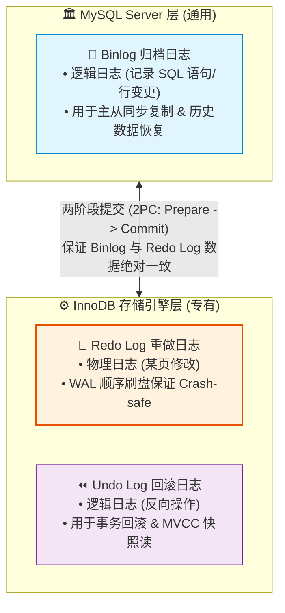
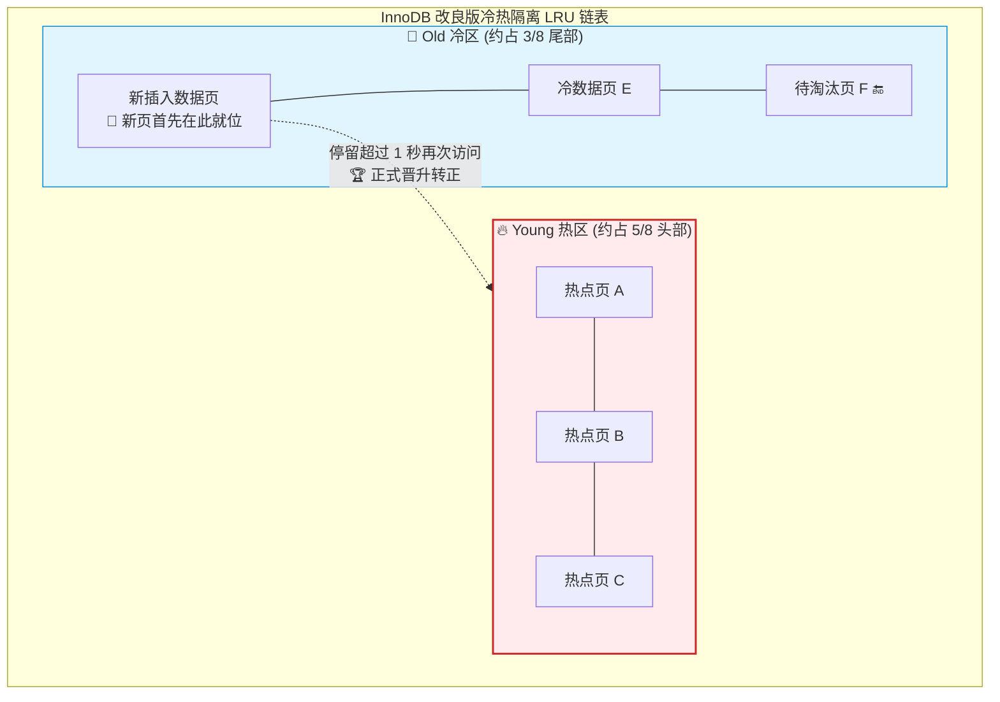

# MySQL底层原理日志体系与BufferPool

## 使用入口：先解决问题，再做验证

解释持久化、缓存与恢复如何影响数据库表现。

**先做基本操作**：先完成一次事务提交/回滚并观察查询性能，再结合日志和监控理解 Buffer Pool 与恢复。初次学习可先完成[本模块基础实践](/doc/MySQL/SQL编写与生产维护实战)。

**再逐步深入**：基本 API 与输入输出 → 常见失败和使用边界 → 场景排查与优化 → 本文机制分析与源码。面试先讲用途和自己的操作过程，再回答场景与原理追问。

## 🎯 核心技术原理与实战归纳
- **核心设问与思考**：“MySQL 的 **Redo Log**、**Undo Log** 和 **Binlog** 各自有什么作用？数据库突然断电宕机，数据是如何实现**崩溃恢复（Crash Recovery）**的？”
- **深水区追问**：“为什么需要**两阶段提交（2PC）**？如果不用两阶段提交，主从同步会出现什么严重数据不一致？InnoDB 的 **Buffer Pool** 内存模型是怎样的，为什么不能用普通的 LRU 算法，而要用**冷热分区改良版 LRU**？为什么一张表存了 2000 万行数据，**B+ 树高度通常只有 3 层**（请现场数学推导）？”

---

## 一、 为什么 2000 万行数据的 B+ 树只有 3 层？（经典容量数学推导）

### 1. 核心物理结构前提
- InnoDB 最小物理存储单位是 **数据页（Page）**，默认大小为 **16KB（16384 字节）**。
- 根节点与非叶子节点：只存 **主键 ID + 指向子节点的指针**。
- 叶子节点：存储 **主键 ID + 完整的行记录数据（Row Data）**。

### 2. 数学推导过程
- 假设主键为 `BIGINT` 占 **8 字节**，InnoDB 内部的子节点指针占 **6 字节**。
- **单个非叶子节点页（16KB）能存放多少个指针目录项？**
  $$\text{非叶子项个数} = \frac{16 \times 1024}{8 + 6} \approx 1170 \text{ 个}$$
- **假设单行记录平均占 1KB（包含标题、金额、状态、时间等常规字段）：**
  - 单个叶子节点页（16KB）能容纳：$16 \text{KB} / 1 \text{KB} \approx 16 \text{ 条完整行数据}$。
- **计算 3 层 B+ 树的总容量：**
  - 第 1 层（根节点）：1 个页，容纳 1170 个指针。
  - 第 2 层（非叶子层）：$1170 \text{ 个页} \times 1170 \text{ 个指针} = 1,368,900 \text{ 个指针}$。
  - 第 3 层（叶子层数据页）：$1,368,900 \text{ 个页} \times 16 \text{ 行} \approx \mathbf{21,902,400 \text{ 行（约 2190 万行）}}$！

> **要点总结**：这意味着即使在两千万级大表里，根据主键查询数据，**最多只需要经过 3 次磁盘 I/O（甚至前两层常驻内存，仅需 1 次物理磁盘读）**，即可在毫秒级精准定位记录！

---

## 二、 三大日志体系与崩溃恢复机制

::: tip 📝 通俗心智模型：记账账本与录像带
* **Redo Log（重做日志）就像【掌柜随身记账的草稿小黑板】（物理日志、WAL 机制）**：
  * 客人来赊账，掌柜绝不会每次都翻开笨重的大账本（磁盘 16KB 数据页随机写）慢慢写，而是随手在柜台小黑板上划一笔“张三赊米一斗”（顺序写入 Redo Log，毫秒搞定）。
  * 就算突然停电（服务器断电宕机），小黑板上的记录绝不会丢，重新开机照着小黑板把账补录到大账本上即可（Crash-safe 崩溃恢复）！
* **Undo Log（回滚日志）就像【时光倒流悔棋按钮】（逻辑日志）**：
  * 事务执行到一半如果报错或者主动 Rollback，Undo Log 负责执行完全相反的逆操作（你刚才 Insert，我就 Delete；你刚才 Update，我就改回旧值），瞬间恢复如初。
* **Binlog（归档日志）就像【店里的全景监控录像机】（逻辑日志，属于 Server 层）**：
  * 记录所有建表、增删改的真实 SQL 事件。主库录下视频，从库拿着录像带一帧一帧照着做，实现主从同步与任意历史时间点恢复。
:::

### 1. 三大日志核心差异速查

| 日志类型 | 归属层次 | 记录格式 | 核心使命 |
| :--- | :--- | :--- | :--- |
| **Redo Log** | InnoDB 引擎特有 | 物理日志（记录“某表空间某数据页做了什么修改”） | **WAL 机制**，保证已提交事务的持久性（Crash-safe） |
| **Undo Log** | InnoDB 引擎特有 | 逻辑日志（记录相反的反向操作，如 Insert 对应 Delete） | 事务回滚（Rollback）与 **MVCC 多版本并发快照读** |
| **Binlog** | Server 层独立 | 逻辑日志（记录 DDL / DML 语句或行事件变更） | **主从复制（Master-Slave）** 与基于时间点的增量备份恢复 |

---

### 2. WAL 机制（Write-Ahead Logging）
- 如果每次更新都要把整页 16KB 数据立即刷回磁盘，会导致严重的**磁盘随机写 IO 瓶颈**。
- **WAL 核心**：修改数据时，先更新内存（Buffer Pool），并**顺序写入**追加到 Redo Log 物理日志并落盘（顺序 IO 极快）；等空闲时再由后台线程异步将脏数据页批量刷新到磁盘表空间。

---

### 3. 两阶段提交（2PC, Two-Phase Commit）保证数据绝对一致

#### 为什么必须两阶段提交？
若不使用两阶段提交，更新操作先写 Redo Log 成功，还没来得及写 Binlog 机器突然断电：
- **机器重启后**：通过 Redo Log 成功恢复了数据，本地数据最新。
- **从库同步时**：从库依赖 Binlog 复制，因为 Binlog 里没有这条记录，导致**从库缺失该数据，主从数据发生严重永久不一致**！

#### 两阶段提交标准执行时序：
1. **阶段 1：Prepare 阶段**
   - InnoDB 引擎将修改记录写入 Redo Log，并将该事务的 Redo Log 状态标记为 **`Prepare`**。
2. **阶段 2：Commit 阶段**
   - Server 层将事务的变更逻辑写入 **Binlog** 并落盘。
   - 调用 InnoDB 引擎接口，将 Redo Log 的状态修改为 **`Commit`**。

#### 崩溃恢复判定规则：
- 重启检查时，若发现某事务 Redo Log 处于 `Prepare`：
  - 去检查 Binlog 中**是否存在对应事务的 XID**。
  - 若 Binlog 中已存在完整记录：说明在最后 Commit 阶段宕机，**自动提交该事务**。
  - 若 Binlog 中无该记录：说明在写 Binlog 前宕机，**通过 Undo Log 自动回滚该事务**，保证绝对一致！

---

## 三、 Buffer Pool 内存模型与改良版 LRU 算法

### 1. Buffer Pool 内存结构
Buffer Pool 是 InnoDB 在内存中开辟的大缓冲区（默认 128MB，生产建议分配物理内存的 60%~75%）：
- 包含**数据页（Data Page）**、**索引页（Index Page）**、**自适应哈希索引（AHI）**、**锁信息**等。
- 三大核心链表：
  - **Free List**：空闲可用缓冲页链表。
  - **Flush List**：被修改但尚未刷盘的“脏页（Dirty Pages）”链表。
  - **LRU List**：管理活跃命中缓存的淘汰链表。

---

### 2. 为什么不能用经典 LRU？（冷热数据分区改良）
经典 LRU（最近最少使用）算法存在两大致命缺陷：
1. **全表扫描污染**：一次误操作的大表全表扫描或备份（`mysqldump`），会瞬间把 Buffer Pool 现存的所有热点缓存页全数挤出内存！
2. **预读失效**：MySQL 空间局部性预读机制会把相邻的数据页提前加载进内存，但这些预读页可能根本不会被后续查询访问到。

### 3. InnoDB 的改良版 LRU 链表架构
InnoDB 将 LRU 链表按比例分为两部分：
- **Young 区域（热数据区，约占 5/8）**：头部，存放高频热点页。
- **Old 区域（冷数据区，约占 3/8）**：尾部，新加载的数据页首先放入 Old 区域头部。

::: tip 🏢 通俗心智模型：新实习生入职考核机制（防全表扫描污染）
* **如果使用普通 LRU（反例）**：
  * 只要有人不小心跑了一条 `select * from big_table`，几百万条只用一次的垃圾数据会瞬间像潮水一样涌入，把内存里常驻的所有核心热点商品、VIP 用户缓存全部挤死清出内存，数据库瞬间雪崩！
* **InnoDB 改良版 LRU（设立隔离考察区）**：
  * **Young 核心区（约占 5/8）**：坐镇核心功勋老员工（真·高频热点页）。
  * **Old 考察区（约占 3/8）**：新读取的数据页一律先安排进 Old 区！
  * **转正晋升门槛（`innodb_old_blocks_time = 1000ms`）**：新页进入 Old 区后，**必须在间隔超过 1 秒后再次被访问**，才被允许晋升到 Young 区！全表扫描通常在几百毫秒内就扫完走人，因此它们只能在 Old 区自生自灭、被自然淘汰，**绝不可能污染 Young 热区**！
:::

- **晋升机制（`innodb_old_blocks_time`，默认 1000 毫秒）**：
  新读入的数据页放入 Old 区后，**只有在间隔超过 1 秒后再次被访问**，才会被正式晋升到 Young 区头部！
  - 全表扫描虽然读取了大量页，但同一页的多次扫描都在 1 秒内完成，访问结束后随着冷区自然淘汰，**绝不会污染 Young 热区**！
