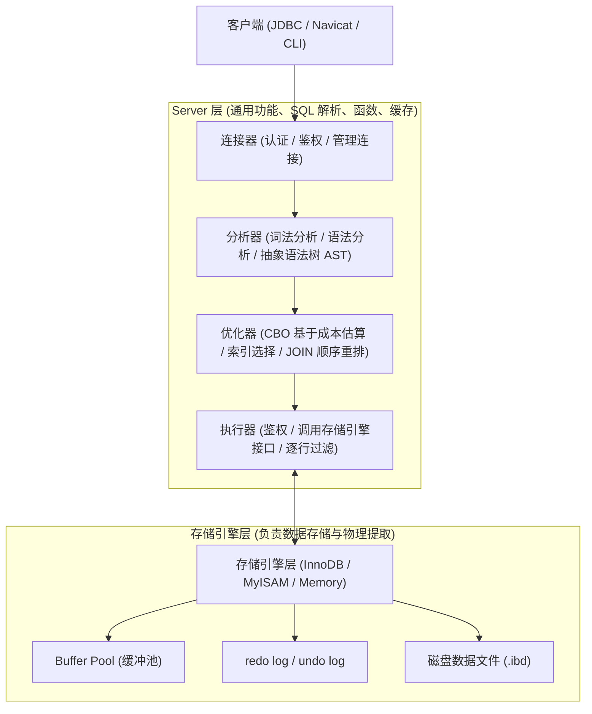
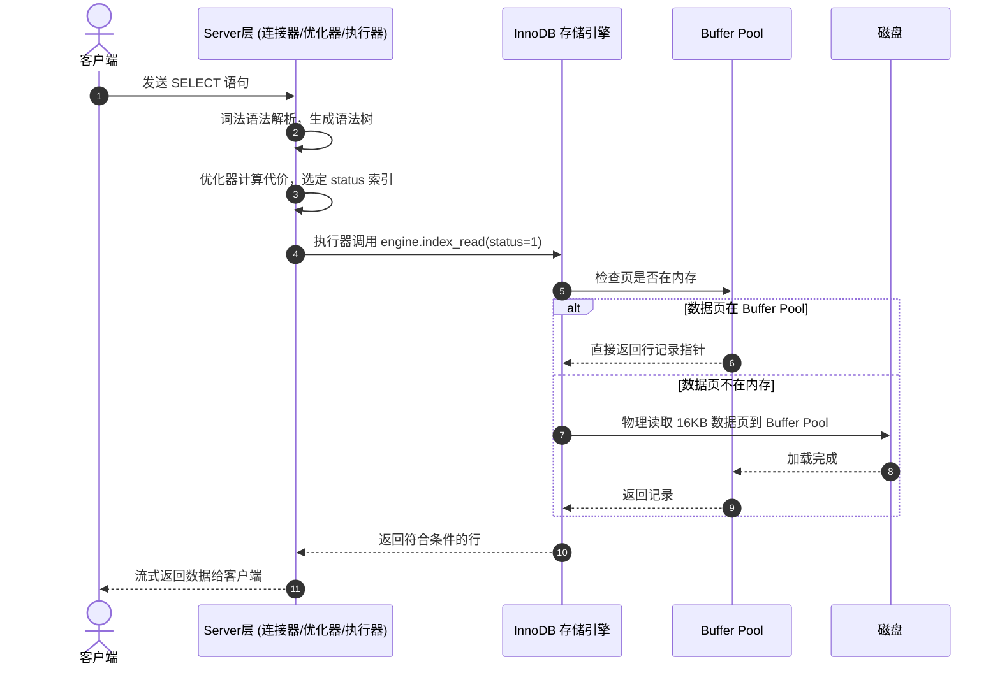

# SQL 执行原理与逻辑执行顺序全解

很多开发者熟练编写 SQL，但面对线上慢查询或复杂多表查询时，常因不理解 SQL 在数据库内部的真实流转流程而无法精准优化。本篇深入拆解 MySQL 基础架构、物理执行流与逻辑执行顺序。

---

## 1. MySQL 逻辑架构分层

MySQL 架构在概念上分为两层：**Server 层** 与 **存储引擎层**。



### 1.1 Server 层核心组件职责
- **连接器（Connectors）**：处理 TCP 握手、用户身份认证（用户名密码）、读取权限并保存在当前连接会话中。注意：一旦连接建立，中途修改权限不会影响已建立的连接。
- **分析器（Analyzer）**：
  - **词法分析**：将 SQL 字符串拆分成关键字、表名、列名。例如将 `SELECT` 识别为查询动作，将 `users` 识别为表名。
  - **语法分析**：依据 SQL 语法规则检查语句是否合规，若不合规抛出 `You have an error in your SQL syntax`；合法则生成解析树（Parse Tree）。
- **优化器（Optimizer）**：
  - 基于成本模型（Cost-Based Optimizer, CBO）计算不同执行方案的代价。
  - 核心工作包括：**多索引选择**、**多表 JOIN 顺序重排**、**子查询改写与常量折叠**。
- **执行器（Executor）**：
  - 判断用户对目标表是否有对应操作权限。
  - 打开表，调用存储引擎标准读写接口（例如 `ha_innobase::index_read`），从引擎层逐行获取符合条件的数据并返回给客户端。

---

## 2. SQL 物理执行全流程剖析

以一条标准的查询语句为例：
```sql
SELECT id, name, status FROM users WHERE status = 1;
```

其底层真实的流转步骤如下：



> **注意：查询缓存（Query Cache）的废弃**  
> MySQL 8.0 已彻底移除查询缓存。因为表只要有任何一次更新，该表所有的 Query Cache 就会全部失效，高并发写入场景下锁竞争严重，弊远大于利。

---

## 3. SQL 语句逻辑执行顺序推导

书写 SQL 与 MySQL 内部逻辑执行的顺序完全不同。掌握逻辑顺序是写好复杂 SQL 与排查语法错误的前提。

### 3.1 语法书写顺序 vs 逻辑执行顺序

| 阶段 | 语法书写顺序 | 逻辑执行顺序 | 阶段行为说明 |
|:---|:---|:---|:---|
| 1 | `SELECT` | `FROM` | 锁定主表，加载基表数据 |
| 2 | `DISTINCT` | `ON` | 应用连接条件过滤笛卡尔积 |
| 3 | `FROM` | `JOIN` | 关联第二张表，生成临时驱动集合 |
| 4 | `JOIN` | `WHERE` | 基于行级条件筛选，过滤不符合行 |
| 5 | `WHERE` | `GROUP BY` | 将数据按指定列进行分组聚合 |
| 6 | `GROUP BY` | `HAVING` | 对分组后的聚合结果进行二次过滤 |
| 7 | `HAVING` | `SELECT` | 提取需要的列、计算表达式 |
| 8 | `ORDER BY` | `DISTINCT` | 对输出字段进行去重操作 |
| 9 | `LIMIT` | `ORDER BY` | 按指定列对结果集进行排序（filesort 或 index） |
| 10| - | `LIMIT` | 截取偏移量，返回最终窗口行 |

### 3.2 逻辑顺序常见经典避坑场景

#### 场景 1：为什么 WHERE 子句中不能直接使用 SELECT 中定义的别名？
```sql
-- 错误写法：Unknown column 'total_price' in 'where clause'
SELECT price * count AS total_price 
FROM order_item 
WHERE total_price > 100;
```
- **根因推导**：从上表可知，`WHERE` 执行在第 4 步，而 `SELECT` 中的别名直到第 7 步才被计算和命名。在第 4 步执行时，内存符号表中根本不存在 `total_price`。
- **解决方案**：在 `WHERE` 中重复计算表达式 `WHERE price * count > 100`，或者使用派生表 / CTE。

#### 场景 2：为什么 HAVING 可以使用 SELECT 别名，而 WHERE 不行？
- `HAVING` 执行在第 6 步，虽然理论上在 `SELECT` 之前，但在很多 SQL 方言（包括 MySQL）中，优化器在 GROUP BY 之后已对聚合表达式做了符号绑定，因此 MySQL 允许在 `HAVING` 和 `ORDER BY` 中引用 `SELECT` 别名。

#### 场景 3：WHERE 条件 vs ON 条件的区别
在 `LEFT JOIN` 中：
- `ON` 条件是在连接阶段生效。即使某行在被驱动表不符合 `ON` 条件，主表（左表）记录依然会输出，右表字段填充 `NULL`。
- `WHERE` 条件在关联后生效，若在 `WHERE` 中对右表字段做非空判断（如 `WHERE right_table.status = 1`），会导致 `LEFT JOIN` 直接退化为 `INNER JOIN`。

---

## 4. 优化器（Optimizer）改写逻辑

开发者书写的 SQL 往往并不直接等于实际执行的语句，优化器会根据统计信息（Cost Model）进行等价重写：

### 4.1 常量折叠与无用分支剪枝
```sql
-- 原始 SQL
SELECT * FROM users WHERE 1 = 1 AND (age > 18 OR 1 = 0);
-- 优化器改写后
SELECT * FROM users WHERE age > 18;
```

### 4.2 子查询展开（Subquery Unnesting）
```sql
-- 原始 SQL
SELECT * FROM orders WHERE user_id IN (SELECT id FROM users WHERE status = 1);
-- 优化器可能改写为半连接（Semi-Join）
SELECT orders.* FROM orders SEMI JOIN users ON orders.user_id = users.id AND users.status = 1;
```
优化器将 `IN` 子查询转换为 Semi-Join 或 EXISTS，从而能够利用多表连接算法（如哈希连接或索引嵌套循环），避免外表全表扫描驱动多次内表子查询。

---

## 5. 社招高频面试追问

### Q1：一条 SQL 查询很慢，有哪些可能的原因？
1. **网络与连接阶段**：连接池满，客户端排队等待获取数据库连接。
2. **锁阻塞**：遇到表级 MDL 锁（有未提交事务在做 DDL）或行级锁（当前行正在被其他长事务更新）。
3. **优化器选错索引**：统计信息不准（基数 Cardinality 偏差），优化器误判全表扫描代价小于索引走法。可通过 `ANALYZE TABLE` 重新收集统计信息。
4. **物理 I/O 阻塞**：Buffer Pool 内存不足，脏页刷新（Flush）压力大，触发磁盘大量 Random I/O。
5. **执行层性能瓶颈**：全表扫描、隐式类型转换索引失效、深分页（`LIMIT 1000000, 10`）或产生了内存/磁盘临时表（Using temporary）及文件排序（Using filesort）。

### Q2：为什么 MySQL 在执行 JOIN 时，小表一定要驱动大表？
- 在 **Index Nested-Loop Join (INLJ)** 算法下，外层循环读取驱动表的每一行，内层循环根据关联键直接去被驱动表的索引树查询。
- 设外表行数为 $N$，内表行数为 $M$。总查询代价大致为：外表全表扫描 $N$ 次 + 内表索引树搜索 $N \times \log_2(M)$ 次。
- 显然，外表行数 $N$ 对总循环次数起决定性作用。$N$ 越小，内表树查找发起次数越少，因此优化器总是尽量选择过滤后数据量更小的表作为驱动表。
