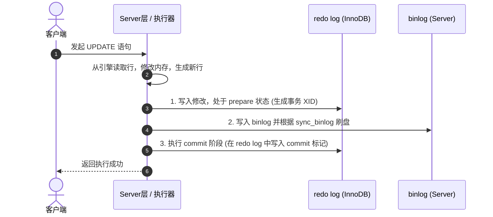
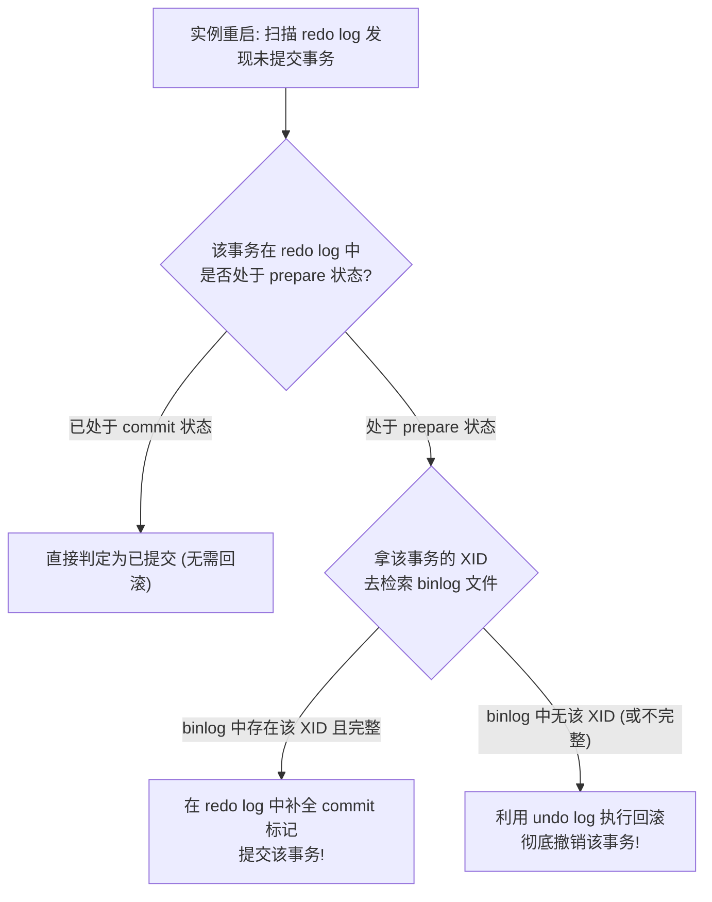

# redo log、binlog 与两阶段提交 Crash-Safe 机制

“MySQL 实例如果在写入过程中突然断电宕机，重启后数据如何保证不丢失？”“为什么有了 redo log 还要有 binlog？既然两者都有，为什么必须引入两阶段提交？”

这是大厂中高级社招面试中衡量候选人是否真正吃透关系型数据库内核机制的试金石。

---

## 1. redo log 与 binlog 的底层核心差异

MySQL 内部有两套极其关键的日志：位于存储引擎层的 **redo log（重做日志）** 和位于 Server 层的 **binlog（归档日志）**。

| 对比维度 | redo log（重做日志） | binlog（归档日志） |
|:---|:---|:---|
| **产生层级** | **InnoDB 存储引擎层**独有 | **Server 层**产生，所有引擎通用 |
| **日志类型** | **物理日志**（记录的是“对某个表空间、某物理页做了什么二进制字节修改”） | **逻辑日志**（记录的是逻辑 SQL 语句或行镜像数据的变更） |
| **写入方式** | **循环写（Circular Write）**，固定大小的文件组，空间会用尽并覆盖 | **追加写（Append-Only）**，写满一个文件自动切新文件，全量保存 |
| **主要功能** | **Crash-Safe 崩溃恢复**，保障已提交事务在断电后物理不丢 | **主从复制（Replication）**、基于时间点的数据恢复（Point-in-Time Recovery） |

### 1.1 redo log 的循环写模型
InnoDB 的 redo log 默认由一组文件（例如 `ib_logfile0`、`ib_logfile1`）组成。
- **`write pos`**：当前记录写入的物理位置，顺时针向前推进。
- **`checkpoint`**：当前允许擦除的位置（即对应内存脏页已经真正刷新落盘到磁盘的位置），同样顺时针推进。
- **可用空间**：`write pos` 到 `checkpoint` 之间的空闲区域。
- **停机刷盘危险**：如果 `write pos` 追赶上了 `checkpoint`，说明 redo log 空间已满，此时系统会**强行阻塞所有更新 SQL**，紧急调度后台线程将脏页落盘并推进 `checkpoint`！

```text
                  write pos (当前写入位置)
                       │
                       ▼
       ┌───────────────────────────────┐
       │ 已写入但脏页未刷盘 (不能覆盖) │
       ├───────────────────────────────┤
       │ 空闲可用空间 (可直接覆盖写)   │
       └───────────────────────────────┘
                       ▲
                       │
                  checkpoint (已刷盘落盘位置)
```

---

## 2. 核心深水区：两阶段提交（2PC）机制

一条 `UPDATE` 语句的执行，不仅要写 Buffer Pool、写 redo log，还要写 binlog。为了保证两个日志的一致性，InnoDB 引入了 **两阶段提交（Two-Phase Commit, 2PC）**。

### 2.1 两阶段提交的完整执行链路



---

## 3. 严密反证法：为什么必须有两阶段提交？

如果不用两阶段提交，而是采用单纯的“先写一个，再写另一个”，在写入中途遭遇断电崩溃，会导致什么严重后果？

### 假想情景 1：先写 redo log，后写 binlog
1. 事务修改了数据，`redo log` 写入完成并落盘。
2. 此时服务器瞬间断电，`binlog` 尚未写入。
3. **后果**：
   - **主机恢复**：MySQL 重启后，依据物理 `redo log` 将数据完全恢复。主机上有最新数据。
   - **从机同步**：由于 `binlog` 根本没写，主从复制同步流中没有任何记录。从机没有这条更新！
   - **主从数据严重不一致，数据彻底分叉！**

### 假想情景 2：先写 binlog，后写 redo log
1. 事务执行，`binlog` 写入完成并落盘。
2. 此时服务器瞬间断电，`redo log` 尚未写入。
3. **后果**：
   - **主机恢复**：MySQL 重启后，由于 `redo log` 没有任何记录，该事务被判定为未提交并回滚。主机上**没有**该数据。
   - **从机同步**：从机读取到了那条真实的 `binlog` 并严格执行回放。从机上**多出了**该数据！
   - **再次导致主从数据严重不一致！**

---

## 4. 崩溃恢复（Crash Recovery）判定算法

在引入了两阶段提交后，当 MySQL 突然崩溃重启，InnoDB 在扫描日志时，是如何依据 **事务 XID** 判定一条事务到底是该提交还是该回滚的？



- **核心原则**：**以 binlog 是否落盘为最终裁判依据！**
  - 只要 `binlog` 已经完整写盘，说明该事务未来一定会被从库同步执行，因此主库崩溃恢复时必须强行将其在 `redo log` 中标记为 `commit`！
  - 如果 `binlog` 还没写盘就挂了，主从两端都不应有该数据，此时安全利用 `undo log` 执行回滚。

---

## 5. 性能与安全平衡：三大刷盘参数深度调优

在生产环境中，redo log 和 binlog 的刷盘频率直接决定了写入性能（QPS）与数据安全性的生死权衡。

### 5.1 `innodb_flush_log_at_trx_commit`（控制 redo log 刷盘）
- **`0`**：每次事务提交，只留在 `redo log buffer` 内存中，由后台线程每秒执行一次写入并刷盘。性能最高，但 **MySQL 进程崩溃就会丢失最近 1 秒的数据**。
- **`1`（金融级默认）**：每次事务提交，**强制调用 OS 的 `fsync` 将日志直接写入磁盘物理文件**。性能受限于磁盘 I/O，但**保证绝对不会丢失已提交数据**。
- **`2`**：每次事务提交，只调用操作系统的 `write` 写入 OS Page Cache，由操作系统每秒刷新到磁盘。MySQL 进程崩溃不丢数据，**但操作系统断电会丢 1 秒数据**。

### 5.2 `sync_binlog`（控制 binlog 刷盘）
- **`0`**：每次事务提交，只写入操作系统的 OS Cache，由系统自行决定何时落盘。
- **`1`（金融级默认）**：每次事务提交，**强制发起一次磁盘 `fsync` 落盘**。
- **`N`（常见 100~1000）**：累积 $N$ 个事务后批量发起一次 `fsync`。大幅提升写吞吐，但在断电时最多可能丢失 $N$ 个事务的 binlog。

> **生产配置标准总结**：
> - **核心交易、支付财务库（双 1 配置）**：
>   ```ini
>   innodb_flush_log_at_trx_commit = 1
>   sync_binlog = 1
>   ```
> - **高并发日志、从库读取、埋点数据（折中追求 QPS）**：
>   ```ini
>   innodb_flush_log_at_trx_commit = 2
>   sync_binlog = 1000
>   ```
