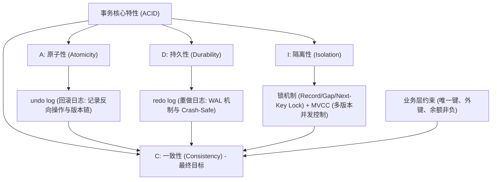

# 事务 ACID 四大特性的底层实现机制

事务（Transaction）是数据库区别于普通文件系统的最核心特性。在面试中，几乎每个人都能脱口而出 ACID 代表 Atomicity、Consistency、Isolation、Durability。但中高级社招的核心考点是：**InnoDB 底层究竟通过哪些具体的物理结构和日志机制来分别保障这四大特性的？**

---

## 1. ACID 与底层物理机制映射全景



- **原子性（A）**：由 **undo log（回滚日志）** 保障。
- **持久性（D）**：由 **redo log（重做日志）与 WAL 机制** 保障。
- **隔离性（I）**：由 **锁机制（排他/共享锁、Next-Key Lock）与 MVCC（多版本并发控制）** 保障。
- **一致性（C）**：**一致性是事务的最终目的**，必须由 A、I、D 三者作为底层技术基石，再加上**业务代码层面的逻辑合法性约束**共同达成！

---

## 2. 原子性（Atomicity）的物理实现：undo log

原子性要求事务包含的所有数据库操作要么全成功，要么全失败回滚。

### 2.1 undo log 的物理反向操作
当事务在执行修改时，InnoDB 会在底层同步记录相对应的“逻辑反向操作”到 undo log 中：
- 当执行 `INSERT` 时：undo log 中记录一条对应的 `DELETE`（保留主键信息）。
- 当执行 `DELETE` 时：undo log 中记录一条对应的 `INSERT`（完整记录被删除行的各列历史快照）。
- 当执行 `UPDATE` 时：undo log 中记录一条反向的 `UPDATE`（记录被修改字段的旧值）。

### 2.2 异常与回滚触发
一旦事务执行中途抛出异常、网络连接中断，或者应用主动触发 `ROLLBACK`：
1. 存储引擎通过当前事务的事务 ID（`DB_TRX_ID`）以及每行记录中的回滚指针（`DB_ROLL_PTR`），沿着 undo 版本链逆序查找；
2. 依次应用 undo log 中的反向语句进行逻辑抵消；
3. 将数据完全恢复到事务开启前的状态，从而确保原子性。

---

## 3. 持久性（Durability）的物理实现：redo log 与 WAL

持久性要求一旦事务提交，其所做的全部修改即使遭遇断电也绝不能丢失。

### 3.1 为什么不能直接将数据页写回磁盘？
InnoDB 的数据存储在 16KB 的数据页中。如果事务每次提交都强行将脏页（Dirty Page）刷新到磁盘：
1. **严重的磁盘随机 I/O**：一个事务修改了多行数据，这些行可能离散分布在不同的物理页中，导致大量的磁盘随机磁头寻道。
2. **写放大问题**：只修改了 1 个字段（几字节），却必须把整整 16KB 的数据页全量同步刷盘。

### 3.2 WAL 机制（Write-Ahead Logging）
InnoDB 采用 **WAL 机制**：**先写日志，再写磁盘**。
1. 当事务修改数据时，首先修改内存 Buffer Pool 中的数据页（此时数据页变为“脏页”）；
2. 紧接着，将该修改对应的**物理操作日志**写入内存中的 `redo log buffer`；
3. 在事务执行 `COMMIT` 时，只需要将顺序追加的 `redo log` 刷入磁盘即可（顺序写性能极高）；
4. 内存中的脏页并不需要立即刷盘，而是由后台专门的 `Checkpointer` 线程根据系统负载择机异步批量刷盘。

```text
事务提交 ──▶ 顺序追加写入 redo log (ib_logfile) ──▶ 立即返回客户端成功
               │
               ▼ (操作系统崩溃断电)
重启实例 ──▶ 读取 redo log ──▶ 将尚未落盘的脏页重放到 Buffer Pool ──▶ 数据完全恢复 (Crash-Safe)
```

---

## 4. 隔离性（Isolation）的物理实现：锁 + MVCC

隔离性要求多个并发执行的事务之间互不干扰。MySQL 依据并发性能要求提供了四大隔离级别：
- **当前读（锁定读）**：使用 **读写锁（S/X 锁）、间隙锁（Gap Lock）和 Next-Key Lock**，通过悲观锁机制阻塞冲突事务的写入，保证并发串行化。
- **快照读（一致性非锁定读）**：使用 **MVCC（多版本并发控制）**，基于 undo log 版本链和 `Read View` 视图，实现“读不加锁、读写不冲突”，极大释放了高并发读性能。

---

## 5. 一致性（Consistency）：最终的追求与协同关系

一致性指的是**数据库在事务开始之前和完成之后，都必须处于一致的合法业务状态**。

### 5.1 底层数据库一致性
- 实体完整性（主键唯一、非空约束）。
- 参照完整性（外键约束）。
- 域完整性（字段数据类型、长度限制、CHECK 条件）。

### 5.2 业务逻辑一致性（必须由业务代码与底层协同完成）
- **经典案例**：A 向 B 转账 100 元，A 账户扣减 100 元，B 账户必须增加 100 元。转账前后 A + B 的总金额必须保持不变。
- 如果没有**原子性**（A 扣了 100 后断电，B 没加），一致性被破坏；
- 如果没有**隔离性**（并发重入，导致 A 账户在余额不足时被多次扣减），一致性被破坏；
- 如果没有**持久性**（B 加了 100 后断电重启丢失），一致性被破坏；
- 如果业务代码写错（如 A 扣了 100，代码逻辑写成了给 B 加 50），即使数据库引擎的 A、I、D 机制再完美，一致性依然被彻底打破！

---

## 6. 社招高频面试追问

### Q1：redo log 和 undo log 的根本区别是什么？
| 对比维度 | redo log（重做日志） | undo log（回滚日志） |
|:---|:---|:---|
| **核心职责** | 保障事务的**持久性（Durability）**，提供 Crash-Safe 崩溃恢复 | 保障事务的**原子性（Atomicity）**与 MVCC 快照读 |
| **记录形式** | **物理偏向日志**（记录的是“对某个表空间、某个物理页、某个偏移量处做了什么字节修改”） | **逻辑偏向日志**（记录的是反向的逻辑 SQL 或旧行镜像） |
| **生成与刷盘** | 顺序循环写文件组（write pos 追赶 checkpoint） | 写入专门的 undo 表空间数据页中，受 redo log 保护 |
| **生命周期** | 事务提交后，一旦内存脏页真正刷新落盘，对应的 redo log 即可被覆盖复用 | 事务提交后，如果不再有其他活跃事务的 Read View 需要依赖该版本链，由 purge 线程回收 |

### Q2：什么是“脏页”？脏页在什么时候会被刷新到磁盘？
- **脏页定义**：内存 Buffer Pool 中被修改过、但尚未同步写入磁盘物理文件的数据页。
- **刷盘时机（Flush）**：
  1. **redo log 写满**：checkpoint 追上了 write pos，系统强制暂停所有更新操作，紧急将脏页刷盘（此时数据库会出现瞬间性能抖动）。
  2. **Buffer Pool 内存不足**：LRU 链表淘汰页面时，若淘汰的是脏页，必须先刷盘再复用内存。
  3. **系统空闲时**：后台后台 `Master Thread` 发现系统 I/O 空闲，定时定期分批异步刷盘。
  4. **MySQL 正常关闭**：执行 `systemctl stop mysqld` 时，将内存所有脏页完全刷盘。
