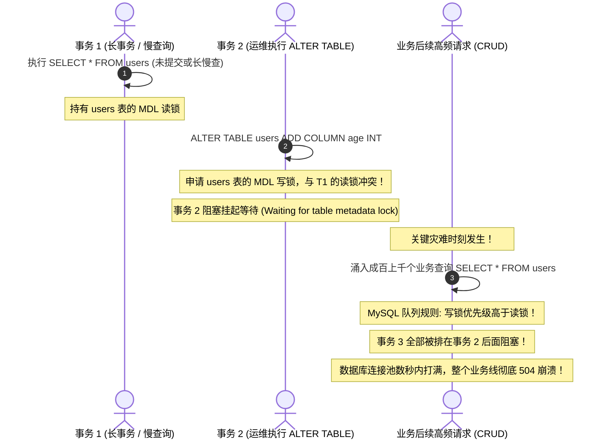

# 全局锁、表级锁与元数据锁 (MDL)

提到数据库锁，很多人第一反应就是行锁、记录锁、间隙锁。然而在真实生产故障中，造成整个系统瞬间卡死、连接池瞬间打满的，往往是位于更高层级的 **全局锁、表锁与元数据锁（MDL）**。

---

## 1. 全局锁：Flush tables with read lock (FTWRL)

全局锁是对整个数据库实例加锁。

### 1.1 语法与效果
```sql
FLUSH TABLES WITH READ LOCK; -- 加全局读锁 (FTWRL)
UNLOCK TABLES;               -- 释放全局锁
```
- **加锁效果**：整个数据库实例处于**只读状态**。
- 所有后续的写入操作（增删改 `INSERT/UPDATE/DELETE`）、DDL 操作（建表、修改表结构）以及更新类事务的提交全部被无情阻塞！

### 1.2 经典场景与为什么危险？
- **历史用途**：做**全库逻辑外置备份**。
- **致命危险**：
  - 如果在主库执行全局锁备份，业务整个写服务直接瘫痪。
  - 如果在从库执行全局锁备份，从库无法回放主库 binlog，导致主从延迟严重飙升。

### 1.3 现代解法：`mysqldump --single-transaction`
现代备份绝不再执行 FTWRL，而是利用 InnoDB 的 MVCC 特性：
```bash
mysqldump --single-transaction -u root -p database_name > backup.sql
```
- 在启动备份前，显式开启一个事务（`START TRANSACTION WITH CONSISTENT SNAPSHOT`），建立快照读视图。
- 整个备份过程基于 MVCC 快照安全导出数据，**整个数据库可以继续并发正常更新，丝毫不需要全局加锁**！

---

## 2. 表级锁与意向锁（Intention Locks）

### 2.1 显式表锁
```sql
LOCK TABLES orders READ;  -- 加表级共享读锁
LOCK TABLES orders WRITE; -- 加表级排他写锁
UNLOCK TABLES;
```
InnoDB 引擎通常依赖细粒度的行级锁，极少需要由业务显式锁定整张表。

### 2.2 核心深水区：为什么必须存在“意向锁（IS / IX）”？
意向锁是 **InnoDB 自动加上的表级锁**，无需业务干预：
- **意向共享锁（IS, Intention Shared Lock）**：事务准备对某行加 S 锁前，必须先在表上拿到 IS 锁。
- **意向排他锁（IX, Intention Exclusive Lock）**：事务准备对某行加 X 锁前，必须先在表上拿到 IX 锁。

#### 如果没有意向锁，数据库会面临什么恐怖的性能灾难？
假设事务 A 正在对 `orders` 表的某一行（如 `id = 100`）加了行级排他锁（X 锁）。
此时事务 B 想要对整张 `orders` 表执行 `LOCK TABLES orders WRITE`（申请表级排他锁）：
- **没有意向锁时**：事务 B 为了确认自己能不能拿到表锁，**必须去遍历整张表的所有数据页和所有行，逐行检查是否有人持有行锁**！若表有千万行，检查时间复杂度是不可接受的 $O(N)$！
- **有了意向锁后**：事务 A 在锁住第 100 行的同时，已经在表上盖了一个“印章”——`IX 锁`。事务 B 申请表锁时，**只需花费 $O(1)$ 的代价看一眼表上是否有 IX 锁**，发现有，直接排队阻塞等待！

> **意向锁的互斥矩阵**：
> 意向锁之间（IS 与 IS、IS 与 IX、IX 与 IX）**互相完全兼容，绝不互斥**！意向锁仅仅与显式的**表级 S 锁和 X 锁**产生互斥。

---

## 3. 生产极高危事故复盘：元数据锁（MDL）导致全库雪崩

这是无数中大型互联网公司线上发生过的惨烈 P1 事故。

### 3.1 什么是 MDL 锁（Metadata Lock）？
- MDL 是为了**保护表结构一致性**而设计的隐式锁，由 Server 层自动管理：
  - 当对一张表进行常规增删改查（CRUD）时，加 **MDL 读锁（Shared）**；
  - 当对一张表执行修改结构（如 `ALTER TABLE` 加列、改字段）时，加 **MDL 写锁（Exclusive）**。
- **互斥规则**：MDL 读锁之间兼容（允许无数并发查询）；**MDL 读锁与 MDL 写锁互斥**。

### 3.2 事故演进全景图（全库雪崩四部曲）



#### 为什么后续正常的 SELECT 也会全被卡死？
在 MySQL 的锁等待队列中，为了防止写锁被源源不断的读锁永久饥饿，**写锁申请的优先级高于后续进来的读锁申请**！
当 `ALTER TABLE` 申请 MDL 写锁排队后，**所有后续发起的新查询（尽管它们申请的是读锁），也必须通通排在写锁之后等待**！于是整个系统的业务查询在几秒钟内全线停滞。

---

## 4. 线上大表变更防雪崩应急与最佳实践

### 4.1 监控与排查定位命令
当出现数据库连接池打满、大量请求卡在 `Waiting for table metadata lock` 时：
```sql
-- 1. 查找哪个长事务正在持有 MDL 读锁不释放
SELECT * FROM performance_schema.metadata_locks 
WHERE OBJECT_NAME = 'users';

-- 2. 查看锁等待关系与对应线程 ID
SELECT * FROM sys.schema_table_lock_waits;

-- 3. 紧急救火：杀掉阻塞源头的长事务线程
KILL <thread_id>;
```

### 4.2 变更前必须设置等待超时（`lock_wait_timeout`）
在执行任何 DDL 变更前，**严禁无限期等待锁**，必须主动设置会话级超时：
```sql
-- 设置本次 DDL 如果在 5 秒内拿不到 MDL 写锁，自动失败放弃，绝不长期阻塞后续请求！
SET lock_wait_timeout = 5;
ALTER TABLE users ADD COLUMN age INT;
```
如果超时报错，说明当前有长事务正在占用，安全退出并稍后重试，绝对不会拉崩整个数据库。
