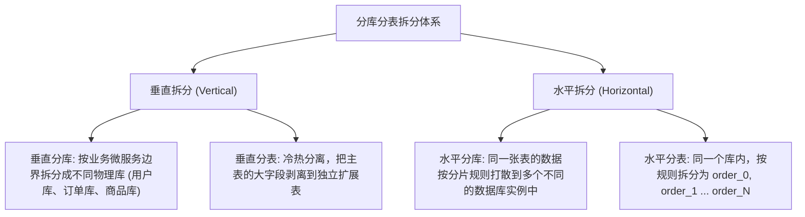
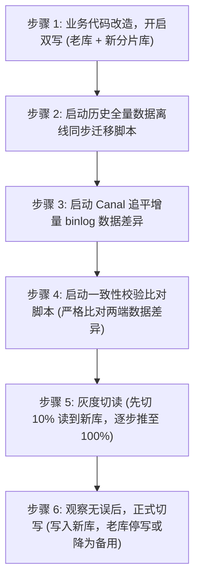

# 分库分表架构设计与 ShardingSphere 核心实战

当业务高速增长，单表数据量突破两千万行，或者单库并发写 QPS 突破单机物理极限时，单纯依靠硬件升级（Scale-Up）或读写分离已无法支撑，系统必须走向 **分库分表（Sharding）** 架构。

分库分表是后端分布式架构中最具技术含量的领域之一，也是社招中高级面试必考的系统设计深水区。

---

## 1. 为什么分？何时分？拆分维度全景

### 1.1 触发分库分表的核心瓶颈指标
1. **数据容量与 B+ 树深度瓶颈**：单表数据量突破 2000 万行或物理文件突破 30GB，B+ 树高度上升至 4 层，Buffer Pool 缓存命中率严重下滑，慢查询频发。
2. **写吞吐量与连接数瓶颈**：单台 MySQL 实例的最大并发连接数（通常 1000~2000）被微服务集群耗尽，CPU 争用与锁冲突加剧，单机磁盘 I/O 吞吐被打满。

### 1.2 四大拆分维度对比



---

## 2. 分片键（Sharding Key）设计与经典分片算法

分片键（Sharding Key）决定了数据最终落在哪一个物理库和哪一张物理表中，是分库分表设计的第一核心命题。

### 2.1 常见分片算法对比

| 算法类型 | 原理 | 优势 | 劣势 | 典型场景 |
|:---|:---|:---|:---|:---|
| **哈希取模 (Hash % N)** | `hash(sharding_key) % 分片数` | 数据分布极度均匀，无热点倾斜 | 后续扩容极其痛苦，必须重新数据迁移（推荐翻倍扩容） | 订单中心、用户中心核心交易表 |
| **范围分片 (Range)** | 按时间（按月/按年）或自增 ID 范围 | 扩容方便，天然支持冷热归档 | **数据倾斜严重**，最新热点永远集中在最后一个分片 | 日志系统、账单流水记录 |
| **地理位置 / 组织分片** | 按地区、租户 ID 分片 | 跨分片聚合较少 | 租户间数据量差异大（二八定律） | 多租户 SaaS 系统 |

---

### 2.2 核心高难考点：买家与卖家的双维度查询（基因法）

#### 场景难题：
在电商订单中心，买家要查“我的所有订单列表”（以 `buyer_id` 为维度）；商家也要查“我的店铺所有售出订单”（以 `merchant_id` 为维度）。
- 如果以 `buyer_id` 取模分片：买家查询直接路由到单库单表，速度极快；但商家查询没有 `buyer_id`，只能在全网所有分库分表发起**低效的广播查询（Scatter-Gather）**，系统瞬间崩溃！

#### 破局神器：基因法（Gene Method）
- **核心思想**：让买家的 `order_id` 中，**强制嵌入买家或卖家的分片特征码（基因）**！
- 假设系统分为 16 个库（$16 = 2^4$，由二进制后 4 位决定分片编号）：
  1. 取买家 ID `buyer_id` 的最后 4 位作为“基因”（例如 `buyer_id = 1001`，二进制后 4 位为 `1001`）；
  2. 在生成全局唯一的订单号 `order_id` 时，**将这 4 位基因强制拼接到订单号的最末尾**：
     $$\text{order\_id} = \text{雪花算法前56位} + \text{buyer\_id后4位基因}$$
- **效果**：
  - 买家按 `buyer_id` 查询：直接根据 `buyer_id % 16` 精准定位单个分片！
  - 任何端按 `order_id` 查询：提取 `order_id` 后 4 位，**同样能 100% 精准定位到同一个分片**，完全杜绝广播查询！
  - 针对商家端的多维复合查询：通过 Canal 异步同步至 **Elasticsearch**，由 ES 专门支撑商家后台的复杂跨维度组合筛选。

---

## 3. 分布式全局唯一 ID 生成方案

在单表中自增主键 `AUTO_INCREMENT` 很好用，但分库分表后，如果每个分表各自自增，会导致严重的主键 ID 冲突。

### 3.1 方案对比选型

| 方案 | 原理 | 优势 | 劣势与踩坑点 |
|:---|:---|:---|:---|
| **UUID** | 客户端独立生成 32 位字符 | 本地生成，无网络开销 | **完全随机无序**，直接引发 B+ 树剧烈页分裂，严禁做主键！ |
| **数据库号段模式 (Leaf)** | 每次从 DB 批量申请一段 ID（如 1000~2000）缓存在内存，内存自增 | 趋势递增，高性能，发号快 | 依赖 DB，需配置双 Buffer 异步平滑换段 |
| **雪花算法 (Snowflake)** | Twitter 提出的 64 位整型算法 | **严格单调递增，高性能，纯本地计算** | **依赖服务器系统时钟**，遭遇时钟回拨会发重复 ID |

---

### 3.2 雪花算法（Snowflake ID）结构拆解与时钟回拨破局

```text
64 位 Snowflake ID 二进制结构：
┌───────┬──────────────────────────────────────────┬─────────────┬──────────────┐
│ 1 bit │ 41 bit: 毫秒级时间戳 (可支撑约 69 年)     │ 10 bit: 机器│ 12 bit: 序列号│
│ 固定0 │ (当前时间戳 - 业务起始时间戳)             │ Worker ID   │ (每毫秒4096个)│
└───────┴──────────────────────────────────────────┴─────────────┴──────────────┘
```

#### 生产高危：如何解决 NTP 服务器“时钟回拨”引发的重复 ID 事故？
如果服务器发生 NTP 时间校准，当前机器时间突然回拨（倒退）了：
1. **毫秒级小回拨（$\le 5\text{ms}$）**：代码中进入死循环 `Thread.sleep` 短暂等待，直到时间追赶上上一时刻再继续发号。
2. **较大回拨（$> 5\text{ms}$）**：
   - 方案一：向统一配置中心（如 Zookeeper）重新申请一个全新的备用 `WorkerId` 继续发号。
   - 方案二：保留多位历史时间戳槽位进行容错交替。

---

## 4. 分库分表四大世纪难题与破局方案

### 4.1 跨库 JOIN 难题
- **字段冗余法**：将高频的关联字段（如商品名称、用户手机号）直接反范式冗余存放在订单表中，空间换时间。
- **业务层组装**：先查订单表拿到 10 条 `user_id`，再在 Java 代码层发起一次 `IN (ids)` 批量查询用户信息，在内存中完成 `Map` 关联拼装。
- **广播表（Broadcast Table）**：对于基础字典表、配置表，在每个分库中都完整保留一份，本地直接 `JOIN`。

### 4.2 跨库全局排序与分页难题
查询 `ORDER BY create_time LIMIT 1000, 10`：
- **原生低效做法**：分库分表中间件必须向所有分片各自发送 `LIMIT 0, 1010` 的查询，在内存中汇聚成 $N \times 1010$ 条记录后做归并排序，严重消耗中间件内存！
- **工业级解法**：全面推行**游标分页（`WHERE id > max_id LIMIT 10`）**，或者将分页列表数据同步至 ES 支撑。

---

## 5. 数据平滑双写迁移方案（零停机切换）

老库单表数据量达 5000 万，如何平滑迁移到分库分表集群中，同时保证业务 **0 停机、数据 0 丢失、支持秒级回滚**？


- **核心保障**：整个迁移过程中，老库始终保持完备，任何一个阶段发现数据异常或新库性能抖动，**只需将开关一键回滚回老库**，业务完全无感。
