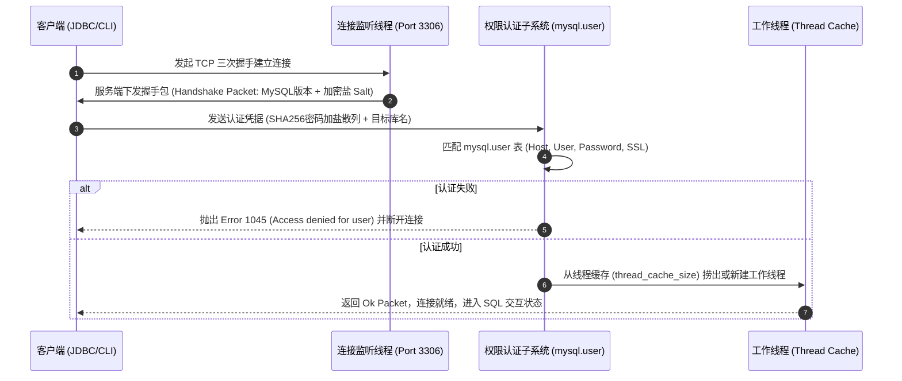

# 初级-MySQL架构全景客户端连接与核心配置精讲

MySQL 是目前全球应用最广泛的开源关系型数据库管理系统（RDBMS）。对于刚接触后端开发或数据库的初级工程师而言，往往容易将 MySQL 简单理解为一个“黑盒存储文件”。深入理解 MySQL 的**逻辑三层架构（连接层、Server 层、存储引擎层）**、客户端通信协议握手流程，以及生产环境中最关键的基础配置参数（字符集、连接数、超时时间），是构建扎实数据库底座的第一步。

---

## 一、核心底层机制与全景架构

### 1.1 MySQL 逻辑三层体系全景架构图

MySQL 采用了高度模块化、插件式的分层架构设计。客户端发起的任何 SQL 查询，都会自上而下经过三个核心层级：

```mermaid
graph TD
    subgraph 第一层: 连接层 (Connection Layer)
        Client[客户端应用 / Navicat / CLI / Java JDBC] -->|TCP/IP 或 Socket 握手通信| ConnPool[连接池管理器 Connection Pool]
        ConnPool --> Auth[身份认证与权限校验: 用户名/密码/Host白名单]
        ConnPool --> ThreadManage[线程管理器: 每个连接独占一个工作线程]
    end

    subgraph 第二层: SQL Server 核心层 (Server Layer)
        ThreadManage --> Parser[词法与语法分析器: 词法分析 Token -> 语法树 AST]
        Parser --> Preprocessor[预处理器: 校验表名/列名是否存在及列权限]
        Preprocessor --> Optimizer[查询优化器: 基于代价模型 CBO 选择最优执行路径与索引]
        Optimizer --> Executor[执行器: 权限校验 -> 调用存储引擎 API 提取数据]
    end

    subgraph 第三层: 插件式存储引擎层 (Pluggable Storage Engine)
        Executor -->|handler 接口标准规范| InnoDB[InnoDB 引擎: 默认事务型/行锁/MVCC/Crash-Safe]
        Executor -->|handler 接口标准规范| MyISAM[MyISAM 引擎: 表锁/不支持事务/空间只读]
        Executor -->|handler 接口标准规范| Memory[Memory 引擎: 内存散列/断电丢失]
    end

    subgraph 物理存储介质
        InnoDB & MyISAM & Memory --> FS[本地磁盘文件系统: .ibd 表空间 / redo / undo / binlog]
    end
```

### 1.2 客户端连接握手与授权时序



---

## 二、源码级实战推导：核心配置参数与连接状态调优

### 2.1 生产级必调核心配置文件（`my.cnf` / `my.ini`）

在 MySQL 部署上线时，默认配置往往偏向极度保守（仅用于低配置开发机），直接上生产会导致连接爆满或字符集乱码。

```ini
[mysqld]
# 1. 基础网络与端口配置
port = 3306
bind-address = 0.0.0.0
socket = /var/run/mysqld/mysqld.sock

# 2. 彻底杜绝中文乱码的全局字符集（强制 UTF-8 4字节全字符）
character-set-server = utf8mb4
collation-server = utf8mb4_unicode_ci

# 3. 高并发连接管理
max_connections = 1000            # 最大允许客户端并发连接数
max_connect_errors = 10000        # 某主机连接中断超限后才加入黑名单，防止误封
thread_cache_size = 64            # 缓存空闲工作线程数，减少频繁 pthread_create 损耗

# 4. 连接超时回收机制（防止僵尸连接吃满资源）
wait_timeout = 600                # 非交互式连接（如应用连接池连接）空闲超时秒数（默认8小时，建议改10分钟）
interactive_timeout = 600         # 交互式连接（如 Navicat、终端客户端）空闲超时秒数

# 5. 数据包大小限制（防止大 JSON 或多行批量插入被截断）
max_allowed_packet = 64M

# 6. 默认存储引擎强制指定
default-storage-engine = InnoDB
```

---

### 2.2 查看与动态修改运行时连接状态

无需重启 MySQL 服务，通过特权账号动态查看与优化连接状态：

```sql
-- 1. 查看当前最大连接数与当前已建立的连接数
SHOW VARIABLES LIKE 'max_connections';
SHOW STATUS LIKE 'Threads_connected'; -- 当前处于连接状态的线程数
SHOW STATUS LIKE 'Threads_running';   -- 当前正在执行查询的活跃线程数（核心报警指标）

-- 2. 动态调整最大连接数（即时生效，但重启后需靠 my.cnf 固化）
SET GLOBAL max_connections = 1500;

-- 3. 查看全局字符集生效状态
SHOW VARIABLES LIKE 'character_set%';
-- 确保 character_set_server、character_set_connection、character_set_database 均为 utf8mb4
```

---

## 三、社招高频硬核连环追问

### 追问 1：既然 MySQL 每个连接都有一个工作线程，为什么 `max_connections` 不能直接设为 10000 或更大？

> **考官意图**：考察候选人对操作系统线程开销、内存上下文切换以及数据库资源瓶颈的本质认知。

**回答硬核要点**：
1. **内存物理开销**：
   - 每一个连接线程创建时，MySQL 都会为其分配私有的连接内存缓冲区（Session Buffers），包括：`sort_buffer_size`、`join_buffer_size`、`read_buffer_size` 等。如果一个连接并发分配 5MB 内存，10000 个连接在瞬时高并发查询下需要消耗近 **50GB 专用内存**，极易触发操作系统的 OOM Killer 杀掉 `mysqld` 进程。
2. **CPU 上下文切换雪崩（Context Switch）**：
   - CPU 核心数量通常只有 16~64 核。当数千个活跃线程同时竞争 CPU 时间片时，CPU 绝大部分时间都将耗费在寄存器保存、内核态/用户态切换上，导致整体吞吐量（TPS）呈断崖式下跌。
3. **架构正解**：
   - 合理的 `max_connections` 通常设定在 `500 ~ 2000` 之间；更庞大的并发必须由应用层连接池（如 HikariCP）与微服务网关层进行限流排队削峰。

---

### 追问 2：连接池长时间空闲后发起第一个查询，经常偶发报 `Communications link failure` 或 `2006 (MySQL server has gone away)`，根本原因是什么？

> **考官意图**：考察候选人对 TCP KeepAlive 与 MySQL `wait_timeout` 机制协同工作的实战排错经验。

**回答硬核要点**：
- **本质根因**：
  - 应用端连接池（如 Druid 或 HikariCP）维持了一批空闲连接；
  - MySQL 服务端的 `wait_timeout` 默认是 28800 秒（8小时），若被调低为例如 600 秒；当业务半夜无流量超过 600 秒时，**MySQL 服务端主动单方面关闭了底层的 TCP Socket 连接**。
  - 应用端连接池未感知到此断开，在早晨第一笔业务请求进来时，直接复用该死连接发送 SQL，立刻触发底层 Socket 管道破裂（Broken Pipe），抛出 2006 异常。
- **解决 SOP**：
  - 应用层连接池开启连接探活校验：配置 `testOnBorrow=false`、`testWhileIdle=true`、`keepalive=true`，定时向数据库发送 `SELECT 1` 心跳探测保活，主动淘汰陈旧连接。

---

### 追问 3：MySQL 为什么废弃了由 Server 层内置的“查询缓存（Query Cache）”？并在 MySQL 8.0 中彻底连根拔起？

> **考官意图**：考察 MySQL 历史技术架构演进背后的设计取舍（Trade-off）。

**回答硬核要点**：
- **Query Cache 的设计初衷**：以 SQL 文本为 Key，将查询结果集缓存到内存。相同 SQL 第二次查询直接 0ms 返回。
- **弊大于利的致命缺陷**：
  1. **极其苛刻的失效机制**：只要一张表发生了一笔 `INSERT`、`UPDATE` 或 `DELETE`，**该表关联的所有查询缓存必须全部失效并被强行清空**。在写多读少或持续写入的现代 OLTP 系统中，Query Cache 的命中率近乎为 0。
  2. **严重的全局互斥锁竞争**：所有读写线程在操作 Query Cache 时必须争抢全局大锁，造成严重的锁等待。
- **替代方案**：现代架构统一将数据缓存后置到应用侧或专业的分布式缓存中间件（如 Redis、Memcached）中，Server 层只专注于高效解析与执行。

---

## 四、生产级避坑指南与排障 SOP

### 4.1 初学者与生产常见连接故障排查速查表

| 故障代码/现象 | 根本物理诱因 | 生产级排障与解决 SOP |
| :--- | :--- | :--- |
| **Error 1045 (28000): Access denied for user** | 1. 密码错误；2. 用户对应的 Host 白名单未授权（如仅建了 `'root'@'localhost'`，从外部 IP 访问被拒） | `SELECT user, host FROM mysql.user;` 确认授权主机范围，执行 `CREATE USER 'user'@'%' IDENTIFIED BY 'xxx';` 授权 |
| **Error 1129 (HY000): Host 'xxx' is blocked** | 该客户端 IP 短时间内向 MySQL 发起了超过 `max_connect_errors` 次的失败握手 | 执行 `FLUSH HOSTS;` 清除被屏蔽主机缓存，并在 `my.cnf` 中将 `max_connect_errors` 调大至 10000 |
| **Error 1040 (HY000): Too many connections** | 活跃与空闲连接总数达到了 `max_connections` 阈值，所有新请求被拒 | 紧急使用保留的管理员连接登入：`mysql -u root`，排查耗时卡死线程 `SHOW PROCESSLIST;` 并用 `KILL [id]` 释放，临时调高 `max_connections` |
| **插入生僻汉字/Emoji 表情报 Incorrect string value** | 数据库/表/列使用了旧版 3 字节的 `utf8`（即 `utf8mb3`），而 Emoji 占用 4 字节 | 全量执行 `ALTER TABLE 表名 CONVERT TO CHARACTER SET utf8mb4 COLLATE utf8mb4_unicode_ci;` |

### 4.2 线上连接泄露与异常连接排查常用指令集

```sql
-- 1. 查看当前所有正在执行的线程状态（找出处于 Locked 或长耗时执行的慢查询）
SHOW FULL PROCESSLIST;

-- 2. 统计当前连接来自哪些客户端 IP（定位是否有某个微服务节点发生连接泄漏）
SELECT SUBSTRING_INDEX(host, ':', 1) AS client_ip, count(*) AS conn_count 
FROM information_schema.processlist 
GROUP BY client_ip 
ORDER BY conn_count DESC;

-- 3. 统计睡眠状态（Sleep）超过 300 秒但未被释放的空闲连接
SELECT id, user, host, db, time, state, info 
FROM information_schema.processlist 
WHERE command = 'Sleep' AND time > 300 
ORDER BY time DESC;
```
